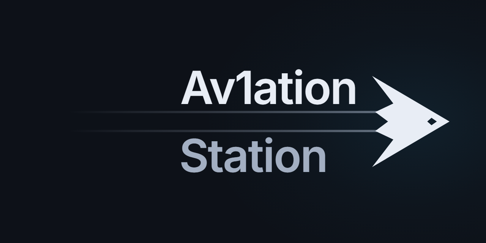

<p align="center">
  
</p>

<p align="center">
  A desktop workspace for scene-aware, quality-targeted video encoding with
  <a href="https://github.com/rust-av/Av1an">Av1an</a>.
</p>

Queue videos, tune each one scene by scene, target a quality level, and watch every stage in one place along with VapourSynth scripting, preview, logs, and history where you need them. The
engine is built directly into the app, so scene data, metrics, progress, and errors are
structured values rather than scraped console output.

> **Pre-release.** `0.1.0-rc.3` is available as unsigned Windows x64 and Linux x64 downloads
> and an ad-hoc signed macOS arm64 build. See [Install](#install) for the downloads, the
> caveats, and the source build, and [docs/progress.md](docs/progress.md) for current status.

## Features

- **See the whole pipeline** — derived stages, live progress, queue position, and retained
  work, read from the encoder itself.
- **Rich, interactive charts** — zoomable per-scene graphs with probe toggles and
  distribution, convergence, and quality-vs-size views; live checkpoint updates; and a
  statistics strip for mean, median, range, and percentiles, plus a sortable scene table.
- **Configure the encoder, not a wall of flags** — named, grouped, documented controls,
  advanced flags, custom builds, and a validated JSON editor.
- **Control the scenes** — a Scenes tab built as a video editor: rail, details, a single
  player, and a proportional timeline; compare Original, Decoded, and Encoded; edit easily
  with undo.
- **Quality targets** — per-scene probes, speed scaling, bitrate optimization, and a final
  quality check.
- **VapourSynth** — optional; native FFMS2 input works without it; bundled editor completion
  from generated scene data.
- **Batch processing** — run a project queue in order, one video at a time; a failed video
  does not abandon the rest.
- **Project templates** — save a configuration and apply it to another project.
- **History and logs** — append-only run history and anonymised log export.

## Install

### Choose a build

Version 0.1.0-rc.3 is a pre-release for Windows x64, macOS arm64, and Linux x64, published
from the
[0.1.0-rc.3 pre-release](https://github.com/Av1ation-Association/Av1ation-Station/releases/tag/v0.1.0-rc.3).
Each platform ships two builds:

- **Bundled toolchain** (recommended) — includes FFmpeg, VapourSynth, MKVToolNix, the
  encoders, the scene model, and the native quality metrics. Nothing downloads at install or
  run time.
- **System toolchain** — uses the tools already installed on your machine. No bundled Python,
  VapourSynth, encoders, or metrics. Each capability resolves independently, so a system
  VapourSynth can sit beside a bundled encoder, or the other way around.

Windows offers an EXE installer and a portable ZIP; Linux offers a Debian package and an
AppImage; macOS offers a DMG and an app ZIP. Windows and Linux installers are unsigned.
macOS is ad-hoc signed but not notarised. Verify the
[SHA-256 sums](https://github.com/Av1ation-Association/Av1ation-Station/releases/download/v0.1.0-rc.3/SHA256SUMS-github.txt)
before running one. All published downloads are pre-release; there is no stable channel yet.

### Install on Windows

Windows 10/11 x64. Download the bundled or system EXE or portable ZIP from the
[0.1.0-rc.3 pre-release](https://github.com/Av1ation-Association/Av1ation-Station/releases/tag/v0.1.0-rc.3).
The MSI is stable-only and is not part of this release candidate.

### Install on Linux

Ubuntu 24.04 or Debian 13 x64. Download the bundled or system Debian package or AppImage
from the same release.

### Install on macOS

macOS 15 or later on Apple silicon. Download the bundled or system DMG or app ZIP from the
same release. The app is ad-hoc signed and not notarised, so Gatekeeper may block it; confirm
the download came from the project release page instead of turning off security controls.
The hosted package job builds and sizes both variants, but install, signature, and runtime
behaviour remain best-effort and unverified on a macOS host.

### Build from source

When no installer fits, build from source. Install the Rust, Node.js, npm, and Tauri
prerequisites in [CONTRIBUTING.md](CONTRIBUTING.md), then:

```bash
npm ci
npm run doctor
npm run dev
```

`npm run doctor` names anything missing. Before a focused test run, use
`npm run doctor -- --profile web` for Vitest, `--profile e2e` for Chromium and the E2E build
tools, or `--profile real-encode` for the real-encode toolchain. See
[CONTRIBUTING.md](CONTRIBUTING.md) and [docs/preflight.md](docs/preflight.md) for the full
setup and provider rules.

### Verify the toolchain

Open **Settings → Dependencies**. Every provider the first encode needs must be available,
and each row names the provider it resolved. Home loads with the project list.

### Other platforms

Windows arm64 and Linux arm64 are not published. No Developer ID or Authenticode signed
installer is published for any platform. On an operating system or architecture without a
build, use the source build above.

### Next step

Read [docs/README.md](docs/README.md) for the architecture documents and
[CONTRIBUTING.md](CONTRIBUTING.md) for the development setup. LAN access is available from
**Settings → Network** and is off by default.

## Command map

Run these from the repository root after `npm run doctor`:

| Command | Use it for |
| --- | --- |
| `npm run check` | Fast local gate: static checks plus the plain web and Rust test suites. |
| `npm run verify` | Full local gate: static checks, both coverage gates, and the test inventory. |
| `npm run test:e2e` | Build and run the Playwright browser journeys against the headless service. |
| `npm run test:real-encode` | Run the weekly real-encode suite with the real toolchain. |

`npm run test:e2e` needs Chromium once (`npx playwright install chromium`);
`npm run test:real-encode` needs the real-encode toolchain described in
[CONTRIBUTING.md](CONTRIBUTING.md#checks-and-tests). Every npm script is listed in
[docs/commands.md](docs/commands.md).

## Contributing

Read [AGENTS.md](AGENTS.md), then [CONTRIBUTING.md](CONTRIBUTING.md). Current status is in
[docs/progress.md](docs/progress.md); the documentation index is [docs/README.md](docs/README.md).

## License

Av1ation Station links `andean-condor`, which is **GPL-3.0**. The combined work is therefore
distributed under the GPL-3.0. The [LICENSE](LICENSE) file is at the repository root.
