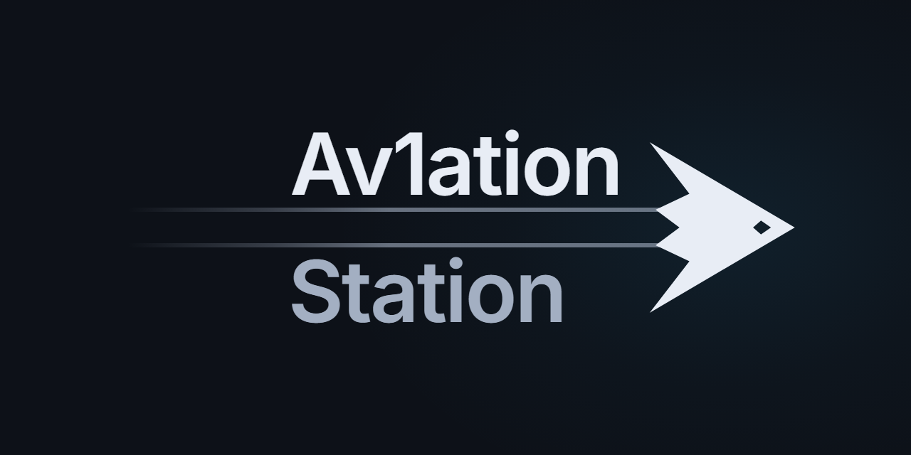

<p align="center">
  <picture>
    <source media="(prefers-color-scheme: dark)" srcset="design/brand/av1ation-station-1280x640-dark.png">
    <source media="(prefers-color-scheme: light)" srcset="design/brand/av1ation-station-1280x640-light.png">
    
  </picture>
</p>

<p align="center">
  A desktop workspace for scene-aware, quality-targeted AV1 encoding with
  <a href="https://github.com/rust-av/Av1an">Av1an</a>.
</p>

<p align="center">
  <a href="https://av1ation-association.github.io/Av1ation-Station/"><strong>Website</strong></a>
  ·
  <a href="https://av1ation-association.github.io/Av1ation-Station/#downloads"><strong>Download</strong></a>
  ·
  <a href="https://av1ation-association.github.io/Av1ation-Station/docs/"><strong>Documentation</strong></a>
  ·
  <a href="https://av1ation-association.github.io/Av1ation-Station/demo/"><strong>Live demo</strong></a>
</p>

Av1ation Station puts the Av1an pipeline in a desktop app: queue videos, tune each scene,
target a quality level, and watch every stage in one place. Scene data, metrics, progress,
and errors are structured values from the engine, not scraped console output.

> **Pre-release.** Windows x64, Linux x64, and macOS arm64 builds are available from the
> [download page](https://av1ation-association.github.io/Av1ation-Station/#downloads).
> Windows and Linux installers are unsigned; the macOS build is best-effort, ad-hoc signed,
> and not notarised. The website is the primary download page for the current version,
> asset list, sizes, SHA-256 sums, platform requirements, and signing caveats; GitHub
> Releases remains the fallback.

## What it does

- **See the whole pipeline.** Six derived stages, live progress, queue position, and retained
  work, read from the encoder itself.
- **Work scene by scene.** A rail, details panel, single player, and proportional timeline;
  compare Original, Decoded, and Encoded, then edit with undo.
- **Hit a quality target.** Per-scene probes, speed scaling, bitrate optimization, and a final
  quality check.
- **Configure the encoder, not a wall of flags.** Grouped, documented controls, advanced
  flags, custom builds, and a validated JSON editor.
- **Run the queue.** Batch projects one video at a time, reuse project templates, and keep
  append-only history and exportable logs.
- **Use your toolchain.** Native FFMS2 input works without VapourSynth; VapourSynth scripting
  is optional, with generated scene data and editor completion.

## Download and install

The [download page](https://av1ation-association.github.io/Av1ation-Station/#downloads) lists
the current pre-release for Windows x64, Linux x64, and macOS arm64, in bundled and
system-toolchain variants. Choose the bundled build unless you already maintain FFmpeg,
VapourSynth, MKVToolNix, and the encoders. The
[documentation](https://av1ation-association.github.io/Av1ation-Station/docs/) covers platform
requirements, verification, portable archives, and the source-build fallback.

Release history is on
[GitHub Releases](https://github.com/Av1ation-Association/Av1ation-Station/releases).

## Build from source

Install Rust, Node.js, npm, and the Tauri prerequisites for your platform. The full setup,
provider rules, and test commands are in [CONTRIBUTING.md](CONTRIBUTING.md).

```bash
npm ci
npm run doctor
npm run dev
```

`npm run doctor` names anything missing. See [docs/commands.md](docs/commands.md) for every
script and [docs/preflight.md](docs/preflight.md) for toolchain selection.

## Documentation

The [website manual](https://av1ation-association.github.io/Av1ation-Station/docs/) covers
installation, the pipeline, configuration, guides, reference, and troubleshooting. For the
codebase, start at [docs/README.md](docs/README.md); current delivery status lives in
[docs/progress.md](docs/progress.md).

## Contributing

Read [AGENTS.md](AGENTS.md) and [CONTRIBUTING.md](CONTRIBUTING.md) before opening a pull
request. Bugs and feature requests are welcome in
[GitHub Issues](https://github.com/Av1ation-Association/Av1ation-Station/issues).

## License

Av1ation Station links `andean-condor`, which is **GPL-3.0**. The combined work is therefore
distributed under the GPL-3.0. The [LICENSE](LICENSE) file is at the repository root.
