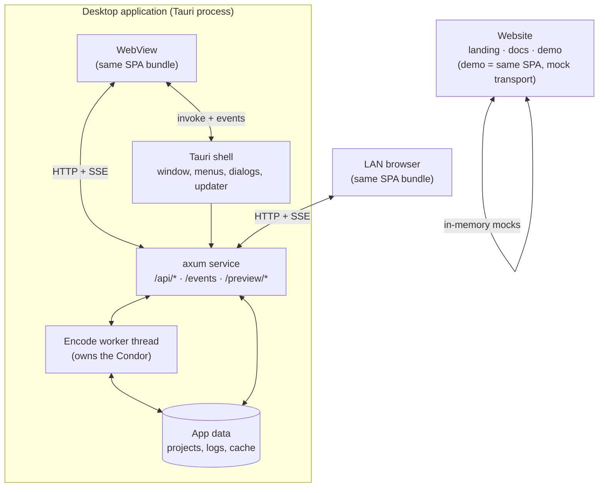
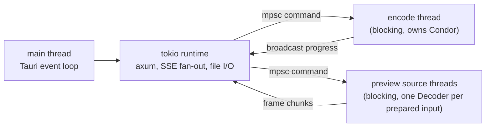
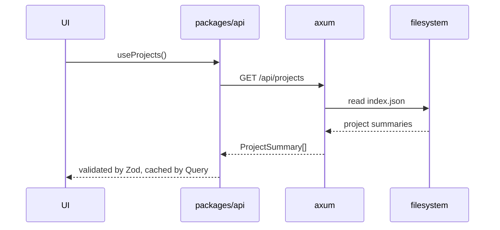
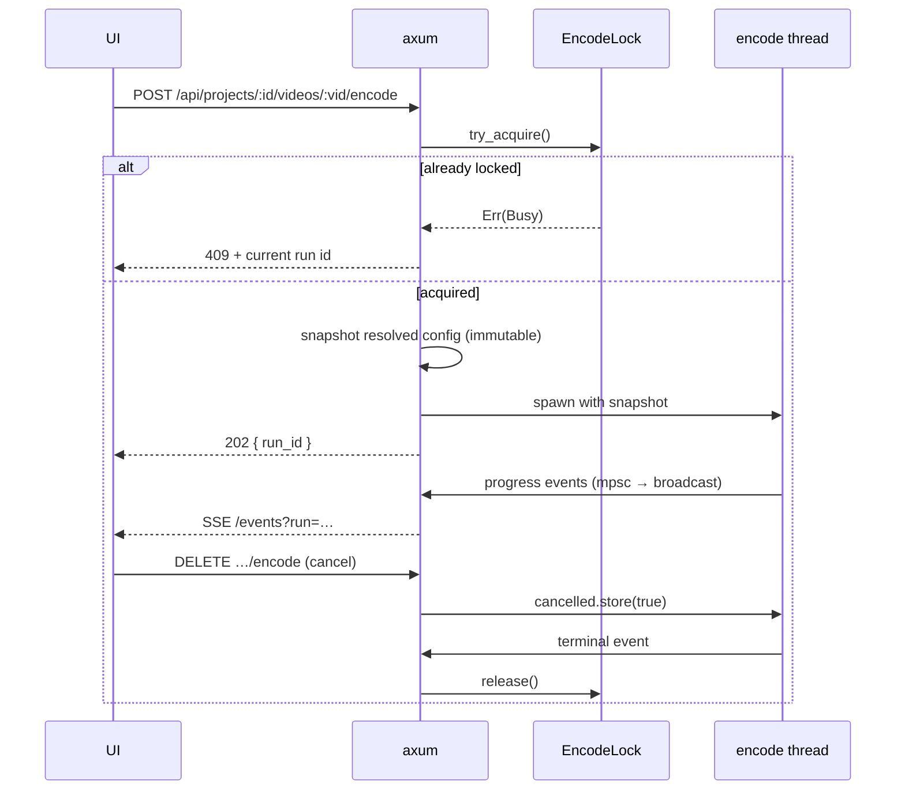
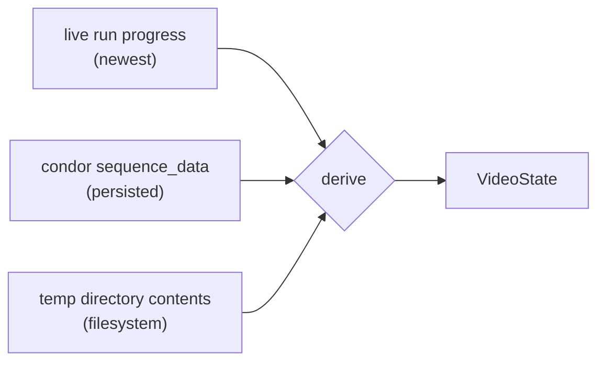
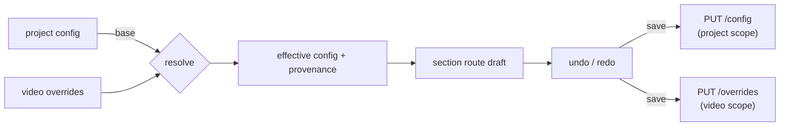
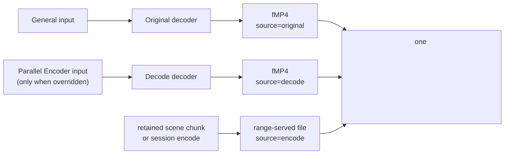
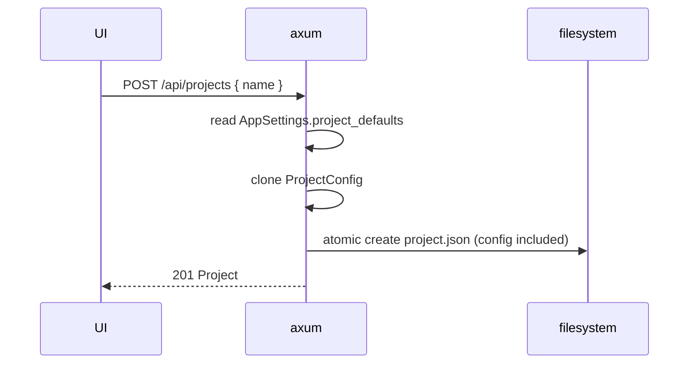

# Architecture

## 1. Goals and constraints

**Goals**

- One UI codebase serving the desktop app, LAN browsers, and the public demo, with zero
  divergence.
- One type-safe boundary between Rust and TypeScript, generated rather than maintained.
- Video pipeline state always reflecting the encoder's actual data.
- Exactly one encode in flight, enforced where it cannot be bypassed.

**Constraints inherited from the engine**

- `andean-condor` is a **synchronous library** with a push-based progress callback
  (`mpsc::Sender<SequenceProgressEvent>`) and cooperative cancellation
  (`Arc<AtomicBool>`).
- It is not on crates.io; it is a git dependency with three path-sibling dependencies.
- It requires Rust edition 2024 (toolchain 1.97+).
- It is GPL-3.0.

**Constraints inherited from the previous attempt**

Recorded in detail in `decisions.md`; the architecturally significant ones are:

- Never duplicate the transport layer per host.
- Never hand-maintain a type that mirrors a Rust type.
- Never persist a state machine.
- Never assume the CI environment can do anything a developer machine can.

## 2. Topology



Three hosts, one bundle. The desktop webview talks to the same `axum` router over
loopback as a LAN browser does; Tauri IPC exists only for things the OS must do on the
webview's behalf (native dialogs, window control, the updater, file drag-and-drop).

That choice is deliberate. If the desktop UI used Tauri IPC for data and the browser
used HTTP, there would be two transports to test and two ways for behaviour to differ.
Because both use HTTP, the browser-mode E2E suite exercises the exact code path the
desktop uses.

### 2.1 Why axum inside the Tauri process

| Option | Verdict |
| --- | --- |
| Tauri IPC only, no HTTP | Rejected: makes LAN access a second, divergent backend. |
| Separate sidecar server process | Rejected: reintroduces the sidecar problem, doubles packaging, complicates the singleton. |
| axum bound to loopback + LAN in the same process | **Chosen**: one router, one state, one guard. |
| WebSocket instead of SSE | Viable, but SSE is unidirectional (which is all progress needs), proxies cleanly, and needs no handshake code. Preview needs a byte stream, which is plain HTTP GET with range support. |

The service binds to `127.0.0.1` on an ephemeral port at startup unless LAN mode is
enabled, in which case it additionally binds `0.0.0.0` behind auth. The port is passed
to the webview through the Tauri window's initialization script so the frontend never
hardcodes it.

### 2.2 Process and thread model



- The `Condor` and its sequences live on **one** encode thread for the whole encode. They
  are created, used, and dropped there.
- Progress arrives on an `mpsc::Sender` created by the engine. A bridge task on the tokio
  runtime forwards into a `tokio::sync::broadcast` channel, which feeds both the SSE
  endpoint and Tauri's event emitter.
- Preview decoding uses its own decoder instances on preview threads; they never share
  state with an in-flight encode, and the encode never waits on them.
- At most two preview decoders exist at once — the Original source (General input) and an
  overridden Decode source (Parallel Encoder input). The Encode source is a file and needs
  no decoder.
- No blocking call runs on a tokio worker thread.

## 3. Workspace layout

npm workspaces for JavaScript, a Cargo workspace for Rust, one repository.

```
Av1ation-Station/
├── AGENTS.md
├── README.md
├── Cargo.toml                  # workspace; pinned engine dependency
├── rust-toolchain.toml          # pins 1.97
├── package.json                 # workspaces + scripts
├── docs/
├── crates/
│   ├── engine/                  # andean-condor integration. no axum, no tauri.
│   ├── contracts/               # schemars types + schema emitter (bin + test)
│   └── service/                 # axum router, state, SSE, persistence
├── apps/
│   ├── desktop/                 # Tauri shell (src-tauri) + webview entry
│   ├── web/                     # LAN/web build target (same UI, HTTP transport)
│   └── website/                 # public landing, docs and demo; demo injects MockTransport
└── packages/
    ├── contracts/               # generated TS types + Zod schemas
    ├── api/                     # transport façade + query/mutation layer
    ├── ui/                      # components, routes, screens, tokens
    └── config/                  # shared eslint/ts/tailwind presets
```

Rationale for `crates/contracts` being separate from `crates/service`: the schema emitter
must be runnable as a standalone binary in CI without linking the Tauri shell or pulling
in the encoder toolchain. Keeping models in a leaf crate makes `cargo run -p contracts`
fast.

Rationale for a package-based frontend rather than folders inside one app: the three
hosts must share everything except their entry point and transport. A workspace enforces
that with dependency rules instead of discipline.

### 3.1 Dependency direction

Enforced by review, by `cargo-deny`-style checks on the Rust side, and by ESLint
`import/no-restricted-paths` on the JavaScript side.

```
packages/contracts  ←  packages/api  ←  packages/ui  ←  apps/*
crates/contracts    ←  crates/service ←  apps/desktop/src-tauri
crates/engine       ←  crates/service
```

Forbidden edges: `packages/ui → @tauri-apps/*`, `crates/service → tauri`,
`crates/engine → axum`, `apps/desktop → apps/website`, any `packages/* → apps/*`.

## 4. Runtime flows

### 4.1 Load the home screen



The index is a cache, not a source of truth. If `index.json` is missing or stale, the
service rebuilds it by scanning the project directory. A dropped index degrades
performance, never correctness.

### 4.2 Start an encode



Key properties:

- The **snapshot** is taken before the worker starts. Configuration edits after this
  point cannot affect a running encode, because the worker holds a copy, not a reference.
- The lock is a `tokio::sync::Mutex<Option<RunHandle>>` in service state, so a second
  request gets a deterministic `409` rather than a race.
- Cancellation is the engine's `AtomicBool`. The service never kills a thread.
- The run id is the correlation key for progress, logs, and the final result.

### 4.3 Navigate away while encoding

The UI blocks navigation with a router-level guard that reads the lock state from Query
cache (fed by SSE), and shows a confirmation that cancels. This is a UX affordance; the
authority is the server, which rejects config writes for the locked video with `423`.

### 4.4 State derived from the filesystem

Not all recoverable state lives in the condor object. **Encoded scene chunks exist as files
in the video's temp directory whether or not a `Condor` is instantiated**, and they are
evidence of completed work.

If Parallel Encoder was stopped halfway, there is one video file per completed scene in
`temp/<video-ulid>/`. Those files tell us which scenes are encoded and how far the encode
progressed, without starting any sequence.

So the derivation has three evidence sources, in priority order:



| Source | What it proves | Cost |
| --- | --- | --- |
| Live run progress | what is happening right now | free, already streamed |
| `condor.scenes[*].sequence_data` | what a sequence recorded when it completed | free, in memory |
| Temp directory listing | which scenes have encoded output files on disk | one `read_dir`, cached |

The filesystem check is the only one with I/O cost, so it is cached with a short TTL and
invalidated by run events. It is what makes "resume where it left off" possible after a
crash, and it is why the concatenator can warn "3 of 40 scenes are not encoded" before the
user asks it to run.

This is specified in detail in [data-model.md](data-model.md#4-derived-state).

### 4.5 Edit configuration



`GET …/config` returns the effective value **and** where each value came from
(`inherited` | `overridden` | `default`), so the UI can show a reset affordance per field
without guessing. The resolution algorithm is specified in
[data-model.md](data-model.md#3-config-resolution).

A save replaces the resource: project scope writes the whole `ProjectConfig`, video scope
writes the sparse `ConfigOverrides`. Neither is a field-level patch and neither merges on
the server, so a client cannot leave a half-updated document behind. The draft is owned by
the section route, not by the shell or the rail; Save commits it and returns to the
project screen, Cancel discards it and returns there, and the navigation guard resolves a
dirty draft before the rail can switch sections. A write against a locked video is rejected with
`423`; the UI's disabled controls are only a reflection of that server rule. Because each
save is a whole-resource replace, two clients editing the same scope resolve by last write;
the server does not merge partial drafts. That is accepted for the single-user LAN model,
and the route guard prevents one client from silently discarding its own work.

Section screens are child routes (`/projects/:id/config/:section` and
`/projects/:id/videos/:vid/config/:section`), and a script editor is a child of the input
it edits. The route therefore owns the breadcrumb, the active rail row and the draft; the
rail is navigation only and never writes. The route shape is specified in
[frontend.md](frontend.md#3-routing).

### 4.6 Preview a scene

The Scenes tab has **one** player. It is attached to one of three sources, and switching
sources replaces what that element plays rather than mounting a second player.



The player's labels are `Original` (General input), `Decode` (an overridden Parallel
Encoder input), and `Encode` (the retained chunk or a session encode).

- A session resolves the General input and, when `ParallelEncoderConfig.input` is `Some`,
  the Parallel Encoder input as well. Each prepared input gets its own decoder and cache;
  the preview decoder never shares state with a run.
- The session manifest lists which sources exist. `decode` is present only when the input is
  overridden; `encode` is present only when a retained chunk exists or the user asked for a
  scene encode. The client does not infer availability.
- The Encode source is a file. Selecting it never re-encodes; `Preview scene` produces a new
  session encode, and the chosen encode input source (`Decode` by default, else `Original`)
  only changes the comparison picture.
- When the encode input source has different geometry or frame count, the client maps by
  scene-relative time. It does not claim frame equality that a `Resize`, `Crop`, or `Trim`
  filter has made false.
- Only the selected source is prepared eagerly. The second decode is prepared on demand and
  evicted first under the preview budget in [preview.md](preview.md#5-disk-and-memory-budget).

### 4.7 Create a project from defaults



The clone is part of the create write. There is no second request, no "apply defaults" job,
and no live link between the template and the project. That is why a project can be edited
while Settings is open and why changing defaults never rewrites existing work. The same
copy boundary appears at a smaller scale when a video is added: `InputDefaults` becomes a
materialised `Input` owned by the video. In both cases, the saved resource is complete on
disk rather than resolved through a mutable pointer.

Queue order is likewise owned by the project document, not by a client sort. A reorder or
bulk removal is one server mutation under the run lock; the list the next LAN client reads
is the list that was committed.

## 5. Cross-cutting concerns

| Concern | Approach |
| --- | --- |
| **Errors** | One `AppError` enum in Rust with a stable `code`, serialized into a uniform envelope; the frontend maps `code` to a message and a recovery action. Never surface a raw engine string without a code. |
| **Logging** | `tracing` with a JSON file layer per run plus a ring buffer in memory for the live log view. Logs are append-only files, and the anonymiser is a pure transform over them. |
| **Time** | All timestamps server-side as UTC ISO-8601; formatting is a frontend concern. |
| **IDs** | ULID for projects and runs (sortable, no coordination); the engine's own indices for scenes. |
| **Feature flags** | Compile-time Cargo features for optional preview/GPU paths so a broken optional dependency cannot block a release. |
| **Theming** | CSS custom properties; light/dark/system. Charts read the same tokens. |
| **i18n** | English only, but all user-visible strings go through a message catalogue from day one, because retrofitting string extraction is expensive. |
| **Telemetry** | None. Crash logs and anonymised export are user-initiated. |

## 6. Failure modes and their handling

Capability loss is scoped, never global. The engine has independent decode paths and
independent encode paths, so a missing optional dependency removes one capability and
leaves the rest working.

### 6.1 Capability degradation

| Missing | Effect | Not affected |
| --- | --- | --- |
| VapourSynth | the two VapourSynth input kinds are unavailable, and noise detection cannot build its graph; the UI offers native FFMS2 for decoding | native FFMS2 decoding, preview of native inputs, and encoding from them |
| FFmpeg | muxing paths that shell out to it are unavailable | encoding, when the selected encoder writes a directly concatenable format |
| `mkvmerge` | the muxing fallback is unavailable | encoding and muxing via FFmpeg |
| Any single encoder executable | that encoder is absent from the catalogue | other encoders; scene detection, noise detection, and target quality |
| All encoder executables | encode is disabled | scene detection, noise detection, target quality, charts, and preview |
| FFMS2 | the native input kind is unavailable | VapourSynth inputs |
| A metric backend | the metrics it provided are absent from the metric catalogue | the remaining metrics, and every sequence that does not score |

Encoding is therefore disabled only when no encoder executable exists or the selected
encoder's executable is missing. Preview of a scene is enabled whenever that scene's
resolved input can be decoded. Both are per-video capabilities derived from the resolved
configuration, not process-wide flags. Full derivation is in `backend.md` §9.

### 6.2 Runtime faults

| Failure | Detection | Behaviour |
| --- | --- | --- |
| Engine panics inside a sequence | worker thread `catch_unwind` boundary | run terminates with `ENGINE_PANIC`, lock released, log preserved |
| Worker thread dies without a terminal event | watchdog on the run's last-heartbeat timestamp | run marked failed, lock released |
| Disk full while writing output | encoder error propagated | run fails with `DISK_FULL`, partial output kept for inspection |
| Project file corrupt | deserialize error | project loads in "recovery" state, raw file exposed for export, never silently rewritten |
| LAN client disconnects mid-stream | SSE write error | dropped from fan-out, encode continues |
| Two app instances | Tauri `single-instance` plugin | second instance focuses the first |
| Port collision on loopback | bind retry over a small range | recorded in the init script |
| Clock skew affecting log ordering | monotonic sequence numbers in the event stream | ordering never depends on wall clock |

Every entry in both tables needs a test in Phase 4.

## 7. Capability model

Capabilities are derived once per request from resolved configuration plus the preflight
inventory, and cached on the asset they describe.

```rust
pub struct Capabilities {
    pub decode: BTreeSet<DecodeKind>,   // Ffms2 | VapourSynth
    pub encoders: BTreeSet<EncoderId>,  // those whose executable was found
    pub metrics: BTreeSet<MetricId>,    // those whose backend is available
    pub can_write_output: bool,
    pub can_write_temp: bool,
}
```

`Capabilities::for_video` projects this global inventory onto one video's resolved input,
encoder, and metric choices. The UI reads capabilities from the API; it never probes the
system itself. An action is enabled when its required capability is present, and the
reason an action is disabled is always the missing capability, named.


## 8. What is explicitly not in this architecture

- No database server and no embedded database. Project data is JSON per project with a
  rebuildable index, the execution timeline is JSONL, and logs are files (A2, D29).
- No message queue, no IPC between separate processes, no daemon.
- No plugin system for user-supplied sequences in v0.1. The extension point exists in
  the engine crate, but loading third-party code into the process is a security decision
  that needs its own ADR.
- No multi-window or multi-document interface (A6).
- No cloud sync, accounts, or telemetry.
