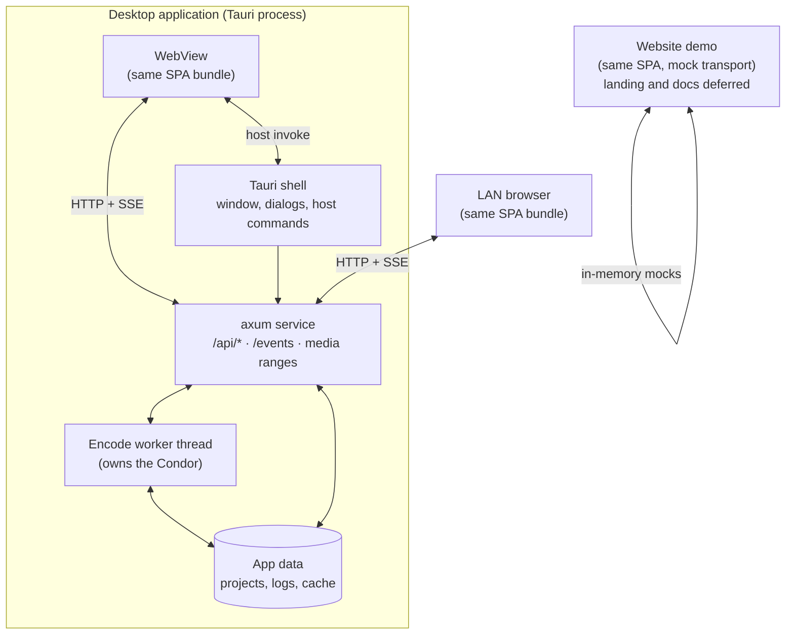
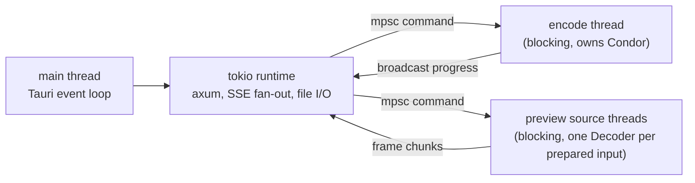
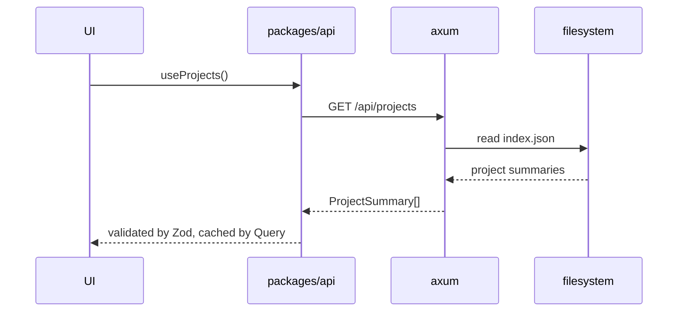
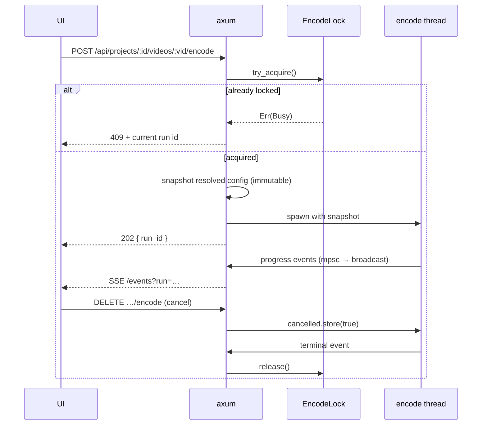
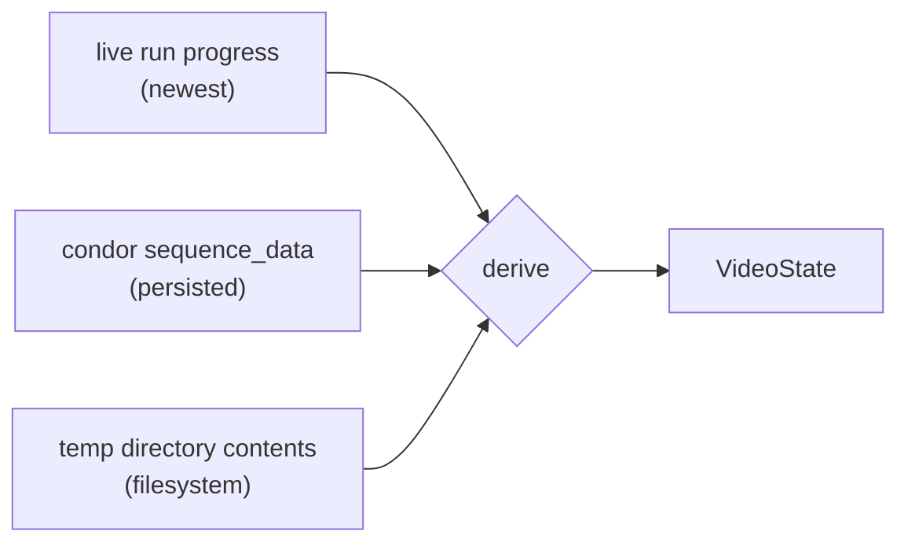
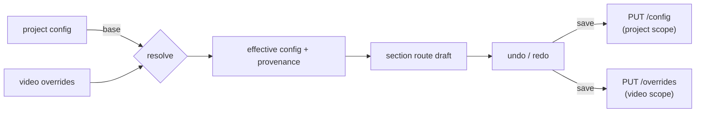
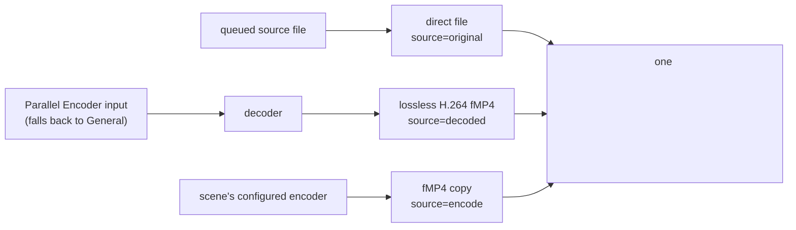
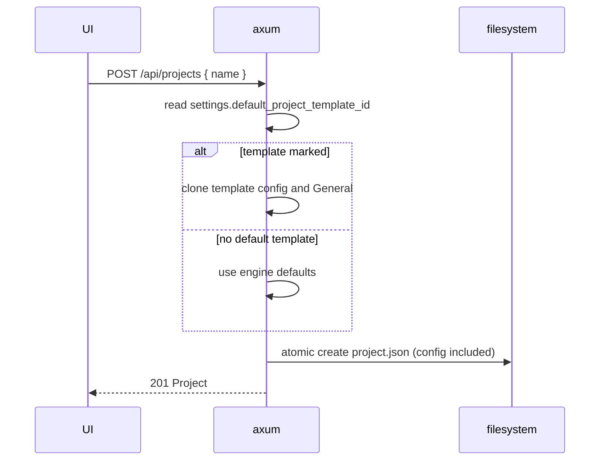

# Architecture

## Contents

- [1. Goals and constraints](#1-goals-and-constraints)
- [2. Topology](#2-topology)
- [3. Workspace layout](#3-workspace-layout)
- [4. Runtime flows](#4-runtime-flows)
- [5. Cross-cutting concerns](#5-cross-cutting-concerns)
- [6. Failure modes and their handling](#6-failure-modes-and-their-handling)
- [7. Capability model](#7-capability-model)
- [8. What is explicitly not in this architecture](#8-what-is-explicitly-not-in-this-architecture)

## 1. Goals and constraints

**Goals**

- One UI codebase serving the desktop app, LAN browsers, and the public demo, with zero
  divergence.
- One type-safe boundary between Rust and TypeScript, generated rather than maintained.
- Video pipeline state always reflecting the encoder's actual data.
- Exactly one encode in flight, enforced where it cannot be bypassed.

**Constraints inherited from the engine**

- `andean-condor` is a **synchronous library** with a push-based progress callback
  (`mpsc::Sender<SequenceProgressEvent>`) and cooperative cancellation
  (`Arc<AtomicBool>`).
- It is not on crates.io; it is a git dependency with three path-sibling dependencies.
- It requires Rust edition 2024 (toolchain 1.97+).
- It is GPL-3.0.

**Constraints inherited from the previous attempt**

The architecturally significant ones are:

- Never duplicate the transport layer per host.
- Never hand-maintain a type that mirrors a Rust type.
- Never persist a state machine.
- Never assume the CI environment can do anything a developer machine can.

## 2. Topology



Three hosts, one bundle. The desktop webview talks to the same `axum` router over
loopback as a LAN browser does; Tauri IPC exists only for things the OS must do on the
webview's behalf (native dialogs, opening a path or URL, and writing an exported file to
the path a save dialog returned).

That choice is deliberate. If the desktop UI used Tauri IPC for data and the browser
used HTTP, there would be two transports to test and two ways for behaviour to differ.
Because both use HTTP, a browser-mode E2E suite can exercise the exact code path the
desktop uses; the checked-in Playwright smoke creates a project and opens Settings against the real headless service, while the full journey suite is planned for Phase 4b.

A packaged desktop window loads the service's loopback origin rather than a `tauri://` page,
so `rust/desktop-shell/capabilities/default.json` grants that origin (`remote`) the IPC
permissions it needs for native dialogs and opening paths or links. The
pattern must include the ephemeral port (`http://127.0.0.1:*`): a bare host matches only the
default port and silently denies every plugin call, which surfaces as a native dialog
"refused by the host" rather than as a build error. A unit test in the desktop crate parses
the capability and asserts the pattern matches a real loopback origin with a port. Nothing
else crosses IPC: no project, settings, or encode data moves over it, and a browser host has
no IPC at all.

### 2.1 Why axum inside the Tauri process

| Option | Verdict |
| --- | --- |
| Tauri IPC only, no HTTP | Rejected: makes LAN access a second, divergent backend. |
| Separate sidecar server process | Rejected: reintroduces the sidecar problem, doubles packaging, complicates the singleton. |
| axum bound to loopback + LAN in the same process | **Chosen**: one router, one state, one guard. |
| WebSocket instead of SSE | Viable, but SSE is unidirectional (which is all progress needs), proxies cleanly, and needs no handshake code. Preview needs a byte stream, which is plain HTTP GET with range support. |

The service binds to `127.0.0.1` on an ephemeral port at startup unless LAN mode is
enabled, in which case it additionally binds `0.0.0.0` behind auth. The port is passed
to the webview through the Tauri window's initialization script so the frontend never
hardcodes it.

### 2.2 Process and thread model



- The `Condor` and its sequences live on **one** encode thread for the whole encode. They
  are created, used, and dropped there.
- Progress arrives on an `mpsc::Sender` created by the engine. A supervisor task on the
  tokio runtime forwards into a `tokio::sync::broadcast` channel, which feeds the SSE
  endpoint and the replay buffer that answers a reconnect.
- Preview proxies use their own decoder and encoder instances on preview threads; they
  never share state with an in-flight encode, and the encode never waits on them. Original
  is served as the queued source file, Decoded is a lossless proxy, and Encoded runs the
  scene's encoder into a remuxed proxy. A build is shared by cache key while viewers exist.
- `rust/crates/service/src/run/runs/` owns the singleton lock, the progress bridge, and the
  release rule. Routes only start, cancel, and subscribe; the fake and real runners reach
  the engine through the same ownership, so swapping one for the other moves nothing.
- Both hosts stop through `ServiceHandle`: it cancels the active run, waits for its
  terminal event, then asks axum to finish in-flight requests. A bare task handle cannot
  guarantee the lock is released before exit.
- No blocking call runs on a tokio worker thread.
- On Windows, the desktop and headless hosts attach to a console provided by a hidden
  `cmd /c more` host started with `CREATE_NO_WINDOW`. Every engine-owned child inherits it,
  and local spawns also pass `CREATE_NO_WINDOW` as a fallback, so no child console appears
  without forking the engine. The hidden host owns no socket or state and exits with the
  application.

## 3. Workspace layout

npm workspaces for JavaScript, a Cargo workspace for Rust, one repository.

Workspace package names are `@av1ation/contracts`, `@av1ation/api`, `@av1ation/ui`, and
`@av1ation/config`; Rust crates are `av1ation-contracts`, `av1ation-engine`,
`av1ation-service`, and the desktop shell. Prefixing avoids collisions with a future
publish and makes an import name its layer.

```
Av1ation-Station/
├── AGENTS.md
├── README.md
├── rust-toolchain.toml          # pins 1.97
├── package.json                 # workspaces + scripts
├── docs/
├── rust/
│   ├── Cargo.toml               # Rust workspace; pinned engine dependency
│   ├── Cargo.lock
│   ├── README.md                # crate map and where Rust changes go
│   ├── crates/
│   │   ├── contracts/           # schemars types + schema emitter
│   │   ├── engine/              # andean-condor integration; no axum, no tauri
│   │   └── service/             # axum router, state, SSE, persistence
│   └── desktop-shell/           # Tauri window, IPC, capabilities, icons
├── apps/
│   ├── desktop/                 # desktop webview entry
│   ├── web/                     # LAN/web build target (same UI, HTTP transport)
│   └── website/                 # public demo; injects MockTransport (deferred landing)
└── packages/
    ├── contracts/               # generated TS types + Zod schemas
    ├── api/                     # transport façade + query/mutation layer
    ├── ui/                      # components, routes, screens, tokens
    └── config/                  # shared ESLint, Prettier and TypeScript presets
```

Rationale for `rust/crates/contracts` being separate from `rust/crates/service`: the schema emitter
must be runnable as a standalone binary in CI without linking the Tauri shell or pulling
in the encoder toolchain. Keeping models in a leaf crate makes `cargo run -p av1ation-contracts`
fast.

Rationale for a package-based frontend rather than folders inside one app: the three
hosts must share everything except their entry point and transport. A workspace enforces
that with dependency rules instead of discipline.

All Rust lives under `rust/`; no Rust crate or native host lives under `apps/`. The
`apps/` directory contains only the JavaScript host entries.

### 3.1 Where a change belongs

| If you are adding… | Put it in |
| --- | --- |
| A type that crosses the HTTP boundary | `rust/crates/contracts/src/<group>`, then regenerate contracts |
| Engine integration, probing, preview, or script execution | `rust/crates/engine/src` ([module map](engine.md)) |
| An HTTP route, persistence rule, or run supervisor | `rust/crates/service/src` ([module map](service.md)) |
| A route test | `rust/crates/service/tests/api/<family>.rs` |
| A Tauri window, native dialog, opener, or permission | `rust/desktop-shell` |
| A shared UI feature or screen | `packages/ui/src/features/<domain>` |
| A transport or query hook | `packages/api/src` |
| A runnable host entry | `apps/<host>/src` |
| A cross-host browser test | `e2e/` |

Contract types and route tests are named for the production module they serve. A new
contract type goes in its group module; a new route test goes in the matching family
module.

### 3.2 Dependency direction

Enforced by review on the Rust side and by ESLint `no-restricted-imports` on the
JavaScript side. There is no cargo-deny layer check in the tree yet.

```
packages/contracts  ←  packages/api  ←  packages/ui  ←  apps/*
rust/crates/contracts  ←  rust/crates/service  ←  rust/desktop-shell
rust/crates/engine     ←  rust/crates/service
```

Forbidden edges: `packages/ui → @tauri-apps/*`, `packages/api → @tauri-apps/*`,
`rust/crates/service → tauri`, `rust/crates/engine → axum`, `apps/desktop → apps/website`, any
`packages/* → apps/*`. React and TanStack Query are allowed in `packages/api` for the typed
query/mutation façade, but no JSX component belongs there.

## 4. Runtime flows

### 4.1 Load the home screen



The index is a cache, not a source of truth. If `index.json` is missing or stale, the
service rebuilds it by scanning the project directory. A dropped index degrades
performance, never correctness.

### 4.2 Start an encode



Key properties:

- The **snapshot** is taken before the worker starts. Configuration edits after this
  point cannot affect a running encode, because the worker holds a copy, not a reference.
- The lock is a `tokio::sync::Mutex<Option<RunHandle>>` inside `RunSupervisor`, so a
  second request gets a deterministic `409` rather than a race.
- Cancellation is the engine's `AtomicBool`. The service never kills a thread.
- The run id is the correlation key for progress, logs, and the final result.

### 4.3 Navigate away while encoding

Navigation stays available. The run belongs to the video, not to the screen that started
it: leaving its page does not cancel it, and the shell's run chip shows the live run and
opens the active video from every route. Reopening the video reads the same state from
the event stream.

The server still decides what can be written while a run is active. Project configuration
is read-only because every video inherits it, and the encoding video's General, overrides,
storage, scenes, and sequence reset are read-only because they describe the work in
flight. Sibling videos in the same project stay editable, another project stays editable,
and template settings stay editable; the queue allows Add and sibling reorder or removal,
while the active row stays fixed. Every second start is still refused process-wide. The UI
reflects those scopes with disabled controls, while the service answers `423` for a write
that reaches a locked scope.

### 4.4 State derived from the filesystem

Not all recoverable state lives in the condor object. **Encoded scene chunks exist as files
in the video's temp directory whether or not a `Condor` is instantiated**, and they are
evidence of completed work.

If Parallel Encoder was stopped halfway, there is one video file per completed scene in
`temp/<video-uuid>/`. Those files tell us which scenes are encoded and how far the encode
progressed, without starting any sequence.

So the derivation has three evidence sources, in priority order:



| Source | What it proves | Cost |
| --- | --- | --- |
| Live run progress | what is happening right now | free, already streamed |
| `condor.scenes[*].sequence_data` | what a sequence recorded when it completed | free, in memory |
| Temp directory listing | which scenes have encoded output files on disk | one `read_dir`, cached |

The filesystem check is the only one with I/O cost, so it is cached with a short TTL and
invalidated by run events. It is what makes "resume where it left off" possible after a
crash, and it is why the concatenator can warn "3 of 40 scenes are not encoded" before the
user asks it to run.

This is specified in detail in [data-model.md](data-model.md#4-derived-state).

### 4.5 Edit configuration



`GET …/config` returns the effective value **and** where each value came from
(`inherited` | `overridden` | `default`), so the UI can show a reset affordance per field
without guessing. The resolution algorithm is specified in
[data-model.md](data-model.md#3-config-resolution).

A save replaces the resource: project scope writes the whole engine configuration
document, video scope writes the sparse `ConfigOverrides`. Neither is a field-level patch and neither merges on
the server, so a client cannot leave a half-updated document behind. The draft is owned by
the section route, not by the shell; Save commits it and stays on the screen, Discard resets
it, and the navigation guard resolves a dirty draft before the back link or browser history
can leave. Client-side, one draft session owns the history, saved baseline, dirty and guard
state, and save/discard transition for one document; project, video, and General adapters
decide what the draft and its save payload are. The session is the edit buffer, not a
second read cache for server state. A write against a locked scope is rejected with
`423`; the UI's disabled controls are only a reflection of that server rule. Because each
save is a whole-resource replace, two clients editing the same scope resolve by last write;
the server does not merge partial drafts. That is accepted for the single-user LAN model,
and the route guard prevents one client from silently discarding its own work.

Section screens are child routes (`/projects/:id/config/:section` and
`/projects/:id/videos/:vid/config/:section`), and a script editor is a child of the input
it edits. The route therefore owns the breadcrumb and the draft; the project's section grid is
navigation only and never writes. The route shape is specified in
[frontend.md](frontend.md#3-routing).

### 4.6 Preview a scene

The Scenes tab has **one** player. It is attached to one of three sources, and switching
sources replaces what that element plays rather than mounting a second player.



The player's labels are `Original` (the queued source file), `Decoded` (the Parallel
Encoder input, falling back to General), and `Encoded` (one detected scene's chunk).

- `Original` is served directly with byte ranges. `Decoded` opens the Parallel Encoder
  input, falling back to General, and streams a window from the playhead as lossless H.264
  in fragmented MP4; a lossless PNG serves the scrub still. The preview decoder never
  shares state with a run.
- `Encoded` resolves the scene containing the playhead, runs the configured encoder with
  that scene's exact parameters, and muxes its stdout into fragmented MP4 with FFmpeg
  `-c:v copy`. It is produced on demand and cached; it is not the concatenated output.
- `encode_from=original|decoded` chooses the comparison input for `Encoded`; `decoded` is
  the default.
- There is no preview-session endpoint. The media route prepares the requested source per
  request, shares an in-flight build between viewers, caches under
  `<app-data>/cache/preview` keyed by input, encoder, frame range, size and modification
  time, and stops a build when its last viewer leaves.
- When the encode input source has different geometry or frame count, the client maps by
  scene-relative time. It does not claim frame equality that a `Resize`, `Crop`, or `Trim`
  filter has made false.
- Only the selected source is attached to the element; preview builds are shared per cache
  key rather than one decoder per open tab. The budget is in
  [preview.md](preview.md#5-disk-and-memory-budget).

### 4.7 Create a project from a template



The clone is part of the create write. There is no second request, no "apply template"
job, and no live link between the template and the project. That is why a project can be
edited while Settings is open and why changing a template never rewrites existing work.
When no template is marked default, the engine defaults are used. The same copy boundary
appears at a smaller scale when a video is added: `GeneralDefaults` becomes a materialised
`Input` owned by the video. In both cases, the saved resource is complete on disk rather
than resolved through a mutable pointer.

Queue order is likewise owned by the project document, not by a client sort. A reorder or
bulk removal is one server mutation under the run lock; the list the next LAN client reads
is the list that was committed.

## 5. Cross-cutting concerns

| Concern | Approach |
| --- | --- |
| **Errors** | One `AppError` enum in Rust with a stable `code`, serialized into a uniform envelope; the frontend maps `code` to a message and a recovery action. Never surface a raw engine string without a code. |
| **Logging** | `tracing` writes stderr and `<app-data>/logs/application.log`; each run's records are appended as `logs/<run>/run.jsonl` beside `meta.json`. The live viewer pages the log with `tail`/`offset`; the anonymiser is a pure transform over the records. |
| **Time** | All timestamps server-side as UTC ISO-8601; formatting is a frontend concern. |
| **IDs** | UUID v4 strings for projects, videos, runs and encoder forks; the engine's own indices for scenes. |
| **Feature flags** | Runtime capability discovery. The application crates declare no optional Cargo features; an absent optional dependency removes only the capability it provides (`AGENTS.md` §2.8). |
| **Theming** | CSS custom properties; light/dark/system. Charts read the same tokens. |
| **i18n** | English only. User-visible copy is written directly in the components; there is no message catalogue in v0.1. |
| **Telemetry** | None. Crash logs and anonymised export are user-initiated. |

## 6. Failure modes and their handling

Capability loss is scoped, never global. The engine has independent decode paths and
independent encode paths, so a missing optional dependency removes one capability and
leaves the rest working.

### 6.1 Capability degradation

| Missing | Effect | Not affected |
| --- | --- | --- |
| VapourSynth | the two VapourSynth input kinds are unavailable, and noise detection cannot build its graph; the UI offers native FFMS2 for decoding | native FFMS2 decoding, preview of native inputs, and encoding from them |
| FFmpeg | muxing paths that shell out to it are unavailable | encoding, when the selected encoder writes a directly concatenable format |
| `mkvmerge` | the muxing fallback is unavailable | encoding and muxing via FFmpeg |
| Any single encoder executable | that encoder is absent from the catalogue | other encoders; scene detection, noise detection, and target quality |
| All encoder executables | encode is disabled | scene detection, noise detection, target quality, charts, and preview |
| FFMS2 | the native input kind is unavailable | VapourSynth inputs |
| A metric backend | the metrics it provided are absent from the metric catalogue | the remaining metrics, and every sequence that does not score |

Encoding is therefore disabled only when no encoder executable exists or the selected
encoder's executable is missing. Preview of a scene is enabled whenever that scene's
resolved input can be decoded. Both are per-video capabilities derived from the resolved
configuration, not process-wide flags. Full derivation is in `preflight.md`.

### 6.2 Runtime faults

| Failure | Detection | Behaviour |
| --- | --- | --- |
| Engine panics inside a sequence | worker thread `catch_unwind` boundary | run terminates with `ENGINE_PANIC`, lock released, log preserved |
| Worker thread dies without a terminal event | the run's event channel closes | a run-level timeline record says the run ended without a terminal event, and the lock is released |
| Disk full while writing output | encoder error propagated | run fails with `DISK_FULL`, partial output kept for inspection |
| Project file corrupt | deserialize error | project is skipped by the Home list and its detail answers `422 INVALID_CONFIG`; the raw file is never rewritten |
| LAN client disconnects mid-stream | SSE write error | dropped from fan-out, encode continues |
| Two app instances | Tauri `single-instance` plugin | second instance focuses the first |
| Port collision on loopback | the OS refuses the bind | startup reports the address error; the ephemeral port makes a collision rare |
| Clock skew affecting log ordering | monotonic sequence numbers in the event stream | ordering never depends on wall clock |

Every entry in both tables needs a test in Phase 4.

## 7. Capability model

The machine's inventory is a cached `PreflightReport`: one `PreflightCheck` per probe,
carrying a `capability` group (`decode`, `encode`, `muxing`, `metric`, or `application`),
an `available` flag, and the observed version or the reason it is missing. The report is
served by `GET /api/health`; `POST /api/preflight/refresh` discards the cache and probes
again. There is no process-wide "can encode" boolean.

`POST /api/projects/:id/videos/:vid/validate` projects the report onto one video's resolved
configuration and adds the per-video facts a probe cannot know: whether the source is
readable, whether the output and scratch directories are writable, free space on both
volumes, and missing VapourSynth plugin namespaces. It returns `VideoValidation` with
`blockers`, `warnings`, and the relevant `checks`; `can_encode` is true exactly when
`blockers` is empty. That response is what the video screen reads.

The UI never probes the system itself. An action is enabled when its required capability is
present, and the reason an action is disabled is always the missing capability, named.

A capability has one provider. A user-provided executable for an encoder that is absent
from `PATH` makes that encoder present; it does not appear as a second encoder, and it does
not widen any other capability. The same holds for a custom FFmpeg or `mkvmerge`, which
satisfies **muxing** and nothing else.


## 8. What is explicitly not in this architecture

- No database server and no embedded database. Project data is JSON per project with a
  rebuildable index, the execution timeline is JSONL, and logs are files (A2).
- No message queue, no IPC between separate processes, no daemon.
- No plugin system for user-supplied sequences in v0.1. The extension point exists in
  the engine crate, but loading third-party code into the process is a security decision
  that needs its own ADR.
- No multi-window or multi-document interface (A6).
- No cloud sync, accounts, or telemetry.
