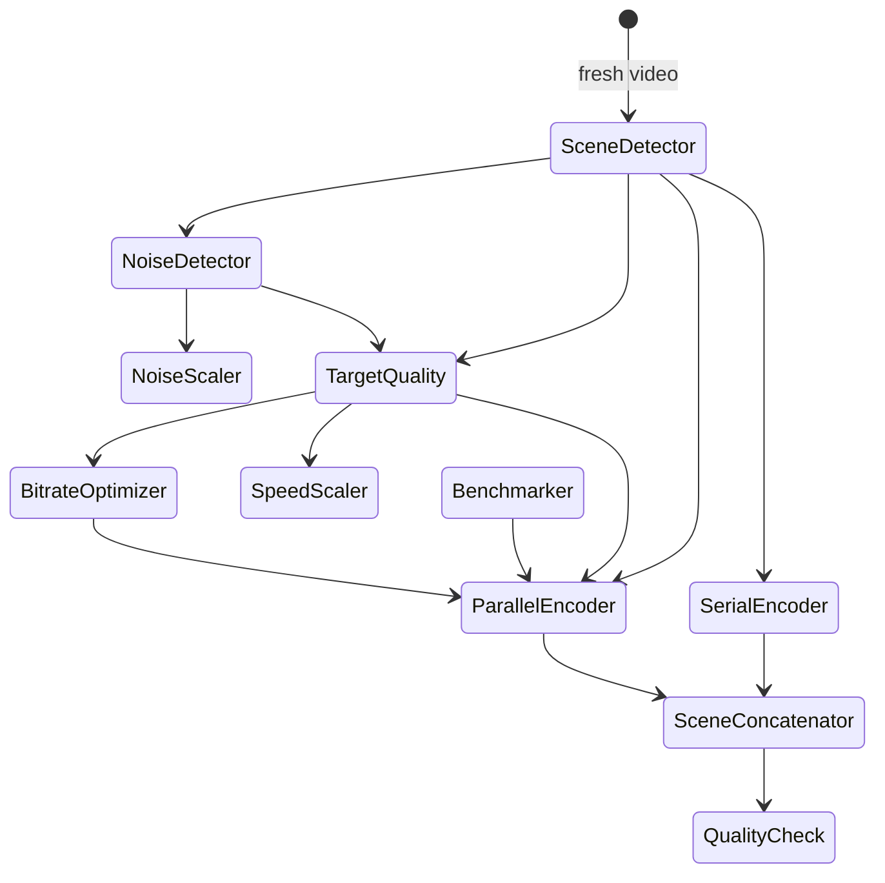
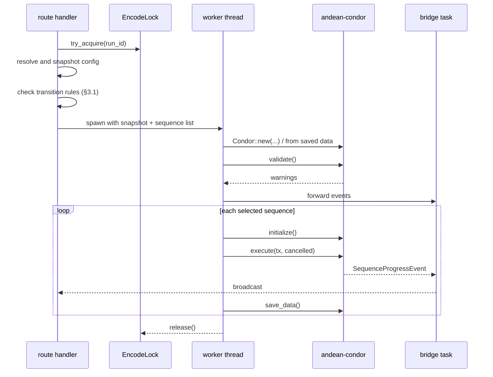

# Backend

Rust side of Av1ation Station. Three crates, one dependency on the engine, one HTTP
surface.

## 1. Crate responsibilities

### `crates/engine` — the integration boundary

Owns everything that touches `andean-condor`. No `axum`, no `tauri`, no serialization
concerns beyond what the engine's own `schemars` derives already provide.

```rust
pub struct EncodeRequest {
    pub input: Input,
    pub output: Output,
    pub encoder: Encoder,
    pub sequence_config: DefaultSequenceConfig,
    /// Materialised engine scenes, including any per-scene encoder edits.
    pub scenes: Option<Vec<Scene<DefaultSequenceData>>>,
    pub project_id: ProjectId,
    pub video_id: VideoId,
    pub run_id: RunId,
}

pub struct EncodeHandle {
    pub run_id: RunId,
    pub cancel: Arc<AtomicBool>,
    pub events: mpsc::Receiver<EncodeEvent>,
}

pub trait EncodeRunner: Send {
    fn start(&self, req: EncodeRequest) -> Result<EncodeHandle, EngineError>;
}
```

`EncodeEvent` is our own type, not `SequenceProgressEvent`. Converting at the boundary
means an upstream event-shape change breaks one adapter instead of the whole application,
and it lets us add correlation ids, timestamps, and a monotonic sequence number that the
engine does not provide.

The trait exists so tests can substitute a fake runner that emits scripted event
sequences without VapourSynth, FFmpeg, or a real encode.

### `crates/contracts` — the type surface

All types that cross the boundary live here and derive `schemars::JsonSchema` and
`serde::{Serialize, Deserialize}`. It also contains a `bin/emit-schema` target that
writes `schema/` to disk for the TypeScript generator.

Keeping this separate from `service` means the schema can be emitted in CI in seconds
without building the Tauri shell or the encoder.

### `crates/service` — transport and orchestration

The `axum` router, application state, the encode singleton, persistence, SSE fan-out,
and error mapping. Depends on `engine` and `contracts`. Never depends on `tauri`.

This crate is also the **headless test target**: an `apps/desktop` build and a
`service --headless` binary expose the same router, and Playwright drives the latter.
That is how E2E runs in CI without a GUI (see [testing.md](testing.md)).

## 2. The engine dependency

`andean-condor` is a workspace member of the Av1an repository, not a published crate,
and it has **three path-sibling dependencies**:

```toml
# upstream andean-condor/Cargo.toml (abridged)
av-metrics-vmaf     = { path = "../av-metrics-vmaf" }
av-metrics-vship    = { path = "../av-metrics-vship" }
av-metrics-fmetrics = { path = "../av-metrics-fmetrics" }
```

Cargo resolves those path siblings from the same git source, so one dependency is enough:

```toml
# Cargo.toml (workspace root)
[workspace.dependencies]
andean-condor = { git = "https://github.com/BoatsMcGee/Av1an", rev = "<pinned-sha>" }
```

Do **not** add `[patch]` entries for the metric crates. Cargo rejects a patch that points
at the same source ("patches must point to different sources"), and the path siblings
already resolve from the repository. This was verified in the 1.2 dependency spike.

The reproducibility hazard is the engine's **transitive branch** dependencies. Its
manifest takes `av-decoders` from branch `v-0-12` and `av-scenechange` from branch
`av-decoders-0.11.0`, and branch heads move. In the spike, a newer `av-decoders` changed a
`from_raw` signature from `i32` to `i64` and the engine at the pinned revision stopped
compiling. `Cargo.lock` pins both branches to the revisions in the engine's own lockfile:

```bash
cargo update -p av-decoders --precise <sha-from-upstream-lock>
cargo update -p av-scenechange --precise <sha-from-upstream-lock>
```

Commit `Cargo.lock` and use `--locked` in CI. A `cargo update` that moves either branch
without the engine revision is a broken build; bump them together, in one commit.

`[patch]` remains valid when the replacement is a **different** source, such as a local
vendored path. That is the fallback if a branch cannot be pinned by the lockfile.

**If this becomes unstable, the fallback is vendoring.** Add a `vendor/av1an` subtree
at the pinned revision with `[patch]` pointing at local paths, and record it as an ADR.
Do not fork unless upstream refuses a needed change.

On Windows, run Cargo from a Developer Command Prompt, or call `vcvars64.bat` first. Git
Bash's `/usr/bin/link.exe` shadows the MSVC linker and build scripts fail with a link
error that names the Visual Studio installer. A local `rustc-wrapper = "kache"` is fine;
do not pass `-C link-arg=-fuse-ld=lld` to the MSVC target, where `link.exe` ignores it and
emits `LNK4044`. Use `-C linker=lld-link` if lld is intended.

Other dependency notes:

| Crate | Note |
| --- | --- |
| `ort` | pinned by upstream to `2.0.0-rc.12`; DirectML on Windows. GPU features are opt-in Cargo features so a CPU-only build is always possible. |
| `vapoursynth` | requires VapourSynth at runtime and a matching arch; preflight-check it. |
| `ffms2-sys` | needs the ffms2 native library; guard with a preflight check. |
| Lints | upstream enables a very strict clippy set (`unwrap_used`, `cfg_not_test`, …). Those lints apply to the dependency only; our crates choose their own, slightly looser set. |

## 3. Driving sequences

### 3.0 The sequence catalogue

`andean-condor` ships eleven sequences. The engine does **not** order them — the caller
supplies a `Vec<Box<dyn Sequence>>` and the engine runs them in that order. Ordering is
therefore our responsibility, and it is the heart of the "run one sequence" feature.

| Sequence | Requires | Produces |
| --- | --- | --- |
| **Scene Detector** | a valid `Input` | `condor.scenes`; optional per-scene cut scores |
| **Noise Detector** | scenes non-empty; VapourSynth installed. A native `Input::Video` is accepted: the sequence builds its own VapourSynth graph from the FFMS2 decode. | `sequence_data.noise_detection` |
| **Noise Scaler** | scenes non-empty; noise detection present; encoder is AOM/RAV1E/SVT-AV1 | `sequence_data.noise_scaling`; sets `photon_noise.iso` |
| **Target Quality** | scenes non-empty; encoders validate; `scenes_directory` | `sequence_data.target_quality` (passes with quantizer/scores/bitrate); probe files |
| **Bitrate Optimizer** | scenes non-empty; a Target Quality pass exists; `bitrate_sigma_threshold` set | rewrites per-scene quantizers; no new data field |
| **Parallel Encoder** | scenes non-empty; encoders validate; `scenes_directory`, `workers > 0`; `ffmpeg` if any scene has an `ffmpeg_filter` | `sequence_data.parallel_encoder`; encoded scene files |
| **Serial Encoder** | scenes non-empty; encoders validate; `scenes_directory` | encoded scene files; no data field |
| **Scene Concatenator** | encoded scene files exist; `mkvmerge` or `ffmpeg` | the output file |
| **Quality Check** | scenes non-empty; output file exists | `sequence_data.quality_check` |
| **Benchmarker** | scenes non-empty; encoders validate; `workers` **not** already set | sets `parallel_encoder.workers` |
| **Speed Scaler** | scenes non-empty; `speed_quantizers` with ≥2 pairs | rewrites per-scene speed; no data field |

**Zone Encoder** is not a standalone sequence — Target Quality uses it internally when the
scene set is eligible.

### 3.1 Valid transitions

Only **Scene Detector** can run on a fresh video. Everything else needs scenes, and several
need specific prior data. The transition table is the specification:



Rules, derived from the engine's own `validate`/`initialize`/`execute` checks:

1. **Scene Detector is the only entry point.** No other sequence can run without scenes.
2. **Noise Scaler requires Noise Detector** to have produced data for at least one scene.
3. **Bitrate Optimizer requires Target Quality** to have produced at least one pass.
4. **Scene Concatenator requires encoded scene files on disk** — from Parallel *or* Serial
   Encoder. This is the one prerequisite the filesystem answers, not the condor object.
5. **Quality Check requires the output file to exist**, so it runs after Concatenator.
6. **Benchmarker requires `workers` to be unset**, and must run before Parallel Encoder.
7. **Speed Scaler requires quantizers to be known**, so it runs after Target Quality or
   Bitrate Optimizer.
8. **Parallel and Serial Encoder are alternatives**, not a sequence — pick one per video.

Two of these are *warnings* in the engine rather than errors, and we promote them to
blocking errors because running them anyway produces a confusing failure later:

- Quality Check with no output file (engine warns) → we block.
- Scene Concatenator with missing scene files (engine validates) → we block.

And one we deliberately keep permissive: **Scene Concatenator with only some scenes
encoded.** The engine allows it, and it is genuinely useful to concatenate a partial
result. We allow it but warn prominently, naming how many scenes are missing.

### 3.2 Running one sequence vs. running all

| Endpoint | Behaviour |
| --- | --- |
| `POST …/run` | executes exactly the named sequence, after checking §3.1 |
| `POST …/encode` | runs the full chain in dependency order, like the `condor` CLI's root command |

`encode` resolves the chain at request time from the video's current state, skipping
sequences whose completion rule is already satisfied. So a video that already has scenes
and target quality starts at Parallel Encoder. This is the same "newest evidence wins" rule
as derived state; there is no separate stale check, because the engine stores no config
hash to compare.

Both endpoints share the lock, the cancellation path, the event stream, and the periodic
`save_data` described in §3.4.

### 3.3 Live data during a run

A sequence calls `condor.save()` many times while it executes, not once when it finishes.
Every one of those calls is a durable checkpoint and the service must treat it as such.

The engine gives the service the hook: `Condor` carries a `save_callback` supplied at
construction, and `save()` invokes it with the current `CondorModel` before returning. The
service's callback is the persistence sink, so each call serialises and stores the model
before the sequence continues. Writes are atomic — write to a sibling temp path, `fsync`,
rename — so a power loss during a save leaves either the previous checkpoint or the new
one, never a truncated file. The callback is synchronous and must stay cheap; it enqueues
the write and returns.

Why each call matters:

- **Cancellation mid-sequence keeps its work.** Scene Detector may detect 400 of 1,200
  scenes before the user cancels. Those 400 survive because they were checkpointed as they
  were found, not at completion.
- **Live charts are real, not estimated.** Each checkpoint is fanned out on the SSE stream,
  so a scene chart grows as scenes are detected and a target-quality plot gains points as
  scenes are scored. There is no second data path and no polling loop.
- **Crash recovery resumes from the last checkpoint.** The next run reads the checkpoint
  and the sequence's own `initialize()` decides what to redo.

Checkpoint data is **read-only in the UI**. It is the engine's record of what happened;
permitting edits would reintroduce the drift that derived state exists to prevent. User
intent — the configuration — is stored separately and is the only thing the user edits.

Checkpoints are coalesced, not queued: if two saves land within the write window, the
later one supersedes the earlier, and the fan-out still emits a notification per save so
subscribers observe monotonic progress. Coalescing bounds write amplification during a
fast sequence without losing the final state of any call.

### 3.4 The run loop



Rules:

1. **Snapshot, then start.** The worker receives owned data. It never reads project state
   from the shared store.
2. **One worker thread per run.** The `Condor` is created on that thread and dropped on
   that thread.
3. **`validate()` before `execute()`.** Warnings are surfaced to the user as a pre-flight
   panel; a validation error aborts before any work.
4. **Cooperative cancellation only.** Set the atomic and let the engine unwind; the
   terminal event decides whether the run counts as cancelled or failed.
5. **`save_data` after each sequence completes**, not only at the end. A crash then loses
   at most one sequence's work, and the UI can show partial results immediately.
6. **Persistence is a separate step** from the run's log and result, so a failed run still
   leaves evidence.

### 3.5 Progress fan-out

```
engine mpsc::Sender<SequenceProgressEvent>
      │
      ▼
 bridge task (tokio)  ──►  EncodeEvent { run_id, seq, at, payload }
      │
      ├──► tokio::sync::broadcast  ──►  GET /events (SSE), per-run filters
      │                             └──►  Tauri emitter (desktop notifications, tray)
      └──► ring buffer (last N)     ──►  GET /api/runs/:id/events?since=seq  (resume after reload)
```

The ring buffer plus monotonic `seq` is what lets a browser tab reload mid-encode and
recover without gaps. `Last-Event-ID` on SSE reconnects resolves to `seq`, so a
reconnecting client resumes rather than restarting.

Backpressure policy: the bridge never blocks the engine. If a subscriber is slow, the
broadcast channel lags and that subscriber receives a `lagged` marker and refetches the
ring buffer. Dropping progress is acceptable; blocking the encoder is not.

### 3.6 Derived state, computed server-side

The UI must not reimplement the state machine, because then it exists twice. The service
exposes `GET /api/projects/:p/videos/:v/state` which returns:

```rust
pub struct VideoState {
    pub sequences: Vec<SequenceState>,  // per-sequence, not just per-phase
    pub next: Vec<SequenceId>,          // every sequence currently runnable, not just one
    pub blocking_reason: Option<Reason>,
    pub encoded_scenes: EncodedSceneSummary,  // from the temp directory
}

pub struct SequenceState {
    pub id: SequenceId,
    pub status: SequenceStatus,         // NeverRun | Complete | Active | Failed | Skipped
    pub progress: Option<f64>,          // while Active
    pub last_run: Option<DateTime<Utc>>,
    pub blocking: Option<BlockedReason>,// why it cannot run now
}
```

Two things this shape fixes relative to a simple phase list:

1. **State is per sequence, not per phase.** A video can have Scene Detector complete,
   Noise Detector complete, and Target Quality never run. A flat phase list cannot express
   that, and the user needs to see exactly which sequences are done and which are available.
2. **`next` is a list, not an option.** Because sequences can be run individually, several
   may be simultaneously valid — after Scene Detector, both Noise Detector and Target
   Quality are runnable. The UI offers all of them.

There is deliberately no `Stale` status. The engine does not stamp `sequence_data` with a
config hash, so staleness cannot be derived. Freshness is an advisory comparison of the
data's `created_on` with the section's last-saved time, displayed beside the state and never
used to change it ([data-model.md](data-model.md#41-sequences-not-phases)).

`encoded_scenes` comes from listing the video's temp directory, so it is correct even with
no `Condor` instantiated and no run active. That is what lets the concatenator warn "3 of
40 scenes are not encoded" before the user asks it to run.

The derivation is a pure function over three evidence sources — live run progress, condor
`sequence_data`, and the temp directory listing — with newest evidence winning. It is unit
tested against fixture `Condor` values including partially-complete ones. The algorithm is
specified in [data-model.md](data-model.md#4-derived-state).

Why server-side: the same derivation feeds the queue's progress bars, the video timeline,
the per-sequence run buttons, and the "can this encode start?" preflight. Four consumers,
one implementation.

## 4. Service state

```rust
pub struct AppState {
    pub paths: AppPaths,                       // app data, cache, logs, temp
    pub projects: ProjectStore,                // JSON documents + index
    pub encode: Arc<EncodeLock>,               // tokio::sync::Mutex<Option<RunHandle>>
    pub events: EventBus,                      // broadcast + ring buffer
    pub preflight: PreflightReport,            // vapoursynth, ffmpeg, mkvmerge, arch
    pub preview: PreviewRegistry,              // per-run preview sessions
    pub auth: AuthState,                       // LAN token, or None when loopback-only
    pub config: Arc<RwLock<AppConfig>>,        // settings: theme, paths, LAN on/off
}
```

`AppState` is passed to the router as `axum::extract::State<Arc<AppState>>`. Nothing in it
is a global; the Tauri shell owns it and hands a clone to the server task on startup.

## 5. HTTP surface

All routes are versioned under `/api`. Naming is resource-oriented; verbs appear only
where an action is not a resource transition (start/cancel/run-sequence).

### 5.1 Inputs and scripts

`andean-condor` models a decoded input as a three-variant enum, and **the VapourSynth
script lives inside the input**, not beside it:

```rust
pub enum Input {
    Video { path, import_method: ImportMethod, filters: Vec<Ffms2Filter> },
    VapourSynth { path, import_method: VapourSynthImportMethod, cache_path, filters },
    VapourSynthScript { source: VapourSynthScriptSource, variables, index, filters,
                        stream_concurrently },
}

pub enum VapourSynthScriptSource { Path(PathBuf), Text(String) }
```

`Condor` carries exactly one `input`. Five sequences additionally carry **optional
per-sequence input overrides**, which fall back to the Condor input when `None`:

| Sequence | Override fields |
| --- | --- |
| `SceneDetectorConfig` | `input: Option<Input>` |
| `NoiseDetectorConfig` | `input: Option<Input>` |
| `TargetQualityConfig` | `input: Option<Input>`, `metric_input: Option<Input>` |
| `ParallelEncoderConfig` | `input: Option<Input>` |
| `QualityCheckConfig` | `input: Option<Input>` |

Consequences for the API:

- **There is no dedicated `/script` endpoint.** A script is a field of an input, so it is
  read and written through the config endpoints. A project config returns `InputDefaults`
  (the pathless projection) including `VapourSynthScript { source: Text(..) | Path(..) }`;
  a video config returns the materialised `Input` with its source path.
- **`script.vpy` as a separate file is not required.** The script may be stored as
  `VapourSynthScriptSource::Text` inside the input. A `Path` variant is supported for users
  who prefer a real file, and the UI offers both, but the input is the source of truth
  either way.
- **Per-sequence inputs are first-class.** The config surface must expose the override
  slots above, each defaulting to "inherit from project input", because a VapourSynth-script
  input for the encoder and a native FFMS2 input for noise detection is a legitimate and
  useful configuration. Target quality has two slots: the input it encodes and the metric
  input it scores against.

### 5.2 Routes

Preview routes sit outside `/api` because they serve bytes rather than JSON; the session
manifest is the only JSON response. The stream ids are `original`, `decode`, and `encode`
(the player labels `Original`, `Decode`, `Encode`). `source=decode` is valid only when
`ParallelEncoderConfig.input` is `Some`; `source=encode` only when the session has an
encoded chunk. An unavailable source is `404` with the manifest's source list, not an
empty stream.

| Method | Path | Purpose |
| --- | --- | --- |
| `GET` | `/api/health` | version, preflight summary, capabilities |
| `GET` | `/api/projects` | project summaries (index) |
| `POST` | `/api/projects` | create; copies `settings.project_defaults` unless the body supplies a config |
| `GET` | `/api/projects/:id` | project detail |
| `PATCH` | `/api/projects/:id` | rename, description |
| `DELETE` | `/api/projects/:id` | delete (guarded if a run is active) |
| `GET` | `/api/projects/:id/config` | effective config + provenance, **including the input and its script** |
| `PUT` | `/api/projects/:id/config` | replace project config |
| `GET` | `/api/projects/:id/videos` | queue |
| `POST` | `/api/projects/:id/videos` | add videos |
| `PATCH` | `/api/projects/:id/videos/order` | replace the queue order (`video_ids`) |
| `POST` | `/api/projects/:id/videos/remove` | remove several videos atomically |
| `GET` | `/api/projects/:id/videos/:vid` | video detail, including `clip_info` |
| `DELETE` | `/api/projects/:id/videos/:vid` | remove one video |
| `GET` | `/api/projects/:id/videos/:vid/config` | effective config + provenance |
| `PUT` | `/api/projects/:id/videos/:vid/overrides` | set overrides |
| `DELETE` | `/api/projects/:id/videos/:vid/overrides` | reset to inherited |
| `GET` | `/api/projects/:id/videos/:vid/state` | derived phases |
| `POST` | `/api/projects/:id/videos/:vid/validate` | preflight for one video |
| `POST` | `/api/projects/:id/videos/:vid/run` | **run one sequence** (body: sequence id) |
| `POST` | `/api/projects/:id/videos/:vid/encode` | **run all sequences** (409 if busy) |
| `DELETE` | `/api/projects/:id/videos/:vid/encode` | cancel |
| `GET` | `/api/runs/:run/events` | event replay from `seq` |
| `GET` | `/api/events` | SSE stream (optional `run` filter) |
| `GET` | `/api/runs/:run/logs` | log page |
| `POST` | `/api/runs/:run/logs/export` | anonymised export |
| `GET` | `/api/encoders` | encoder catalogue + parameter descriptors |
| `GET` | `/api/sequences` | sequence catalogue + config schema |
| `GET` | `/api/settings` / `PUT` | app settings, including `project_defaults` |
| `POST` | `/preview` | create a preview session for a video and scene set |
| `DELETE` | `/preview/:session` | evict a preview session |
| `GET` | `/preview/:session` | manifest: available sources, scene index, produced range |
| `GET` | `/preview/:session/stream?source=original\|decode\|encode` | fragmented MP4, range-capable |
| `GET` | `/preview/:session/frames/:n?source=original\|decode\|encode` | single frame (JPEG) for scrubbing |

`POST …/run` and `POST …/encode` share the lock, the cancellation path, and the event
stream. The only difference is which sequences execute: `encode` runs the full chain in
dependency order, `run` executes exactly the one named in the body, subject to the
transition rules in §3.3.

Status codes matter and are part of the contract:

| Code | Meaning |
| --- | --- |
| `409` | a run is already active |
| `423` | resource is locked by an active run |
| `412` | preflight failed (missing dependency) |
| `422` | semantically invalid config, or an invalid sequence transition |
| `507` | insufficient disk space |

**Project creation is a copy, not a link.** `AppSettings.project_defaults` is a complete
`ProjectConfig`. `POST /api/projects` clones it into the new `project.json` inside the same
atomic create that writes the file; the new project is never briefly configless, and a
concurrent `PUT /api/settings` cannot produce a half-copied project. The request may carry
an explicit config for tests or import, but the normal UI sends only the name. Later edits
to defaults do not propagate, and a project edit does not write back to defaults. This is
the same reason overrides are copied into a materialised `Input` at add time rather than
referenced: a saved project must mean what it says.

**Queue order and bulk removal are server state.** `PATCH …/videos/order` takes the full
ordered `video_ids` list and rejects a list that is not a permutation of the current queue,
so a stale client cannot drop or duplicate a video. `POST …/videos/remove` takes a set of
ids and removes them in one lock check and one write; a partial failure leaves the queue
unchanged. A run locks ordering and removal for every video it owns until its terminal
event. Single-video `DELETE` remains for the row menu.

## 6. Persistence

```
<app-data>/
├── config.json                 # app settings
├── index.json                  # project summaries cache (rebuildable)
├── projects/
│   └── <ulid>/
│       ├── project.json        # name, description, config, input, video list
│       └── videos/
│           └── <ulid>.json     # per-video overrides + condor data
├── temp/
│   └── <video-ulid>/           # per-video scratch space (see §6.1)
└── logs/
    └── <run-ulid>/
        ├── run.jsonl           # structured events
        ├── engine.log          # raw engine output
        └── meta.json           # command line, versions, environment
```

Decisions:

- **The VapourSynth script is not a separate file.** It lives inside the input as
  `VapourSynthScriptSource::Text` or `::Path` (§5.1). At project scope that input is the
  pathless `InputDefaults`; a video materialises it with the source path. A `Path` variant
  is offered for users who want to edit the script in an external editor, but the input is
  the source of truth either way.
- **`project.json` holds inherited config; `videos/<id>.json` holds only overrides.** The
  effective config is always computed, never stored. This is what makes "reset to project
  value" a deletion rather than a copy.
- **Writes are atomic** (temp file in the same directory, `fsync`, rename). The engine's
  own `save_data` does the same for condor state; match it.
- **`index.json` is a cache.** Corruption triggers a rebuild from `projects/*/project.json`.
- **Migration** is version-gated: `project.json` has a `schema_version`, and loaders run an
  ordered migration chain. Unknown-newer versions refuse to load rather than partially
  applying.

### 6.1 Temporary storage for encoded chunks

Encoded scene chunks are large — gigabytes per video — and must survive for the whole
encode so the concatenator can assemble them. Three candidate locations:

| Location | Pros | Cons |
| --- | --- | --- |
| **OS `TEMP`** | conventional; OS cleans up eventually | the OS or a cleanup tool may delete files mid-encode; on Windows `TEMP` is often on the same volume as the system drive |
| **Next to the input video** | same volume as source and output, so no cross-device copy; survives reboots | pollutes the user's media directories; may be read-only or on a network share |
| **App-data `temp/`** | fully under our control; predictable; survives reboots; easy to clean on uninstall | may be on a different volume from the output, costing a copy at concatenation time |

**Decision: app-data `temp/<video-ulid>/`, with a user-configurable override in Settings.**

Rationale: the decisive factor is that losing these files mid-encode destroys hours of
work, and only a location we control avoids that. The OS `TEMP` directory is explicitly
unsafe here — Storage Sense, `tmpfiles.d`, and third-party cleaners all delete from it
without asking. Next to the input is the second-best choice and is offered as the override
for users whose app-data volume differs from their media volume.

Rules:

- One directory per video, named by video ULID, so concurrent work never collides and a
  crashed run's chunks are attributable.
- **Chunks are preserved by default after a successful run.** They are what makes a later
  Quality Check possible on an already-produced output, and what lets a user edit a few
  scenes and re-run Parallel Encoder for just those scenes instead of re-encoding the whole
  video. Deleting them would make both workflows impossible after the fact.
- **Automatic deletion is opt-in.** A `delete_chunks_on_success` setting defaults to
  `false`. Only when the user enables it are chunks removed after the final sequence
  completes, and even then only after the concatenated output is verified (non-zero size,
  playable header).
- Chunks are therefore never deleted as an incidental step of any sequence. A sequence that
  would otherwise clean up leaves the files in place.
- The UI states, per video, how much space the retained chunks occupy and offers an explicit
  "delete chunks" action, so the default costs the user nothing but is never invisible.
- The service exposes `retained_bytes` per video and the sum per project. It is computed by
  walking `temp/<video-ulid>/` and adding chunk and probe file sizes; the walk shares the
  chunk-listing cache (short TTL, invalidated by run events), so a project row costs no more
  than a directory walk per video. Source videos, `project.json` and logs are excluded. A
  project with no retained work reports `0` and the UI renders an em dash.
- On startup, `temp/` entries older than the retention window (default 7 days) with no
  active run are reported to the user for cleanup, never deleted silently.
- Free-space checks account for the temp directory, not just the output directory, and
  account for retained chunks of completed videos.

## 7. Logging and anonymisation

### 7.1 Two log scopes

| Scope | Contents | Attribution |
| --- | --- | --- |
| **Application** | startup, preflight, settings changes, LAN auth, project I/O | none — process-wide |
| **Run** | everything a `Condor` sequence emits while processing one video | `run_id`, `video_id`, `project_id`, and the sequence name |

Run logs are attributed to one video. A queue of encodes therefore never produces an
undifferentiated stream: every run log line carries its `run_id`, `video_id`, and
`project_id`, because the run is created per video and the correlation id is stamped at
creation. A single log sink holds both scopes so ordering across them is preserved.

```rust
pub struct LogRecord {
    pub seq: u64,                 // monotonic, ordering never depends on wall clock
    pub at: DateTime<Utc>,
    pub level: Level,
    pub scope: LogScope,          // App | Run { run_id, video_id, project_id }
    pub sequence: Option<String>, // which sequence emitted it, when in a run
    pub target: String,
    pub message: String,
    pub fields: BTreeMap<String, Value>,
}
```

Consequences:

- The log viewer filters by video without a separate indexing pass.
- Anonymised export is scoped to one video by default, which is also the right privacy
  default — exporting one video's log should not leak another's paths.
- A run's log directory is `logs/<run-ulid>/`, and the run id resolves to exactly one video.

### 7.2 Anonymisation

`anonymise()` is a pure transform over lines, unit tested with fixtures. The full category
list and mechanics are in [security.md](security.md#6-log-anonymisation). The export
endpoint returns a preview so the user sees the redactions before saving.

## 8. Errors

One enum, one envelope, stable codes.

```rust
#[derive(Serialize, JsonSchema)]
pub struct ErrorBody {
    pub code: ErrorCode,        // stable, machine-readable
    pub message: String,        // human, already localised-ready
    pub detail: Option<String>, // engine text, never parsed by the UI
    pub hint: Option<Hint>,     // actionable recovery suggestion
    pub correlation: RunId,     // ties the toast to a log file
}

pub enum ErrorCode {
    Busy, Locked, PreflightFailed, InvalidConfig, NotFound, Io,
    EnginePanic, EngineFailed, Cancelled, DiskFull, Unauthorized, Internal,
}
```

Rule: the frontend switches on `code`, never on `message`. Engine text goes in `detail`
and is displayed in an expandable block, never used for control flow.

`From<EngineError> for AppError` is a single exhaustive match in `crates/service`; when
upstream adds a variant, the compiler points at the one place to update.

## 9. Preflight

Run at startup and on demand; cached in `AppState` and exposed in `/api/health`.

### 9.1 What is actually required

`andean-condor` decodes through **either** native FFMS2 **or** VapourSynth, and encodes
through **standalone encoder executables** — `aomenc`, `svt-av1`/`SvtAv1EncApp`, `rav1e`,
`x264`, `x265`, `vvenc`, or `ffmpeg` itself. Neither VapourSynth nor FFmpeg is universally
required:

| Dependency | Required for | Not required for |
| --- | --- | --- |
| **VapourSynth** | any `Input::VapourSynth` or `Input::VapourSynthScript`; noise detection on **any** input, because the sequence builds its own graph from an FFMS2 decode | native `Input::Video` (FFMS2) decoding, and encoding from a native input that does not run noise detection |
| **FFMS2** | native `Input::Video` | VapourSynth inputs |
| **At least one encoder executable** | encoding | scene detection, noise detection, target quality |
| **FFmpeg** | muxing/concatenation paths that shell out to it | encoding itself, when the chosen encoder writes a directly concatenable format |
| **`mkvmerge`** | the muxing fallback | everything else |
| **VMAF** | `QualityMetric::VMAF` | every other metric; any sequence that does not score |
| **SSIMULACRA2 / BUTTERAUGLI / CVVDP** | the corresponding `QualityMetric` variant, via any one of three backends | every other metric |
| **XPSNR** | `QualityMetric::XPSNR` | every other metric |

So the preflight rules are:

- **Encoding is disabled only when no encoder executable is available**, or when the
  *selected* encoder's executable is missing. A missing `ffmpeg` does not disable encoding.
- **Preview of a scene is available whenever the scene's input can be decoded.** A native
  FFMS2 input previews fine with no VapourSynth installed; a VapourSynth input requires it.
  The per-scene capability is derived from that scene's resolved input, not from a global
  flag.
- **A missing VapourSynth disables the VapourSynth input kinds and noise detection**, and
  the UI offers native FFMS2 for decoding rather than dead-ending. It does not disable
  encoding. Noise detection is not part of the encode dependency set, even though an FFMS2
  input cannot run it without VapourSynth.
- **A metric is available when at least one backend that implements it is usable.** The
  metric catalogue is filtered per metric, not per library.

### 9.2 Metrics

Metric availability is a property of the machine, not of the build: `libvship` and
`libvmaf` are opened with `dlopen` at runtime, so the same binary supports different
metrics on different systems. The engine exposes this directly — the service calls
`metrics::availability::libraries()` and must not reimplement the probes.

`libraries()` returns one `MetricLibraryInfo` per native library (`libvship`, `fmetrics`,
`libvmaf`) with `available`, `version`, diagnostic `details`, and — for GPU libraries — the
enumerated `devices`, each carrying the `id` that is the `gpu_id` a user selects. An
integrated device is usually not what these metrics should run on, which is why the
library's default prefers a discrete one.

The engine's dispatch is `metrics::engine(&metric, input_is_vapoursynth) -> Option<Engine>`,
a pure function of the metric, the input kind, and which libraries loaded. Its precedence is
fixed:

1. **`libvship`**, if it implements the metric and can run.
2. **`fmetrics`**, if it implements the metric and the VapourSynth plugin branch is not the
   better choice. `fmetrics` is skipped for a VapourSynth input when a plugin exists for
   that metric, because a VapourSynth input already has the graph a plugin needs, while an
   FFMS2 input would have to build one purely to score.
3. **The VapourSynth plugin branch**, reached by returning `None` from `engine()`.
4. **`libvmaf`**, for `VMAF` only. Its caller is special-cased and has no plugin branch.

Backend coverage is therefore not uniform, and preflight must model it per metric:

| Metric | `libvship` | `fmetrics` | VapourSynth plugin | `libvmaf` |
| --- | --- | --- | --- | --- |
| VMAF | no | no | no | **yes** |
| SSIMULACRA2 | yes | yes | yes (`vship` plugin) | no |
| BUTTERAUGLI | yes | yes | yes (`vship` plugin) | no |
| CVVDP | yes | yes | yes (`vship` plugin) | no |
| XPSNR | no | no | yes (`vszip` plugin) | no |

Consequences the preflight must express:

- **XPSNR has exactly one backend.** Without VapourSynth and the `vszip` plugin it is
  unavailable, with no fallback.
- **VMAF has exactly one backend.** Without `libvmaf` it is unavailable, with no fallback.
- **SSIMULACRA2, BUTTERAUGLI, and CVVDP degrade.** A machine with no GPU, no VapourSynth,
  but a loadable `fmetrics` still supports all three. A machine with none of the three
  backends supports none of them.
- **`libvship` loading is not sufficient.** It is compiled per-backend against a GPU driver
  and scoring additionally requires a device that passes `Vship_GPUFullCheck`. A library
  that loaded but enumerated no usable device is reported as loaded with an empty device
  list, and that distinction is what the remediation text must act on.

`Engine::VapourSynth` is a branch in the engine crate rather than a dlopened library, so
`engine()` reports it as always available. Whether the *plugin* is present is a separate
question the service must answer, which is why the plugin column above is not derivable
from `libraries()`.

When a metric is unavailable, remediation names the concrete install, not the abstraction:

| Unavailable | Remediation |
| --- | --- |
| VMAF | install `libvmaf`; set `VMAF_LIB_DIR` for a non-standard location; supply an explicit model path when built-in models are absent |
| SSIMULACRA2 / BUTTERAUGLI / CVVDP, all backends | install `fmetrics` for a CPU path, or `libvship` plus a Vulkan driver for a GPU path, or VapourSynth plus the `vship` plugin |
| SSIMULACRA2 / BUTTERAUGLI / CVVDP, GPU only | no usable device passed `Vship_GPUFullCheck`; choose another device by `gpu_id`, or install `fmetrics` |
| XPSNR | install VapourSynth and the `vszip` plugin |

### 9.3 Checks

| Check | Failure effect |
| --- | --- |
| At least one encoder executable on `PATH` (or configured) | encode disabled |
| The *selected* encoder's executable present | that encoder unavailable in the catalogue |
| VapourSynth loadable and arch-matching | VapourSynth input kinds unavailable; noise detection unavailable |
| FFMS2 library loadable | native input kind unavailable |
| `ffmpeg` present | muxing paths that need it unavailable |
| `mkvmerge` present | muxing fallback unavailable |
| `metrics::availability::libraries()` per-library status | filters the metric catalogue per §9.2 |
| VapourSynth plugin presence, per plugin-backed metric | removes that metric when no native backend covers it |
| VapourSynth filter plugins (`vszip`, `mvutensils`, `zoomvtools`, `com.vs.fgs`, `vodesfunc`/`vskernels`/`vsscale`) | removes exactly the filters that need the missing module; core `Crop`/`Resize`/`Trim` remain available |
| output directory writable | encode disabled |
| temp directory writable and has free space | encode disabled |
| free disk space above threshold | warning only |
| engine crate reports its supported encoders | filter the catalogue |

Preflight is a **list of results**, not a boolean, so the fix-it screen can name each
missing component and link to it. This is the single most common source of "it doesn't
work" reports in this class of application.

## 10. Concurrency invariants

Collected here because they are the easiest thing to break:

1. `EncodeLock` is acquired before any worker is spawned and released only after the
   worker emits a terminal event or the watchdog fires.
2. Config writes for a locked video return `423`. There is no bypass parameter.
3. The preview decoder never shares a `Condor`, `Decoder`, or file handle with the encode
   worker.
4. `broadcast` senders never block; lagging is expected and handled.
5. Persistence writes never hold a `RwLock` across `.await`.
6. No `unwrap()` on anything derived from user input, filesystem contents, or the engine.
