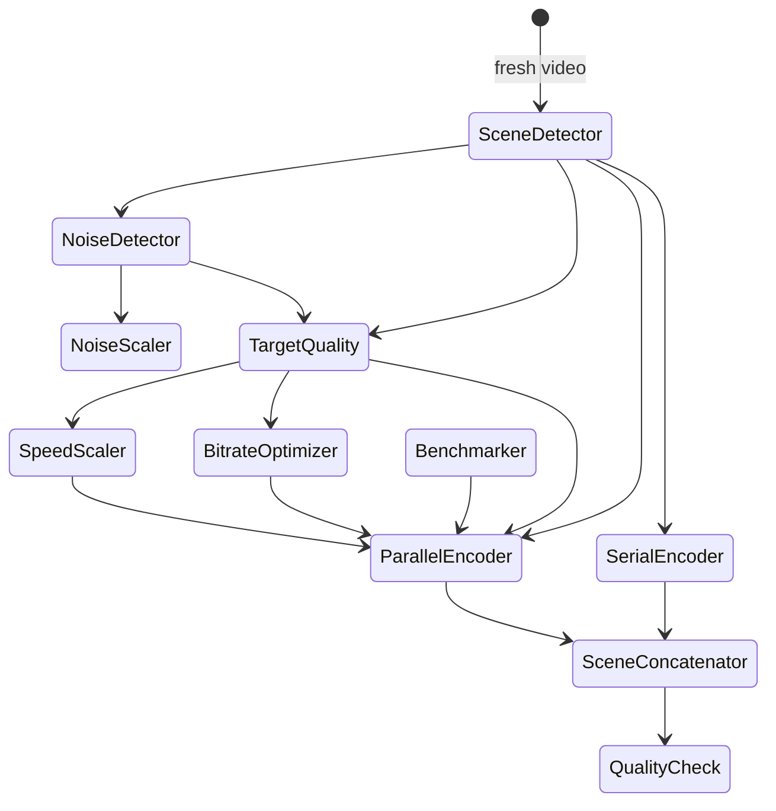
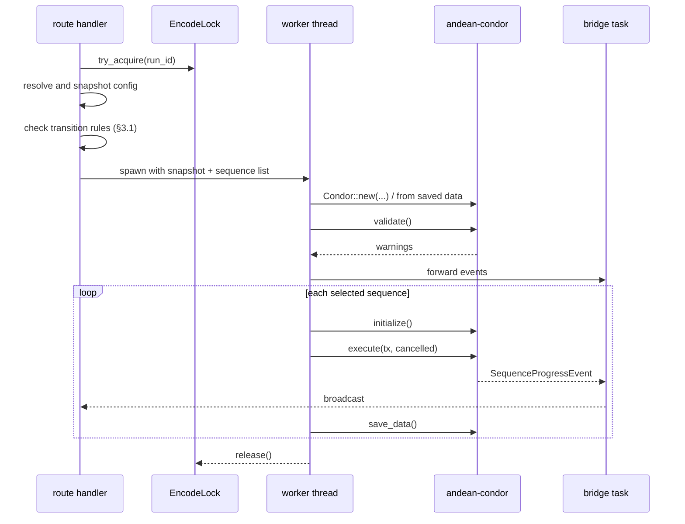

# Backend

Rust side of Av1ation Station. Three shared crates plus the Tauri desktop host, one
dependency on the engine, one HTTP surface. All of it lives under `rust/`.

## Contents

- [1. Crate responsibilities](#1-crate-responsibilities)
- [2. The engine dependency](#2-the-engine-dependency)
- [3. Driving sequences](#3-driving-sequences)
- [4. Service state](#4-service-state)
- [5. HTTP surface](#5-http-surface)
- [6. Persistence](#6-persistence)
- [7. Logging and anonymisation](#7-logging-and-anonymisation)
- [8. Errors](#8-errors)
- [9. Preflight](#9-preflight)
- [10. Concurrency invariants](#10-concurrency-invariants)

## 1. Crate responsibilities

### `rust/crates/engine` — the integration boundary

Owns everything that touches `andean-condor`. No `axum`, no `tauri`, no serialization
concerns beyond what the engine's own `schemars` derives already provide.

The crate's module map and ownership rules are in [engine.md](engine.md); the sections below specify the run contract and event semantics.

```rust
pub struct EncodeRequest {
    pub run_id: String,
    pub project_id: String,
    pub video_id: String,
    pub input: serde_json::Value,          // engine `Input` JSON
    pub video_path: String,                // what a script input is told to open
    pub output: serde_json::Value,         // engine `Output` JSON
    pub encoder: serde_json::Value,        // engine `Encoder` JSON
    pub sequence_config: serde_json::Value,// includes Benchmarker and Speed Scaler
    pub condor: Option<serde_json::Value>, // the persisted checkpoint, when one exists
    pub sequences: Vec<String>,            // exact sequence ids to execute, in order
    /// Called synchronously for every engine checkpoint, before the sequence continues.
    pub checkpoint: Arc<dyn Fn(serde_json::Value) -> Result<(), String> + Send + Sync>,
}

pub struct EncodeHandle {
    pub run_id: String,
    pub cancel: Arc<AtomicBool>,
    pub events: mpsc::Receiver<EncodeEvent>,
}

pub trait EncodeRunner: Send + Sync {
    fn start(&self, req: EncodeRequest) -> Result<EncodeHandle, EngineError>;
}
```

`EncodeEvent` is our own type, not `SequenceProgressEvent`. Converting at the boundary
means an upstream event-shape change breaks one adapter instead of the whole application,
and it lets us add correlation ids, timestamps, and a monotonic sequence number that the
engine does not provide.

Progress is one monotonic percentage per step. A stage's `Completed` marker only ends that
stage, a `new-scene` marker only records a boundary, and a scene's `size` pair only records
the bytes it wrote; none of them moves the bar, and only the sequence's own terminal event
reaches 100. Without that rule an initialization stage reports 100 and processing then resets
the bar to its real position, and Parallel Encoder latched at 100 after its first finished
scene, for the rest of the run.

Target Quality is the sequence whose bar restarts. It runs in passes, each pass encoding and
then comparing, and each step reports its own 0-100, so the bar fills twice per pass. Its
pass count cannot be a total: the engine sends the configured maximum, and the sequence stops
as soon as every scene meets its target, which happens after one pass as readily as after the
maximum. The event therefore carries that ceiling as `max_passes`, and a pass counter is not
a percentage — `(pass - 1) / pass`, which the engine sends before a pass, said two thirds of a
three-pass run and then fell to 0 when the encode began. The stage snapshot restarts at a new
`phase` or `pass` and stays monotonic inside one step. The sequence saves a checkpoint at the
end of each pass, so a finished pass is durable while the next one runs; the first event of a
new pass is when the shell refreshes the scene table, which is what makes the pass charts
gain a pass as it finishes instead of at the end of the run.

Parallel Encoder's own ticks count frames, not scenes, so the runner counts the scenes its
workers finish and attaches `scenes_processed`/`scenes_total` to every tick, seeded from the
scenes the engine already recorded bytes for. A resumed run still reports the video's
whole position: the frames of the scenes the earlier runs wrote are seeded into the bar, so
its first tick reads where the video actually stands rather than describing the remainder.
Quality Check seeds its bar the same way: scenes whose scores its previous run wrote are
counted before the first pending frame is compared. Its live counters are the video's
sampled frames and scored scenes; the ETA divides only the samples this run still has to
score.

A Parallel Encoder tick also names the scene one worker holds: `scene_index`,
`scene_progress`, and the scene's own `scene_frames_processed`/`scene_frames_total`. Those
frame counters are local to the scene, unlike the tick's aggregate `frames_processed`,
which counts the whole encode; only the local pair can measure that worker's rate and
finish estimate. A worker names itself after its scene because the engine sends no worker
id, so the scene's final status — a `Completed` child carrying the scene id and no
percentage — is what tells the UI that worker has moved on.

A finished chunk is the other half of that story. Parallel Encoder checkpoints a scene once
its chunk is written, with the size and the wall clock between its two timestamps, so the
checkpoint that recorded them emits `scene_bytes` and `scene_encode_ms` beside
`scene_index`. The client patches the cached row's `chunk_bytes`, `encoded`, and
`encode_ms` from it, which is what makes the rail mark the scene and the Encoding chart
plot its throughput while the other workers still run. A tick describes work in flight and
a table read is the only other source, so without this both kept the previous run's picture
until the sequence ended. The runner remembers the pair each scene already recorded,
including the chunks a resumed run starts with, so a chunk is announced once and a later
checkpoint never replays the table.

Noise Detector samples one frame per scene and reports that scene's value as a
`SceneQuality` child. Completion values cannot carry it: the value is evidence about the
video, not a fraction of the work, and the bar is the sequence's scene tally. It crosses
the boundary as `scene_noise` beside `scene_index`, only for this sequence. Quality Check
reports a `FrameScore` for every sampled frame while it compares; the runner accumulates
those scores against the scene's expected sampled frames and, once the scene is complete,
publishes their mean as `scene_quality`. Native and VMAF scoring paths never send a
`SceneQuality` child, so this accumulation is what makes their score chart move during the
run. The client patches the cached row's `quality_score` from that event. Target Quality's
`SceneQuality` belongs to a probe pass rather than to the video, so it crosses as neither
value. The client patches the cached scene table from these events, so the measured-data
charts and their statistics fill in scene by scene instead of appearing whole when the
terminal event lands.

The live event alone is not enough for a reader that arrives late. Both sequences write
their scene data only when they checkpoint: Noise Detector at the end of its run, Quality
Check after every scene has been scored. The supervisor keeps Noise Detector's values and
the scene-table read overlays them on the derived rows. The shell keeps both tallies from
the event stream, because a table read can still overtake the supervisor's copy, and applies
them to whichever read comes next. A page opened five seconds into a run shows all five
seconds, not only what arrived after it loaded. This is live execution state, like the
singleton and the stage snapshot: it is not persisted, and the terminal event discards it
because the checkpoint then holds the same values.

The trait exists so tests can substitute a fake runner that emits scripted event
sequences without VapourSynth, FFmpeg, or a real encode.

### `rust/crates/contracts` — the type surface

All types that cross the boundary live here and derive `schemars::JsonSchema` and
`serde::{Serialize, Deserialize}`. It also contains a `bin/emit-schema` target that
writes `schema/` to disk for the TypeScript generator.

Keeping this separate from `service` means the schema can be emitted in CI in seconds
without building the Tauri shell or the encoder.

### `rust/crates/service` — transport and orchestration

The `axum` router, application state, the encode singleton, persistence, SSE fan-out,
and error mapping. Depends on `engine` and `contracts`. Never depends on `tauri`.

This crate is also the **headless test target**: the `av1ation-service --port <port>`
binary exposes the same router as the desktop build. The checked-in Playwright smoke and
fake-engine journeys drive that real HTTP surface without a GUI, including LAN pairing,
locked-scope writes, and the process-wide `409`. Nine of the ten error-path rows are
automated; the native second-instance row was recorded as a packaged Windows release check
on 2026-11-12 (see [testing.md](testing.md#39-error-path-matrix)).

## 2. The engine dependency

`andean-condor` is a workspace member of the Av1an repository, not a published crate,
and it has **three path-sibling dependencies**:

```toml
# upstream andean-condor/Cargo.toml (abridged)
av-metrics-vmaf     = { path = "../av-metrics-vmaf" }
av-metrics-vship    = { path = "../av-metrics-vship" }
av-metrics-fmetrics = { path = "../av-metrics-fmetrics" }
```

Cargo resolves those path siblings from the same git source, so one dependency is enough:

```toml
# rust/Cargo.toml (workspace root)
[workspace.dependencies]
andean-condor = { git = "https://github.com/rust-av/Av1an", rev = "7e37c21dffd13fbc7825d60586c69104e95e71a4" }
```

`rust/crates/engine/build.rs` and the contract generator reject a path dependency or any other
repository URL, so generated metadata cannot silently describe a local checkout.

Do **not** add `[patch]` entries for the metric crates. Cargo rejects a patch that points
at the same source ("patches must point to different sources"), and the path siblings
already resolve from the repository. This was verified in the 1.2 dependency spike.

The engine's decoder dependencies are now released crates, not branch references:
`av-decoders 0.12.0` and `av-scenechange 0.25.0` resolve from crates.io, and `rust/Cargo.lock`
pins those versions. Earlier engine revisions took both from moving branches, which made a
regenerated lockfile capable of breaking the build; that hazard is gone. When bumping the
engine `rev`, regenerate the lockfile and review whether either crate's major or minor
version changed before committing. Build with `--locked` so the resolved graph is exact.

`[patch]` remains valid when the replacement is a **different** source, such as a local
vendored path. That is the fallback if a released decoder version cannot be used.

**If this becomes unstable, the fallback is vendoring.** Add a `vendor/av1an` subtree
at the pinned revision with `[patch]` pointing at local paths, and record it as an ADR.
Do not fork unless upstream refuses a needed change.

On Windows, run Cargo from a Developer Command Prompt, or call `vcvars64.bat` first. Git
Bash's `/usr/bin/link.exe` shadows the MSVC linker and build scripts fail with a link
error that names the Visual Studio installer. A local `rustc-wrapper = "kache"` is fine;
keep it in the gitignored project-local `.cargo/config.toml`, because kache is an optional
cache and a checkout without it must build with plain rustc. `KACHE_CACHE_DIR` may point at a
shared local store, such as `P:/kache-store`, so this checkout and the `andean-condor` checkout
reuse one cache instead of duplicating it. Do not pass
`-C link-arg=-fuse-ld=lld` to the MSVC target, where `link.exe` ignores it and emits
`LNK4044`. Use `-C linker=lld-link` if lld is intended.

Other dependency notes:

| Crate         | Note                                                                                                                                                                      |
| ------------- | ------------------------------------------------------------------------------------------------------------------------------------------------------------------------- |
| `ort`         | pinned by upstream to `2.0.0-rc.12`; DirectML on Windows. GPU features are opt-in Cargo features so a CPU-only build is always possible.                                  |
| `vapoursynth` | requires VapourSynth at runtime and a matching arch; preflight-check it.                                                                                                  |
| `ffms2-sys`   | needs the ffms2 native library; guard with a preflight check.                                                                                                             |
| Lints         | upstream enables a very strict clippy set (`unwrap_used`, `cfg_not_test`, …). Those lints apply to the dependency only; our crates choose their own, slightly looser set. |

## 3. Driving sequences

### 3.0 The sequence catalogue

`andean-condor` ships eleven sequences. The engine does **not** order them — the caller
supplies a `Vec<Box<dyn Sequence>>` and the engine runs them in that order. Ordering is
therefore our responsibility, and it is the heart of the "run one sequence" feature.

| Sequence               | Requires                                                                                                                                                 | Produces                                                                                                                                                                                                                                                                    |
| ---------------------- | -------------------------------------------------------------------------------------------------------------------------------------------------------- | --------------------------------------------------------------------------------------------------------------------------------------------------------------------------------------------------------------------------------------------------------------------------- |
| **Scene Detector**     | a valid `Input`                                                                                                                                          | `condor.scenes`; optional per-scene cut scores                                                                                                                                                                                                                              |
| **Noise Detector**     | scenes non-empty; VapourSynth installed. A native `Input::Video` is accepted: the sequence builds its own VapourSynth graph from the FFMS2 decode.       | `sequence_data.noise_detection`                                                                                                                                                                                                                                             |
| **Noise Scaler**       | scenes non-empty; encoder is AOM/RAV1E/SVT-AV1. A scene without noise detection is left untouched, so Noise Detector need not have finished every scene. | `sequence_data.noise_scaling`; sets `photon_noise.iso`. Reset clears the setting **and** the grain-table option it produced, because photon noise is the only writer of that file: a document holding the option after the setting is gone names a path nothing will create |
| **Target Quality**     | scenes non-empty; encoders validate; `scenes_directory`                                                                                                  | `sequence_data.target_quality` (passes with quantizer/scores/bitrate); probe files                                                                                                                                                                                          |
| **Bitrate Optimizer**  | scenes non-empty; a Target Quality pass exists; `bitrate_sigma_threshold` set                                                                            | rewrites per-scene quantizers; no new data field, so it is an action rather than a state                                                                                                                                                                                    |
| **Parallel Encoder**   | scenes non-empty; encoders validate; `scenes_directory`, `workers > 0`; `ffmpeg` if any scene has an `ffmpeg_filter`                                     | `sequence_data.parallel_encoder`; encoded scene files                                                                                                                                                                                                                       |
| **Serial Encoder**     | scenes non-empty; encoders validate; `scenes_directory`                                                                                                  | encoded scene files; no data field                                                                                                                                                                                                                                          |
| **Scene Concatenator** | every scene has an encoded chunk; `mkvmerge` or `ffmpeg`                                                                                                 | the output file                                                                                                                                                                                                                                                             |
| **Quality Check**      | scenes non-empty; output file exists                                                                                                                     | `sequence_data.quality_check`                                                                                                                                                                                                                                               |
| **Benchmarker**        | scenes non-empty; encoders validate; `workers` **not** already set                                                                                       | sets `parallel_encoder.workers`                                                                                                                                                                                                                                             |
| **Speed Scaler**       | scenes non-empty; `speed_quantizers` with ≥2 pairs                                                                                                       | rewrites per-scene speed; no data field, so it is an action rather than a state                                                                                                                                                                                             |

**Zone Encoder** is not a standalone sequence — Target Quality uses it internally when the
scene set is eligible.

### 3.1 Valid transitions

Only **Scene Detector** can run on a fresh video. Everything else needs scenes, and several
need specific prior data. The transition table is the specification:



Rules, derived from the engine's own `validate`/`initialize`/`execute` checks:

1. **Scene Detector is the only entry point.** No other sequence can run without scenes.
2. **Noise Scaler requires only scenes.** It scales the scenes that have a Noise Detector
   measurement and leaves the rest untouched, so a partial detection does not lock it.
3. **Speed Scaler requires scenes and at least two speed/quantizer pairs.** It is an action:
   it rewrites each scene's encoder speed and has no completion field of its own.
4. **Bitrate Optimizer requires Target Quality** to have produced at least one pass, and a
   configured `bitrate_sigma_threshold`. It is an action too: it rewrites high-bitrate scene
   quantizers without adding a data field.
5. **Scene Concatenator requires encoded scene files on disk** — from Parallel _or_ Serial
   Encoder. This is the one prerequisite the filesystem answers, not the condor object.
6. **Quality Check requires the output file to exist**, so it runs after Concatenator.
7. **Benchmarker requires `workers` to be unset**, and must run before Parallel Encoder.
8. **Parallel and Serial Encoder are alternatives**, not a sequence — pick one per video.

The two actions are never reported as `Complete` and never enter `next`; a full run applies
both in front of Parallel Encoder when they are enabled, and the UI starts either one alone
from its Target Quality row.

One of these is a _warning_ in the engine rather than an error, and we promote it to a
blocking error because running it anyway produces a confusing failure later:

- Quality Check with no output file (engine warns) → we block.

Scene Concatenator is already strict: the engine errors when any requested chunk is
missing, so partial concatenation is never offered. The row stays visible and names how
many scenes are missing. Resetting the concatenator removes its `Scene Concatenator`
scratch directory as well as the finished output, so a failed mux cannot leave a stale file
behind.

### 3.2 Running one sequence vs. running all

| Endpoint        | Behaviour                                                                     |
| --------------- | ----------------------------------------------------------------------------- |
| `POST …/run`    | executes exactly the named sequence, after checking §3.1                      |
| `POST …/encode` | runs the full chain in dependency order, like the `condor` CLI's root command |

`encode` resolves the chain at request time from the video's current state, skipping
stateful sequences whose completion rule is already satisfied. So a video that already has
scenes and target quality starts at Parallel Encoder, with the enabled Speed Scaler and
Bitrate Optimizer actions applied immediately before it. This is the same "newest evidence
wins" rule as derived state; there is no separate stale check, because the engine stores no
config hash to compare.

Both endpoints share the lock, the cancellation path, the event stream, and the periodic
`save_data` described in §3.4.

### 3.3 Live data during a run

A sequence calls `condor.save()` many times while it executes, not once when it finishes.
Every one of those calls is a durable checkpoint and the service must treat it as such.

The engine gives the service the hook: `Condor` carries a `save_callback` supplied at
construction, and `save()` invokes it with the current `CondorModel` before returning. The
service's callback is the persistence sink, so each call serialises and stores the model
before the sequence continues. Writes are atomic — write to a sibling temp path, `fsync`,
rename — so a power loss during a save leaves either the previous checkpoint or the new
one, never a truncated file. The callback is synchronous and must stay cheap; it enqueues
the write and returns.

Why each call matters:

- **Cancellation mid-sequence keeps its work.** Scene Detector may detect 400 of 1,200
  scenes before the user cancels. Those 400 survive because they were checkpointed as they
  were found, not at completion.
- **Live charts are real, not estimated.** Each checkpoint is fanned out on the SSE stream,
  so a scene chart grows as scenes are detected and a target-quality plot gains points as
  scenes are scored. There is no second data path and no polling loop.
- **Crash recovery resumes from the last checkpoint.** The next run reads the checkpoint
  and the sequence's own `initialize()` decides what to redo. It resumes only a result
  whose provenance revision and context still match; otherwise it names the sequences to
  reset instead of reusing the old data.

Checkpoint data is **read-only in the UI**. It is the engine's record of what happened;
permitting edits would reintroduce the drift that derived state exists to prevent. User
intent — the configuration — is stored separately and is the only thing the user edits.

Checkpoints are coalesced, not queued: if two saves land within the write window, the
later one supersedes the earlier, and the fan-out still emits a notification per save so
subscribers observe monotonic progress. Coalescing bounds write amplification during a
fast sequence without losing the final state of any call.

### 3.4 The run loop



Rules:

1. **Snapshot, then start.** The worker receives owned data. It never reads project state
   from the shared store.
2. **One worker thread per run.** The `Condor` is created on that thread and dropped on
   that thread.
3. **`validate()` before `execute()`.** Warnings are surfaced to the user as a pre-flight
   panel; a validation error aborts before any work.
4. **Cooperative cancellation only.** Set the atomic and let the engine unwind; the
   terminal event decides whether the run counts as cancelled or failed.
5. **`save_data` after each sequence completes**, not only at the end. A crash then loses
   at most one sequence's work, and the UI can show partial results immediately.
6. **Persistence is a separate step** from the run's log and result, so a failed run still
   leaves evidence.

### 3.5 Progress fan-out

```
engine mpsc::Sender<SequenceProgressEvent>
      │
      ▼
 bridge task (tokio)  ──►  EncodeEvent { project_id, video_id, run_id, seq, at, kind, … }
      │
      ├──► tokio::sync::broadcast  ──►  GET /api/events (SSE)
      └──► ring buffer (last N)     ──►  GET /api/runs/:id/events?since=seq  (resume after reload)
```

The ring buffer plus monotonic `seq` is what lets a browser tab reload mid-encode and
recover without gaps. `Last-Event-ID` on a native SSE reconnect resolves to `seq`; a
fresh `EventSource`, which cannot send that header, passes the next sequence as `?since=`.
Both resume from the cursor rather than restarting.

Backpressure policy: the bridge never blocks the engine. If a subscriber is slow, the
broadcast channel lags and that subscriber receives a `lagged` marker and refetches the
ring buffer. Dropping progress is acceptable; blocking the encoder is not.

### 3.6 Derived state, computed server-side

The UI must not reimplement the state machine, because then it exists twice. The service
exposes `GET /api/projects/:p/videos/:v/state` which returns:

```rust
pub struct VideoState {
    pub video_id: String,
    pub scene_count: u32,
    pub sequences: Vec<SequenceState>,  // per-sequence, not just per-phase
    pub next: Vec<String>,              // every sequence currently runnable, not just one
    pub active: bool,
    pub run_id: Option<String>,
    pub failure: Option<VideoFailure>,  // latest failed run; sequence is None before its first sequence
    pub output_exists: bool,
    pub retained_bytes: u64,            // derived from the temp directory
    pub script_data: Vec<ScriptData>,   // what each script input will receive
}

pub struct SequenceState {
    pub id: String,                     // the id `POST …/run` accepts, e.g. `SceneDetector`
    pub name: String,
    pub status: SequenceRunStatus,      // never_run | incomplete | complete | active | failed | skipped
    pub runnable: bool,
    pub progress: Option<f64>,          // live while active, and cancelled detection's coverage
    pub detail: Option<String>,         // short evidence, e.g. `42/48 scenes encoded`
}
```

Two things this shape fixes relative to a simple phase list:

1. **State is per sequence, not per phase.** A video can have Scene Detector complete,
   Noise Detector complete, and Target Quality never run. A flat phase list cannot express
   that, and the user needs to see exactly which sequences are done and which are available.
2. **`next` is a list, not an option.** Because sequences can be run individually, several
   may be simultaneously valid — after Scene Detector, both Noise Detector and Target
   Quality are runnable. The UI offers all of them.

There is deliberately no `Stale` status. The engine does not stamp `sequence_data` with a
config hash, so staleness cannot be derived. Freshness is an advisory comparison of the
data's `created_on` with the section's last-saved time, displayed beside the state and never
used to change it ([data-model.md](data-model.md#41-sequences-not-phases)).

`retained_bytes` and each scene's chunk state come from listing the video's temp directory,
so they are correct even with no `Condor` instantiated and no run active. That is what lets
the concatenator report "3 of 40 scenes are not encoded" before the user asks it to run;
it is not offered until every scene has a chunk, because the engine refuses a partial
concatenation rather than publishing a shortened video.

The engine stamps resumable results with a provenance revision and the context that
produced them. A checkpoint from an older engine has no stamp and cannot be resumed: the
sequence refuses it at admission with the applicable reset path. The service neither
rewrites nor deletes the old result; the run error carries the engine's guidance.

The derivation is a pure function over three evidence sources — live run progress, condor
`sequence_data`, and the temp directory listing — with newest evidence winning. It is unit
tested against fixture `Condor` values including partially-complete ones. The algorithm is
specified in [data-model.md](data-model.md#4-derived-state). The latest run's failure is attached from the timeline after derivation; its `sequence`
names the failed attempt, or is `None` when the run failed before its first sequence. It is
the only reason a run that failed before its first sequence can explain itself, and it lets
the UI place a sequence failure in that sequence's card without reconstructing the owner
from a `Failed` status.

Why server-side: the same derivation feeds the queue's progress bars, the video timeline,
the per-sequence run buttons, and the "can this encode start?" preflight. Four consumers,
one implementation.

## 4. Service state

```rust
pub struct AppState {
    pub(crate) info: AppInfo,                  // versions and API metadata
    pub(crate) runs: RunSupervisor,            // singleton lock, progress bridge, release rule
    pub(crate) preflight: PreflightCache,      // one cached probe list, shared by health and refresh
    pub(crate) settings: Option<SettingsStore>,
    pub(crate) projects: Option<ProjectStore>, // JSON documents + index
    pub(crate) videos: Option<VideoStore>,     // per-video documents and scratch directories
    pub(crate) timeline: Option<TimelineStore>,
    pub(crate) logs: Option<LogStore>,
    pub(crate) lan: LanController,             // LAN token and paired sessions
    pub(crate) disk: DiskProbe,
    pub(crate) preview_builds: PreviewBuilds,  // in-flight proxy builds, shared per cache key
}
```

The settings file is `<app-data>/config.json`. The desktop host supplies Tauri's resolved
app-data directory; the headless binary takes `--data-dir` or `AV1ATION_DATA_DIR`. A host
that passes no directory still runs, with settings persistence disabled.

`AppState` is passed to the router with `with_state(state)` and extracted as
`axum::extract::State<AppState>`; it is cheap to clone because its stores and guards are
shared handles. Nothing in it is a global; the desktop host builds it and hands a clone to
the server task on startup.

Settings writes share one seam. `SettingsStore` owns the lock, load, apply, and atomic save,
and every settings writer uses it. `PATCH /api/settings` is a merge patch: an absent field
keeps its stored value, a present field replaces it, and `temp_dir: null` clears the override.
Presence survives deserialization, so an absent field is distinguishable from `null`; the
response is the complete settings document.

## 5. HTTP surface

All routes are versioned under `/api`. Naming is resource-oriented; verbs appear only
where an action is not a resource transition (start/cancel/run-sequence).

### 5.1 Inputs and scripts

`andean-condor` models a decoded input as a three-variant enum, and **the VapourSynth
script lives inside the input**, not beside it:

```rust
pub enum Input {
    Video { path, import_method: ImportMethod, filters: Vec<Ffms2Filter> },
    VapourSynth { path, import_method: VapourSynthImportMethod, cache_path, filters },
    VapourSynthScript { source: VapourSynthScriptSource, variables, index, filters,
                        stream_concurrently },
}

pub enum VapourSynthScriptSource { Path(PathBuf), Text(String) }
```

`Condor` carries exactly one `input`. Five sequences additionally carry **optional
per-sequence input overrides**, which fall back to the Condor input when `None`:

| Sequence                | Override fields                                       |
| ----------------------- | ----------------------------------------------------- |
| `SceneDetectorConfig`   | `input: Option<Input>`                                |
| `NoiseDetectorConfig`   | `input: Option<Input>`                                |
| `TargetQualityConfig`   | `input: Option<Input>`, `metric_input: Option<Input>` |
| `ParallelEncoderConfig` | `input: Option<Input>`                                |
| `QualityCheckConfig`    | `input: Option<Input>`                                |

The runner constructs **one sequence at a time**, immediately before that sequence runs, and
clears the previous one before opening the next input. This is deliberate: a per-sequence
input can be a second full decoder graph, and holding every configured override open for a
whole run wastes memory. It also means a request for Scene Detector never evaluates Parallel
Encoder's script, so an unrelated broken override cannot block a single-sequence run.

#### Script evaluation and injected data

A `VapourSynthScript` is evaluated when its input is opened, not when a frame is requested.
A graph built once at the start of a run therefore cannot see anything a later sequence
produced. The runner opens the script before every sequence with the engine's current
`condor.scenes`, and replaces `condor.input`; the `Condor` itself, its checkpoints, and its
scenes are unchanged. A per-sequence script override receives the same current table when
that sequence is built, immediately before it runs.

Target Quality's probe input and Parallel Encoder's encode input are prepared once, when
their sequence opens, and kept for the rest of the run. Re-injecting the completed scene
table into Target Quality's probe input or Parallel Encoder's encode input would change the
document identity that the later sequence admits, so a fresh run freezes those documents after their owning sequence starts;
a resumed run without that sequence uses the stored input unchanged. This freezes only the
model's injected values: the generated `condor_data` module still reflects the scene table
while the owning sequence is running.

A script must tolerate an empty scene table: Scene Detector is the first sequence, so its
graph is evaluated before any scene exists. It must also return the same frame count and
format that Scene Detector measured, because detection ran on the unmodified graph.

A script's own imports are re-read when their file changes. VSScript keeps one CPython
runtime for the process, so `sys.modules` outlives an open; the engine drops the script's
local modules whose file stamp changed before every probe, check, preview, and sequence
open, while installed packages and the generated `condor_data` stay loaded. Editing a helper
such as `toolkit.py` therefore reaches the next open without restarting the app.

The service supplies these VSScript variables. VapourSynth exposes them to Python as
`bytes`, so a text value is read with `.decode()`; JSON values are accepted by
`json.loads` directly.

| Variable             | Value                                                                                                                                                                                             |
| -------------------- | ------------------------------------------------------------------------------------------------------------------------------------------------------------------------------------------------- |
| `condor_scenes`      | JSON array of `{index, start, end, data}` for every scene. `data` is the engine's `sequence_data`: `noise_detection`, `noise_scaling`, `target_quality`, `parallel_encoder`, and `quality_check`. |
| `condor_scene_count` | Number of scenes, as a decimal string.                                                                                                                                                            |
| `condor_temp_dir`    | The per-video scratch directory for chunks and sidecars.                                                                                                                                          |
| `condor_run_id`      | The run's correlation id.                                                                                                                                                                         |
| `condor_sequence`    | The sequence about to run, for example `ParallelEncoder`. Empty before the first sequence.                                                                                                        |

These keys are reserved: a user value with the same name is replaced. The table is derived
from `condor.scenes` at open time and is never persisted by the service. A script that reads Noise Detector's `data.noise_detection` therefore sees `null`
while Scene Detector and Noise Detector themselves are opening, and the result while Target
Quality, Parallel Encoder, or Quality Check is opening. Scripts that ignore these variables
are unaffected.

The generated `condor_data` module reads its document from the directory named by
`condor_temp_dir` in the evaluating script's frame, not from its own location. VSScript
keeps one Python runtime for the process, so `sys.modules` can hand a video the module
another video imported first; resolving the file per open keeps each script's scene table
and detector results its own. A call made after evaluation returns falls back to the JSON
beside the module.

The key table and its current values are served by
`GET /api/projects/:id/videos/:vid/state` as `script_data`: one entry per script input, with
the configuration path it occupies, the sequence whose open will see the values, and one row
per key carrying its description, source, Python format, and value. The value comes from the
same saved scenes and resolved configuration the next run will use, not from a second
implementation. `condor_scenes` is bounded to a 4 KiB preview because the state response is
not a data export; `bytes` still reports the full length and `truncated` marks the preview.
The UI therefore documents and previews what a script receives without evaluating it.

#### Plugin namespaces are checked before a run

VSScript reports a missing plugin only when the script is opened, and its error names the
namespace (`No attribute with the name hqdn3d exists`) without saying that it is a plugin.
`POST …/encode` and `POST …/run` therefore read the script inputs the selected sequence list
will open — the General input plus each override the runner would construct — and check every
literal `core.<namespace>` and `core.<namespace>.<function>` against the loaded core. A
missing plugin returns `422` naming the plugin and the script's section before the singleton
is reserved; an override for a sequence outside the request is not read, matching lazy
sequence construction. The check is static by design: dynamic access through `getattr`,
`exec`, or a script that calls `LoadPlugin` is left to the open, whose `No attribute` error
is translated to the same plugin sentence by
[`script_plugins::explain_open_error`](../rust/crates/engine/src/script/plugins.rs).

`POST …/validate` runs the same scan for the video's derived chain and returns the misses as
`plugin_problems`, one row per namespace, section, and missing function. The page that owns
the input renders the row: General shows `General input`, and each Configuration page filters
the list to the input contexts it owns, so an Encoding script is reported on Encoding rather
than on every tab. `GET /api/projects/:id/scripts` and `GET /api/settings/templates/:template_id/scripts` run
the same scan over a project's General input and sequence overrides, or over the template and
its General defaults, and return `ScriptPluginReport` before any video is queued. The reports
are advisory: they do not block a sequence the user did not ask to run, and a host without
VapourSynth reports no plugin problems because there is no loaded core to compare against.
An unreadable script file is reported as `error`, not as a missing namespace.

Consequences for the API:

- **There is no dedicated `/script` endpoint.** A script is a field of an input, so it is
  read and written through the config endpoints. A project config returns `GeneralDefaults`
  (the pathless projection) including `VapourSynthScript { source: Text(..) | Path(..) }`;
  a video config returns the materialised `Input` with its source path.
- **`script.vpy` as a separate file is not required.** The script may be stored as
  `VapourSynthScriptSource::Text` inside the input. A `Path` variant is supported for users
  who prefer a real file, and the UI offers both, but the input is the source of truth
  either way.
- **Per-sequence inputs are first-class.** The config surface must expose the override
  slots above, each defaulting to "inherit from project input", because a VapourSynth-script
  input for the encoder and a native FFMS2 input for noise detection is a legitimate and
  useful configuration. Target quality has two slots: the input it encodes and the metric
  input it scores against.

### 5.2 Routes

Preview bytes are served by `GET …/media`; its JSON siblings are listed with the other
video routes. The stream ids are `original`, `decoded`, and `encode` (the player labels
`Original`, `Decoded`, `Encoded`). `source=original` is the queued source file.
`source=decoded&frame=N&frames=W` opens the Parallel Encoder input (falling back to General)
and streams W frames from N as lossless H.264 in fragmented MP4, preserving the input's own
bit depth. A window is the unit because it bounds the work and the cache file; the player
snaps N to a fixed grid, so a seek finds a window it already has. `source=encode&scene=S`
resolves one detected scene and
reproduces its whole chunk from the scene's own first frame; `frame=N` resolves the scene by
containment when the caller does not already know its index. `encode_from=original` chooses
the General input instead of the Parallel Encoder input. Both proxies are video only: a
browser appends them to a `SourceBuffer`, which rejects a segment whose index names a track
it does not hold, so the player takes sound from the source's own element. Both are cached
under `<app-data>/cache/preview`, keyed by the engine's proxy recipe, the input, the
encoder, the frame range, and the source's size and modification time, and both are
`.mp4`. The recipe names the codec, lossless mode, preset, GOP, bit-depth rule, and mux
flags, so a pipeline change invalidates the cache without a separate version number.
`GET …/frame?source=decoded&frame=N` renders one lossless PNG (16-bit for a 10-bit input)
for the scrubber; it is never cached.

Lossless H.264 is entropy coding, not a quality setting: a decoded frame is bit-identical to
the Y4M frame the encoder received. The software path encodes the two-second 10-bit 1080p
23.976 window at about 35 fps, ahead of the 24 fps the player needs. The service opens the
input's decode graph once per source identity on a dedicated thread and writes consecutive
windows through it; only the lossless encode and mux remain per window. A native `Video`
source may open a second graph while the first is busy, so an append does not wait for a
warm; every other input keeps one, because evaluating it twice allocates a second copy of
whatever it builds. The appended lead and the cache runway are sized from the measured bitrate and build time
against the `SourceBuffer` budget. Paused, the player fills at most six seconds of that lead
and warms up to 1.5 GiB of cache, so a build's mux overlaps the picture instead of landing
at a seam. Playing, it starts no warms: the script input's one decode graph belongs to the
append ahead of the playhead, and a warm would queue that append behind a build. Starting
playback aborts a paused warm; the next append reads a finished cache file or queues its
build.
NVENC is not used:
H.264 NVENC has no lossless profile, so it cannot produce the Decoded reference. The raw
alternative moves about 142 MB/s at 1080p 10-bit and is a local-connection path rather than
a LAN default.

The encoded path does not write an elementary stream to disk. The scene's encoder document
comes from the checkpoint, the engine builds its final-pass argument list, and the single
output-path argument is replaced with stdout. FFmpeg reads that bitstream on stdin and
copies it into fragmented MP4 (`-c:v copy`), so the picture is the encoder's own output
rather than a second-generation encode. Frames are fed from the scene's first frame because
rate control and keyframe placement depend on them; the player waits until the requested
frame is seekable before leaving its loading stage. The finished concatenated file is not a
substitute for a scene chunk. Consecutive scenes reuse one opened input: the engine keeps a
session per source identity and encodes each scene through it while it is idle, so only the
first scene of a review pays for script materialisation and graph construction (measured at
1.75 s of a 19.1 s warm build on a 261-scene 1080p project). A scene that arrives while that
graph is writing opens a transient one, so a warm and the playhead's own chunk still
overlap. An encoder refusal leaves the graph open; a frame the graph could not produce ends
the session.

The container is the one parameter the preview may pin. An SVT-AV1 build that exposes
`--webm` may default to Matroska even though a run reads IVF chunks back; the scene preview
then passes `--webm 0`. Mainline builds without that switch already write IVF, so the
preview leaves their output format alone. Every rate-control, filter, and colour option
stays exactly as the run configured it. A run's `--keyint 0` means one keyframe per chunk,
which would hold all fragments to the end, so the muxer also caps fragment length at half a
second and the
player can start while the scene is still encoding. A 10-bit-only encoder given 8-bit
decoded frames exits with a diagnostic; its stderr is read while frames are still being
fed, so the route fails with that line in about a second instead of consuming the scene
before reporting the build failure.

The route does not wait for a whole proxy. A request that opens the proxy is answered with
the growing part file as a chunked body, so the element decodes the first fragment while
the rest is still being produced. A request whose range starts past zero cannot be answered
from a growing file, so it waits for the finished cache file and then uses ordinary range
delivery. A second request for the same cache key follows the running build instead of
starting a duplicate decode, and the last viewer leaving stops it and removes the partial
file. A source that cannot be prepared is `422` with the reason before the body starts; a
failure after bytes have been sent closes the body. There is no `/preview` session endpoint; the media route prepares a source per request.
Its cache lifecycle is specified in [preview.md](preview.md).

<!-- routes:start -->

| Method   | Path                                                                     | Purpose                                                                                                                                                                                                                                                                                                                                            |
| -------- | ------------------------------------------------------------------------ | -------------------------------------------------------------------------------------------------------------------------------------------------------------------------------------------------------------------------------------------------------------------------------------------------------------------------------------------------- |
| `GET`    | `/api/health`                                                            | app and engine package versions, pinned engine revision, API version, and the cached preflight report                                                                                                                                                                                                                                              |
| `GET`    | `/api/toolchain`                                                         | the bundled components recorded for this target's reviewed lock: versions, licences, source links, and artifact hashes                                                                                                                                                                                                                             |
| `GET`    | `/api/update`                                                            | newest published release from the forge; a repository with none answers with no `latest`                                                                                                                                                                                                                                                           |
| `GET`    | `/api/diagnostics/bundle`                                                | redacted support bundle for the chosen `projects` and log tail; built on request, written nowhere                                                                                                                                                                                                                                                  |
| `POST`   | `/api/preflight/refresh`                                                 | discard the cached report, probe again, and return the new report                                                                                                                                                                                                                                                                                  |
| `POST`   | `/api/preflight/probe`                                                   | probe one user-provided executable against a family and return its candidate check without saving it                                                                                                                                                                                                                                               |
| `POST`   | `/api/preflight/custom`                                                  | probe one user-provided executable and return its check (preflight.md §Custom executables)                                                                                                                                                                                                                                                         |
| `DELETE` | `/api/preflight/custom/:id`                                              | drop a user-provided executable and re-probe                                                                                                                                                                                                                                                                                                       |
| `POST`   | `/api/script/materialise`                                                | render a script as a standalone `.vpy` with the generated module and injected values                                                                                                                                                                                                                                                               |
| `GET`    | `/api/settings`                                                          | read the app settings document                                                                                                                                                                                                                                                                                                                     |
| `PATCH`  | `/api/settings`                                                          | replace only the settings fields the request presents                                                                                                                                                                                                                                                                                              |
| `PUT`    | `/api/settings/scene-model`                                              | the machine-level TransNetV2 ONNX path, or `null`                                                                                                                                                                                                                                                                                                  |
| `PUT`    | `/api/settings/python-interpreter`                                       | the interpreter the script editor's language server analyses, or `null`                                                                                                                                                                                                                                                                            |
| `PUT`    | `/api/settings/tool-source`                                              | one capability's provider, `bundled`, `system`, or `null` for automatic; a Bundled choice is refused when this install cannot resolve it                                                                                                                                                                                                           |
| `GET`    | `/api/settings/templates`                                                | list the project templates                                                                                                                                                                                                                                                                                                                         |
| `POST`   | `/api/settings/templates`                                                | create a project template seeded from the engine defaults                                                                                                                                                                                                                                                                                          |
| `PUT`    | `/api/settings/templates/default`                                        | set or clear the template a new project copies                                                                                                                                                                                                                                                                                                     |
| `POST`   | `/api/settings/templates/import`                                         | import one portable template archive under a unique name                                                                                                                                                                                                                                                                                           |
| `PUT`    | `/api/settings/templates/:template_id`                                   | replace a template's name, configuration, and General defaults                                                                                                                                                                                                                                                                                     |
| `DELETE` | `/api/settings/templates/:template_id`                                   | delete a project template                                                                                                                                                                                                                                                                                                                          |
| `GET`    | `/api/settings/templates/:template_id/export`                            | export one template with host paths removed and report them                                                                                                                                                                                                                                                                                        |
| `GET`    | `/api/settings/templates/:template_id/defaults`                          | read a template's effective configuration                                                                                                                                                                                                                                                                                                          |
| `PUT`    | `/api/settings/templates/:template_id/defaults`                          | replace a template's configuration                                                                                                                                                                                                                                                                                                                 |
| `POST`   | `/api/settings/templates/:template_id/defaults/reset`                    | reset a template to the engine defaults                                                                                                                                                                                                                                                                                                            |
| `POST`   | `/api/settings/templates/:template_id/defaults/reset/:section`           | reset one template section                                                                                                                                                                                                                                                                                                                         |
| `GET`    | `/api/settings/templates/:template_id/general`                           | read a template's General defaults                                                                                                                                                                                                                                                                                                                 |
| `PUT`    | `/api/settings/templates/:template_id/general`                           | replace a template's General defaults                                                                                                                                                                                                                                                                                                              |
| `GET`    | `/api/settings/templates/:template_id/scripts`                           | VapourSynth plugin problems in a template's inputs                                                                                                                                                                                                                                                                                                 |
| `GET`    | `/api/projects`                                                          | project summaries (index)                                                                                                                                                                                                                                                                                                                          |
| `POST`   | `/api/projects`                                                          | create from `name` (and optional `description`); copies the default project template, or the engine defaults when none is marked                                                                                                                                                                                                                   |
| `POST`   | `/api/projects/import`                                                   | import that archive as a new project; never reuses ids                                                                                                                                                                                                                                                                                             |
| `GET`    | `/api/projects/:project_id`                                              | project detail                                                                                                                                                                                                                                                                                                                                     |
| `PATCH`  | `/api/projects/:project_id`                                              | rename, description                                                                                                                                                                                                                                                                                                                                |
| `DELETE` | `/api/projects/:project_id`                                              | delete (guarded if a run is active)                                                                                                                                                                                                                                                                                                                |
| `GET`    | `/api/projects/:project_id/config`                                       | effective config + provenance, **including the input and its script**                                                                                                                                                                                                                                                                              |
| `PUT`    | `/api/projects/:project_id/config`                                       | replace project config                                                                                                                                                                                                                                                                                                                             |
| `PUT`    | `/api/projects/:project_id/general`                                      | replace the project's `GeneralDefaults`                                                                                                                                                                                                                                                                                                            |
| `POST`   | `/api/projects/:project_id/template`                                     | apply a saved template to a project                                                                                                                                                                                                                                                                                                                |
| `PUT`    | `/api/projects/:project_id/defaults`                                     | restore a project configuration and General snapshot                                                                                                                                                                                                                                                                                               |
| `GET`    | `/api/projects/:project_id/scripts`                                      | VapourSynth plugin problems in the project's General input and enabled sequence overrides                                                                                                                                                                                                                                                          |
| `GET`    | `/api/projects/:project_id/export`                                       | portable JSON archive: configuration, queue, overrides, checkpoints                                                                                                                                                                                                                                                                                |
| `GET`    | `/api/projects/:project_id/videos`                                       | queue                                                                                                                                                                                                                                                                                                                                              |
| `POST`   | `/api/projects/:project_id/videos`                                       | add one video from an input path                                                                                                                                                                                                                                                                                                                   |
| `PATCH`  | `/api/projects/:project_id/videos/order`                                 | replace the queue order (`video_ids`)                                                                                                                                                                                                                                                                                                              |
| `POST`   | `/api/projects/:project_id/videos/remove`                                | remove several videos atomically                                                                                                                                                                                                                                                                                                                   |
| `GET`    | `/api/projects/:project_id/videos/:video_id`                             | video detail: paths, output existence, retained bytes                                                                                                                                                                                                                                                                                              |
| `DELETE` | `/api/projects/:project_id/videos/:video_id`                             | remove one video                                                                                                                                                                                                                                                                                                                                   |
| `DELETE` | `/api/projects/:project_id/videos/:video_id/chunks`                      | delete retained chunks; `423` while that video encodes                                                                                                                                                                                                                                                                                             |
| `DELETE` | `/api/projects/:project_id/videos/:video_id/runs/:run_id`                | forget one run's timeline entries and log directory                                                                                                                                                                                                                                                                                                |
| `GET`    | `/api/projects/:project_id/videos/:video_id/config`                      | effective config + provenance                                                                                                                                                                                                                                                                                                                      |
| `GET`    | `/api/projects/:project_id/videos/:video_id/general`                     | the video's engine `Input` and `Output` documents and its queued source                                                                                                                                                                                                                                                                            |
| `PUT`    | `/api/projects/:project_id/videos/:video_id/general`                     | replace both documents after validating paths and engine shapes                                                                                                                                                                                                                                                                                    |
| `GET`    | `/api/projects/:project_id/videos/:video_id/storage`                     | its scratch directory, the inherited root, retained bytes, and the volume's free and total space                                                                                                                                                                                                                                                   |
| `PUT`    | `/api/projects/:project_id/videos/:video_id/storage`                     | point the scratch work at a directory of its own, or `null` to inherit; `409` while chunks are retained                                                                                                                                                                                                                                            |
| `GET`    | `/api/projects/:project_id/videos/:video_id/history`                     | the append-only timeline entries, oldest first                                                                                                                                                                                                                                                                                                     |
| `GET`    | `/api/projects/:project_id/videos/:video_id/media`                       | byte-range stream of `source=original`, `decoded` (lossless H.264 MP4 from `frame=N`, for `frames=W` or to the end when omitted), or `encode` (a `scene=S` chunk); `encode_from=original` selects the encode's input; `audio=N` serves a cached audio-only extraction of the original source; `206` for a range, `416` when it cannot be satisfied |
| `GET`    | `/api/projects/:project_id/videos/:video_id/frame`                       | one lossless PNG of `source=decoded&frame=N`, for scrubbing without a stream build                                                                                                                                                                                                                                                                 |
| `GET`    | `/api/projects/:project_id/videos/:video_id/audio-tracks`                | the source's audio streams as labels, language, codec, channels, and default flag, read from the container header                                                                                                                                                                                                                                  |
| `POST`   | `/api/projects/:project_id/videos/:video_id/concat-inventory`            | read one concatenation input's streams                                                                                                                                                                                                                                                                                                             |
| `POST`   | `/api/projects/:project_id/videos/:video_id/concat-source-info`          | read the source's chapters and global metadata                                                                                                                                                                                                                                                                                                     |
| `GET`    | `/api/projects/:project_id/videos/:video_id/thumbnails`                  | read the keyframe grid manifest                                                                                                                                                                                                                                                                                                                    |
| `GET`    | `/api/projects/:project_id/videos/:video_id/thumbnails/:index`           | serve one cached thumbnail                                                                                                                                                                                                                                                                                                                         |
| `POST`   | `/api/projects/:project_id/videos/:video_id/probe`                       | open the decode graph and return clip geometry, timing, pixel format and colour, or the reason it could not open; a script input is evaluated with its generated module and the reserved `condor_*` values, exactly as a run would                                                                                                                 |
| `GET`    | `/api/projects/:project_id/videos/:video_id/overrides`                   | the raw sparse override map                                                                                                                                                                                                                                                                                                                        |
| `PUT`    | `/api/projects/:project_id/videos/:video_id/overrides`                   | replace overrides; each path is a leaf or a whole `encoder`/`sequences.<key>` section                                                                                                                                                                                                                                                              |
| `DELETE` | `/api/projects/:project_id/videos/:video_id/overrides`                   | reset to inherited                                                                                                                                                                                                                                                                                                                                 |
| `GET`    | `/api/projects/:project_id/videos/:video_id/state`                       | derived phases and the `script_data` documentation view                                                                                                                                                                                                                                                                                            |
| `GET`    | `/api/projects/:project_id/videos/:video_id/scenes`                      | one row per scene: frame range, final Target Quality pass, retained chunk bytes, encoder label and override provenance                                                                                                                                                                                                                             |
| `PUT`    | `/api/projects/:project_id/videos/:video_id/scenes/encoder`              | write one encoder document to named scenes; rejects the whole request if any index is stale or a run holds the lock                                                                                                                                                                                                                                |
| `POST`   | `/api/projects/:project_id/videos/:video_id/scenes/add`                  | insert a scene in an uncovered `start_frame`–`end_frame` range; clears chunks because later indices move                                                                                                                                                                                                                                           |
| `POST`   | `/api/projects/:project_id/videos/:video_id/scenes/split`                | split the scene containing `frame`; clears chunks because later indices move                                                                                                                                                                                                                                                                       |
| `POST`   | `/api/projects/:project_id/videos/:video_id/scenes/merge`                | merge an adjacent scene selection; clears chunks                                                                                                                                                                                                                                                                                                   |
| `POST`   | `/api/projects/:project_id/videos/:video_id/scenes/reset`                | delete the selected scenes' retained chunks only                                                                                                                                                                                                                                                                                                   |
| `POST`   | `/api/projects/:project_id/videos/:video_id/scenes/undo`                 | restore the scene table before the last structural edit                                                                                                                                                                                                                                                                                            |
| `PATCH`  | `/api/projects/:project_id/videos/:video_id/scenes/:index`               | change one scene's boundaries                                                                                                                                                                                                                                                                                                                      |
| `DELETE` | `/api/projects/:project_id/videos/:video_id/scenes/:index`               | delete one scene                                                                                                                                                                                                                                                                                                                                   |
| `GET`    | `/api/projects/:project_id/videos/:video_id/scenes/:index/encoder`       | one scene's complete encoder document, for the details sheet                                                                                                                                                                                                                                                                                       |
| `PUT`    | `/api/projects/:project_id/videos/:video_id/scenes/:index/sequence-data` | replace one scene's custom sequence data                                                                                                                                                                                                                                                                                                           |
| `POST`   | `/api/projects/:project_id/videos/:video_id/validate`                    | preflight for one video, including missing VapourSynth plugin namespaces                                                                                                                                                                                                                                                                           |
| `POST`   | `/api/projects/:project_id/videos/:video_id/run`                         | **run one sequence** (body: sequence id)                                                                                                                                                                                                                                                                                                           |
| `POST`   | `/api/projects/:project_id/videos/:video_id/encode`                      | **run all sequences** (409 if busy)                                                                                                                                                                                                                                                                                                                |
| `DELETE` | `/api/projects/:project_id/videos/:video_id/encode`                      | cancel                                                                                                                                                                                                                                                                                                                                             |
| `POST`   | `/api/projects/:project_id/videos/:video_id/sequences/:sequence/reset`   | clear one sequence's derived data and scratch files; `422` when it has not run, `423` while the lock is held                                                                                                                                                                                                                                       |
| `GET`    | `/api/projects/:project_id/videos/:video_id/runs`                        | every run that has a log, newest first, joined to its timeline outcome                                                                                                                                                                                                                                                                             |
| `GET`    | `/api/projects/:project_id/queue`                                        | the queue batch: running state, current video, and stop reason                                                                                                                                                                                                                                                                                     |
| `POST`   | `/api/projects/:project_id/queue`                                        | start the batch named by `video_ids`, in that order; `409` when a run already owns the singleton                                                                                                                                                                                                                                                   |
| `DELETE` | `/api/projects/:project_id/queue`                                        | stop the batch and cancel its active run; `404` when none is running                                                                                                                                                                                                                                                                               |
| `GET`    | `/api/encoders`                                                          | encoder catalogue + parameter descriptors                                                                                                                                                                                                                                                                                                          |
| `POST`   | `/api/encoders/probe`                                                    | probe one build as a fork of a base encoder without saving (preflight.md §Custom encoder definitions)                                                                                                                                                                                                                                              |
| `POST`   | `/api/encoders/forks`                                                    | save a probed encoder fork                                                                                                                                                                                                                                                                                                                         |
| `PUT`    | `/api/encoders/forks/:id`                                                | replace a fork's name, path, or parameter map                                                                                                                                                                                                                                                                                                      |
| `DELETE` | `/api/encoders/forks/:id`                                                | drop a saved fork                                                                                                                                                                                                                                                                                                                                  |
| `PUT`    | `/api/encoders/:id/parameters`                                           | replace one built-in encoder's descriptor set                                                                                                                                                                                                                                                                                                      |
| `DELETE` | `/api/encoders/:id/parameters`                                           | restore the engine's descriptors for one built-in encoder                                                                                                                                                                                                                                                                                          |
| `GET`    | `/api/storage`                                                           | retained work, scratch and app-data footprint, per-project rows                                                                                                                                                                                                                                                                                    |
| `GET`    | `/api/sequences`                                                         | sequence catalogue + config schema                                                                                                                                                                                                                                                                                                                 |
| `GET`    | `/api/config/schema`                                                     | the engine's configuration schema                                                                                                                                                                                                                                                                                                                  |
| `GET`    | `/api/config/filters`                                                    | `Ffms2Filter` and `VapourSynthFilter` schemas                                                                                                                                                                                                                                                                                                      |
| `GET`    | `/api/config/script-guide`                                               | the script-guide document                                                                                                                                                                                                                                                                                                                          |
| `GET`    | `/api/editor/language-server`                                            | whether a Python language server is available                                                                                                                                                                                                                                                                                                      |
| `GET`    | `/api/editor/interpreters`                                               | every Python interpreter the settings picker can offer                                                                                                                                                                                                                                                                                             |
| `GET`    | `/api/editor/lsp`                                                        | WebSocket bridge to that language server                                                                                                                                                                                                                                                                                                           |
| `POST`   | `/api/config/scripts/validate`                                           | validate one VapourSynth script and return its outcome                                                                                                                                                                                                                                                                                             |
| `DELETE` | `/api/runs/:run_id`                                                      | cancel that run                                                                                                                                                                                                                                                                                                                                    |
| `GET`    | `/api/runs/:run_id/events`                                               | event replay from `seq`                                                                                                                                                                                                                                                                                                                            |
| `GET`    | `/api/runs/:run_id/logs`                                                 | log page: `offset` or `tail=true`, plus `level` and `q`; filtering happens before slicing, so `total` is the match count                                                                                                                                                                                                                           |
| `DELETE` | `/api/runs/:run_id/logs`                                                 | remove the log directory; `409 BUSY` while that run is live, `404` when it is already gone. History keeps the run's record                                                                                                                                                                                                                         |
| `POST`   | `/api/runs/:run_id/logs/export`                                          | anonymised export                                                                                                                                                                                                                                                                                                                                  |
| `GET`    | `/api/events`                                                            | SSE stream; `since` or `Last-Event-ID` replays from a sequence cursor                                                                                                                                                                                                                                                                              |
| `POST`   | `/api/events/ticket`                                                     | one-use streaming ticket for SSE or the editor WebSocket on a LAN session; loopback streams need none                                                                                                                                                                                                                                              |
| `POST`   | `/api/media/ticket`                                                      | mint a one-use media credential for a paired LAN session                                                                                                                                                                                                                                                                                           |
| `POST`   | `/api/pair`                                                              | exchange an eight-character pairing code for its session token; no bearer token, same-origin only, `401` for every invalid code, `429` with `Retry-After` after five failures from one peer in a minute                                                                                                                                            |
| `GET`    | `/api/lan`                                                               | LAN status, bound address, and paired sessions with their tokens and shortcodes                                                                                                                                                                                                                                                                    |
| `POST`   | `/api/lan/enable`                                                        | start the LAN listener                                                                                                                                                                                                                                                                                                                             |
| `POST`   | `/api/lan/disable`                                                       | stop the LAN listener                                                                                                                                                                                                                                                                                                                              |
| `POST`   | `/api/lan/rotate`                                                        | issue another pairing token; existing sessions remain until revoked                                                                                                                                                                                                                                                                                |
| `POST`   | `/api/lan/sessions/:session_id/revoke`                                   | revoke one paired browser                                                                                                                                                                                                                                                                                                                          |

<!-- routes:end -->

`POST …/run` and `POST …/encode` share the lock, the cancellation path, and the event
stream. The only difference is which sequences execute: `encode` runs the full chain in
dependency order, `run` executes exactly the one named in the body, subject to the
transition rules in §3.3.

Status codes matter and are part of the contract:

| Code  | Meaning                                                        |
| ----- | -------------------------------------------------------------- |
| `409` | a run is already active                                        |
| `423` | resource is locked by an active run                            |
| `422` | semantically invalid config, or an invalid sequence transition |
| `507` | insufficient disk space                                        |

The disk floor is a fixed **512 MiB** on both the output and scratch volumes; below
**2 GiB** the validation response warns but allows the run. The check walks to the nearest
existing ancestor, so a scratch directory that the engine has not created yet is still
measured on the volume it will use. An unreadable volume is a warning, not a refusal: a
network share must not become unusable for lack of evidence. See §6.1.

**Project creation is a copy, not a link.** A marked project template is a complete
configuration and General document. `POST /api/projects` copies it into the new
`project.json` inside the same atomic create that writes the file; when no template is
marked default, the engine defaults are used. The new project is never briefly configless,
and a concurrent `PATCH /api/settings` cannot produce a half-copied project. The request
carries only a name and optional description; import is a separate endpoint and archive
schema. Later edits to a template do not propagate, and a project edit does not write back
to the template. This is the same reason overrides are copied into a materialised `Input`
at add time rather than referenced: a saved project must mean what it says.

**Queue order and bulk removal are server state.** `PATCH …/videos/order` takes the full
ordered `video_ids` list and rejects a list that is not a permutation of the current queue,
so a stale client cannot drop or duplicate a video. `POST …/videos/remove` takes a set of
ids and removes them in one lock check and one write; a partial failure leaves the queue
unchanged. A run locks ordering and removal for every video it owns until its terminal
event. Single-video `DELETE` remains for the row menu.

**A queue batch is service state, not a client loop.** `POST /queue` names the ids and
returns; one service task reserves the same singleton an explicit encode takes and walks the
list, so a second batch or encode is refused by one lock and one video's failure does not
abandon the rest. Membership is polled once per 1.2 s only while a batch is active; each
row's progress still comes from the pushed `video-state` cache. The batch therefore survives
navigation and reload, and a restart reports no batch rather than resuming stale work.

## 6. Persistence

```
<app-data>/
├── config.json                 # app settings, including accepted custom executables
├── index.json                  # project summaries cache (rebuildable)
├── projects/
│   └── <project-uuid>/
│       ├── project.json        # name, description, config, general defaults
│       └── videos/
│           ├── <video-uuid>.json       # input, output, overrides, condor data
│           └── <video-uuid>/
│               └── timeline.jsonl      # append-only execution history (see §6.1)
├── temp/
│   └── <video-uuid>/           # per-video scratch space (see §6.1)
└── logs/
    ├── application.log       # service-wide records: startup, settings, failures
    └── <run-uuid>/
        ├── run.jsonl           # structured events
        └── meta.json           # command line, versions, environment
```

`engine.log` is intentionally absent: the pinned engine writes encoder stderr in-process
and exposes no file or callback. §7.1 records the consequence for diagnosis.

Decisions:

- **The VapourSynth script is not a separate file.** It lives inside the input as
  `VapourSynthScriptSource::Text` or `::Path` (§5.1). At project scope that input is the
  pathless `GeneralDefaults`; a video materialises it with the source path. A `Path` variant
  is offered for users who want to edit the script in an external editor, but the input is
  the source of truth either way.
- **`project.json` holds inherited config; `videos/<id>.json` holds only overrides.** The
  effective config is always computed, never stored. This is what makes "reset to project
  value" a deletion rather than a copy.
- **A configuration save is checked and normalised.** `PUT /api/projects/:id/config`
  validates the document against the engine's own default shape, rejects an unknown section
  or field with `422`, materialises the full document, and writes it atomically. The
  response carries per-leaf provenance, and a read never writes. A one-key section whose
  child the default does not own is a replacement variant, because the engine's externally
  tagged enums serialise that way.
- **Writes are atomic** (temp file in the same directory, `fsync`, rename). The engine's
  own `save_data` does the same for condor state; match it.
- **`index.json` is a cache.** Corruption triggers a rebuild from `projects/*/project.json`.
  Every entry is also checked against its directory before the list is served, and the size
  is measured at that moment, so a project removed outside the app is never listed and a
  stale size is never replayed.
- **Reads never write.** A project's access time is held in memory by the store and made
  durable by the next create, rename, or delete. Only `POST /api/projects` creates a
  directory, so a read racing a delete cannot resurrect the project.
- **Migration** is version-gated but there is no migration chain yet: `project.json` and
  each video document carry a `schema_version`, and this build reads version 1. A missing
  version is treated as 0 and parsed against the current struct, so a field added since
  then must be defaulted in Rust. A newer version and a damaged document refuse to load;
  over HTTP both are `422` `INVALID_CONFIG`, because a client cannot fix either by retrying.
  A corrupt project is skipped by the Home list and its raw file is left untouched.
- **A project's configuration is copied at creation.** `POST /api/projects` copies the
  marked project template's configuration into the new `project.json` in the same atomic
  create; without a marked template it writes the engine's default encoder and sequence
  configuration. The project is never briefly configless. The file's `config` field is
  serialised by the engine, so a new project reflects that engine's defaults rather than a
  second table of numbers.
- **`index.json` is written after every create, rename, and delete**, and read for the
  project list. When it is missing, corrupt, or a different index version, the store rescans
  `projects/*/project.json` and rewrites it, so a lost cache costs one scan rather than the
  project list. A rewrite is serialised with the other rewrites, so two concurrent mutations
  cannot interleave a scan and a write and drop one of the new projects.

### 6.1 Temporary storage for encoded chunks

Encoded scene chunks are large — gigabytes per video — and must survive for the whole
encode so the concatenator can assemble them. Three candidate locations:

| Location                    | Pros                                                                               | Cons                                                                                                                    |
| --------------------------- | ---------------------------------------------------------------------------------- | ----------------------------------------------------------------------------------------------------------------------- |
| **OS `TEMP`**               | conventional; OS cleans up eventually                                              | the OS or a cleanup tool may delete files mid-encode; on Windows `TEMP` is often on the same volume as the system drive |
| **Next to the input video** | same volume as source and output, so no cross-device copy; survives reboots        | pollutes the user's media directories; may be read-only or on a network share                                           |
| **App-data `temp/`**        | fully under our control; predictable; survives reboots; easy to clean on uninstall | may be on a different volume from the output, costing a copy at concatenation time                                      |

**Decision: app-data `temp/<video-uuid>/`, with a user-configurable override in Settings.**

Rationale: the decisive factor is that losing these files mid-encode destroys hours of
work, and only a location we control avoids that. The OS `TEMP` directory is explicitly
unsafe here — Storage Sense, `tmpfiles.d`, and third-party cleaners all delete from it
without asking. Next to the input is the second-best choice and is offered as the override
for users whose app-data volume differs from their media volume.

Rules:

- One directory per video, named by video UUID, so concurrent work never collides and a
  crashed run's chunks are attributable.
- **Chunks are preserved by default after a successful run.** They are what makes a later
  Quality Check possible on an already-produced output, and what lets a user edit a few
  scenes and re-run Parallel Encoder for just those scenes instead of re-encoding the whole
  video. Deleting them would make both workflows impossible after the fact.
- **Automatic deletion is opt-in.** A `delete_chunks_on_success` setting defaults to
  `false`. Only when the user enables it are chunks removed after the final sequence
  completes, and even then only after the concatenated output exists and is non-empty.
  The removal holds the encode lock until it finishes, so a new run cannot write into a
  directory that is being removed. `DELETE …/videos/:vid/chunks` is the explicit action;
  a missing directory is `204`, an active run on that video is `423`.
- Chunks are therefore never deleted as an incidental step of any sequence. A sequence that
  would otherwise clean up leaves the files in place.
- The UI states, per video, how much space the retained chunks occupy and offers an explicit
  "delete chunks" action, so the default costs the user nothing but is never invisible.
- Removing a video deletes its scratch directory after the document is gone, and removing a
  project does the same for every video it queued; otherwise the retained files would have
  no resource left to address them. Cleanup is best-effort so a locked file cannot keep a
  removed video in the queue.
- The service exposes `retained_bytes` per video, and a project's `size_bytes` adds the
  retained bytes of every queued video to the project directory's size. The per-video walk
  over `temp/<video-uuid>/` sums chunk and probe file sizes. Source videos, `project.json`
  and logs are excluded. A project with no retained work reports only its document size.
- On startup, `temp/` entries older than the retention window (default 7 days) with no
  active run are reported to the user for cleanup, never deleted silently.
- Free-space checks account for the temp directory, not just the output directory, and
  account for retained chunks of completed videos. A run is refused with `507` below a
  512 MiB floor on either volume; below 2 GiB the validation result warns instead. The
  floor is deliberately not an estimate of the output size, which the encoder alone knows.
- The archive endpoint exports the configuration, queue, overrides, and the last engine
  checkpoint as one JSON document. Media and encoded chunks are excluded, so a bug report
  does not move gigabytes. Import validates every entry before creating a project, then
  writes the queue under new ids; a failure deletes the partially-created project.

## 7. Logging and anonymisation

### 7.1 Two log scopes

| Scope           | Contents                                                                              | Attribution                                               |
| --------------- | ------------------------------------------------------------------------------------- | --------------------------------------------------------- |
| **Application** | startup, preflight refresh, settings changes, project create/delete, service failures | none — process-wide                                       |
| **Run**         | everything a `Condor` sequence emits while processing one video                       | `run_id`, `video_id`, `project_id`, and the sequence name |

Run logs are attributed to one video. A queue of encodes therefore never produces an
undifferentiated stream: every run log line carries its `run_id`, `video_id`, and
`project_id`, because the run is created per video and the correlation id is stamped at
creation. Each run has its own file; the application file is process-wide, and the
`at` timestamp is the ordering key across the two.

```rust
pub struct LogRecord {
    pub seq: u64,                 // monotonic, ordering never depends on wall clock
    pub at: String,               // UTC ISO-8601
    pub level: String,            // info | warn | error
    pub scope: String,            // app | run
    pub run_id: String,
    pub video_id: String,
    pub project_id: String,
    pub sequence: Option<String>, // which sequence emitted it, when in a run
    pub message: String,
}
```

The service writes two scopes. `logs/application.log` is the application record: one
process-wide file, written by a `tracing` file layer and mirrored to stderr, covering
startup, settings changes, and service failures. `logs/<run-uuid>/run.jsonl` plus
`meta.json` is the run record, attributed to one project and video and paged by the log
endpoints. Both hosts install the same subscriber through
`init_tracing_with_app_data`; the desktop passes Tauri's resolved app-data directory.

The pinned engine writes encoder stderr in-process and exposes no file or callback for it,
so no `engine.log` exists. The log endpoints serve the service's own event view of the run.
A failed scene's event does carry the engine's `EncoderResult`, whose text includes that
encoder's stderr, so failure diagnosis is present in `run.jsonl` even though the
successful-pass stderr is discarded by the pinned engine. Capturing that stream requires
an upstream engine change and remains open work; the file tree above does not claim it.

Consequences:

- The log viewer filters by video without a separate indexing pass.
- Anonymised export is scoped to one video by default, which is also the right privacy
  default — exporting one video's log should not leak another's paths.
- A run's log directory is `logs/<run-uuid>/`, and the run id resolves to exactly one video.
- Deleting one log removes only its directory. The timeline record, the retained chunks and
  the video are untouched, so a run whose log is gone still appears in History. A live run
  is refused because it still appends to the file.

#### 7.1.1 What a sequence writes

A run log used to carry lifecycle text only: `Noise Detector completed` says nothing about
the noise it measured, so a wrong-looking result could only be checked by opening the
persisted checkpoint. `rust/crates/engine/src/run/sequence_log/` now turns the scene table the
sequence just checkpointed into records, so a logged value cannot differ from what the
engine wrote.

Every sequence ends with one summary record. Each of these also writes one record per
scene, because its result is per scene:

| Sequence         | Per-scene record                                                                                           |
| ---------------- | ---------------------------------------------------------------------------------------------------------- |
| Scene Detector   | `start` and `end` (the engine's half-open range), so a run's own boundaries can be compared with the table |
| Noise Detector   | `noise` to four decimals and `luminance`                                                                   |
| Target Quality   | final quantizer, mean score, bitrate, probe count; one summary per pass                                    |
| Parallel Encoder | chunk bytes, frames, bitrate, encode duration                                                              |

Measured values are logged to four decimals. Noise is routinely around `0.002`, and a
rounded readout made a real measurement look like zero.

A run also writes three context records before its first sequence: the source (file,
resolution, frame rate, frame count, requested sequences), the encoder (label and speed),
and the settings that change results (noise threshold and scaler range, target-quality
metric and probe cap, bitrate sigma, benchmark threshold, worker count).

These records are delivered as `Detail` and `Warning` engine events and are **log-only**:
the service appends them to `run.jsonl` and never broadcasts them, so a 5,000-scene video
cannot evict live progress from the SSE channel or the replay buffer. The Logs tab still
shows them as they are appended, because it follows the file's tail. `Warning` records carry
the engine's validation, initialization, and processing warnings at `warn`.

### 7.2 Anonymisation

`anonymise()` is a pure transform over lines, unit tested with fixtures. The full category
list and mechanics are in [security.md](security.md#6-log-anonymisation). The export
endpoint returns a preview so the user sees the redactions before saving.

## 8. Errors

One enum, one envelope, stable codes.

```rust
#[derive(Serialize, JsonSchema)]
#[serde(deny_unknown_fields)]
pub struct ErrorBody {
    pub code: ErrorCode,            // stable, machine-readable; the only field to branch on
    pub message: String,            // human, already localised-ready
    #[serde(skip_serializing_if = "Option::is_none")]
    pub detail: Option<String>,     // engine or OS text, never parsed by the UI
    #[serde(skip_serializing_if = "Option::is_none")]
    pub hint: Option<String>,       // actionable recovery suggestion
    #[serde(skip_serializing_if = "Option::is_none")]
    pub correlation: Option<String>,// the run this error belongs to, when it has one
}

pub enum ErrorCode {                // wire values are SCREAMING_SNAKE_CASE
    Busy, Locked, PreflightFailed, InvalidConfig, NotFound, Io,
    EnginePanic, EngineFailed, Cancelled, DiskFull, Unauthorized, Internal,
}
```

The categories are deliberately coarse: `code` is the unit of control flow, and the
specific reason travels in `message`, `detail`, and `hint`. A malformed request body, an
unknown custom-executable family, and an out-of-range value are therefore all
`INVALID_CONFIG`, distinguished by their message and hint rather than by three codes the UI
would have to enumerate. A throttled pairing request is `429` with the coarse retry-later
`BUSY` code, and `Retry-After` carries the delay. Adding a variant is an API change and
bumps the contract revision.

Every JSON request body is read through `ApiJson<T>` in
`rust/crates/service/src/api/json.rs`. It is the only body extractor in the service: a
missing or wrong content type, malformed JSON, and a shape mismatch all return `400`
`INVALID_CONFIG` with one generic message and hint, and the parser's own text is never
copied into `detail`. `npm run check:api-json` rejects a raw `Json<T>` parameter or a
`JsonRejection` outside that module, so a new handler cannot reopen the per-route mapping
the extractor replaced. One extractor keeps a malformed body's status and envelope identical
on every route; semantic validation still returns its specific `422`.

Rule: the frontend switches on `code`, never on `message`. Engine text goes in `detail`
and is displayed in an expandable block, never used for control flow. `correlation` is
present only when the error belongs to a run; a settings write has no run to point at.

`From<EngineError> for AppError` is a single exhaustive match in `rust/crates/service`; when
upstream adds a variant, the compiler points at the one place to update.

## 9. Preflight

`AppState` owns one `PreflightCache`: it probes on the first read, off the async executor,
caches the result, and `/api/health` returns that cached report; `POST
/api/preflight/refresh` discards it and probes again. The probe lives in
`rust/crates/engine`, so the service and the desktop host never keep separate tables of
executable names.

The full rules — required dependencies, bundled and system providers, custom encoder
definitions, metric backends, the check list, custom executables, and the optional Python
language server — are in [preflight.md](preflight.md). The route table in §5.2 and
`architecture.md` §6 point there for the derivation.

## 10. Concurrency invariants

Collected here because they are the easiest thing to break:

1. `EncodeLock` is acquired before any worker is spawned and released only after the
   worker emits a terminal event or the watchdog fires.
2. A run freezes the configuration its snapshot depends on: the project's configuration and
   the encoding video's General, overrides, storage, scenes, and sequence reset return `423`.
   Sibling videos remain editable because their documents are not part of the snapshot. Queue
   order and removal lock only the active row. Another project keeps editing, because nothing
   it writes can reach a request the worker already materialised. There is no bypass
   parameter.
3. The encode singleton is process-wide. A start in a second project is refused with `409`
   naming the video and project that hold it; the refusal never changes that project's own
   state, and the UI reads the same live stream to disable the button before the click.
4. The preview decoder never shares a `Condor`, `Decoder`, or file handle with the encode
   worker.
5. `broadcast` senders never block; lagging is expected and handled.
6. Persistence writes never hold a `RwLock` across `.await`.
7. No `unwrap()` on anything derived from user input, filesystem contents, or the engine.
