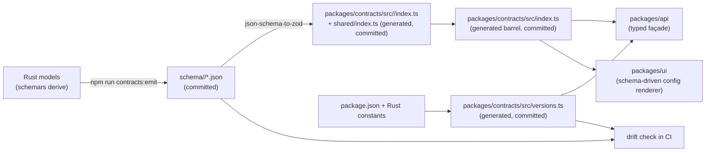

# Contracts

The single mechanism by which Rust types become TypeScript types. No hand-maintained
duplicates.

## Contents

- [1. Why this pipeline exists](#1-why-this-pipeline-exists)
- [2. Pipeline](#2-pipeline)
- [3. Stage 1 — emit JSON Schema](#3-stage-1--emit-json-schema)
- [4. Stage 2 — generate TypeScript](#4-stage-2--generate-typescript)
- [5. Stage 3 — drift enforcement](#5-stage-3--drift-enforcement)
- [6. Schema-driven configuration UI](#6-schema-driven-configuration-ui)
- [7. What is intentionally *not* generated](#7-what-is-intentionally-not-generated)
- [8. Postel's-law boundary settings](#8-postels-law-boundary-settings)
- [9. Ownership and review](#9-ownership-and-review)

## 1. Why this pipeline exists

Hand-maintaining an option profile describing encoder parameters, plus matching
TypeScript types, does not survive contact with a real encoder catalogue. The parameter
set differs per encoder and per encoder fork, so a hand-written profile is wrong for any
build the author did not test, and every wrongness surfaces as a silent runtime failure
rather than a compile error.

`andean-condor` already derives `schemars::JsonSchema` on every model type it exposes.
That is free, complete, and authoritative. We consume it.

## 2. Pipeline



Each stage is a file on disk, committed. Nothing is generated at build time or at
runtime. That means:

- a reviewer can see contract changes as a diff;
- a failed build tells you exactly which stage diverged;
- you can develop the frontend without the Rust toolchain;
- `npm run contracts:check` fails when someone edits Rust without regenerating; the Rust
  CI job runs the same command.

## 3. Stage 1 — emit JSON Schema

`rust/crates/contracts/src/bin/emit-schema.rs` writes one JSON Schema document per top-level
model into its feature group under `schema/` using `schemars::schema_for!`. Output is
deterministic: stable key ordering, no timestamps, and references resolved to local `$defs`
so no external resolution is needed. The group lives beside the filename and model in the
emitter's entry list, so adding a contract chooses all three in one place. Every document
keeps its full kebab-case filename, which stays unambiguous outside its directory.

| Group | Holds |
| --- | --- |
| `platform/` | App info, diagnostics, logs, LAN pairing, storage overview, update status |
| `settings/` | The settings document, configuration overrides, effective config, defaults |
| `project/` | Project documents, summaries, and templates |
| `video/` | Queued videos, audio tracks, concat inventory, thumbnails |
| `scene/` | Scene lists, views, ranges, and per-scene encoder state |
| `queue/` | Queue batches and video order |
| `run/` | Runs, sequences, progress events, and the timeline |
| `encoder/` | Encoder definitions, forks, parameters, preflight, tools, interpreters |
| `script/` | Script documents, checks, materialised data, and the language server |
| `protocol/` | Shapes shared by every feature: errors, tickets, input and output modes |

`schema/routes/` is written by the route emitter and is not a contract group. `--prune`
removes JSON documents the current entries no longer produce, so renaming or deleting a
contract cannot leave a stale schema behind; `--check` fails when one remains.

The group is a feature boundary, not a filename prefix: `video-order-request` belongs to
`queue`, and `encoder-definition` belongs to `encoder`. A document's group is chosen in the
same emitter entry that names its model, so a new contract cannot land in an unnamed
directory, and the full kebab-case filename keeps it unambiguous when it moves.

### 3.1 Rust module layout

The crate mirrors the ten groups: `rust/crates/contracts/src/<group>.rs` is one public
module per schema group. `lib.rs` declares those modules and `API_VERSION` and re-exports
no contract type, so a caller names the owner
(`av1ation_contracts::encoder::ParameterKey`) and the emitter imports group-qualified
paths. A helper type follows the feature that defines it even when another group embeds
it: settings custom tools embed encoder descriptors, but `ParameterDescriptor`, `Choice`,
and `PreflightCheck` remain in `encoder`. `protocol` holds only the shapes no feature owns
— errors, tickets, input and output modes — plus `ErrorCode`; it is not a catch-all. The
JSON output is unchanged because `schemars` names a type by type and the emitter entry
order fixes the document set.

### 3.2 Contract rules

- Every type crossing the HTTP boundary **must** live in `rust/crates/contracts` and derive
  `JsonSchema`.
- Field-level documentation becomes `description` and is carried into the generated
  TypeScript as JSDoc. Write the doc comment; it is the form label.
- Validation constraints use `schemars` attributes (`#[schemars(range(min = 0))]`,
  `#[schemars(length(...))]`) so the same constraint reaches Zod and the UI.
- No `serde(flatten)` on boundary models — it produces weak schemas.
- Boundary response models derive `#[serde(deny_unknown_fields)]`, which emits
  `additionalProperties: false` and makes the generated Zod object `.strict()`.
- Sum types use `#[serde(tag = "kind", content = "value")]` so the generated TS is a
  discriminated union, which is the only sum-type shape that narrows cleanly.

## 4. Stage 2 — generate TypeScript

One artifact per model, from the same schema:

| Artifact | Generator | Purpose |
| --- | --- | --- |
| Zod validator | `json-schema-to-zod` | runtime validation at the boundary |
| TypeScript type | `z.infer<typeof ModelSchema>` | compile-time types derived from the validator |

Runtime validation is not redundant with the types. HTTP responses are `unknown`; a
backend bug or a version skew between a browser tab and a restarted server produces
malformed data, and Zod turns that into a clear error instead of a `TypeError` in a
component three layers deep. Inferring the type from Zod keeps the two artifacts in
agreement by construction.

Naming: each `Model` schema is emitted as `ModelSchema` and its type as `Model` in its
group module under `packages/contracts/src/<group>/index.ts`; the root barrel re-exports
every group. Nested definitions used by more than one group live in the generated
`shared/index.ts`. The generator formats each module with Prettier, and no hand-written
aliases or duplicate shapes live beside them. A generated symbol's module path names its
owning group; `shared` holds only definitions embedded by more than one group, never a
catch-all. Generation removes generated index files whose group no longer exists, and the
check reports them as drift.

The same generator writes `packages/contracts/src/versions.ts` from `package.json`,
`ENGINE_VERSION`, `ENGINE_REVISION`, and `API_VERSION`. Mock transports and contract tests
import those constants, so a fixture cannot claim a version or engine commit the app does
not have. The revision is lifted from the workspace `andean-condor` pin at build time; the
upstream package version never changes between engine commits.

## 5. Stage 3 — drift enforcement

The drift check runs, in order:

1. `node scripts/run-cargo.mjs run --locked -p av1ation-contracts --bin emit-schema --
   --out ../schema --check` — regenerates in memory and diffs against `schema/`. It also fails
   when a document in `schema/` is not produced by any current entry; `--prune` deletes
   those on emit, and the check never deletes anything.
2. `npm run contracts:generate -- --check` — same for every generated module
   (`packages/contracts/src/<group>/index.ts`, `shared/index.ts`, the root `index.ts`) and
   `packages/contracts/src/versions.ts`. A removed group's generated index is stale output,
   not a historical file.
3. `npm test` — runs the round-trip test that a fixture response parses against its
   generated Zod schema.

`npm run contracts:check` runs steps 1 and 2 together. CI runs it in the Rust job; run it
locally before a commit too.

## 6. Schema-driven configuration UI

The largest payoff of this pipeline: the configuration form is **data**, not code.

Backend endpoints expose descriptors:

```
GET /api/encoders      → [{ id, name, parameters: { "--crf": ParameterDescriptor } }]
GET /api/sequences     → [{ id, name, fields: [FieldDescriptor] }]
```

```rust
/// Identity of one encoder parameter. Prefix is part of the identity: `--crf`
/// and `-crf` are different spellings, even when both reach the same encoder.
///
/// The value is the canonical `"{prefix}{name}"` string ("--crf", "-y"), which is
/// also its JSON object key. `ParameterKey::new` builds it from the two halves.
pub struct ParameterKey(String);

pub struct ParameterDescriptor {
    /// `Some(Space)` emits two argv entries; `Some(Joined("="))` emits one.
    /// `None` means a boolean flag with no value.
    pub delimiter: Option<Delimiter>,
    pub label: String,
    pub description: Option<String>,
    pub doc_link: Option<String>,
    pub kind: ParameterKind,
    /// Suggested initial value for a user who enables this parameter. It is not
    /// applied until the user sets the parameter; see §6.1.
    pub default: Option<Value>,
    pub widget: Widget,
    pub advanced: bool,
    pub group: Option<String>,
    /// Constraints that involve another parameter in the same definition.
    pub relations: Vec<ParameterRelation>,
}
```

The descriptor is generated from the engine's own `EncoderBase::default_parameters()` and
`CLIParameter`, so adding an encoder upstream adds it to the UI without a frontend change.
`/api/encoders` performs that mapping: a `Bool` becomes `Flag`, a `Number` becomes an
unbounded `Number` with `integer` inferred from its default, and a `String` becomes `Text`.
The engine exposes no minima, maxima, units, labels, or choice lists, so those stay absent
until the curated catalogue supplies documented values; `/api/encoders` then resolves every
`Auto` widget, so callers receive the same concrete control the renderer draws.

The renderer in `packages/ui/src/features/configuration/` maps `Widget` to a control and uses
provenance to render the inherited/overridden badge and reset affordance. Field grouping
comes from `group`; the `advanced` flag drives a disclosure rather than a second screen.

This is also why we do not use a general-purpose form library for the config surface: the
form is derived from data with one renderer, and a form library would want one component
per field.

### 6.1 One source of truth for the CLI shape

There is no `CliShape` type: it was a placeholder that duplicated facts which already
have a home. The engine's real type is a sum of three variants:

```rust
pub enum CLIParameter {
    String  { prefix: String, delimiter: String, value: String },
    Number  { prefix: String, delimiter: String, value: f64 },
    Bool    { prefix: String, value: bool },
}
```

The parameter's *name* is not in that enum: the engine stores each `CLIParameter` in a
`HashMap<String, CLIParameter>` where the key is the name. So the complete CLI identity is
`(prefix, name)`, and the only other CLI fact is the delimiter. That is exactly the split
above:

- `ParameterKey { prefix, name }` is the map key and therefore the identity. Two entries
  with the same key cannot coexist.
- `delimiter: Option<Delimiter>` is the only CLI-encoding field. `None` is the Bool case:
  a flag emits its key and no value. `Some(Space)` is two argv entries; any other delimiter
  is joined into one (`--crf=22`).
- `ParameterKind` owns the value type and *all* of its constraints. There is no separate
  `Constraints` struct that can disagree with the kind.

A `CliShape` type would restate the prefix, delimiter, and Bool/value distinction already
present in those two fields. Do not add it back.

`ParameterKind` is deliberately closed, so an ill-typed constraint cannot be built:

```rust
pub enum ParameterKind {
    /// Boolean flag. Emitted when true, omitted when false.
    Flag,
    Number(NumberSpec),
    Text(TextSpec),
    Choice(ChoiceSpec),
    Path(PathSpec),
    Duration(DurationSpec),
    /// A list encoded into one delimited string.
    Collection(CollectionSpec),
}

pub struct NumberSpec {
    pub integer: bool,
    pub min: Option<f64>,
    pub max: Option<f64>,
    pub step: Option<f64>,
    pub unit: Option<String>,
}

pub struct TextSpec {
    pub max_len: Option<u32>,
    pub pattern: Option<String>,
    pub multiline: bool,
    /// A shape the editor validates; absent on plain text.
    pub format: Option<TextFormat>,
}

pub enum TextFormat {
    Email,
    Url,
    DateTime,   // ISO-8601 date or date-time
}

pub enum ChoiceValueKind {
    Text,
    Number,
}

pub struct ChoiceSpec {
    pub options: Vec<Choice>,
    /// Text or Number. Absent on descriptors authored before the distinction.
    pub value_kind: Option<ChoiceValueKind>,
    /// One widget covers single- and multi-select; `multiple` is not a second widget.
    pub multiple: bool,
    pub min_selected: usize,
    pub max_selected: Option<usize>,
}

pub struct PathSpec {
    pub directory: bool,
    pub accept: Vec<String>,
}

pub struct DurationSpec {
    pub unit: DurationUnit,
    pub min: Option<f64>,
    pub max: Option<f64>,
}

pub struct CollectionSpec {
    /// Number, Text, Choice, Path, or Duration. A flag or a nested collection
    /// is not a value, so the item kind is closed and the schema stays acyclic.
    pub item: CollectionItemKind,
    pub separator: String,
    pub min_items: usize,
    pub max_items: Option<usize>,
}

pub enum ParameterValue {
    Null,
    Bool(bool),
    Number(f64),
    Text(String),
    List(Vec<ParameterScalar>),   // flat: nested lists are not a CLI value
}

pub struct Choice {
    pub value: ParameterValue,   // what the encoder receives
    pub label: String,           // what the user reads
    pub description: Option<String>,
    pub doc_link: Option<String>,
}
```

`Choice.value` is a `Value`, not a `String`. `value_kind` states whether the editor
authors text or numbers, so an encoder's `0 main, 1 high, 2 professional` becomes labelled
numbers rather than being guessed from the options. SVT-AV1 tune is a `Choice` whose values
are numbers `0..4` with labels `VQ`, `PSNR`, `SSIM`, … and a `Segmented` presentation.
Booleans are a `Flag`, not a `Choice`; a boolean-valued option that the CLI spells as
`0`/`1` is a `Choice` of two numbers, because the engine's `Bool` variant cannot emit a
value.

A `Path` is a text value with the host's Browse action: `directory` selects a folder and
`accept` narrows the suggested file types. `TextSpec.format` is evidence from the encoder's
own help, so the editor validates an email, URL, or ISO-8601 date-time before it reads as a
plain string; it never changes the value the encoder receives.

### 6.2 Catalogue versus selection

A descriptor catalogue is not the parameter values. Keeping them in one type is how a
profile ends up carrying every default, and how two parameters with the same name silently
overwrite each other.

```rust
pub struct EncoderDefinition {
    pub id: String,
    pub display_name: String,
    pub executable: PathBuf,
    pub version: Option<String>,
    /// Catalogue only. Order is deterministic for reviewable files.
    pub parameters: BTreeMap<ParameterKey, ParameterDescriptor>,
    pub source: DescriptorSource,
}

pub struct EncoderSelection {
    pub encoder_id: String,
    /// Only parameters the user set. An absent key means "encoder default".
    pub values: BTreeMap<ParameterKey, Value>,
}
```

`BTreeMap` is the `HashMap` you asked for with a stable iteration order: uniqueness is
still structural, and a generated file diffs cleanly. A `HashMap` would reorder on every
write and make review noisy.

JSON object keys must be strings, so `ParameterKey` serialises as the canonical
`"{prefix}{name}"` string (`"--crf"`) and deserialises by splitting the leading dash run
from the name. The loader rejects a duplicated canonical key rather than letting the last
one win; `serde_json`'s default duplicate-key behaviour is not acceptable for a
user-authored file. The generated schema describes the key with a `propertyNames` pattern.

**The engine's name-only map is the hard constraint.** Condor keys its options by `name`,
so a profile cannot set both `--crf` and `-crf` even though they are distinct keys in our
catalogue. Validation therefore has two levels:

1. The catalogue rejects a duplicate `(prefix, name)` key.
2. A selection rejects two *set* parameters that share a `name`, naming both keys in the
   error. The catalogue may contain both spellings; only one may be active at a time.

This is also why `default` does not mean "set". A default is a suggestion shown when the
user enables a row; only keys present in `EncoderSelection.values` become Condor options.
A profile that showed every default would collide with itself and would override encoder
defaults the user never chose.

### 6.3 Widgets and presentations

A value's type and constraints do not determine how it should be edited. CRF is a number,
but it is best edited with a slider because its useful range is small and its effect is
monotonic. Frame count is a number that must be a plain input, because the range is
unbounded. Therefore `Widget` remains its own axis, but it now describes only the control:

```rust
pub enum Widget {
    /// Let the builder choose from the rules below. The default for built-ins.
    Auto,
    Slider { step: Option<f64>, marks: Vec<Mark> },
    NumberInput { step: Option<f64> },
    /// One control for single- and multi-select; `multiple` is in `ChoiceSpec`.
    ChoiceInput { presentation: ChoicePresentation },
    TextInput { placeholder: Option<String>, multiline: bool },
    /// A flag. No on/off spellings: Condor emits the key or nothing.
    Toggle,
    /// A two-state control for a number that only takes 0 and 1. Unlike `Toggle`, the
    /// parameter carries a value, so the switch writes `1` or `0`; clearing the row is the
    /// only way back to the encoder's own default.
    Switch,
    PathPicker,
    DurationInput,
    CollectionInput { presentation: CollectionPresentation },
}

pub enum ChoicePresentation {
    /// Radio or segmented up to four options, dropdown above. The default.
    Auto,
    Radio,
    Segmented,
    Dropdown,
}

pub enum CollectionPresentation { Chips, CommaSeparated }

pub struct Mark { pub value: f64, pub label: Option<String> }
```

`ChoicePresentation::Auto` is the threshold you asked about: radio/segmented at four or
fewer options, dropdown above. A descriptor may force any presentation when the labels or
ordering make the automatic choice wrong, so the threshold is a default and not a rule the
designer cannot override. `multiple` belongs to `ChoiceSpec`, not to the widget: a
multi-select and a single-select are the same control with a different cardinality, and
two widget names would force every renderer branch to handle both.

Widget selection, applied in order when a descriptor is built with `Auto`:

1. `Flag` → `Toggle`.
2. `Choice` → `ChoiceInput { presentation: Auto }`.
3. `Path` → `PathPicker`; `Duration` → `DurationInput`.
4. Integer `Number` whose only values are 0 and 1 → `Switch`. An encoder that spells a boolean
   as a value (`--enable-qm 0|1`) is not a quantity; a slider would let it take 0.5 and the
   encoder would refuse the run.
5. `Number` with finite `min` and `max` spanning at most 100 units → `Slider`. Fractional
   steps are allowed: CRF is 1–70 in 0.25 increments. The descriptor's `step` is preserved;
   an integer slider with no authored step falls back to 1.
6. Any other `Number` → `NumberInput`.
7. `Text` → `TextInput`; `Collection` → `CollectionInput`.

A slider may carry up to eight curated `Mark`s. Each mark has a finite value inside the
range, an optional label, and a unique value. The renderer always adds the descriptor's
default as a `Default <value>` mark without storing it, even when a curated mark carries
that value, so switching widgets cannot pollute the descriptor. Ticks remain for every
mark; a label that would collide is hidden until its own tick is hovered or focused, and
the default marker wins a collision. Automatic marks never repeat the endpoint labels: the
slider's own ends already communicate the minimum and maximum.

An explicit widget is evidence and is left alone. When it cannot represent its kind — a
`Slider` without a finite range, or a `Toggle` on a `Choice` — the renderer falls back to a
plain field instead of drawing a broken control.

Built-in descriptors carry hand-authored constraints from each encoder's official
documentation because the engine does not expose minima, maxima, or units. A catalogue row the engine does not seed also carries the
shipped build's documented default, read from its `--full-help`; a preset-dependent
default stays unset, because a single value would be wrong for some presets. Probed user
encoders get only the type and help text from `--help`; when a range is unknown the field
stays a plain `NumberInput`, never a slider with invented limits. A user may add constraints in the JSON file; they are
validated against the kind and cannot widen a built-in's range silently.

### 6.4 Relations between parameters

Some parameters are only valid together. `--min-foo 28` requires `--max-foo` to be at
least 28, and `--tune` may only be set when `--enable-tune` is on. A free-form expression
language would be a second schema, a second validator, and a second thing to keep in sync
between Rust and TypeScript. A closed enum gives exhaustiveness in Rust and a generated
discriminated union in TypeScript:

```rust
pub enum ParameterRelation {
    Requires { other: ParameterKey, equals: Value, message: String },
    AtLeastOneOf { others: Vec<ParameterKey>, message: String },
    GreaterThanOrEqual { other: ParameterKey, message: String },
    LessThanOrEqual { other: ParameterKey, message: String },
    MutuallyExclusive { other: ParameterKey, message: String },
    SameValue { other: ParameterKey, message: String },
}
```

Relations reference only parameters in the same definition, and only *set* parameters
participate. The Rust service evaluates them on save and returns `422` with the message and
both keys. The TypeScript renderer evaluates the same generated relations for inline
feedback and disables Save; it is a convenience, never the authority. A conformance
fixture list is generated from Rust tests and replayed by the TypeScript tests, so the two
evaluators cannot drift without a failing test. The inequalities apply only to `Number`
kinds; `SameValue` applies to any two kinds with the same value variant.

Relationships that are *editing behaviour* rather than validity — a width/height aspect
lock, for example — are not relations. They are field links on a filter descriptor (§6.5),
because unlocking them is a valid state, not an error.

### 6.5 Filter descriptors

The input filter list is a second descriptor-driven surface, and the engine's native input
and its VapourSynth input do not accept the same filters.

- **Native FFMS2 input** accepts exactly one `Ffms2Filter` variant, `OutputFormat`. Its
  fields are `bit_depth` (`8`, `10`, `12`), `chroma` (`Yuv420`, `Yuv422`, `Yuv444`,
  `Monochrome`), `width`, and `height`; every field is optional and an unset field keeps
  the decoded value. Offering Crop, Trim, or a scaler choice here would be a lie: FFMS2
  always resizes with bicubic.
- **VapourSynth input** accepts an ordered `Vec<VapourSynthFilter>`. Verified against the
  engine at the pinned revision, the enum has exactly ten variants: `Crop`, `Resize`,
  `OutputFormat`, `Trim`, `Rescale`, `WNNM`, `Bilateral`, `Degrain`, `ZoomDegrain`, and
  `FGS`. There is no `Splice` variant and no generic filter escape hatch in the typed
  model. The filter catalogue is [`filter-catalogue.md`](filter-catalogue.md); it is the authoritative field
  list for both the form and the runner.

Both are described by the same descriptor shape the encoder editor uses:

```rust
pub struct FilterDescriptor {
    pub id: String,
    pub label: String,
    pub group: String,
    pub applies_to: FilterTarget,   // Native | VapourSynth
    pub fields: BTreeMap<FieldId, ParameterDescriptor>,
    pub links: Vec<FieldLink>,
    /// Geometry cannot be validated until a source exists. The form shows the
    /// unvalidated note at project scope; the service checks on expansion.
    pub needs_clip_info: bool,
}

type FieldId = String;

pub struct FieldLink {
    pub a: FieldId,
    pub b: FieldId,
    pub kind: LinkKind,
}

pub enum LinkKind {
    /// Width and height edit together while locked. The ratio is the source's
    /// when known; at project scope the lock is unavailable rather than
    /// inventing a ratio.
    AspectRatio { lock_by_default: bool },
}
```

A filter field reuses `ParameterDescriptor` rather than a parallel field type. Its
`delimiter` is always `None` and is never read: a filter field is not an argv token, so
only `label`, `description`, `doc_link`, `kind`, `default`, `widget`, `advanced`, `group`,
and `relations` apply. The loader rejects `Some(delimiter)` on a filter field. This keeps
one value/constraint vocabulary while keeping CLI encoding meaningful only for encoder
parameters.

Filter descriptors are app-owned, not engine-generated: the engine has no notion of a
minimum width, an aspect lock, or a helpful label. The catalogue is committed alongside the
schemas, and a contract test asserts that every `VapourSynthFilter` variant has exactly one
descriptor and that `Ffms2Filter::OutputFormat` is the only native one. A new engine filter
without a descriptor fails the contract test rather than appearing silently uneditable.

Validation has three levels, in order:

1. The editable value obeys its `ParameterKind` (integer, range, choice membership,
   required length).
2. Pairwise `ParameterRelation`s are evaluated when both fields are set; the renderer
   mirrors the generated relations for inline feedback and the service rejects the same
   fixture on save.
3. Filters that depend on the source geometry (Crop, Resize, Trim, Rescale) are checked by
   the service when clip info exists. At project scope there is no source, so the form
   states that geometry is validated when a video is added instead of pretending it knows
   the frame size. This is a check on expansion, not at encode time.

The editor workflow is: **Add** opens a filter picker (search, grouped by target, recently
used first), choosing a type opens its parameter form, and Confirm inserts it at the focused
position in the ordered list. The form is prefilled from the source's clip info when one
exists. It stays open with "Add another" for repeated filters, and every filter can be
duplicated. This is slower than a single dropdown for the one native filter, which is why
the native list skips the picker entirely: it has one type, so Add inserts the form
directly.

### 6.6 User-supplied encoders and forks

The engine's built-in catalogue covers the encoders it knows about. A saved fork is an
additive catalogue entry for another build of a known encoder; it is not a provider
replacement.

A fork is stored as an `EncoderFork` in `AppSettings.encoder_forks` (`config.json`), with
`id`, `label`, `base`, `executable`, `version`, `profile`, `warning`, `parameters`, and
`parameters_edited`. `base` names the engine family (`aom`, `svt-av1`, `rav1e`, `vpx`,
`avm`, `x264`, `x265`, or `vvenc`). `profile` and `warning` are optional: the first names
the detected shipped profile, the second explains a signature mismatch. `POST
/api/encoders/probe` returns an `EncoderForkProbe` without saving it; `POST
/api/encoders/forks` saves the accepted result, and `PUT`/`DELETE /api/encoders/forks/:id`
update or remove it. On startup the service re-probes a user fork whose parameters the user
has not edited; `parameters_edited` keeps hand-authored changes. `GET /api/encoders` lists
each shipped profile first and then each saved fork, with `fork: true`, its `base`, and
`source: Known` telling a shipped profile from a user build.

The build ships complete tables for `svt-av1-essential` and `svt-av1-5fish` without their
executables. Those rows always exist, have app-owned labels, and cannot be renamed or
deleted. Their update carries `reset_parameters` and `clear_executable` alongside the
ordinary `label`, `path`, and `parameters` fields: reset restores the shipped table, clear
forgets the path, and neither touches the other. Detection and table merging are described
in [preflight.md](preflight.md#custom-encoder-definitions).

Selecting a fork writes its executable and starting options into the project's engine
encoder document, so the project never references the catalogue. A located fork's
executable makes the run use that binary. A pathless fork writes null and a disabled marker
option; run preparation reads the marker, so locating the build later changes what the
next run executes without rewriting saved projects. A deleted build, or a saved path that
no longer exists, falls back to the base encoder's provider. The marker is a false `Bool`,
which the engine omits from argv. The settings screen owns the probe, save, edit, reset,
clear, and delete flow; see
[preflight.md](preflight.md#custom-encoder-definitions) and
[screens/settings.md](screens/settings.md#encoders).

The contracts crate still emits `EncoderDefinition` and
`schema/encoder/encoder-definition.schema.json` as the complete catalogue-entry shape, but
the service has no file-backed `encoders/<id>.json` loader. Do not document or add a second
save format without an ADR.

## 7. What is intentionally *not* generated

- **Routes.** Typed by TanStack Router's own generation.
- **Encoders' free-form `-x` style parameter strings.** Users may type raw parameter
  strings; those are `string` in the contract and validated by the engine, not by us.
- **Log lines.** Free text by nature; the contract covers only their envelope
  (`{ seq, at, level, target, message, fields }`).
- **Anything with a lifetime tied to a session.** Session ids and tokens are opaque
  `string` in the contract.

## 8. Postel's-law boundary settings

The boundary is strict on output and lenient on input where it is safe:

| Direction | Policy |
| --- | --- |
| Backend → frontend | Strict. Generated schemas are `.strict()`; an unknown key is a contract bug and raises `ApiError` rather than being silently dropped. |
| Frontend → backend | Strict enough to reject typos, lenient about `null` vs. absent for optional override fields. |
| Persisted project files | Strict, with `schema_version` and a migration chain; unknown keys preserved-but-ignored so an older build does not destroy a newer build's data. |

That last row matters: two app versions must never silently corrupt a project file, so a
newer `schema_version` refuses to load rather than dropping fields it does not know.

## 9. Ownership and review

- `schema/`, `packages/contracts/src/**/index.ts`, and
  `packages/contracts/src/versions.ts` are reviewed like any other code but are never
  hand-edited. A reviewer's job is to confirm the *Rust* change is intended.
- A contract change that removes or renames a field is a breaking change: bump the
  `schema_version`, and note it in [progress.md](progress.md).
- Contract changes are called out explicitly in the pull request description.
