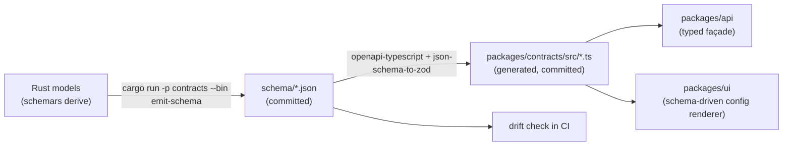

# Contracts

The single mechanism by which Rust types become TypeScript types. No hand-maintained
duplicates.

## 1. Why this pipeline exists

Hand-maintaining an option profile describing encoder parameters, plus matching
TypeScript types, does not survive contact with a real encoder catalogue. The parameter
set differs per encoder and per encoder fork, so a hand-written profile is wrong for any
build the author did not test, and every wrongness surfaces as a silent runtime failure
rather than a compile error.

`andean-condor` already derives `schemars::JsonSchema` on every model type it exposes.
That is free, complete, and authoritative. We consume it.

## 2. Pipeline



Each stage is a file on disk, committed. Nothing is generated at build time or at
runtime. That means:

- a reviewer can see contract changes as a diff;
- a failed build tells you exactly which stage diverged;
- you can develop the frontend without the Rust toolchain;
- CI fails when someone edits Rust without regenerating.

## 3. Stage 1 — emit JSON Schema

`crates/contracts/src/bin/emit-schema.rs` writes one JSON Schema document per top-level
model into `schema/` using `schemars::schema_for!`. Output is deterministic: stable key
ordering, no timestamps, `$id` set to a stable URN, and references resolved to local
`$defs` so no external resolution is needed.

Rules:

- Every type crossing the HTTP boundary **must** live in `crates/contracts` and derive
  `JsonSchema`.
- Field-level documentation becomes `description` and is carried into the generated
  TypeScript as JSDoc. Write the doc comment; it is the form label.
- Validation constraints use `schemars` attributes (`#[schemars(range(min = 0))]`,
  `#[schemars(length(...))]`) so the same constraint reaches Zod and the UI.
- No `serde(flatten)` on boundary models — it produces weak schemas.
- Sum types use `#[serde(tag = "kind", content = "value")]` so the generated TS is a
  discriminated union, which is the only sum-type shape that narrows cleanly.

## 4. Stage 2 — generate TypeScript

Two artifacts per model, from the same schema:

| Artifact | Generator | Purpose |
| --- | --- | --- |
| `.d.ts`-style types | `openapi-typescript` (schema wrapped as a synthetic OpenAPI components block) | compile-time types |
| Zod validators | `json-schema-to-zod` | runtime validation at the boundary |

Runtime validation is not redundant with the types. HTTP responses are `unknown`; a
backend bug or a version skew between a browser tab and a restarted server produces
malformed data, and Zod turns that into a clear error instead of a `TypeError` in a
component three layers deep.

Naming: generated symbols are prefixed by their model name and are re-exported from
`packages/contracts/src/index.ts` with hand-written **aliases only** (no new shapes).

## 5. Stage 3 — drift enforcement

CI runs, in order:

1. `cargo run -p contracts --bin emit-schema -- --check` — regenerates in memory and
   diffs against `schema/`. Non-zero on mismatch.
2. `npm run contracts:generate -- --check` — same for `packages/contracts/src/`.
3. `npm run contracts:verify` — compiles `packages/contracts` and runs a round-trip test
   that every fixture response parses against its Zod schema.

A pull request that changes a Rust model without regenerating fails at step 1 with the
diff printed.

## 6. Schema-driven configuration UI

The largest payoff of this pipeline: the configuration form is **data**, not code.

Backend endpoints expose descriptors:

```
GET /api/encoders      → [{ id, name, parameters: { "--crf": ParameterDescriptor } }]
GET /api/sequences     → [{ id, name, fields: [FieldDescriptor] }]
```

```rust
/// Identity of one encoder parameter. Prefix is part of the identity: `--crf`
/// and `-crf` are different spellings, even when both reach the same encoder.
pub struct ParameterKey {
    pub prefix: String,   // "--", "-", or "" for a bare argument
    pub name: String,     // "crf"
}

pub struct ParameterDescriptor {
    /// `Some(Space)` emits two argv entries; `Some(Joined("="))` emits one.
    /// `None` means a boolean flag with no value.
    pub delimiter: Option<Delimiter>,
    pub label: String,
    pub description: Option<String>,
    pub doc_link: Option<String>,
    pub kind: ParameterKind,
    /// Suggested initial value for a user who enables this parameter. It is not
    /// applied until the user sets the parameter; see §6.1.
    pub default: Option<Value>,
    pub widget: Widget,
    pub advanced: bool,
    pub group: Option<String>,
    /// Constraints that involve another parameter in the same definition.
    pub relations: Vec<ParameterRelation>,
}
```

The descriptor is generated from the engine's own `EncoderBase::default_parameters()` and
`CLIParameter`, so adding an encoder upstream adds it to the UI without a frontend change.

The renderer in `packages/ui/src/features/config/` maps `Widget` to a control and uses
provenance to render the inherited/overridden badge and reset affordance. Field grouping
comes from `group`; the `advanced` flag drives a disclosure rather than a second screen.

This is also why we do not use a general-purpose form library for the config surface: the
form is derived from data with one renderer, and a form library would want one component
per field.

### 6.1 One source of truth for the CLI shape

`CliShape` as previously sketched was a placeholder and should be deleted. It duplicated
facts that already have a home. The engine's real type is a sum of three variants:

```rust
pub enum CLIParameter {
    String  { prefix: String, delimiter: String, value: String },
    Number  { prefix: String, delimiter: String, value: f64 },
    Bool    { prefix: String, value: bool },
}
```

The parameter's *name* is not in that enum: the engine stores each `CLIParameter` in a
`HashMap<String, CLIParameter>` where the key is the name. So the complete CLI identity is
`(prefix, name)`, and the only other CLI fact is the delimiter. That is exactly the split
above:

- `ParameterKey { prefix, name }` is the map key and therefore the identity. Two entries
  with the same key cannot coexist.
- `delimiter: Option<Delimiter>` is the only CLI-encoding field. `None` is the Bool case:
  a flag emits its key and no value. `Some(Space)` is two argv entries; any other delimiter
  is joined into one (`--crf=22`).
- `ParameterKind` owns the value type and *all* of its constraints. There is no separate
  `Constraints` struct that can disagree with the kind.

A `CliShape` type would restate the prefix, delimiter, and Bool/value distinction already
present in those two fields. Do not add it back.

`ParameterKind` is deliberately closed, so an ill-typed constraint cannot be built:

```rust
pub enum ParameterKind {
    /// Boolean flag. Emitted when true, omitted when false.
    Flag,
    Number(NumberSpec),
    Text(TextSpec),
    Choice(ChoiceSpec),
    Path(PathSpec),
    Duration(DurationSpec),
    /// A list encoded into one delimited string.
    Collection(CollectionSpec),
}

pub struct NumberSpec {
    pub integer: bool,
    pub min: Option<f64>,
    pub max: Option<f64>,
    pub step: Option<f64>,
    pub unit: Option<String>,
}

pub struct TextSpec {
    pub max_len: Option<u32>,
    pub pattern: Option<String>,
    pub multiline: bool,
}

pub struct ChoiceSpec {
    pub options: Vec<Choice>,
    /// One widget covers single- and multi-select; `multiple` is not a second widget.
    pub multiple: bool,
    pub min_selected: usize,
    pub max_selected: Option<usize>,
}

pub struct PathSpec {
    pub directory: bool,
    pub accept: Vec<String>,
}

pub struct DurationSpec {
    pub unit: DurationUnit,
    pub min: Option<f64>,
    pub max: Option<f64>,
}

pub struct CollectionSpec {
    pub item: Box<ParameterKind>,
    pub separator: String,
    pub min_items: usize,
    pub max_items: Option<usize>,
}

pub enum Value {
    Null,
    Bool(bool),
    Number(f64),
    Text(String),
    List(Vec<Value>),
}

pub struct Choice {
    pub value: Value,            // what the encoder receives
    pub label: String,           // what the user reads
    pub description: Option<String>,
    pub doc_link: Option<String>,
}
```

`Choice.value` is a `Value`, not a `String`. That is what collapses the old
`LabelledNumber` widget: SVT-AV1 tune is a `Choice` whose values are numbers `0..4` with
labels `VQ`, `PSNR`, `SSIM`, … and a `Segmented` presentation. `Select` and
`LabelledNumber` were two widgets because `Choice.value` could only be text; with a typed
value there is one choice kind and two presentations. Booleans are a `Flag`, not a
`Choice`; a boolean-valued option that the CLI spells as `0`/`1` is a `Choice` of two
numbers, because the engine's `Bool` variant cannot emit a value.

### 6.2 Catalogue versus selection

A descriptor catalogue is not the parameter values. Keeping them in one type is how a
profile ends up carrying every default, and how two parameters with the same name silently
overwrite each other.

```rust
pub struct EncoderDefinition {
    pub id: String,
    pub display_name: String,
    pub executable: PathBuf,
    pub version: Option<String>,
    /// Catalogue only. Order is deterministic for reviewable files.
    pub parameters: BTreeMap<ParameterKey, ParameterDescriptor>,
    pub source: DescriptorSource,
}

pub struct EncoderSelection {
    pub encoder_id: String,
    /// Only parameters the user set. An absent key means "encoder default".
    pub values: BTreeMap<ParameterKey, Value>,
}
```

`BTreeMap` is the `HashMap` you asked for with a stable iteration order: uniqueness is
still structural, and a generated file diffs cleanly. A `HashMap` would reorder on every
write and make review noisy.

JSON object keys must be strings, so `ParameterKey` serialises as the canonical
`"{prefix}{name}"` string (`"--crf"`) and deserialises by splitting the leading dash run
from the name. The loader rejects a duplicated canonical key rather than letting the last
one win; `serde_json`'s default duplicate-key behaviour is not acceptable for a
user-authored file. The generated schema describes the key with a `propertyNames` pattern.

**The engine's name-only map is the hard constraint.** Condor keys its options by `name`,
so a profile cannot set both `--crf` and `-crf` even though they are distinct keys in our
catalogue. Validation therefore has two levels:

1. The catalogue rejects a duplicate `(prefix, name)` key.
2. A selection rejects two *set* parameters that share a `name`, naming both keys in the
   error. The catalogue may contain both spellings; only one may be active at a time.

This is also why `default` does not mean "set". A default is a suggestion shown when the
user enables a row; only keys present in `EncoderSelection.values` become Condor options.
A profile that showed every default would collide with itself and would override encoder
defaults the user never chose.

### 6.3 Widgets and presentations

A value's type and constraints do not determine how it should be edited. CRF is a number,
but it is best edited with a slider because its useful range is small and its effect is
monotonic. Frame count is a number that must be a plain input, because the range is
unbounded. Therefore `Widget` remains its own axis, but it now describes only the control:

```rust
pub enum Widget {
    /// Let the builder choose from the rules below. The default for built-ins.
    Auto,
    Slider { step: Option<f64>, marks: Vec<Mark> },
    NumberInput { step: Option<f64> },
    /// One control for single- and multi-select; `multiple` is in `ChoiceSpec`.
    ChoiceInput { presentation: ChoicePresentation },
    TextInput { placeholder: Option<String>, multiline: bool },
    /// A flag. No on/off spellings: Condor emits the key or nothing.
    Toggle,
    PathPicker,
    DurationInput,
    CollectionInput { presentation: CollectionPresentation },
}

pub enum ChoicePresentation {
    /// Radio or segmented up to four options, dropdown above. The default.
    Auto,
    Radio,
    Segmented,
    Dropdown,
}

pub enum CollectionPresentation { Chips, CommaSeparated }

pub struct Mark { pub value: f64, pub label: Option<String> }
```

`ChoicePresentation::Auto` is the threshold you asked about: radio/segmented at four or
fewer options, dropdown above. A descriptor may force any presentation when the labels or
ordering make the automatic choice wrong, so the threshold is a default and not a rule the
designer cannot override. `multiple` belongs to `ChoiceSpec`, not to the widget: a
multi-select and a single-select are the same control with a different cardinality, and
two widget names would force every renderer branch to handle both.

Widget selection, applied in order when a descriptor is built with `Auto`:

1. `Flag` → `Toggle`.
2. `Choice` → `ChoiceInput { presentation: Auto }`.
3. `Path` → `PathPicker`; `Duration` → `DurationInput`.
4. `Number` with finite `min` and `max` and at most 20 discrete steps → `Slider`.
5. Any other `Number` → `NumberInput`.
6. `Text` → `TextInput`; `Collection` → `CollectionInput`.

A widget that cannot represent its kind (a `Slider` on an unbounded `Number`, a `Toggle`
on a `Choice`) is a descriptor error, rejected when the definition loads. It never renders
as a broken control.

Built-in descriptors carry hand-authored constraints because the engine does not expose
minima, maxima, or units. Probed user encoders get only the type and help text from
`--help`; when a range is unknown the field is a `NumberInput` marked "unbounded", never a
slider with invented limits. A user may add constraints in the JSON file; they are
validated against the kind and cannot widen a built-in's range silently.

### 6.4 Relations between parameters

Some parameters are only valid together. `--min-foo 28` requires `--max-foo` to be at
least 28, and `--tune` may only be set when `--enable-tune` is on. A free-form expression
language would be a second schema, a second validator, and a second thing to keep in sync
between Rust and TypeScript. A closed enum gives exhaustiveness in Rust and a generated
discriminated union in TypeScript:

```rust
pub enum ParameterRelation {
    Requires { other: ParameterKey, equals: Value, message: String },
    AtLeastOneOf { others: Vec<ParameterKey>, message: String },
    GreaterThanOrEqual { other: ParameterKey, message: String },
    LessThanOrEqual { other: ParameterKey, message: String },
    MutuallyExclusive { other: ParameterKey, message: String },
    SameValue { other: ParameterKey, message: String },
}
```

Relations reference only parameters in the same definition, and only *set* parameters
participate. The Rust service evaluates them on save and returns `422` with the message and
both keys. The TypeScript renderer evaluates the same generated relations for inline
feedback and disables Save; it is a convenience, never the authority. A conformance
fixture list is generated from Rust tests and replayed by the TypeScript tests, so the two
evaluators cannot drift without a failing test. The inequalities apply only to `Number`
kinds; `SameValue` applies to any two kinds with the same value variant.

Relationships that are *editing behaviour* rather than validity — a width/height aspect
lock, for example — are not relations. They are field links on a filter descriptor (§6.5),
because unlocking them is a valid state, not an error.

### 6.5 Filter descriptors

The input filter list is a second descriptor-driven surface, and the engine's native input
and its VapourSynth input do not accept the same filters.

- **Native FFMS2 input** accepts exactly one `Ffms2Filter` variant, `OutputFormat`. Its
  fields are `bit_depth` (`8`, `10`, `12`), `chroma` (`Yuv420`, `Yuv422`, `Yuv444`,
  `Monochrome`), `width`, and `height`; every field is optional and an unset field keeps
  the decoded value. Offering Crop, Trim, or a scaler choice here would be a lie: FFMS2
  always resizes with bicubic.
- **VapourSynth input** accepts an ordered `Vec<VapourSynthFilter>`. Verified against the
  engine at the pinned revision, the enum has exactly nine variants: `Crop`, `Resize`,
  `Trim`, `Rescale`, `WNNM`, `Bilateral`, `Degrain`, `ZoomDegrain`, and `FGS`. There is no
  `Splice` variant and no generic filter escape hatch in the typed model. The filter
  catalogue is [`filter-catalogue.md`](filter-catalogue.md); it is the authoritative field
  list for both the form and the runner.

Both are described by the same descriptor shape the encoder editor uses:

```rust
pub struct FilterDescriptor {
    pub id: String,
    pub label: String,
    pub group: String,
    pub applies_to: FilterTarget,   // Native | VapourSynth
    pub fields: BTreeMap<FieldId, ParameterDescriptor>,
    pub links: Vec<FieldLink>,
    /// Geometry cannot be validated until a source exists. The form shows the
    /// unvalidated note at project scope; the service checks on expansion.
    pub needs_clip_info: bool,
}

type FieldId = String;

pub struct FieldLink {
    pub a: FieldId,
    pub b: FieldId,
    pub kind: LinkKind,
}

pub enum LinkKind {
    /// Width and height edit together while locked. The ratio is the source's
    /// when known; at project scope the lock is unavailable rather than
    /// inventing a ratio.
    AspectRatio { lock_by_default: bool },
}
```

A filter field reuses `ParameterDescriptor` rather than a parallel field type. Its
`delimiter` is always `None` and is never read: a filter field is not an argv token, so
only `label`, `description`, `doc_link`, `kind`, `default`, `widget`, `advanced`, `group`,
and `relations` apply. The loader rejects `Some(delimiter)` on a filter field. This keeps
one value/constraint vocabulary while keeping CLI encoding meaningful only for encoder
parameters.

Filter descriptors are app-owned, not engine-generated: the engine has no notion of a
minimum width, an aspect lock, or a helpful label. The catalogue is committed alongside the
schemas, and a contract test asserts that every `VapourSynthFilter` variant has exactly one
descriptor and that `Ffms2Filter::OutputFormat` is the only native one. A new engine filter
without a descriptor fails CI rather than appearing silently uneditable.

Validation has three levels, in order:

1. The editable value obeys its `ParameterKind` (integer, range, choice membership,
   required length).
2. Pairwise `ParameterRelation`s are evaluated when both fields are set; the renderer
   mirrors the generated relations for inline feedback and the service rejects the same
   fixture on save.
3. Filters that depend on the source geometry (Crop, Resize, Trim, Rescale) are checked by
   the service when clip info exists. At project scope there is no source, so the form
   states that geometry is validated when a video is added instead of pretending it knows
   the frame size. This is a check on expansion, not at encode time.

The editor workflow is: **Add** opens a filter picker (search, grouped by target, recently
used first), choosing a type opens its parameter form, and Confirm inserts it at the focused
position in the ordered list. The form is prefilled from the source's clip info when one
exists. It stays open with "Add another" for repeated filters, and every filter can be
duplicated. This is slower than a single dropdown for the one native filter, which is why
the native list skips the picker entirely: it has one type, so Add inserts the form
directly.

### 6.6 User-supplied encoders and forks

The engine's built-in catalogue covers the encoders it knows about. It cannot know about a
user's fork of `svt-av1` that adds `--enable-custom-thing`, nor about an encoder build with
a different parameter set. Hand-maintaining forms for those does not scale past the
encoders the author happened to test.

**Therefore the encoder catalogue is user-extensible, and the extension file is JSON with a
published `$schema`.**

```rust
/// Same shape as §6.2; repeated here only to show the file envelope.
pub struct EncoderDefinition {
    pub id: String,                 // user-chosen slug, e.g. "svt-av1-fork"
    pub display_name: String,
    pub executable: PathBuf,        // resolved on PATH or absolute
    pub version: Option<String>,    // from `--version`
    pub parameters: BTreeMap<ParameterKey, ParameterDescriptor>,
    pub source: DescriptorSource,
}

pub enum DescriptorSource {
    /// Parsed from the executable's `--help` at probe time.
    Probed,
    /// Authored by the user in `encoders/<id>.json`.
    Declared,
    /// Shipped by the engine for a known encoder.
    Builtin,
}
```

JSON, not TOML, because the file needs a `$schema` key. With `"$schema"` pointing at the
committed schema document, an editor gives completion, inline documentation, and
validation for every field — including the widget and constraint vocabulary, which is the
part a user is most likely to get wrong. TOML has no equivalent, so a TOML file would mean
authoring blind and discovering mistakes at load time.

The file is `encoders/<id>.json` under app-data:

```jsonc
{
  "$schema": "https://av1ation.app/schema/encoder-definition.schema.json",
  "id": "svt-av1-fork",
  "display_name": "SVT-AV1 (my fork)",
  "executable": "svt-av1-fork",
  "parameters": {
    "--crf": {
      "label": "CRF",
      "description": "Controls the quality of the video",
      "doc_link": "https://example.com/docs.html#crf",
      "delimiter": "Space",
      "kind": { "Number": {
        "integer": true, "min": 0, "max": 63, "step": 1, "unit": null } },
      "default": 35,
      "widget": { "Slider": { "step": 1,
        "marks": [{ "value": 20 }, { "value": 35 }, { "value": 50 }] } },
      "advanced": false, "group": "Quality", "relations": []
    },

    "--tune": {
      "label": "Tune",
      "delimiter": "Space",
      "kind": { "Choice": {
        "options": [
          { "value": 0, "label": "VQ" },
          { "value": 1, "label": "PSNR" },
          { "value": 2, "label": "SSIM" } ],
        "multiple": false, "min_selected": 1, "max_selected": 1 } },
      "widget": { "ChoiceInput": { "presentation": "Segmented" } },
      "advanced": true, "group": "Quality", "relations": []
    }
  }
}
```

`Value` is untagged in JSON, so a choice is written as the literal `0`, `"2"`, or
`true`, not wrapped in a `{"Number": …}` object. `ParameterKind` and `Widget` are
externally tagged, which keeps the generated schema unambiguous; the editor is the primary
editing surface and the JSON is the escape hatch.

Flow:

1. The user adds an encoder in Settings by pointing at an executable (or a name on `PATH`).
2. The backend runs `<exe> --help` (and `--version`) and parses the parameter list into
   `ParameterDescriptor`s — flags become `Toggle`, `--name <value>` becomes `TextInput` or
   `NumberInput` by inspecting the metavar, and enumerated values become `Choice` where
   `--help` lists them. A probed descriptor has no invented range or unit; those are added
   by the user, which is the point of the correction step.
3. The parsed result is written as a `Declared` JSON file the user can open and edit. The
   user is the correction mechanism, not a bug report.
4. On load, the file is validated against `encoder-definition.schema.json`. An invalid file
   is reported with the schema path that failed, and the encoder is excluded rather than
   half-loaded.

Why this and not the alternatives:

| Alternative | Why not |
| --- | --- |
| Hand-maintained parameter tables | cannot track encoder forks; wrong for any build we did not test |
| Only support engine-built-in encoders | blocks users whose encoder is not in the engine catalogue |
| Require users to hand-write JSON Schema | too steep; nobody will do it |
| TOML definitions | no `$schema`, so no editor validation or completion |
| Shell out to the encoder to validate every keystroke | slow, and encoders have side effects |

The `--help` parse is a **best-effort probe with a human correction step**, which is the
only design that stays correct as encoders change without us shipping a release. The
emitted file is valid on first write, so editing is optional and targeted.

Note that `EncoderBase` in the engine remains the source of truth for *known* encoders;
user definitions are an additive overlay, never a replacement, so an engine upgrade cannot
silently drop a user's encoder. `id` collisions resolve in favour of the user definition,
with a warning naming the built-in it shadows.

## 7. What is intentionally *not* generated

- **Routes.** Typed by TanStack Router's own generation.
- **Encoders' free-form `-x` style parameter strings.** Users may type raw parameter
  strings; those are `string` in the contract and validated by the engine, not by us.
- **Log lines.** Free text by nature; the contract covers only their envelope
  (`{ seq, at, level, target, message, fields }`).
- **Anything with a lifetime tied to a session.** Session ids and tokens are opaque
  `string` in the contract.

## 8. Postel's-law boundary settings

The boundary is strict on output and lenient on input where it is safe:

| Direction | Policy |
| --- | --- |
| Backend → frontend | Strict. Zod `.strict()` on generated schemas; unknown keys are a bug and should fail loudly in development, log-and-ignore in release. |
| Frontend → backend | Strict enough to reject typos, lenient about `null` vs. absent for optional override fields. |
| Persisted project files | Strict, with `schema_version` and a migration chain; unknown keys preserved-but-ignored so an older build does not destroy a newer build's data. |

That last row matters: two app versions must never silently corrupt a project file, so a
newer `schema_version` refuses to load rather than dropping fields it does not know.

## 9. Ownership and review

- `schema/` and `packages/contracts/src/generated/` are reviewed like any other code but
  are never hand-edited. A reviewer's job is to confirm the *Rust* change is intended.
- A contract change that removes or renames a field is a breaking change: bump the
  `schema_version`, and note it in [progress.md](progress.md).
- Contract changes are called out explicitly in the pull request description.
