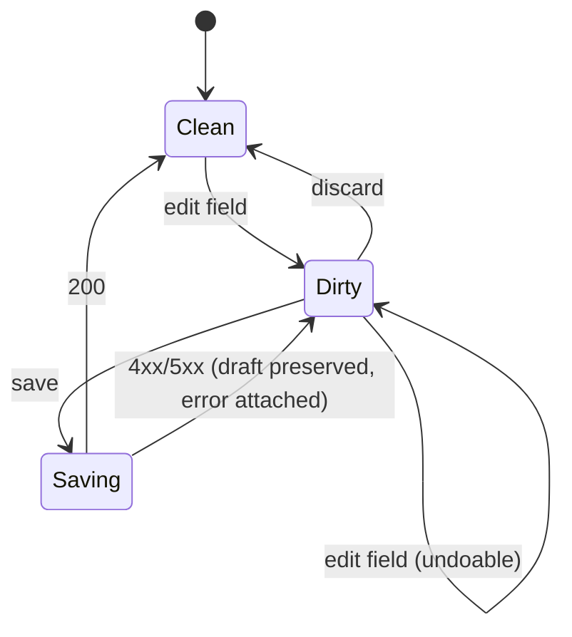

# Frontend

## 1. Package layout

```
packages/
├── contracts/     generated only — TS types + Zod validators from JSON Schema
├── api/           transport implementations + typed façade + query/mutation layer
├── ui/            design tokens, primitives, screens, routes, feature modules
└── config/        shared eslint / tsconfig / tailwind presets
apps/
├── desktop/       Tauri entry; injects the HTTP transport pointing at loopback
├── web/           standalone web build; injects the HTTP transport with a user-supplied origin
└── website/       public landing, docs and demo; demo injects the mock transport
```

`apps/{desktop,web}` are entry points of roughly 60 lines: mount the same `<App />`,
inject a different transport, done. `apps/website` also hosts the static landing and
documentation pages; its demo entry mounts the same `<App />` with `MockTransport`. Any
application component that lives in an `apps/*` directory is a bug.

## 2. Transport façade

The rule from AGENTS.md §2.1, made concrete.

```ts
// packages/api/src/transport/types.ts
export interface Transport {
  request<T>(spec: RequestSpec, decode: Decoder<T>): Promise<T>;
  subscribe(spec: StreamSpec, onEvent: (e: AppEvent) => void): () => void;
  stream(spec: StreamSpec): { url: string; headers: Record<string, string> };
}
```

Three implementations:

| Implementation | Used by | Notes |
| --- | --- | --- |
| `HttpTransport` | desktop, web | `fetch` + `EventSource` (or `fetch` streaming fallback), injected base URL and token |
| `MockTransport` | website demo, unit tests, Storybook, E2E-without-server | routes `RequestSpec` to fixture handlers; can replay a recorded SSE trace |
| `RecordingTransport` | developer tool | wraps a real transport and writes a trace file that `MockTransport` can replay |

`stream()` returns a URL rather than bytes because `<video>`, ``, and download links
need real URLs — a `Blob` per frame would defeat the preview design.

The façade exports **hooks**, not raw calls:

```ts
useProjects()            useProject(id)         useProjectConfig(id)
useVideo(id)             useVideoState(id)      useEncoderCatalogue()
useRunEvents(runId)      useEncode(id)          usePreflight()
```

No component may import from `transport/`. Enforced by ESLint `no-restricted-imports` on
`packages/ui` and `apps/*`.

## 3. Routing

TanStack Router, file-based, typed routes and typed search params.

```
/                                      home: project list
/projects/<id>                         project: General summary + queue
/projects/<id>/config/<section>        one configuration section
/projects/<id>/config/<section>/input/<slot>/script
/projects/<id>/videos/<vid>            video: ?tab=configuration | scenes
/projects/<id>/videos/<vid>/config/<section>
/projects/<id>/videos/<vid>/config/<section>/input/<slot>/script
/settings
/settings/defaults/<section>
/about
```

`<section>` is `general`, `scene-detection`, `noise-generation`, `target-quality`,
`encoding`, `concatenation`, or `quality-check`; `<slot>` is `input` or
`metric-input`, and exists only where that input is present. Sections are path segments,
not query state, so a section is linkable, the rail is a list of links, and the breadcrumb
is generated from the route rather than maintained beside it. The queue stays on the
project screen; the rail's Queue row links to `/projects/<id>#queue`. The script editor is
a child of the input that owns it, which is what makes its breadcrumb name the exact
context (`… / Encoding / Input / VapourSynth Script`) instead of a project-wide script.
The Settings default editor uses the same section components at
`/settings/defaults/<section>`; it is the only Settings sub-route, because a default is a
`ProjectConfig` and not a second configuration model.

Two route-level mechanisms do real work:

- **`beforeLoad` guards.** Navigating away from a video while its run is active, or while
  a config draft is dirty, is intercepted and resolved by an explicit user choice
  (save / discard / stay for a draft; stop / stay for a run). The guard reads from Query
  cache, so it does not refetch, and it applies to the rail's section links as well as to
  the browser's back button.
- **Validated search params.** Selection and panel state live in the URL
  (`?tab=scenes&scene=12&source=encode&input=decode&sel=3,4,5`) so the desktop app and a
  LAN browser land on the same view, and a reload restores context for free.

Why TanStack Router over React Router: typed search params, typed path params, and
first-class `beforeLoad`-with-cancel semantics, which the navigation guards require.
Why not Next.js or a framework with a server: there is no Node server and no SSR; the
backend is Rust. A framework would add a second runtime for no benefit.

## 4. Server state vs. client state

**TanStack Query owns all server state.** Nothing else.

| Concern | Owner | Persistence |
| --- | --- | --- |
| projects, configs, encoders, preflight | Query | cache only, `staleTime` tuned per key |
| run events / progress | Query cache, updated by SSE writer | cache only, seeded from `/api/runs/:id/events?since=` |
| selection, panel sizes, scroll positions | Zustand (ephemeral) | session storage for panel sizes only |
| config draft + undo/redo | Zustand + `zundo` | never persisted until saved |
| playback position | component state | no |
| theme | Query (settings) | server is the source of truth |

The SSE handler writes into the Query cache with `setQueryData` using the same keys the
REST hooks use, so a screen opened *after* the encode started shows correct progress
without a special path. This is the main reason for Query over hand-rolled stores: it
gives one cache with two writers and no synchronisation bug.

**Nothing derived from the server is duplicated into Zustand.** Zustand holds only what
the server has never heard of.

## 5. Draft, undo/redo, and save

Configuration editing is a draft workflow, not a form-per-field mutation.



- The draft is a `Record<FieldPath, unknown>` of **only the fields that differ**, so a
  field returns to inherited by removing its key.
- `zundo` gives undo/redo for free because the draft is a plain serialisable object.
  Keyboard shortcuts are scoped to the editor region so they do not fight Monaco.
- Validation runs on the draft against generated Zod schemas *and* server-side on save.
  Client-side validation is a UX convenience; the server is the authority.
- A failed save keeps the draft and shows a field-level error; it never discards user work.
- Save replaces the resource (project config or the video's sparse overrides), never a
  partial merge. Two clients writing the same scope resolve by last write; the server does
  not merge, and the route guard is what prevents a single client from losing its own draft.
- Before an encode starts, a dirty draft forces a save-or-discard decision. The snapshot
  the server takes must be the one the user saw.

## 6. Components and design system

- **Tailwind CSS v4** with `@tailwindcss/vite` — no `tailwind.config.js`; tokens are CSS
  custom properties in one file, consumed by both utilities and the chart theme. The token
  source is a DTCG JSON document that Penpot also consumes; see
  [frontend-penpot.md](frontend-penpot.md) §4. The default theme is dark.
- **Headless primitives (Radix)** are vendored into `packages/ui/src/components/` and edited
  in place. This is a deliberate trade: we own the code, so we can fix accessibility and
  animation details without upstream dancing. Base UI is the documented fallback if Radix's
  DOM weight becomes a problem — see [decisions.md](decisions.md) D6.
- **`class-variance-authority`** for variant APIs, **`tailwind-merge`** for composition.
- **lucide-react** for icons, at one consistent stroke width.
- **`cmdk`** for the command palette (`Ctrl/Cmd-K`) — global navigation plus contextual
  actions, which is also the most important keyboard-accessibility win for a dense app.
- **`sonner`** for toasts, with a strict policy: toasts only for transient outcomes
  (saved, copied, export ready). Errors that need a decision get an inline panel, not a
  toast that disappears.
- **`motion`** (Framer Motion successor) for orchestration only — presence, list
  reordering, shared layout for the scene selection. Animation budget in §8.

Deliberately **not** adopted: a general component kit (MUI, Mantine, Chakra). They bring
their own theming system, their own layout primitives, and a bundle cost, and they fight
Tailwind. A headless layer gives the same components with none of that.

Also not adopted: a form library for the general config surface. The configuration model
is generated from JSON Schema, so the "form" is a renderer driven by schema plus a small
set of field descriptors — not a hand-authored form per encoder. `@tanstack/react-form`
is used only for the few genuinely bespoke forms (project create, settings).

## 7. Screens

### 7.1 Penpot-first design gate

No screen implementation begins until its Penpot board set is approved. The designer
deliverable for each screen is: default populated state, the four §11 states (loading,
empty, error, populated), and every interactive overlay it owns (menus, dialogs, toasts).
Implementation then transcribes the approved boards; it does not invent layout.

Boards are drawn in the dark theme, which is the application default. Penpot file structure,
the token contract, and the handoff conventions live in `docs/frontend-penpot.md`. The gate
is sequenced in Phase 3 of `docs/plan/03-ui.md`; the review checkpoint is recorded in
`docs/progress.md`.

### 7.2 Screen table

| Screen | Responsibilities |
| --- | --- |
| Home | compact project list with path, retained size and video count; create; open OS directory; delete; footer links to About, documentation and the repository |
| Settings | tabbed sections: appearance, dependency inventory and remediation, encoder catalogue and parameter editing, project defaults, storage paths, network and pairing, about/version |
| Project | General defaults, the local section rail and the video queue; each rail row opens that section, and the script is edited on its own screen |
| Video | three tabs: `Configuration` with per-video provenance, reset, status and data; `Scenes` with one player, a proportional timeline, scene details and charts; `Logs` with the run log, follow-tail, filtering, search and anonymised export |
| About | version, licenses (GPL obligations), links to upstream repositories |

### 7.3 Home

The project list is the landing surface and the only place projects are created or removed.
Rows are compact and carry two text lines, not a six-column table.

| Cell | Source | Notes |
| --- | --- | --- |
| Name | project manifest | line one, 14px medium; inline rename |
| Path + open directory | resolved project path | line two; a folder button precedes the path and reveals it in the OS file manager |
| On disk | derived, see below | trailing stack, right-aligned; counts retained scene chunks and probe files, e.g. `47.9 GB on disk` |
| Videos | derived from project state | trailing stack, right-aligned; completed / total, e.g. `7 / 12 videos` |
| Delete | — | row action only; destructive confirm states what is removed on disk. The column is unlabelled |

Name and path take all remaining width; size and video count stack vertically in one
right-aligned cell immediately before the delete action, so a short list does not leave a
wide dead gap. Dates are hidden at this width.

Created and last-updated are **not shown by default**. They are available on the project
and video detail screens, where they matter for diagnosing staleness. Default sort is
last-accessed descending, so the project a user returns to is first; sort is user-changeable
and persisted app-wide. Last-accessed is distinct from last-updated: opening a project
updates access time without marking its configuration dirty.

There is no **Import** action. The architecture defines project creation and no project
import endpoint; the only archive flow in `plan/02-backend.md` is a diagnostic export for
bug reports, and it is not a Home feature. Home therefore has exactly one primary action,
`New project`.

**On-disk size** is a retained-work measure, not a folder size of the source media. The
service walks `temp/<video-ulid>/` and sums chunk and probe files, exposing
`retained_bytes` per video and a project total. The walk is cached with the same short TTL
as the chunk listing and invalidated by run events, so it costs one directory walk per
video per window and never blocks a row render. Source videos are excluded because they
are referenced by absolute path outside the project; `project.json` and logs are excluded
because they are small and not what the number is for. A project with no retained work
shows an em dash, never `0 B`.

The number is derived metadata, not pipeline state: it is never read to decide which
sequence runs. `backend.md` §6.1 already requires the per-video retained size for the
"delete chunks" action; this is the project-level sum of the same measure.

Deleting a project removes its manifest, its log store, and its temporary working
directory; it never removes the source video files, which are referenced by absolute path
outside the project directory.

### 7.4 Settings

Settings is a tabbed screen: `Appearance`, `Dependencies`, `Encoders`, `Project defaults`,
`Storage`, `Network`, `About`. The tab strip replaces the page heading; the breadcrumb
already names the screen, so the content does not repeat it.

**Appearance** offers theme (`System`, `Dark`, `Light`), row density (`Comfortable`,
`Compact`), and a reduced-motion switch that mirrors the OS preference rather than replacing
it. Dark is the default. Changes preview immediately and persist through the settings
endpoint; there is no Apply button.

**Dependencies** is a dependency inventory rather than a health banner on Home. Each row
carries the observed version, status and remediation. Versions are what the engine reports;
there is no required-version column, because no version requirements are defined. This is
the screen a user lands on when a sequence refuses to run, so it is grouped by capability —
decode, encode, **muxing**, metric — not by executable name, because a capability may be
satisfied by more than one provider. FFmpeg is a muxing provider, not a decoder. A null
probe renders as "not installed" with the command to install it, never as a zero version.

Grouping, status vocabulary, and remediation text are defined by the preflight model in
`backend.md` §9; Settings renders that model and does not compute availability itself.

**Encoders** is a master-detail screen: built-ins from the engine plus user definitions
from `encoders/<id>.json`. The detail is the encoder **definition** — identity, executable,
observed version, source badge, shadow warning — followed by its descriptor table. The
registry is a `BTreeMap<ParameterKey, ParameterDescriptor>`; the table is keyed by
`ParameterKey`, so a duplicate spelling cannot be added twice. "Add parameter" opens the
descriptor form, not a blank key field; a user-defined parameter is an explicit advanced
action, with prefix, name, delimiter, kind, widget, constraints, relations, label,
description, and doc link.

A descriptor row shows the canonical `--key`, kind and widget, constraints or choice
labels, the advanced flag, and edit/delete actions. It is a catalogue row, not a value:
values are chosen on the project's Encoding screen, and this screen never writes a default
into a selection. Two keys with the same `name` but different prefixes may exist in the
catalogue, but only one may be active: the engine keys its own options by name, so a second
active spelling would silently overwrite the first. The conflict is shown inline on both
rows and rejected by the server, not left to save-time chance.

The descriptor's kind and widget determine the value control on Encoding: `Choice` values
use radio or segmented controls up to four options and a dropdown above; the descriptor can
force a presentation. Multi-select renders as chips from the same row. `Number` with a
known range renders a slider; unknown ranges render a number input marked "unbounded"
rather than an invented maximum. Relations (`greater-than-or-equal`, `mutually-exclusive`,
`requires`) render as inline errors and disable Save. Advanced fields sit behind one
disclosure, grouped by `group`, with per-field search. Encoder-selection fields such as
`append_color_data` and Photon noise are not part of the definition; they live on the
Encoding screen (§7.6.5).

Encoding's **Preview command** action opens a read-only sheet with the exact argv that
Parallel Encoder would produce for the current selection, including colour data and pass
parameters, with a copy action. This is a diagnostic, not a second way to run the encode.

Probe re-reads `--help`/`--version` and reports keys that disappeared instead of silently
dropping them. A user definition may shadow a built-in; the detail names the shadowed
encoder. JSON remains an export/import escape hatch, never a required step.

Target Quality has its own parameter override in the Target Quality section; it defaults to
"Same as Encoding" and uses the same table. It is not a second encoder screen.

**Project defaults** is the template copied into a new project. It stores one full
`ProjectConfig` under `AppSettings.project_defaults`; it is not a partial diff and it is not
a live policy. Creating a project copies that document into `project.json`, after which the
project owns its configuration. Editing a project never changes the template, and editing
the template never changes an existing project. There is no automatic propagation and no
"apply to all projects" action, because that would make a project's saved configuration
change without its owner editing it.

The tab is a summary, not a second giant form: General, Scene detection, Noise generation,
Target quality, Encoding, Concatenation and Quality check each get one card with the values
that matter and an **Edit** route. Edit opens the same section component and draft contract
used by a project, at `/settings/defaults/<section>`, with Save/Cancel in the 56px top bar
and the breadcrumb naming `Settings / Project defaults / <section>`. The editor has no
section rail: it edits one section, so a rail would navigate nothing. The scope strip states
that it writes the template for new projects only, and Save writes the template and returns
to Project defaults without touching any project. Cancel discards the draft; leaving a dirty
draft through the breadcrumb asks save / discard / stay. Save is not disabled by validation —
the server runs the same checks and returns the error. Reusing the section
editor is what keeps default filters, encoder descriptors, validation and the command
preview from becoming a parallel implementation. The tab also offers **Reset all to engine
defaults**; that resets the template only and states that existing projects are untouched.

**Storage** sets the temporary-directory override (`backend.md` §6.1), shows free space on
that volume and the app-data volume, the preview-cache retention window, and a
**Keep encoded scene chunks after a successful run** switch that is on by default. The
stored setting is the inverse (`delete_chunks_on_success`), but the UI never presents
retention as an advanced opt-in; turning it off warns that both Quality Check and a
scene-only re-encode stop being possible. It lists retained bytes per project with
a link to each project's per-video breakdown, and offers no bulk delete: deletion is always
per video. A path that is not writable is rejected on selection, before it is saved.

**Network** owns LAN access: the enable switch, the bound address and port, the pairing
token/QR, connected-session count, and revoke. It states the firewall rule needed for the
chosen port and never claims the service is reachable on an address it is not bound to.
Disabling LAN revokes every token in the same action.

**About** shows the version from `/api/health` (never a hardcoded string), the engine and
FFmpeg versions, the GPL obligations and source links, the repository, and a copyable
diagnostic bundle action. It is also reachable from Home's footer.

### 7.5 Shell and navigation

One 56px top bar, mounted once: the mark (a link to Projects), the breadcrumb, and three
icon actions — search, command palette, settings. There is **no global sidebar**. Selecting
a project makes it the work surface; access to Projects is the mark and the breadcrumb root,
Settings is always in the bar, and About is reached from Home's footer or Settings → About
rather than occupying a permanent control.

Breadcrumb truncation removes ancestors from the left first; the current page never
truncates. The project screen adds a local 232px section rail (Configuration sections plus
the queue). **Every project and Configuration screen uses that same rail**: the current
section is highlighted, selecting another row opens that section, and the breadcrumb stays
a static trail rather than becoming a second navigation control. The rail does not
scroll-spy: a section screen shows exactly one section. Its order is the pipeline order —
General, Scene detection, Noise generation, **Target quality**, **Encoding**, Concatenation,
Quality check — because each stage consumes the previous stage's output. Save, Cancel and
the dirty state sit in the same 56px top bar, so draft chrome costs neither editing width
nor editing height. The rail starts below the bar; the content column starts at `x = 264`
and is 1144px wide inside the page's 32px gutter, which keeps one navigation model across
the project screen and every section. At the minimum width the rail collapses into the same
slide-over. The rail never shows a scene count: scenes belong to a selected video, not to a
project. The video screen follows the same local-rail pattern: on its Configuration tab the
rail lists the video's sections, and on its Scenes tab the column becomes the virtualized
scene rail. That rail is not global navigation and does not exist on Home, Settings or
About.

The shell is stable across navigation; only the outlet cross-fades. Global surfaces start
at the window gutter. Project and Configuration surfaces reserve the 232px local rail; the
video surface uses the same local-rail pattern with its own column widths until it is
reflowed.

### 7.6 Project screen and configuration

The project screen is **General**, not an all-sections overview. Its local rail lists the
configuration sections in pipeline order plus Queue. Selecting General keeps the project
screen; selecting any other section opens that section's screen, which keeps the same rail
with that section active. The project screen therefore shows one read-only General summary
and the queue. It does not show Scene detection or any other section under an active
General row: a selected section names exactly what is on screen. The summary has one `Edit`
route, so there is no second editing surface whose draft can diverge from the section
screen.

| Section | Owns |
| --- | --- |
| General | input kind, path/script, filters, output folder, temp-directory override; `clip_info` only in the video context |
| Scene detection | method, minimum/maximum scene length, input override |
| Noise generation | noise detector and noise scaler, in that order, with one input override |
| Target quality | target quality, speed scaling and bitrate optimization, in that order |
| Encoding | encoder, worker count, benchmarker when workers are automatic, colour data, photon noise, parameters, FFmpeg filter, command preview |
| Concatenation | method; the video owns the track map, chapters and metadata |
| Quality check | metric, strategy, statistic, input override |
| Queue | videos, per-video derived state, reorder, multi-select, add/remove, run/cancel |

**Scene detection and Noise generation are separate screens** because they answer different
questions and produce different data. Noise detection and scaling stay together because the
scaler consumes the detector's per-scene value; splitting them would put one pipeline on two
screens. **Benchmarking has no section of its own**: it is the `Auto` branch of Encoding's
worker control, and its threshold and memory cap sit in that branch, where the value it
produces is used. **Target quality, speed scaling and bitrate optimization share one
screen** because they run in that order and each consumes the previous stage's per-scene
quantizer or bitrate; the rail names the group `Target quality`, and the screen's three
stages are all visible.

#### 7.6.0 Queue

The queue is a list of videos, not a table. Each row is two inner lines: the video name,
then the input file name, its duration and the encoded size once that size is known. While
a video is encoding, the size is an estimate and is labelled `est.`; a queued or failed row
shows no size rather than a dash. The state chip is centred against the row's full height,
so it reads as one line instead of stacking with the size. A drag handle at the start
changes order, and the order is the run order. A checkbox selects rows; Shift-click extends,
and dragging across the list sweeps a range. Selection puts one bulk bar above the rows with
**Run**, **Remove** and **More**; it is a single action on the selection, not a repeated
per-row control.

Video files can also be dropped anywhere on the queue, and dropping appends them in drop
order; the file picker is an alternative, not the only way in. The empty queue is one dashed
drop target with the same Add action, and the populated header states that files can be
dropped there. A drop that adds files and a drag that reorders are different gestures: rows
carry the grip, the card accepts files.

A three-pixel progress bar sits on the bottom edge of a row while that video's run is active
or paused; queued and completed rows do not reserve an empty bar. The trailing overflow menu
holds **Open input location**, **Open output directory**, **Reveal retained chunks**,
**Copy input path** and **Remove from queue**. Unavailable actions are present with the
reason, not silently absent. Removal of a video that has retained work states how much will
be deleted and requires confirmation; removing a queue entry never deletes the source file.

Queue order is server state because it changes what the next client runs. Selection is
ephemeral view state: it lives in Zustand, is not persisted, and is cleared by navigation.
The drag interaction is ephemeral until drop; the resulting order is one `PATCH` that
replaces the queue order, and the list does not optimistically reorder itself twice. A run
locks the affected rows' order and removal until it reaches a terminal state, and the server
rejects the mutation with `423` rather than relying on a disabled control.

Every section screen follows the draft contract in §5. Edits are local; the top bar carries
**Cancel**, **Save**, and a dirty-state indicator, while the rail switches sections directly.
The navigation guard intercepts a dirty draft reached through the rail with save / discard /
stay. A section is locked while any run is active and the lock
is enforced by the server, not by disabled inputs alone. Save writes and returns to the
project screen; Cancel restores the last saved state and returns there. There is no
implicit save on navigate, because a user who is experimenting needs a way out and a user
who is done needs a deliberate commit.

The **project context** exposes defaults only. It has no per-video clip info, no sequence
progress or data, and no output file name. The **video context** reuses the same section
components but adds the video's status and progress, its sequence data, its `clip_info`, and
an exact output file chosen with a save dialog. The rules that differ are stated in §7.8.

Three older rules still hold:

- **The scenes directory is not a section field.** It is per-video and owned by the
  service (`backend.md` §6.1). The temp root override lives in General and Settings.
- **Output belongs to General.** At project scope it is a folder; at video scope it is an
  exact file. The concatenator's output is not configured again.
- **Script is an input kind, not a section.** A VapourSynth script is one input for the whole
  video and is edited on the dedicated screen in §7.7; per-scene behaviour comes from the
  script reading injected scene data (AGENTS §2.10).

#### 7.6.1 General

Input is a segmented choice: `FFMS2`, `VapourSynth`, `VapourSynth script`. FFMS2 accepts
`OutputFormat` only (bit depth 8/10/12, chroma, width, height); VapourSynth accepts an
ordered filter list from the engine's nine variants (`Crop`, `Resize`, `Trim`, `Rescale`,
`WNNM`, `Bilateral`, `Degrain`, `ZoomDegrain`, `FGS`); VapourSynth script accepts a path
or text. The filter list is edited with the Add-filter flow in §7.6.2, not a
comma-separated string. The field-by-field catalogue is
[`filter-catalogue.md`](filter-catalogue.md).

The VapourSynth import method is a separate choice (`FFMS2`, `BestSource`,
`L-SMASH-Works`, `DGDecNV`) with its optional index; the native FFMS2 input has an
optional `.ffindex` path. A script input also carries `stream_concurrently`, which
bounds decode memory when several encoders read the same script and can be turned off
when the source plugin decodes faster ahead of time. These are advanced controls, not
part of the Add-filter form.

The project input carries no clip info, because there is no video yet. Selecting a `.py` or
`.vpy` file at video scope switches the input to `VapourSynthScript::Path` and hides the
codec-decoder choices; copying it into the editor converts it to `::Text` and warns that the
script must still be able to locate the source or the injected scene data will not apply.

Output at project scope is `Next to input` or `Specific folder`, with the folder picker and
a path preview. There is no file-name field, and the default never reuses the source name;
the video screen chooses the exact output file. The temp-directory override is a path with
free-space and writability validation; empty means the app-data default.

#### 7.6.2 Filter list

Add opens **one sheet**, not a picker followed by a second surface. The sheet has a
searchable type pane on the left and the selected filter's generated form on the right;
Confirm inserts the filter at the focused position and closes. For FFMS2 there is exactly
one filter type, so the type pane is omitted and the sheet opens on `OutputFormat`
directly; offering Crop, Trim, or a scaler choice there would be a lie.

A single sheet is used because splitting one decision across a popover and an inline form
leaves the list reflowing mid-edit and makes the escape route ambiguous. Search receives
focus, recents and the correct group come first, and `Enter` chooses the first match. Four
accelerators keep repeat work cheap without weakening validation: **Duplicate** on a row
copies every field and inserts below it, **presets** fill values without locking them,
**Add another** keeps the sheet open with the same type, and Escape cancels the whole
insert. Every field is generated from the filter descriptor in `filter-catalogue.md`; a
field the engine does not expose cannot be invented in the form.

Width and height are linked by aspect ratio when the source ratio is known, with a lock
control and a "reset to source ratio" action; unlocking is valid and never an error. At
project scope the source is not known, so the lock is unavailable and the form says the
geometry is checked when a video is added. Filters are ordered, reorderable, duplicable,
and deletable, and each row shows a one-line summary (`Resize 1920×1080 · Lanczos`).
Invalid fields are inline and block Save; crop bounds, trim bounds, and aspect checks that
need the source use the same rule on the server when clip info exists.

#### 7.6.3 Scene detection

Method is `None`, `AVSceneChange`, or `TransNetV2`. `AVSceneChange` carries fast/standard;
all methods carry minimum and maximum scene length in frames. Saving per-frame scores is an
advanced toggle, off by default because it floods the config. The input override follows the
same input component as General. The screen explains that `None` produces one arbitrary
scene and that the detector writes scenes as they are found.

#### 7.6.4 Noise generation

This screen owns both the noise detector and the noise scaler. The detector has an optional
input override (same component as General), a reference filter list, and a denoised filter
list; the defaults are the engine's WNNM pair. The scaler has threshold, minimum scaler,
maximum scaler, and `scale_chroma`. A video input is valid here: the engine builds a
VapourSynth graph from the FFMS2 decode, so the screen warns only when VapourSynth is not
installed, not when the input is not already VapourSynth. The scaler is unavailable until
the detector has produced values, and says so.

#### 7.6.5 Encoding

Encoder selection, then workers: `Auto` reveals the benchmarker's threshold (percent speed
gain per additional worker) and optional memory cap; `Manual` reveals the worker count and
states that benchmarking is skipped. The encoder-specific settings follow:
`append_color_data` (on by default), Photon noise for AOM, RAV1E, SVT-AV1, and AVM
only (`iso` required; `chroma_iso`, `width`, `height`, and the custom coefficient
overrides optional), and the parameter grid: the encoder definition's descriptors (§7.4)
sit in one row of 208px fields grouped into named columns (quality, speed, threading,
filtering). Each field shows its label with an inline info icon, one help line and one
control. The icon opens a compact info surface containing the CLI key (`--crf`), the label,
the description and the documentation link; the key is never repeated beside the label. It
opens on click or keyboard focus, closes on Escape with focus returned to the icon, and is
never hover-only; its placement flips above the field when there is no room below. The
component contract is `01 Components / Parameter info`.
Advanced descriptors stay behind the `Show advanced` disclosure. Noise scaling writes a
per-scene `photon_noise.iso`; this section's ISO is the fallback for scenes the scaler
leaves unchanged, and the UI says so instead of implying the value always wins. Custom
encoder parameters live on this screen, not on a separate Benchmarking screen.

The encoder also owns an optional **FFmpeg filter** graph. It applies to every frame before
the encoder receives it, requires FFmpeg on `PATH`, and is absent, not disabled, for the
FFmpeg encoder because that encoder filters through its own options. The field carries a
clear button inline with its value; an empty value means no filter. Because Quality Check
scores the source while encoding scored the filtered frames, an active filter shows the
warning **Scoring may be inaccurate** here and repeats it in Quality Check; the application
never claims a filtered encode was scored against the same picture. Every parameter reset
control is inline with its value row, on the same baseline as the field it resets, not at
the far edge of the column.

#### 7.6.6 Target quality

One screen, three stages in run order:

1. **Target quality** — metric and its target range, maximum probes, quantizer range,
   interpolator pair, probe strategy and statistic, an optional input override, and an
   optional encoder-parameter override that defaults to "Same as Encoding". The metric
   input exists in the engine but is an advanced disclosure for feature parity; the
   default is off. Flavour text under Input recommends denoising the input graph in
   VapourSynth for more reliable scores, rather than presenting a second input as the
   normal path. Validation enforces `maximum_probes >= 1`, a lower range bound below
   the upper bound, and exactly two interpolators.

   The target range belongs to the metric, not to the sequence: it defaults to the
   engine's per-metric range (VMAF 94–96, SSIMULACRA2 74–76, Butteraugli 0.8–1.2, XPSNR
   44–46, CVVDP 9.4–9.6), and switching metric uses that metric's range. The options the
   chosen metric exposes — a resolution override, threads where it has them, GPU id on the
   GPU metrics, VMAF's model/features/scaler, Butteraugli's intensity and norm, CVVDP's
   display model — sit behind one `Metric options` disclosure that shows how many values
   are set. Probe strategy is the engine's own `Whole`, `Skip { skip }`, or
   `Subset { position, length }`; the control reveals the fields of the chosen variant.
2. **Speed scaling** — a graph with quantizer on x and speed/preset on y, editable points,
   add/remove, and a minimum of two points. The screen refuses Save with fewer than two and
   explains that the sequence is optional.
3. **Bitrate optimization** — one sigma threshold control (1–10), with a preview of the
   scenes it would flag and the prerequisite that encoding has produced bitrates.

#### 7.6.7 Concatenation

At **project scope** the only field is the method: `mkvmerge`, `FFmpeg`, or `IVF`. The
method label is **FFmpeg**, with the project's trademark spelling. Track maps, chapters,
metadata, attachments, and extra inputs describe a particular set of encoded streams, so
they are configured on the **video** screen, not here. Output and the scenes directory are
owned by General and the service; they are not inputs and are not repeated as read-only
fields. Quality check is a separate section, not part of concatenation.

At **video scope** the method's settings appear under the inherited method: mkvmerge gets
track map, chapters, metadata, attachments, and extra inputs; FFmpeg gets its track map,
metadata, and audio/subtitle filters; IVF has none.

The track model follows the engine, not a generic "merge every stream" idea. **The encoded
scenes are the output's only video track.** The source video is never copied; for mkvmerge
the encoder passes `--no-video` for the source and a video entry must be key `0`, addressing
the encoded group; for FFmpeg, a `Video` entry targets the concatenated track `0`. The
interface therefore shows one locked **Video · from encoded scenes** row and never offers a
source-video row. The engine can technically drop that track and produce audio-only output,
but the application does not expose dropping the only video track as a normal remux action;
it is not a way to substitute the source video. The remaining output streams come from the
video's General input: audio, subtitles and attachments can be included or dropped, and
FFmpeg additionally allows a non-copy codec and an audio/subtitle filter per included track.
Video filtering is impossible in both methods. FFmpeg data streams are copied automatically
whenever source tracks are configured and are shown as a read-only note, because the engine
maps them unconditionally.

The track editor is a child **Track map** screen of the video's Concatenation section, not a
field on the project screen. It is a two-pane table: a virtualized 704px list on the left
and a 424px detail pane for the selected track on the right, inside the 1144px content
column. A row carries the include toggle, a stable track label (`Audio 1 · English 5.1`),
its source (input or an extra file), and a one-line summary. The detail pane is generated
from the selected track kind, never from one superset form:

- **Shared track options** (mkvmerge audio/subtitle/video): copy, name, ISO 639-2 language,
  delay in milliseconds, and the flags `default`, `forced`, `enabled`, `hearing_impaired`,
  `visual_impaired`, `text_descriptions`, `original`, `commentary`. Default, forced and
  enabled stay visible; the descriptive flags sit behind one **More flags** disclosure.
- **Audio** adds `aac_is_sbr` and `reduce_to_core`; both are unset/on/off, because the
  engine models them as optional booleans.
- **Subtitle** adds `compression` (`none`, `zlib`) and `charset`.
- **Attachment**: a source attachment can only be kept or dropped. A new file can be added
  by path with name, description and MIME type. Neither muxer can rename or re-describe a
  copied attachment.
- **FFmpeg** tracks expose copy or re-encode, codec, filter, and validated extra arguments.
  A filter needs a non-copy codec and is rejected for video; the forbidden-argument list
  (`-map`, `-c`, `-filter`, `-map_metadata`, and the rest) is enforced before Save, not
  passed through to fail at run time.

mkvmerge keys the map by the source's `mkvmerge --identify` track ID, with key `0` reserved
for the encoded video group; FFmpeg keys it by the source stream index. The row label is
the stable UI name, so a re-probe that renumbers streams updates the key behind the label
rather than silently moving an override to a different track.

The map is **proposed, never applied silently**. `Probe again` reads `ffprobe` or `mkvmerge
--identify`, lists the source streams and their formats, and shows **Use proposal** and
**Reset to proposal**; neither action changes the saved map until the section is saved.
The application persists an explicit concatenation block with `tracks: None`, which the
engine reads as include-all. For FFmpeg that explicitness is required: an absent `ffmpeg`
block produces a video-only file, while a present block with no track overrides copies the
source's audio and subtitles. This screen is where the long stream list is handled, so a
40-track release remains one virtualized list rather than forty expanding cards.

#### 7.6.8 Quality check

Metric (with the same `Metric options` disclosure as Target quality), strategy, statistic,
and an optional input override. Strategy is `Whole`, `Skip`, or `Subset` with the same
variant fields as Target quality. The screen warns when the Encoding configuration applies
an FFmpeg filter, because the scored frames then differ from the source the metric compares
against and the score may be inaccurate. It runs against retained chunks and explains that
deleting them makes the check impossible.

### 7.7 Script editor

The script is one screen per **input**, not one project-wide script. It is reached from the
input component on General, Scene detection, Noise generation, Target quality (input and
metric input), Encoding, and Quality check. The breadcrumb names the owning context and
never says only "Script":

```
Projects / Big Buck Bunny / General / Input / VapourSynth Script
Projects / Big Buck Bunny / Noise generation / Input / VapourSynth Script
Projects / Big Buck Bunny / Encoding / Input / VapourSynth Script
Projects / Big Buck Bunny / Target quality / Metric input / VapourSynth Script
```

There is no "Applies to" block: the breadcrumb is the scope. **Save and Cancel live in the
56px top bar**, beside the dirty-state indicator, exactly as they do on a Configuration
section; the editor itself has no footer and no second pair of actions. Save commits and
returns to the owning section, Cancel discards and returns there without saving. The
navigation guard applies to a dirty script exactly as it does to a dirty config. The editor
is Monaco with the generated `condor_data.pyi`, a Validate action, an inline error strip,
and a read-only "what runs" view that shows the materialised script with the injected
prelude. The generated data module exposes only what the script needs:
`video_path`, `scenes`, and `temp_dir`; width, height, and fps are deliberately absent
because the imported `VideoNode` already provides them. Scene edits are frame ranges, and
the editor warns when a script references a stale scene field.

When the input is `VapourSynthScript::Path`, the screen offers `Edit file` (opens the
original) and `Copy into app` (converts to `::Text`). Copying warns that the script no
longer has the external file's directory on its import path, so a relative `import` or a
relative source path will fail unless the user provides the input video path. A script
without a resolvable source path is still valid Python; it simply cannot produce frames,
and the preview explains that instead of failing at run time.

Preview is **video-context only**. On the project screen it is disabled with the reason
"Choose a video to preview"; on a video screen it previews that video. If the queue is empty
there is nothing to choose, and the control says so. The project editor never opens a file
picker to invent a video for preview.

### 7.8 Video: Configuration, Scenes and Logs

A video is one screen with three tabs. `Configuration` is the per-video configuration; it
reuses every project section component with the video's effective config, provenance, and
reset on every field. `Scenes` is the editor: one player, a proportional scene timeline,
and the selected scene's details. `Logs` is the run log for the video, with follow-tail,
level filtering, search and anonymised export. Increment 1 implements `Configuration` and
`Scenes`; the approved `Logs` tab arrives with the viewer in increment 2, so the tab is
not a dead control before then. The active tab, scene selection, playhead, frame source,
and the encode's input source are URL state, so a reload and a LAN client see the same
view. The page name is in the breadcrumb and is not repeated in any tab.

The Scenes tab is always present; it becomes the editor once scenes exist. With no scenes
it shows why the editor is empty and the one action that fills it (run Scene detection),
because hiding the tab would make the prerequisite invisible.

On top of the project view, a Configuration section shows:

- the sequence's derived status and live progress, and the one action valid next;
- its own data when the sequence has run: scene boundaries and statistics, noise values and
  distribution, target-quality passes and final quantizers, encoded bitrates, quality scores;
- an exact output file chosen with the save dialog, with a reveal action when it exists;
- the video's `clip_info` on General: resolution, frame count, duration, pixel format, colour
  metadata.

Data panels appear only after the sequence has produced data; they are derived from the
engine's objects and the chunks on disk, never from a stored phase. A section with no data
yet shows its empty state and the prerequisite, not a zero-filled chart.

#### 7.8.1 Sequence data views

The data is per scene, so the default view is a scene-indexed chart with a linked table.
Scene selection in the rail or timeline highlights the same indices in every visible chart.

| Section | Summary | Chart |
| --- | --- | --- |
| Scene detection | total scenes, mean/median scene length, shortest/longest, distribution histogram | scene length by scene index; the histogram is a secondary inset, not a second page |
| Noise generation | noise value per scene, mean, p95, threshold crossings | noise on y, scene on x, with the scaler threshold as a horizontal rule and scaled scenes marked |
| Target quality | pass count distribution, scenes per pass, mean quantizer, mean score, efficiency (score per bit/pixel) | quantizer on y, scene on x, one line per pass; missing late passes inherit the last value so the line is continuous. Toggle passes independently. A second aligned axis shows score. |
| Encoding | bytes and bitrate per scene, total encoded size | bitrate on y, scene on x; the selected scene's encoded chunk size is in the details panel |
| Quality check | score, quantizer, bitrate, efficiency per scene | metric score and bitrate on aligned axes; efficiency is an additional series, off by default |
| Concatenation | track map and chapter list proposed from the source | the Track map child screen is the surface; encoded video is locked, source video absent, and the saved map resets to the proposal |

Charts are derived from `condor.scenes[*].sequence_data` and the chunk files, never from a
stored series. A sequence that has run but produced an empty pass list shows "no passes yet"
and the action that produces them. Target-quality pass selection is URL state so a reload
restores the same view in the desktop app and a LAN browser.

#### 7.8.2 Scenes tab layout

The tab is an editor, not a dashboard. The virtualized scene rail is the left edge; the
selection's details and editor sit immediately right of it behind a resizable split; the
single player fills the rest of that row; one full-width proportional timeline spans the
bottom. The details pane takes the width the letterboxed frame does not need — a 16:9 frame
is pillarboxed in a wide column — and dragging the split trades pane width for video width.
The player is a fixed-height stage that letterboxes the frame instead of growing to the
video's aspect, and source selection is a transport control that opens a popover — there is
no source column beside the player. Narrow windows drop the rail to a slide-over and keep
the player at full column width; the timeline stays horizontal and gains a zoom control
instead of wrapping.

Rail rows are compact: the scene number, the frame range, and the timecode range beneath
it. An issue pip attaches to the top-right corner of the number, and only scenes that need
attention draw one; a valid scene adds no green dot. A row list longer than the rail draws
only the rows that fit above the footer.

**Timeline.** One block per scene, width proportional to `end_frame - start_frame`, with a
ruler that always shows timecode and frame numbers together; the playhead repeats both, so
there is no unit toggle. Blocks carry selection, a warning marker for invalid boundaries,
and a chunk marker when a retained encoded chunk exists. Clicking a block selects that
scene and seeks the player to its start; dragging the playhead scrubs the prepared range.
A zoom control changes pixels per frame. At fit-to-width, blocks below 3 px are coalesced
into a density band rather than rendering thousands of sub-pixel nodes; selected and
chunk-bearing scenes stay visible as markers, and zooming in restores individual blocks.
The timeline renders only the visible window plus overscan, sharing the selection store
with the rail.

**Details.** The panel shows the current selection: `start`, `end`, the per-scene encoder,
and the scene's sequence data. The encoder field is not a picker: it shows the inherited or
overridden encoder with its provenance (`Inherited · SVT-AV1` or `Custom · SVT-AV1`), and
the expand affordance beside the `Encoder` label opens the **scene encoder sheet**. A
`Custom scene data` editor appears for a VapourSynth script input, where per-scene values
are injected into the one script that owns the video; it edits data, not the script text. The sheet is the same encoder-parameter
editor Configuration uses — same catalogue, descriptors, widgets and constraints — scoped to
the selection. It opens on the scene's current scope: `Inherited` shows the video encoder's
resolved values read-only, while `Custom for scene` makes them editable and `Apply to scene`
writes the override. `Reset to inherited` deletes the override. It is not a second encoding
configuration.

Sequence data is the engine's record of what the sequences produced, so it is displayed
read-only. It lists the fields the engine exposes for the scene; a field whose sequence has
not run shows `—` with a reason such as `Quality check has not run` in the panel note,
never a zero or a guessed value.
Availability is per field, so a scene can have noise and encoded bytes while quality is
still absent. The editable things are the scene's bounds and encoder, and the input script
that changes the frames. The panel's actions are `Split at playhead`, `Merge with next`,
`Re-encode scene`, and `Delete` under an overflow menu, plus a link to the owning input's
script when that input is a VapourSynth script. A multi-selection shows the aggregate
fields and the same actions with an explicit scope; the encoder sheet then shows the common
value or `mixed`, with a `set for all N` action.

A valid set is summarized in the timeline footer (`No gaps or overlaps`). When a structural
edit produces a problem, a strip appears between the timeline and the details and names the
problem, the scene index, and the block it marks. It never blocks editing; it blocks only
the run action for errors. An empty timeline is the Scenes tab's empty state: it explains that detection
has not run and offers `Run Scene detection`, not a player with nothing in it.

#### 7.8.3 The player and its three sources

One `<video>` element. The transport's source control switches what it is attached to; no
second player is mounted, and no hidden element keeps playing.

| Source | UI label | Content | Available when |
| --- | --- | --- | --- |
| `original` | `Original` | unfiltered decode of the General input | the General input resolves |
| `decode` | `Decode` | filtered decode of the Parallel Encoder input | `ParallelEncoderConfig.input` is overridden; otherwise the input is the General input and `Decode` is absent, not duplicated |
| `encode` | `Encode` | retained scene chunk, or the session encode from `Preview scene` | a retained chunk exists, or a preview has been prepared |

The source list is a transport popover anchored above the source control, so the control
that opened it stays visible. The active source carries the selected row; a source that
cannot be played is disabled and says what would enable it. The default is `Original`.
`Encode` is the output of the encoder with the current encoder settings. When it is active,
a second control chooses the **input source** the Encode is compared against: `Decode`
(default) or `Original`. `Decode` is the filtered input the
encoder actually saw; `Original` is the unfiltered source, offered when the filter chain is
heavy and the user wants to review the encode without paying for it. The input-source
choice never changes the encoded bytes. The control is absent when `Decode` is absent,
because then there is only one input source and a one-option selector is noise. The UI does
not label a source fast or slow: each option says where its frames come from.

Switching preserves scene-relative time and never restarts playback. Only the selected
source is attached, preloaded, and unmuted, so a switch cannot double the audio or leave a
hidden decode running. A source that needs a decoder shows `Preparing Original` or
`Preparing Decode` with a cancel action; an encoded seek shows encoder throughput and an
ETA instead, because the two waits have different causes. When the Encode's input source
and the encoded scene differ in geometry (a `Resize` or `Crop` filter) or in frame count (a
`Trim` filter), the player letterboxes the source and shows `Geometry differs` or `Frames
differ`; it maps by scene-relative time and disables the pixel-comparison overlay rather
than pretending frame N is frame N.

Keyboard: `V` cycles sources, `\` switches the encode input source while `Encode` is
active, `Space` plays or pauses, and the arrow keys step frames. The shortcuts are advertised in the
transport's shortcut sheet, not hidden in documentation.

## 8. Animation budget

Rules, because "animate everything" is how jank gets shipped:

1. Animate **`transform` and `opacity` only.** Any transition on `width`, `height`, `top`,
   `grid-template`, or `filter` is a review rejection unless it is a one-off and measured.
2. Durations: `100ms` for state feedback (hover, press), `160ms` for enter/exit of small
   surfaces, `240ms` for route content transitions. Nothing longer than `300ms` except
   progress shimmer, which is not a transition.
3. Route transitions are a content cross-fade with no layout shift. The shell never moves.
4. Lists use layout animation **only for the selection affordance**, never for reorder of
   a long list — reorder animation on a virtualized list is a guaranteed frame drop.
5. Respect `prefers-reduced-motion`: the global CSS disables transforms and reduces
   durations to `0.01ms`. The icon-button label reveal drops its 4px translate and swaps
   instantly; it never becomes a layout animation.
6. Progress uses a `transform: scaleX()` bar driven by CSS, updated at most once per
   animation frame from a value in a ref, not from React state. Encoding progress can
   arrive hundreds of times per second; re-rendering on each event would be the largest
   source of jank in the application.
7. `content-visibility: auto` on virtualized rows and offscreen panels.
8. Icon-only actions **expand their own host**: the control's width grows from 32 to the
   icon plus label plus padding, and the label occupies that new interior space as opacity
   `0→1` with `translateX(−4px→0)`. There is no separate plaque overlay, tooltip, or
   absolutely positioned slab. `160ms` in, `100ms` out. This is the one deliberate
   layout-affecting transition in the system, justified in
   [decisions.md](decisions.md#d24--icon-actions-expand-their-own-control) because the
   requested interaction cannot exist otherwise. It is used only where the surrounding row
   can absorb the width change; a tight action cluster uses a labelled button instead. The
   icon anchors at the leading edge; expansion may be flipped to the left at a trailing
   edge, with the icon then anchoring right. Icon status chips follow the same rule. Under
   `prefers-reduced-motion` the width change is instant; the label never animates on its
   own after a hover-only state change.

Feedback policy: the user should always be able to answer "did it register?" within
100ms. That means optimistic feedback for local actions (button press, selection) and a
skeleton or progress indicator for anything over ~300ms.

## 9. Accessibility

- Semantic elements first; Radix primitives handle focus traps and ARIA wiring.
- Every interactive element is reachable and operable by keyboard. The command palette
  covers global navigation; `j`/`k` and arrows cover list traversal.
- Focus is visible and never suppressed. Focus order follows reading order.
- Colour is never the only signal: state chips carry an icon and a text label. The compact
  icon chip keeps the same word in its revealed label and in its accessible name.
- Icon-only actions always carry an `aria-label`; the hover/focus label is presentational and
  repeats that name. Focus reveals the same label, so the pattern is not mouse-only.
- Charts get a text summary and a "view as table" toggle — pie and line charts are not
  accessible on their own.
- `axe-core` runs in component tests and in the E2E suite against each screen; violations
  fail the build.

## 10. Performance strategy

| Risk | Mitigation |
| --- | --- |
| 5,000 scene rows | `@tanstack/react-virtual`; windowed rendering with measured row heights |
| high-frequency progress events | SSE writer batches into `requestAnimationFrame`; bar animates from a ref |
| Monaco bundle size | dynamic import; shipped as its own chunk; loaded only when a script input is edited |
| ECharts bundle size | tree-shaken per-chart imports; loader component defers until visible |
| large log files | virtualized log view with a ring buffer; never render the whole file |
| config re-resolution | pure function, memoized by a structural hash of both sides |
| route chunking | every route is a lazy boundary |

Bundle budget: initial JS under 250 KB gzipped excluding Monaco and ECharts; those must
stay in lazy chunks. Enforced by a size check in CI from Phase 5.

## 11. Error and empty-state design

Every screen defines four states before it is considered done: **loading** (skeleton
matching final layout), **empty** (what this is, how to fill it), **error** (what failed,
what to do, how to see details), **populated**. A screen without all four is incomplete and stays out of Phase 3's definition
of done.

## 12. i18n readiness

All strings go through a message catalogue (`i18next`) from the first component, with a
single `en` namespace per screen. No concatenated sentences, no format strings built by
`+`. Retrofitting this later is a mechanical but expensive rewrite, and there is no cost
to doing it now.

## 13. Testing surfaces built into the frontend

Not test-specific code paths — test-*observable* surfaces:

- `data-testid` on stable, semantic elements only (never on wrappers that change).
- `MockTransport` doubles as the Storybook provider, so stories are also fixtures.
- A `?transport=record` developer flag wraps the real transport in `RecordingTransport`.
  It is compiled out of production builds.
