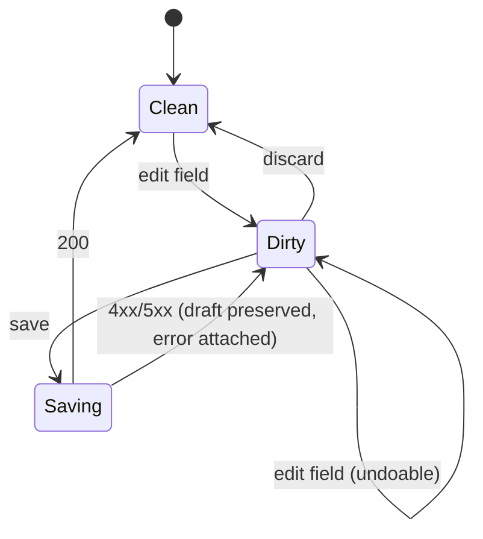

# Frontend

## Contents

- [1. Package layout](#1-package-layout)
- [2. Transport façade](#2-transport-façade)
- [3. Routing](#3-routing)
- [4. Server state vs. client state](#4-server-state-vs-client-state)
- [5. Draft, undo/redo, and save](#5-draft-undoredo-and-save)
- [6. Components and design system](#6-components-and-design-system)
- [7. Screens](#7-screens)
- [8. Animation budget](#8-animation-budget)
- [9. Accessibility](#9-accessibility)
- [10. Performance strategy](#10-performance-strategy)
- [11. Error and empty-state design](#11-error-and-empty-state-design)
- [12. i18n readiness](#12-i18n-readiness)
- [13. Testing surfaces built into the frontend](#13-testing-surfaces-built-into-the-frontend)

## 1. Package layout

```
packages/
├── contracts/     generated only — TS types + Zod validators from JSON Schema
├── api/           transport, live store, and domain hook modules
├── ui/            app shell, feature folders, shared primitives, design tokens
└── config/        shared eslint / tsconfig / tailwind presets
apps/
├── desktop/       desktop webview entry; the native shell lives in rust/desktop-shell
├── web/           standalone web build; injects the HTTP transport with a user-supplied origin
└── website/       public site plus the mock-transport demo
```

`apps/{desktop,web}` are small entry points: mount the same `<App />`, inject a different
transport, done. The desktop entry additionally injects host pickers when it runs inside
Tauri. `apps/website` has two entries: `src/site.tsx` is the public marketing and docs site,
and `src/main.tsx` is the demo that mounts the same `<App />` with `MockTransport` at
`/demo/`. Any application component that lives in an `apps/*` directory is a bug.

The marketing homepage also mounts four real video screens through `VideoDemo`. That host
is a boundary, not a second shell: it supplies `DemoModeProvider` with an overlay root
inside `.video-demo`, so menus, popovers, sheets, and dialogs portal inside the application
frame and open non-modally. A scroll lock or `aria-hidden` sweep would otherwise affect the
surrounding article. `ScreenMain` renders the screen landmark as `main` only in the desktop
application and as a plain block under the embed, because the marketing page already owns
the document's main landmark.

`packages/ui/src` is organized by feature, not by file kind:

```
app/                 shell, router, hosts, route errors
features/
  analytics/         measured-data catalogue, charts, sequence cards
  configuration/     input, filters, and the sequence section editors
  encoders/          catalogue, parameter sheet and drafts, executable provider, saved builds, JSON editor
  logs/              log viewer and history
  preview/           player shell, media session composed from playback/transport/audio/buffering/prefetch hooks, stage transform, MediaSource stream, playback model
  projects/          Home, project screens, queue, templates
  scenes/            rail, timeline, details, structural editing
  script/            Monaco editor, language server, generated stub
  settings/          dependency inventory, network, storage, About
  videos/            video configuration, tabs, run controls
shared/              primitives, theme, shortcuts, models, and pure utilities used by more than one feature
```

A screen, its components, its model, and its tests live in the same feature folder. A
control moves to `shared/` only when more than one feature uses it.

Error presentation is shared rather than copied. `shared/InlineError` is the banner beside a
failed save control; `shared/LoadErrorPanel` replaces a body that never loaded and carries
its retry. The settings-only uppercase label lives in `features/settings/Kicker` because no
other feature uses it.

The encoder catalogue keeps selection, removal, and top-bar wiring in `EncodersPanel`. The
parameter table, the executable provider card, and the saved-build sheet are separate
modules, so editing one does not reopen the catalogue's orchestration. `ParameterSheet` is
composition and controls; `useParameterDraft` owns the reset boundary and field state,
`parameter-draft-rules` owns validation and descriptor conversion, and the preview,
identity, kind, choice, number, default, and relation sections are independent components.

The settings screen is the tab shell. `DependencyInventory` and `Diagnostics` own the
preflight inventory, its loading and empty states, and the probe action; `DependencyRow`
edits one provider, `SceneModelGroup` and `PythonInterpreterGroup` are the two capabilities
that are not executable rows, and `AppearancePanel` owns theme, density, and reduced motion.
The project-template surface is three route modules: `ProjectTemplatesManager` owns the
searchable list, `ProjectTemplateOverview` owns one template's section grid, and
`ProjectDefaultsSectionScreen` owns one section editor. Only `project-defaults-parts` holds
their shared header, section-card link, and section-id helpers.

The sequence analytics catalogue is a façade over focused type, format, series, metric,
table, threshold, and section modules; `sequence-analytics.ts` keeps the public types and
the route dispatch. The Scenes screen composes an extracted compact-width hook, gap and
selection helpers, tab controls, a context menu, and edit dialogs. The Logs screen
composes its formatting model, filter bar, sort header, line menu, export sheet, and retry
panel.

`packages/api/src/api/` mirrors the UI domains: `client`, `system`, `host`, `templates`,
`projects`, `queue`, `configuration`, `encoders`, `encode`, `videos`, `scenes`, `logs`, and
`runs`. Cross-domain contracts live in `keys` (cache keys), `invalidate` (shared invalidation
stacks), and `paths` (encoded URL prefixes). `packages/api/src/api.tsx` is a re-export barrel, so
every existing import from `@av1ation/api` and `./api` keeps its name; the public surface is
still `packages/api/src/index.ts`, which re-exports the barrel rather than maintaining a second
hook list. `transport/mock.ts` is the façade; fixtures, demo data, pickers, and the method route
handlers live under `transport/mock/`.

### 1.1 Feature graph

`npm run check:feature-boundaries` enforces the UI dependency graph. `app/` is the
composition root: it may import `shared/` and any feature. `shared/` is a leaf: it may
import `shared/` and packages below the UI, but never `app/` or a feature. A feature may
import `shared/`, its own files, and only the feature edges below:

| Feature | May import |
| --- | --- |
| `analytics` | — |
| `configuration` | `encoders` |
| `encoders` | — |
| `logs` | `videos` |
| `preview` | — |
| `projects` | `configuration` |
| `scenes` | `encoders`, `preview`, `videos` |
| `script` | `configuration` |
| `settings` | `encoders`, `projects` |
| `videos` | `analytics`, `configuration` |

Every feature also imports itself, and the table lists only other features. The root
`index.ts` is part of `app/`. Tests are scanned like source, because a test that reaches
across a feature couples it just as a component does. A feature folder that is not in the
table, a `feature → app` import, a `shared → feature` or `shared → app` import, and an
unlisted cross-feature edge all fail. The checker also rejects a cycle in the declared
graph.

The table is the only place a new feature edge is declared; a new feature or edge edits it
in the same change. Moving a genuinely shared control to `shared/` is preferred to adding an
edge. Imports from `@av1ation/api`, `@av1ation/contracts`, React, and third-party packages
are outside this graph.

## 2. Transport façade

The rule from AGENTS.md §2.1, made concrete.

```ts
// packages/api/src/transport/types.ts (abridged)
export interface Transport {
  get<T>(path: string, schema: ZodType<T>): Promise<T>;
  post<T>(path: string, body: unknown, schema: ZodType<T>): Promise<T>;
  put(path: string, body: unknown): Promise<void>;
  putJson<T>(path: string, body: unknown, schema: ZodType<T>): Promise<T>;
  patchJson<T>(path: string, body: unknown, schema: ZodType<T>): Promise<T>;
  delete(path: string): Promise<void>;
  subscribe<T>(path: string, schema: ZodType<T>, onEvent: (event: T) => void): () => void;
  readonly mediaUrl: ((path: string) => string) | undefined;
  // Host capabilities: pickFile, pickSaveFile, pickExecutable, pickVideoFile(s),
  // pickDirectory, pickScript, pickIndex, pickModel, saveTextFile, revealPath, openPath,
  // openLanguageServer. Each is undefined on a host that cannot provide it.
}
```

Two implementations:

| Implementation | Used by | Notes |
| --- | --- | --- |
| `HttpTransport` | desktop, web | `fetch` plus an SSE subscription, injected base URL and token; `mediaUrl` is absent on a LAN session |
| `MockTransport` | website demo, component tests | routes each call to in-memory fixtures and a mock event stream |

`mediaUrl` returns a URL rather than bytes because `<video>` and `` need real URLs —
a `Blob` per frame would defeat the preview design. It is absent on hosts that cannot
attach their credential to a media element, so the player shows a reason instead of an
unauthenticated request.

The façade exports **hooks**, not raw calls. Representative names:

```ts
useProjects()            useProject(id)         useProjectConfig(id)
useVideo(id)             useVideoState(id)      useEncoders()
useEncodeEvents()        useHealth()            useRefreshPreflight()
```

`useEncodeEvents()` is mounted once by the application shell, not by a screen. It
subscribes to `/api/events`, routes each event by the `project_id` and `video_id` the
service adds at the boundary, and writes progress under the same `video-state` key
`useVideoState` and the queue read. Progress writes are batched per animation frame; a
transition invalidates the derived state because only the server knows the new scene and
chunk counts. An event is self-describing, so no screen needs to look up which video a run
belongs to before it can use the event.

No component may import from `transport/`. Enforced by ESLint `no-restricted-imports` on
`packages/ui` and `apps/*`.

## 3. Routing

TanStack Router with one code-based route tree in `packages/ui/src/app/router.tsx`, typed routes
and typed search params. The tree is code-based rather than generated per app because the
same SPA is built by three hosts with different roots; a file-based generator would produce
three trees for one application.

```
/                                      home: project list
/projects/<id>                         project: section grid + queue
/projects/<id>/config/general          project General
/projects/<id>/config/<section>        one project configuration section
/projects/<id>/config/script           project General or sequence-input script
/projects/<id>/videos/<vid>            video: Configuration
/projects/<id>/videos/<vid>/config/general
/projects/<id>/videos/<vid>/config/<section>
/projects/<id>/videos/<vid>/script     video General or sequence-input script
/projects/<id>/videos/<vid>/scenes     Scenes
/projects/<id>/videos/<vid>/history    History
/projects/<id>/videos/<vid>/logs       Logs
/settings                              tabs; the active tab is the hash
/settings/templates/<templateId>       one project template overview
/settings/templates/<templateId>/<section>
/settings/templates/<templateId>/script
/settings/encoders/<encoderId>/json    encoder parameter JSON editor
```

`<section>` is `general`, `scene-detection`, `noise-generation`, `target-quality`,
`encoding`, `concatenation`, or `quality-check`. Sections are path segments, not query
state, so a section is linkable, the section grid is a list of links, and the breadcrumb is
generated from the route rather than maintained beside it. The queue stays on the project
screen, below the section grid. A script page takes `section` and `part` search params:
`part` names a whole sequence part (`target_quality`) or a nested input field
(`target_quality.metric_input`), and omitting it edits General's own input. The project,
template, and video script pages therefore share one editor shape while writing different
documents. The Project Templates list is the `#project-templates` tab; each template's
overview and section editors are routes (`/settings/templates/<templateId>` and
`/settings/templates/<templateId>/<section>`), not hash state. The encoder JSON editor is its
own page. Switching tabs is a route-level decision: a dirty panel goes through the same
save/discard/stay guard as leaving the screen. The breadcrumb is `Settings` on a tab,
`Settings / Project Templates / <template name>` on a template overview, and names the
section or script page on a child route.

Three route-level mechanisms do real work:

- **Route metadata.** Every mounted route spreads `routeFor(path)` from the single
  `ROUTE_META` registry, which carries the path, breadcrumb trail, required match params, the
  back target, and the optional script-search parser. The router's `staticData` is typed and
  required, and a test keeps each entry's params equal to its path, so a new route cannot ship
  without a trail or valid params. The shell reads the back target from that same static data
  instead of deriving it from a second switch, and renders the trail from `useMatches`.
  Settings tabs and script parts remain URL state because they select a document, not a panel.
  The command palette reads the active match's typed `staticData` and `params` for project,
  video, and Settings context instead of parsing `location.pathname`; the video tab list lives
  in `features/videos/video-tabs.ts` for both the tab bar and the palette.
- **The dirty-draft blocker.** `useBlocker` intercepts a link, a browser back gesture, or a
  command-palette jump while a configuration draft is dirty, then resolves it with an
  explicit save / discard / stay choice. It reads the draft's saved baseline, not Query
  cache. It does not intercept a running encode: navigation stays available, and the
  shell's persistent run chip shows the live run and opens the active video, where its
  stop controls live.
- **Validated search params.** The script pages use them to name the owning section and
  sequence part (`?section=target-quality&part=target_quality.metric_input`). The Settings
  tab is the URL hash. Scene selection, split sizes, and playback position are ephemeral
  component state, not URL state, so a reload resets those.

Why TanStack Router over React Router: typed search params, typed path params, and a
router-level blocker that can hold a navigation until the user chooses.
Why not Next.js or a framework with a server: there is no Node server and no SSR; the
backend is Rust. A framework would add a second runtime for no benefit.

## 4. Server state vs. client state

**TanStack Query owns all server state.** Nothing else.

| Concern | Owner | Persistence |
| --- | --- | --- |
| projects, configs, encoders, preflight | Query | cache only, `staleTime` tuned per key |
| run events / progress | Query cache, updated by `useEncodeEvents()` | cache only, seeded from `/api/runs/:id/events?since=` |
| selection, panel sizes, scroll positions | React state/context (ephemeral) | none |
| config draft + undo/redo | `useDraftHistory` | never persisted until saved |
| playback position | component state | no |
| theme | Query (settings) | server is the source of truth |

`useEncodeEvents()` writes into the Query cache with `setQueryData` using the same keys the
REST hooks use, so a screen opened *after* the encode started shows correct progress
without a special path. This is the main reason for Query over hand-rolled stores: it
gives one cache with two writers and no synchronisation bug. The event's own
`project_id`/`video_id` select the entry; the run id is only the correlation id.

**Nothing derived from the server is duplicated into ephemeral UI state.** React state holds
only what the server has never heard of.

## 5. Draft, undo/redo, and save

Configuration editing is a draft workflow, not a form-per-field mutation.



- A draft is the whole editable document for one scope: a project section, a video
  section, or a General document. It is not a sparse field-path map. The project and video
  adapters decide what a save writes; for example, a video part that matches the project
  again stops being an override, and an optional sequence keeps its absent-or-null meaning.
- `packages/ui/src/shared/shortcuts.ts` owns every application chord, so a hint and the listener
  that answers it cannot disagree: Save, Undo, Redo, Discard draft, Command palette,
  desktop window zoom, and Run selected video, plus the scene player's bare keys. Window
  zoom is a host capability: the desktop webview scales itself, while a browser keeps its
  native zoom and the website demo ignores the chord. Each player command answers an
  arrow key and a letter: Space or K plays and pauses, ↑ or W and ↓ or S step between
  scenes, ← or A and → or D step between frames (Shift plus a frame arrow steps ten), and
  V, F, R toggle picture, full screen, and the view reset. The player binds Space and K to
  the window while it is mounted, so the rail and timeline can keep focus after a click;
  every other player key answers only on the player's own focused element. Player keys
  skip a focused control, so typing and page scrolling are never hijacked. The modifier
  prints as ⌘ on Apple hardware and Ctrl elsewhere. A
  chord is exact — Alt is never part of one, and Shift distinguishes Save from Save As —
  with Ctrl+Y accepted as a second Redo. Listeners run on the capture phase, so a focused
  field or Monaco cannot swallow a page command, and the first handler to claim an event
  prevents it, so a second mounted draft cannot run one command twice.
- `useDraftHistory` holds the past, present, and future of one serialisable draft. It is
  used by project General, every project section, Settings → Project Templates (General and
  every section), and an encoder's parameter table; the app-settings panels save field by
  field and therefore have no draft to undo. The top bar's undo and redo buttons drive the
  same history as the chords; undo and redo defer while focus is in an input, textarea,
  select, or contenteditable, so a field's own undo keeps working and Monaco is never
  replaced by a whole-document jump. Save and Discard work from anywhere on the page —
  including a focused field or Monaco — and Save suppresses the webview's own Save dialog;
  the button's guards (dirty, pending, locked, validation blockers) still decide whether
  anything is written. The lifecycle around the history — baseline, dirty/changes, guard,
  save/discard, and actions — is one draft session, not a separate state machine per
  screen. A screen supplies the document adapter and save callback.
- Run selected video is the same chord on the queue and on a video page, where the route
  already selects the video. It defers while a text-entry control has focus, so a path
  being typed keeps its own Enter, and while a dialog is open, so it never starts an
  encode behind a question the user is still answering. A focused checkbox does not defer:
  selecting a queue row is how that screen is operated.
- Validation runs on the draft against generated Zod schemas *and* server-side on save.
  Client-side validation is a UX convenience; the server is the authority.
- A failed save keeps the draft and shows a field-level error; it never discards user work.
- The draft-aware surfaces and their history: the seven project section editors (General and
  the six sequence sections), Settings → Project Templates **General** and each template section, and Settings
  → Encoders → one encoder's parameter table. The app-settings panels (Appearance, Storage,
  Network, Dependencies) write field by field and have no draft, so they have nothing to
  undo; a destructive action there is confirmed instead. The script page keeps Monaco's own
  undo stack and deliberately does not join the configuration history.
- Save replaces the resource (project config or the video's sparse overrides), never a
  partial merge. Two clients writing the same scope resolve by last write; the server does
  not merge, and the route guard is what prevents a single client from losing its own draft.
- Before an encode starts, a dirty draft forces a save-or-discard decision. The snapshot
  the server takes must be the one the user saw.
- The guard is one dialog, drawn from `07 Overlays / Guard · unsaved draft`: it names the
  draft, lists up to six changed fields with the saved and drafted values, and offers
  **Stay and keep editing** (focused), **Discard changes**, and **Save and leave**. The
  last action runs the screen's own save and leaves only after the server accepts it, so a
  failed save keeps the user on the screen with the error. A screen with no save action
  does not offer it.

## 6. Components and design system

- **Tailwind CSS v4** with `@tailwindcss/vite` — no `tailwind.config.js`; tokens are CSS
  custom properties in one file, consumed by both utilities and the chart theme. The token
  source is a DTCG JSON document that Penpot also consumes; see
  [frontend-penpot.md](frontend-penpot.md) §4. The default theme is dark.
- **Vendored shadcn/ui primitives.** The headless layer is shadcn/ui source vendored into
  `packages/ui/src/shared/` and edited in place; Radix supplies the behaviour underneath.
  It is source, not a runtime kit: no provider, preset theme, or layout system is adopted.
  We own the code, so we can fix accessibility and animation details without upstream
  dancing. Base UI is the documented fallback if Radix's DOM weight becomes a problem.
- **One menu façade.** `shared/Menu` is the only action-menu API. It exposes one vocabulary
  of trigger, content, item, label, separator, and radio item, and uses shadcn/ui Dropdown
  Menu or Context Menu underneath according to how the menu opens. Screens do not compose
  either menu directly. A searchable selection is a Popover containing a Command, not a
  menu with a text field inside it; the command palette uses the same Command source.
- **App-facing APIs.** Vendored Button, Switch, and Sonner keep their existing application
  APIs and token treatment. Native `<dialog>` surfaces and domain controls stay application
  components: number and search fields, cards, list rows, editable titles, run controls,
  route-backed tabs, and the `data-tip` tooltip. Shadcn/ui is the primitive layer, not a
  second theme or a replacement for those controls.
- **`class-variance-authority`** for variant APIs, **`tailwind-merge`** for composition.
- **lucide-react** for icons, at one consistent stroke width.
- **shadcn/ui Command (`cmdk`)** for the command palette (`Ctrl/Cmd-K`) — global navigation
  plus contextual actions, which is also the most important keyboard-accessibility win for a
  dense app.
- **`sonner`** for toasts, with a strict policy: toasts only for transient outcomes
  (saved, copied, export ready). Errors that need a decision get an inline panel, not a
  toast that disappears. A refused Start or Stop is inline at the control that issued it
  and is never toasted.
- **`motion`** (Framer Motion successor) for orchestration only — presence, list
  reordering, shared layout for the scene selection. Animation budget in §8.

Deliberately **not** adopted: a general component kit (MUI, Mantine, Chakra). They bring
their own theming system, their own layout primitives, and a bundle cost, and they fight
Tailwind. A headless layer gives the same components with none of that.

Also not adopted: a form library for the general config surface. The configuration model
is generated from JSON Schema, so the "form" is a renderer driven by schema plus a small
set of field descriptors — not a hand-authored form per encoder. `@tanstack/react-form`
is used only for the few genuinely bespoke forms (project create, settings).

Five complex sections — Target Quality, Quality Check, Noise generation, Scene detection,
and Encoding — own their layout shells and compose the shared `ParameterControl`; the
remaining sections use the generated renderer. A new widget kind is implemented once, not
once per section.

Two shared seams keep presentation from drifting. `duration.ts` names one policy per reader
(scene length, chart value, run length, ETA, worker hold, clip duration), and `clock.ts`
rounds before splitting, so a minute boundary never renders `:60`. The host-path field owns
one draft, pick, empty-policy, save-or-probe, pending, result, and failure lifecycle, so
every settings row behaves the same way.

## 7. Screens

The per-surface screen contracts live under [screens/](screens/README.md), split so each
can be read and changed on its own: [Home](screens/home.md), [Settings](screens/settings.md),
[Shell and navigation](screens/shell.md), [Project and configuration](screens/project.md),
[Script editor](screens/script-editor.md), and [Video](screens/video.md). The design gate and
screen inventory live in the index; the Phase 3 exit record and the per-screen review
checklist stay in [plan/03-ui.md](plan/03-ui.md).

## 8. Animation budget

Rules, because "animate everything" is how jank gets shipped:

1. Animate **`transform` and `opacity` only.** Any transition on `width`, `height`, `top`,
   `grid-template`, or `filter` is a review rejection unless it is a one-off and measured.
2. Durations: `100ms` for state feedback (hover, press), `160ms` for enter/exit of small
   surfaces, `240ms` for route content transitions. Nothing longer than `300ms` except
   progress shimmer, which is not a transition.
3. Route transitions are a content cross-fade with no layout shift. The shell never moves.
4. Lists use layout animation **only for the selection affordance**, never for reorder of
   a long list — reorder animation on a virtualized list is a guaranteed frame drop.
5. Respect `prefers-reduced-motion`: the global CSS disables transforms and reduces
   durations to `0.01ms`. The icon-button label reveal drops its 4px translate and swaps
   instantly; it never becomes a layout animation.
6. Progress uses a `transform: scaleX()` bar driven by CSS, updated at most once per
   animation frame from a value in a ref, not from React state. Encoding progress can
   arrive hundreds of times per second; re-rendering on each event would be the largest
   source of jank in the application.
7. `content-visibility: auto` on virtualized rows and offscreen panels.
8. Icon-only actions **expand their own host**: the control's width grows from 32 to the
   icon plus label plus padding, and the label occupies that new interior space as opacity
   `0→1` with `translateX(−4px→0)`. There is no separate plaque overlay, tooltip, or
   absolutely positioned slab. `160ms` in, `100ms` out. This is the one deliberate
   layout-affecting transition in the system: the requested interaction cannot exist
   otherwise. It is used only where the surrounding row
   can absorb the width change; a tight action cluster uses a labelled button instead. The
   icon anchors at the leading edge; expansion may be flipped to the left at a trailing
   edge, with the icon then anchoring right. Icon status chips follow the same rule. Under
   `prefers-reduced-motion` the width change is instant; the label never animates on its
   own after a hover-only state change.

Feedback policy: the user should always be able to answer "did it register?" within
100ms. That means optimistic feedback for local actions (button press, selection) and a
skeleton or progress indicator for anything over ~300ms.

Monaco dominates the script and JSON route chunks. Those routes declare a pending
skeleton at the router, so a direct visit paints the shell and a sized editor immediately;
the router's `intent` preload warms the same chunk on hover or keyboard focus. The skeleton
reserves the editor's height and the script page's side card, so the loaded screen does not
jump.

## 9. Accessibility

- Semantic elements first; the vendored Radix primitives under shadcn/ui handle focus traps
  and ARIA wiring. Every action menu goes through `shared/Menu`, so keyboard traversal,
  typeahead, Escape, and focus return are one implementation rather than one per surface.
- Every interactive element is reachable and operable by keyboard. The command palette
  covers global navigation; `j`/`k` and arrows cover list traversal.
- Focus is visible and never suppressed. Focus order follows reading order.
- Colour is never the only signal: state chips carry an icon and a text label. The compact
  icon chip keeps the same word in its revealed label and in its accessible name.
- Icon-only actions always carry an `aria-label`; the hover/focus label is presentational and
  repeats that name. Focus reveals the same label, so the pattern is not mouse-only.
- Charts get a text summary and a "view as table" toggle — pie and line charts are not
  accessible on their own.
- `axe-core` runs in the component-test screen harness over all 17 route families and the
  four embedded demo screens, and fails on a violation. The embedded cases mount the
  marketing main around the real `VideoDemo`, so a duplicate landmark or an overlay that
  hides the host is a test failure. Its jsdom environment cannot measure contrast or target
  size, so the route gallery runs the full rule set against each populated route in Chromium
  in both themes; the browser journeys add the same pass for interactive and locked states.

## 10. Performance strategy

| Risk | Mitigation |
| --- | --- |
| 5,000 scene rows | `@tanstack/react-virtual`; windowed rendering with measured row heights |
| high-frequency progress events | SSE writer batches into `requestAnimationFrame`; bar animates from a ref |
| Monaco bundle size | dynamic import; shipped as its own chunk; loaded only when a script input is edited |
| ECharts bundle size | tree-shaken per-chart imports; loader component defers until visible |
| large log files | virtualized log view with a ring buffer; never render the whole file |
| config re-resolution | pure function, memoized by a structural hash of both sides |
| route chunking | every route is a lazy boundary |

Bundle budget: initial JS under 250 KB gzipped excluding Monaco and ECharts; those must
stay in lazy chunks. `npm run check:bundle-size` reads each built host's `index.html`
module entry and `modulepreload` graph, gzips it at a fixed level, and fails above the
budget; route imports are absent from that graph, so the lazy editors and charts are not
counted.

## 11. Error and empty-state design

Every screen defines four states before it is considered done: **loading** (skeleton
matching final layout), **empty** (what this is, how to fill it), **error** (what failed,
what to do, how to see details), **populated**. A screen without all four is incomplete.
Phase 4's component pass (4.2.2) records the certification in
`packages/ui/src/app/route-states.test.tsx`: 68 cells over all 17 route families, with
loading, error, and populated rendered through `MockTransport`. Home, Project, Scenes,
History, and Logs also render the empty branch. The other 12 record an explicit **N/A**
reason because their empty branch is the same form or list with no rows, not a separate
screen; an optional sequence's empty document is one of those cases and remains covered
by the section editor's own empty state. The LAN Pairing form is a gate before the app
router, not one of the 17 routes, and is certified by the LAN E2E journey in
[testing.md](testing.md#3-frontend-tests). Phase 3 did not claim this certification early.

## 12. i18n readiness

English-only copy is written directly in the components and reviewed with the screen it
belongs to. There is no message catalogue and no `i18next` dependency in v0.1
(architecture §5); adding one later would be a separate, deliberate change.

## 13. Testing surfaces built into the frontend

Not test-specific code paths — test-*observable* surfaces:

- `data-testid` on stable, semantic elements only (never on wrappers that change).
- `MockTransport` is the website demo's provider and the component suite's fixture source,
  so the demo and the tests exercise the same request shapes.
