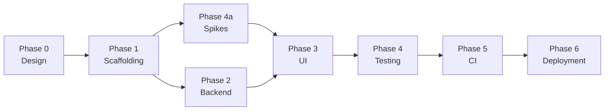

# Phase Plan — Overview

## 1. Purpose

Phase 0 plus six delivery phases, executed in order, each with a definition of done. The
order exists to remove risk early and to avoid building UI against an API that will change.

Phase 4 is split deliberately: **spikes run early** (right after scaffolding), because
their verdicts decide what Phase 3 can build. The rest of Phase 4 (the full pyramid) runs
after the UI exists.

## 2. Why this order

| Ordering rule | Reason |
| --- | --- |
| Backend before UI | The UI is generated largely from contracts; writing screens first means rewriting them. |
| Spikes before UI | Preview and drag-select are the two features that could force an architectural change. Building them last means building them twice. |
| Testing after UI (mostly) | E2E needs screens. Unit tests are written continuously; Phase 4 is where the *pyramid* is completed and enforced. |
| CI after testing | There is no point automating checks that do not exist. |
| Deployment last | Signing, notarisation, and updater infrastructure are only needed when artifacts are worth shipping. |

## 3. Phase summary

| Phase | Plan | Goal | Exit criterion |
| --- | --- | --- | --- |
| 0 | this doc set | decide and document everything | documents reviewed; no open question that blocks Phase 1; the application board set (`00`–`10`) approved. The public website design is deferred to Phase 6 (D31), so it is not a Phase 0 gate |
| 1 | [01-scaffolding.md](01-scaffolding.md) | the application builds and launches | `npm run dev` shows a real screen backed by a real endpoint |
| 2 | [02-backend.md](02-backend.md) | the engine runs behind a stable API | one real encode completes end-to-end through HTTP |
| 3 | [03-ui.md](03-ui.md) | every v0.1 screen is real | all v0.1 journeys work in the desktop app and a LAN browser |
| 4 | [04-testing.md](04-testing.md) | coverage is complete and spikes are resolved | the pyramid is green and S1–S5 have recorded verdicts |
| 5 | [05-ci.md](05-ci.md) | every check is automated | a pull request cannot merge with a red or missing check |
| 6 | [06-deployment.md](06-deployment.md) | artifacts and the public site ship | a signed release installs, updates, and uninstalls cleanly; the public site is published |

## 4. Cross-phase rules

1. **Every phase keeps the build green.** No phase ends with a known broken build.
2. **Every phase updates [progress.md](../progress.md).** A phase that is not in the tracker
   did not happen.
3. **A decision change mid-phase goes into [decisions.md](../decisions.md) first**, then the
   code. Not the other way round.
4. **No phase implements a later phase's feature "while we are here."** Scope creep is how
   the previous application accumulated 20 recorded defects.
5. **Each phase ends with a retrospective note** in `progress.md`: what took longer than
   expected, and what to change in the next phase's plan.

## 5. Features deferred beyond v0.1

Tracked so they are not lost, and so scaffolding leaves room for them:

| Feature | Phase in which it lands | Scaffolding implication |
| --- | --- | --- |
| Monaco VapourSynth editor + Python formatting/linting | 3 (increment 2) | lazy chunk; Monaco loaded only when a script input is edited |
| Scene list, multi-select, drag-select | 3 (increment 3) | virtualization chosen now; selection store shape reserved |
| Scene editing and validation | 3 (increment 3) | scenes are the engine's own; edits write `condor.scenes[i].encoder` and ranges, with no `custom` side table |
| Scene data injected into the script | 3 (increment 3) | `Input::VapourSynthScript::variables` is the carrier; generated `.pyi` stub ships with contracts; the per-scene template is gated on S5 |
| Preview sources (`Original`, `Decode`, `Encode`) on one player | 3 (increment 3) | `/preview/*` routes reserved; cache directory reserved |
| Video execution timeline | 2 | append-only JSONL per video; separate from derived state |
| ECharts analytics | 3 (increment 3) | chart theme bound to CSS tokens now |
| Anonymised log export | 3 (increment 2) | log format JSONL from day one; anonymiser is a pure function |
| Encoder parameter catalogue UI | 2 | descriptors generated from the engine, not hardcoded |
| User-defined encoders via `--help` probe + JSON `$schema` | 2 | schema published with contracts |

The one thing scaffolding must get right for these is **directory layout and lazy-loaded
chunk boundaries**, because those are expensive to change later.

## 6. Risk register

| Risk | Likelihood | Impact | Mitigation | Phase |
| --- | --- | --- | --- | --- |
| Transitive engine branches move under the pinned rev | medium | high — blocks all builds | pin `av-decoders` and `av-scenechange` in `Cargo.lock`; build with `--locked`; vendor fallback documented | 1 |
| VapourSynth/ffms2 native setup differs per machine | high | medium | preflight checks with a fix-it screen, not a crash | 1 |
| Preview infeasible on some platform (S2) | medium | high — architecture exemption | spike before UI; documented degradation path | 4a |
| Decoder re-init too slow to feel usable (S1) | medium | medium — UX downgrade | prepared-range model; pre-warm; honest progress | 4a |
| Upstream engine API changes | medium | medium | `EncodeEvent` adapter isolates the surface | continuous |
| Diagram/graph point counts too large to render | low | low | ECharts canvas + dataZoom; virtualized log | 3 |
| Per-scene script template defeats decoder cache | medium | medium — script editor ships without a template | S5 compares splice, single-pass and precomputed-range templates before the editor promises one | 4a |
| Rust build times slow CI | high | low–medium | cache `target/`, split jobs, build headless binary once | 5 |
| Screen reader/keyboard coverage incomplete | medium | medium | axe in component tests; keyboard parity in review checklist | 3 |
| Two hosts drift apart | low | high | one bundle, transport injection, E2E exercises HTTP | 1, 3 |
