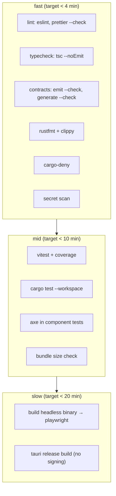

# Phase 5 — CI

**Goal:** every check that matters runs automatically on every pull request, is required for
merge, and is fast enough that nobody is tempted to bypass it.

**Exit criterion:** branch protection requires the full check set; a red check blocks merge;
a clean pull request reaches green in under 20 minutes; a release tag produces installable
artifacts.

---

## 1. Entry criteria

- [ ] Phase 4 exit checklist complete
- [ ] local scripts exist for every check (`npm run lint`, `test`, `contracts`, `cargo …`)
- [ ] CI reuses those scripts rather than reimplementing them

## 2. Principles

1. **CI runs the same commands as the developer.** A CI-only command is a command nobody
   runs locally until it fails.
2. **Fail fast, in parallel.** Cheap checks first, expensive builds cached.
3. **No check that cannot be made deterministic.** A flaky required check is worse than no
   check, because it trains people to re-run.
4. **Generated artifacts are verified, not regenerated silently.** CI fails on drift; it
   never commits.
5. **Screenshot comparison is not a CI check** (D10).

## 3. Workflows

### 3.1 `ci.yml` — pull request and main



| Job | Runs | Cache |
| --- | --- | --- |
| `lint-js` | ESLint + Prettier check | npm |
| `typecheck` | `tsc --noEmit` per workspace | npm, tsbuildinfo |
| `contracts` | `emit-schema --check`, `generate --check`, Zod round-trip | cargo (contracts only) |
| `lint-rust` | `cargo fmt --check`, `cargo clippy -- -D warnings` | cargo |
| `deny` | `cargo deny check` | cargo |
| `test-rust` | `cargo test --workspace` | cargo, `sccache` |
| `test-js` | Vitest with coverage thresholds | npm |
| `bundle-size` | initial chunk budget from `frontend.md` §10 | npm |
| `e2e` | build `av1ation-service --headless` once, run Playwright | cargo, Playwright browser |
| `screenshots` | Playwright screenshot pass, uploaded as an artifact | reuses the `e2e` build |
| `build-tauri` | `cargo tauri build --no-bundle` — proves it compiles | cargo |

Required checks: all of the above except `build-tauri` (required on `main` only) and
`screenshots` (an artifact job, never a gate — see D10).

### 3.2 `nightly.yml`

| Job | Purpose |
| --- | --- |
| real-encode smoke test on a 1 s clip | catches engine-level regressions the fake runner cannot |
| full screenshot generation, uploaded as an artifact | a visual record without gating |
| `cargo audit` / `npm audit` → issue on high severity | dependency drift |
| coverage trend report | visibility only |

None of these are required for merge.

### 3.3 `release.yml`

Owned by Phase 6; the structure is:

```
tag v* → verify checks green on that commit → build signed artifacts (matrix)
      → generate updater manifest → publish release → attach artifacts
```

## 4. Caching strategy

| Cache | Key | Notes |
| --- | --- | --- |
| cargo registry + index | lockfile hash | |
| `target/` | lockfile + toolchain + feature set | the dominant cost; use `sccache` or `Swatinem/rust-cache` |
| npm | `package-lock.json` | `npm ci` |
| Playwright browsers | version | pinned |
| Monaco / ECharts chunks | irrelevant — built, not downloaded | |

Rust is the slow part. Mitigations in order: cache `target/`, split Rust jobs by crate so a
frontend-only change skips most of them, run clippy and tests in one job rather than two
(they share the build), and use path filters so a docs-only change runs a three-job subset.

## 5. Path filters

| Changed paths | Jobs |
| --- | --- |
| `docs/**`, `*.md` | links check only |
| `packages/**`, `apps/**` | JS jobs + `e2e` |
| `crates/**`, `Cargo.*` | Rust jobs + `e2e` |
| `schema/**`, `packages/contracts/**` | contract jobs are required, others run |
| everything | full |

A required check that is skipped by path filtering must still report success, or branch
protection blocks the merge. Use a small "gate" job that reports the required name and
depends on the optional jobs.

## 6. Determinism requirements

| Requirement | Enforcement |
| --- | --- |
| Lockfiles | `npm ci`, `--locked` for cargo |
| Toolchain | `rust-toolchain.toml`, pinned Node via `.nvmrc` |
| Playwright browsers | pinned version, cached |
| Time zone | tests set `TZ=UTC` |
| Locale | tests set `LANG=en_US.UTF-8` |
| Filesystem case sensitivity | paths are lowercase; a lint rule catches mixed-case imports |
| Random ports | `--port 0`, read from stdout |
| No network in tests | Playwright blocks external hosts |

## 7. Artifacts

| Artifact | Retention | Purpose |
| --- | --- | --- |
| coverage (lcov + html) | 14 days | inspection |
| Playwright traces on failure | 14 days | debugging |
| nightly screenshots | 30 days | visual record for humans |
| headless binary | 7 days | cross-job reuse |

## 8. Branch protection

Required: `lint-js`, `typecheck`, `contracts`, `lint-rust`, `deny`, `test-rust`, `test-js`,
`bundle-size`, `e2e`. Also: linear history, no force push to `main`, and a review approval.

## 9. Deliverables

- `ci.yml`, `nightly.yml`, `release.yml` (skeleton, completed in Phase 6).
- Branch protection configured.
- Documented local equivalents in `CONTRIBUTING.md`.
- A "green PR" measured under 20 minutes from a warm cache.

## 10. Explicit non-goals

- Screenshot diffing (§ policy).
- Windows *and* macOS *and* Linux PR CI. Windows is the primary target; PR CI runs
  `ubuntu-latest` for speed, with a Windows job on `main` and in `release.yml`. A platform
  regression on Windows that only CI-on-main would catch is caught by `release.yml`
  building all targets — and by the release checklist.
- Coverage badges.
- Auto-merge on green (a human decides when a change is semantically right).

## 11. Exit checklist

- [ ] all listed workflows exist and pass on the current tree
- [ ] branch protection requires the full set
- [ ] a docs-only change completes in under 3 minutes
- [ ] a full change completes in under 20 minutes warm
- [ ] no job uses `sleep` or a fixed timeout to work around flakiness
- [ ] path filters do not silently skip a required check
- [ ] nightly jobs create issues rather than failing silently
- [ ] `docs/progress.md` updated with the pipeline diagram and timings

## 12. Known traps

| Trap | Avoidance |
| --- | --- |
| Rust build dominating wall clock | `sccache`/`rust-cache`, split jobs, path filters |
| E2E rebuilding the binary | build once, upload, download in the E2E job |
| Node version drift between jobs | `.nvmrc` + `setup-node` with `node-version-file` |
| Playwright version vs. browser version mismatch | install browsers with the exact matching CLI version |
| `cargo-deny` failing on a new advisory and blocking everyone | advisory failures open an issue and warn; license and ban violations block |
| Contract drift sneaking through a path filter | contract jobs run on any `crates/**` or `schema/**` change and are required |
