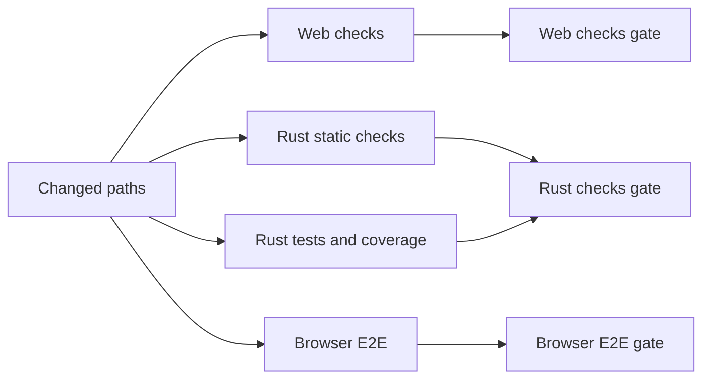
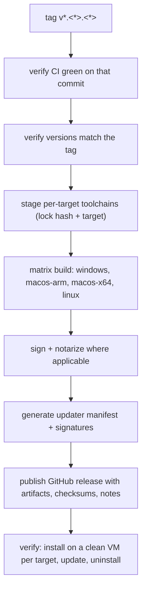

# Phase 5 — CI and delivery

> **Planning record.** Current delivery status lives in [progress.md](../progress.md).
> Release channels, unsigned distribution, and the Linux baseline are owned by
> [releases.md](../releases.md); where this plan differs, the policy wins.

**Goal:** every check that matters runs automatically on every pull request, is required for
merge, and is fast enough that nobody is tempted to bypass it; and a tagged release produces
installers that install, update, and uninstall cleanly on every supported platform, with code
signing where certificates exist and explicit unsigned labels where they do not, plus the
public website that documents and demos them.

**Exit criterion:** branch protection requires the three aggregate gate checks; a red check
blocks merge; a clean pull request reaches green in under 20 minutes; a tagged release
produces installers for Windows, macOS, and Linux, each carrying the largest toolchain its
target can prove; the updater delivers the next version to an installed copy on its supported
platforms; the release notes, checksums, explicit signature status, audit bundle, and GPL
source offer are all present; the public website and its `MockTransport` demo are
published.

---

## 1. Entry criteria

- [ ] Phase 4 exit checklist complete
- [ ] local scripts exist for every check (`npm run lint`, `test`, `contracts`, `cargo …`)
- [ ] CI reuses those scripts rather than reimplementing them
- [ ] at least one release candidate has completed the manual test plan in §16
- [ ] updater signing secret available; code-signing certificates optional under
      [releases.md](../releases.md#unsigned-distribution)
- [ ] the license decision is reflected in the About screen and the repository

## 2. Principles

1. **CI runs the same commands as the developer.** A CI-only command is a command nobody
   runs locally until it fails.
2. **Fail fast, in parallel.** Cheap checks first, expensive builds cached.
3. **No check that cannot be made deterministic.** A flaky required check is worse than no
   check, because it trains people to re-run.
4. **Generated artifacts are verified, not regenerated silently.** CI fails on drift; it
   never commits.
5. **Screenshot comparison is not a CI check**.

## 3. Workflows

### 3.1 `ci.yml` — pull request and default branch



| Job | Runs | Cache |
| --- | --- | --- |
| `changes` | Detects a docs-only change and runs the documentation check | npm |
| `web` | Formatting, ESLint, typecheck, feature boundaries, API JSON, evidence, docs, and `npm audit --audit-level=high`; Vitest coverage, inventory, and `build:ci` (website gallery variant, so no generated captures) | npm |
| `rust-static` | Rustfmt, Clippy, service modules, contracts, routes, and versions | cargo |
| `rust` | `cargo audit --file rust/Cargo.lock`; workspace tests and Rust coverage | cargo, cargo-audit |
| `e2e` | Builds the headless service and desktop SPA, then runs Playwright | cargo, Playwright browser |
| `build-tauri` | Push-only compile check: create an empty `dist/tools`, then `npm run tauri -- build --no-bundle` | cargo |
| `web-gate` | Always reports the `Web checks gate` status from `changes` + `web` | none |
| `rust-gate` | Always reports the `Rust checks gate` status from `changes` + `rust-static` + `rust` | none |
| `e2e-gate` | Always reports the `Browser E2E gate` status from `changes` + `e2e` | none |

The required statuses are exactly `Web checks gate`, `Rust checks gate`, and
`Browser E2E gate`. The underlying `web`, `rust-static`, `rust`, `e2e`, and `build-tauri` jobs are
implementation details and are not required directly, because a docs-only change skips
them. The npm audit runs inside `web`; the Rust audit runs inside `rust`. `build-tauri` is
push-only so its release compile cannot inflate pull-request latency. `screenshots` is a
separate, manual advisory workflow. See [testing.md](../testing.md#35-screenshot-gallery) for the
screenshot policy.

Adding `cargo audit` found four vulnerabilities in the direct `zip 4.6.1` dependency; the
service now uses `zip 9.5.1`, and the audit has no vulnerability findings. The remaining
thirteen RustSec warnings are unmaintained, yanked, or unsound dependencies; `glib 0.18.5`
(`RUSTSEC-2024-0429`) is the unsound one and needs a transitive upgrade.

#### Release-time security gates

**Decision:** the `cargo-deny` license/ban/source policy and repository secret scanning are
release-time gates, not pull-request gates ([tasks 5.28–5.29](#15-release-workflow)). Both
need a reviewed policy before they can block anything, and license/ban scope depends on the
pinned engine's dependency graph and the toolchain lock. The pull-request workflows keep
`cargo audit` and `npm audit` for known vulnerabilities.

- **`cargo-deny` license/ban/source policy:** task 5.28 commits a reviewed `deny.toml` for
  the Cargo graph and runs it in the release-security job before publication. Vulnerability
  advisories remain with `cargo audit`; license, ban, and source violations block the
  release once the policy is in place. Bundled toolchain licences remain task 5.27's
  responsibility.
- **Repository secret scanning:** task 5.29 commits a scanner configuration and a reviewed
  allowlist for generated fixtures and test-only credentials, then runs it in the
  release-security job before publication. Pull requests are not scanned until that
  allowlist is reviewed.

### 3.2 `weekly.yml`

| Job | Purpose |
| --- | --- |
| real-encode gate: all 12 ignored Rust tests on generated clips | catches engine-level regressions the fake runner cannot |
| `cargo audit` / `npm audit` → issue on high severity | dependency drift |
| coverage trend report: both coverage policies on generated reports, uploaded with the run summary | visibility only |

All three rows are implemented in `.github/workflows/weekly.yml`. A scheduled run is skipped
when nothing outside documentation changed since the previous successful scheduled run; a
manual dispatch always runs. The
dependency-audit job opens or updates one issue for npm high/critical and Cargo
vulnerabilities, and closes it when the audit is clean. None of these jobs runs on a pull
request or is a required status.

### 3.3 `trial-linux.yml` — manual runner trial

A `workflow_dispatch`-only workflow that runs copies of the `rust` and `e2e` jobs on
`ubuntu-latest`, so a run can show whether those jobs actually need the Windows runners they
use today. The Rust leg drops the MSVC linker steps and the browser leg installs Chromium's
shared libraries. It is not a gate, reports no required status, and changes nothing in
`ci.yml`; moving the real jobs is a separate decision after a trial run passes.

### 3.4 `release.yml`

Specified in [§15](#15-release-workflow); the shape is:

```
tag v* → verify checks green on that commit → build signed artifacts (matrix)
      → generate updater manifest → publish release → attach artifacts
```

## 4. Caching strategy

| Cache | Key | Notes |
| --- | --- | --- |
| cargo registry + index | lockfile hash | |
| `dist/cargo/` | lockfile + toolchain + feature set | the dominant cost; use `sccache` or `Swatinem/rust-cache` |
| npm | `package-lock.json` | `npm ci` |
| Playwright browsers | version | pinned |
| Monaco / ECharts chunks | irrelevant — built, not downloaded | |

Rust is the slow part. Mitigations in order: cache `dist/cargo/`, run clippy and tests in one
job rather than two (they share the build), and use path filters so a docs-only change runs
only change detection, the documentation check, and the three gates. Splitting Rust jobs by
crate or skipping one language for a change in the other is not implemented: any non-doc
change runs all three aggregates.

## 5. Path filters

Only docs-only gating is implemented. The per-language split described earlier is not
present: a package or app change still runs Rust, and a Rust change still runs Web. Add
separate path outputs to `changes` and the gate conditions before claiming otherwise.

| Changed paths | Aggregate work |
| --- | --- |
| `docs/**`, `*.md` | documentation check only; all three gates report success |
| everything else | all three aggregates |

A required status is always one of the three gate jobs, never an individual runner. A gate
whose runner was skipped by a path filter must report success; otherwise branch protection
will wait forever for a status that cannot occur. The npm audit runs in `web` and the Rust
audit in `rust`; a docs-only change skips both.

## 6. Determinism requirements

| Requirement | Enforcement |
| --- | --- |
| Lockfiles | `npm ci`, `--locked` for cargo |
| Toolchain | `rust-toolchain.toml`, pinned Node via `.nvmrc` |
| Bundled toolchain | `packaging/toolchain.lock.json` is the only version input; `toolchain:verify` fails on an unlocked or mutable entry |
| Playwright browsers | pinned version, cached |
| Time zone | tests set `TZ=UTC` |
| Locale | tests set `LANG=en_US.UTF-8` |
| Filesystem case sensitivity | paths are lowercase; a lint rule catches mixed-case imports |
| Random ports | `--port 0`, read from stdout |
| No network in tests | Playwright blocks external hosts |

## 7. Artifacts

| Artifact | Retention | Purpose |
| --- | --- | --- |
| coverage (lcov + html) | 14 days | inspection |
| Playwright traces on failure | 14 days | debugging |
| screenshots | 30 days | visual record for humans |
| dependency-audit reports | 14 days | npm/Cargo JSON and the issue evidence |
| headless binary | 7 days | cross-job reuse |
| staged toolchain tree (release tags only) | 7 days | release matrix reuse; each component has its own key over target, manifest entry, recipe and builder bytes (5.20) |

## 8. Branch protection

Required statuses are exactly:

- `Web checks gate`
- `Rust checks gate`
- `Browser E2E gate`

Require those names on the default branch. Do **not** require `web`, `rust`, `e2e`, or
`changes` directly: the runners can be skipped by path filtering, while the gates always
report. Also enable linear history, block force pushes to the default branch, and require a
review approval.

**Configured 2026-11-15:** the active ruleset is `Main branch protection - CI gates,
review, linear history` (ID 27332355). It requires the three gate contexts, strict
up-to-date branches, linear history, force-push and deletion blocking, stale-review
dismissal, one approving review, and conversation resolution. Admin bypass remains enabled
because the owner is the only admin and the other collaborator has read access; a hosted
pull request must still exercise the three contexts before this can be treated as verified.

**Generated rulesets:** when the classic branch-protection rule was applied through the
API, GitHub surfaced it as two generated rulesets: `main-1` enforced deletion and
non-fast-forward blocking, while `main-2` enforced linear history, the three required
status checks, and pull-request review. They were consolidated into the single active
ruleset above on 2026-11-15. Admin bypass remains because strict admin enforcement would
leave the only admin unable to satisfy the review requirement until a second
writer/reviewer is available.

## 9. CI deliverables

- `ci.yml`, `weekly.yml`, `release.yml` (specified in §15).
- `toolchain:check` validates the reviewed manifest and recipe syntax in the local/CI static
  profile; full `toolchain:verify` remains a release gate until a complete lock exists (5.20).
- Branch protection configured for the three aggregate gate statuses.
- A dependency audit for npm and Rust advisories, plus a push-only Tauri compile check.
- Documented local equivalents in `CONTRIBUTING.md`.
- A "green PR" measured under 20 minutes from a warm cache.

## 10. Explicit non-goals

- Screenshot diffing (§ policy).
- Windows *and* macOS *and* Linux PR CI. Web checks run on `ubuntu-latest`; Rust and browser
  E2E run on `windows-latest` because Windows is the primary target. The manual
  `trial-linux.yml` exercises the Ubuntu alternatives, and `release.yml` builds all targets.
- Staging the bundled toolchain on every pull request. The lock is verified on every PR;
  the multi-gigabyte staged tree is built only for release tags, and each component cache is
  keyed by target, manifest entry, recipe and builder bytes (5.20).
- Coverage badges.
- Auto-merge on green (a human decides when a change is semantically right).

## 11. CI exit checklist

- [ ] all listed workflows exist and pass on the current tree (local static profiles, full tests, and frontend coverage pass; a hosted run is still pending)
- [x] branch protection requires the three aggregate gates (configured 2026-11-15; hosted context verification pending)
- [ ] a docs-only change completes in under 3 minutes (57 s local workflow-equivalent; awaiting a hosted run)
- [ ] a full change completes in under 20 minutes warm (221 s local component estimate, 442 s measured local component sum; awaiting a hosted run)
- [x] no job uses `sleep` or a fixed timeout to work around flakiness
- [x] path filters do not silently skip a required gate (docs-only gating only; no per-language filters)
- [x] the weekly dependency audit creates or updates an issue; an audit-tool failure fails the job instead of looking clean
- [x] `docs/progress.md` updated with the pipeline diagram and timings

## 12. CI traps

| Trap | Avoidance |
| --- | --- |
| Rust build dominating wall clock | `sccache`/`rust-cache` and docs-only filtering; per-language job splitting is not implemented |
| E2E rebuilding the binary | build once, upload, download in the E2E job |
| Node version drift between jobs | `.nvmrc` + `setup-node` with `node-version-file` |
| Playwright version vs. browser version mismatch | install browsers with the exact matching CLI version |
| `cargo-deny` failing on a new advisory and blocking everyone | the release-security job runs the reviewed license/ban/source policy at release time; advisory findings remain `cargo audit`'s separate signal rather than a second PR gate |
| Contract drift sneaking through a path filter | contract validation runs inside the Web and Rust aggregates on any `rust/crates/**` or `schema/**` change; the aggregate gates are required |
| A toolchain entry quietly pointing at `latest` or an unhashed URL | `toolchain:check` validates the reviewed manifest and recipes in the local/CI static profile; `toolchain:verify` rejects mutable refs and missing hashes at release time, once the lock exists |
| The release job resolving packages from the network | it reads the lock only; `pip` runs with `--no-index --require-hashes` |

## 13. Platform matrix

| Platform | Target | Format | Bundle target | Priority |
| --- | --- | --- | --- | --- |
| Windows x64 | `x86_64-pc-windows-msvc` | `.msi` (WiX) + `.exe` (NSIS) | full bundle | **primary** |
| macOS arm64 | `aarch64-apple-darwin` | `.dmg` + `.app` | full bundle after 5.26 | secondary (primary Mac) |
| macOS x64 | `x86_64-apple-darwin` | `.dmg` + `.app` | full bundle after 5.26 | secondary |
| Linux x64 | `x86_64-unknown-linux-gnu` | `.AppImage` + `.deb` | full bundle after 5.26 | secondary |
| Windows arm64 | `aarch64-pc-windows-msvc` | — | not supported | out of scope |
| Linux arm64 | `aarch64-unknown-linux-gnu` | — | not a Phase 5 target | later, reduced plugins |

Windows x64 is primary because its full bundle is the release gate.
“Secondary” is a build order, not a support tier: Phase 5 exits only with an installer for
every listed release target. The old reason — VapourSynth only publishing a Windows runtime —
no longer applies: R82 publishes `cp312-abi3` wheels for Windows x64, Linux x86_64 and macOS
13+ arm64/x64. Both macOS targets are raised to macOS 15 because the vsjetpack plugin wheels
are `macosx_15_0`. macOS and Linux still wait on the relocation and signing spike in 5.26,
not on an artefact.

macOS 15.0 is the floor because the bundled Python and VapourSynth wheels are
compatible with 13.0 but the vsjetpack plugin wheels are `macosx_15_0`. macOS installers are thin (arm64
and x64), not universal. Linux builds on Ubuntu 24.04/Debian 13 and declares WebKitGTK 4.1;
the system variant also declares FFMS2. Windows arm64 has no VapourSynth wheel, and Linux arm64 is a later target with a reduced
plugin set, not a Phase 5 promise.

### 13.1 Bundled toolchain

The installer carries the pipeline. A clean machine needs no Python, VapourSynth,
FFmpeg, MKVToolNix or encoder install; a user who maintains their own chooses **System** for
that capability and every other capability stays bundled.

| Capability | Bundled contents (per target) |
| --- | --- |
| Python | python-build-standalone CPython 3.14.10, full distribution, no `Scripts/*.exe`; Windows `python.exe`/`Lib`, macOS/Linux `bin/python3`/`lib` |
| VapourSynth | official core + VSScript R82; the target's `cp312-abi3` wheel; Windows `vsscript.dll`, macOS/Linux `libvsscript` plus the runtime `vapoursynth.toml` in app data; ffms2 and vszip plugins |
| Plugins | `vsjetpack[full,gpu,cl,vulkan]` per target — fmtconv, mvsfunc, mvtools, akarin, zsmooth, knlmeanscl, nlm-cuda, bm3d, dfttest2, eedi2, SangNom, edgefixer, …; omissions recorded in the lock |
| Encoders | `aomenc`, `SvtAv1EncApp`, `rav1e`, `vpxenc`, `avmenc`, `x264`, `x265`, `vvencapp`, built for the target |
| Muxing | an LGPL FFmpeg build (no x264/x265) and MKVToolNix `mkvmerge` for the target |
| Scene model | TransNetV2 `transnetv2.onnx` |
| Metrics | `libvmaf`; `fmetrics` from the pinned shared-library fork (`fmetrics.dll`, `libfmetrics.dylib`/`.so`); `libvship` only from a pinned audited build |
| Windows runtime | the Visual Studio 2015–2026 redistributable DLLs, app-local |
| OS webview | WebView2 on Windows, WKWebView on macOS, WebKitGTK 4.1 on Linux — a platform dependency, never in `<tools>` |

Staging layout and the provider rules are in [packaging.md](../packaging.md). The short form:

- Each target's tree is installed at `<resource>/tools`; the host passes `--tools-dir` and
  nothing is derived from the manifest directory or the working directory.
- `tool_sources` selects `bundled` or `system` per id. Absent means auto: bundled when
  healthy, system otherwise. `custom_tools` still wins.
- Python, VapourSynth and its plugins are one id (`vapoursynth`): VSScript initialises one
  CPython and the plugins are built against one core API. The unit is the target's own; a
  second platform's tree is never substituted. Changing that id needs a restart.
- FFmpeg and `mkvmerge` are exposed through `<app-data>/toolbin`; encoder paths are
  materialised into the run document. No tool is copied into a project.
- Each target is built from `packaging/toolchain.lock.json` and never from the network at
  install time. About lists every component with its version, licence and source link.
- Windows x64 carries the full bundle and is the gate. macOS arm64, macOS x64 and Linux x64 stage
  the executables and metrics immediately; their VapourSynth runtime waits for the
  relocation/signing spike in 5.26. Until then those installs default VapourSynth to System
  and say why.
- A component with no artefact for a target is absent from that target's lock, not copied
  from another target; the Dependencies row offers System only.

Each target's installer size is measured, not assumed (5.25). Above 2 GiB compressed, that
target's `scale` extra moves to a companion installer built from the same lock; that is a
size decision, not a runtime download, and it is made separately per target.

## 14. Versioning

- semver, single source in `package.json`, propagated by the Phase 1 script.
- Tags: `v<major>.<minor>.<patch>`.
- Pre-releases: `v<version>-rc.<n>`, published as a GitHub pre-release, never offered by the
  updater to stable installs.
- The updater refuses downgrades.
- The Tauri config's `version` and the Rust crate version must match the tag; `release.yml`
  verifies this before building and fails otherwise.

## 15. Release workflow



Tasks:

| # | Task |
| --- | --- |
| 5.5 | `release.yml` with a `windows-2025`, `macos-15` (arm64), `macos-15-intel` (x64), `ubuntu-24.04` matrix; one staging leg per target, each cached by lock hash and target triple |
| 5.6 | Tauri updater signing key pair; public key compiled in; private key in a secret |
| 5.7 | Windows code signing (Authenticode) of the installer **and every bundled PE**, or an explicit, documented decision to ship unsigned with a SmartScreen warning |
| 5.8 | macOS signing + notarisation of the `.app` and every nested Mach-O (Python, VSScript, FFmpeg, MKVToolNix, encoders, plugins, metrics), inside-out; ad-hoc signing plus documented Gatekeeper instructions if no Developer ID |
| 5.9 | Linux: AppImage + deb; declare `libwebkit2gtk-4.1-0`; build on Ubuntu 24.04; document the `libfuse2` requirement |
| 5.10 | Checksums (SHA-256) per artifact, published in the release body |
| 5.11 | Release notes generated from Conventional Commits, then hand-edited |
| 5.12 | GPL source offer per target: the exact tagged app source, plus `SOURCE-OFFER.md` naming the source and recipe for x265, mkvmerge, FFmpeg and every other GPL/LGPL component |
| 5.13 | `latest.json` updater manifest published; tested by installing `n-1` and updating |
| 5.14 | Uninstall check on each platform: no orphaned data or helper process |
| 5.15 | Portable/zip variant for Windows users who cannot install; macOS/Linux use the normal installers |
| 5.16 | Crash reporting: **none automatic**; a documented "export diagnostics" path instead |
| 5.17 | Website review: review the running landing, documentation index/article, and demo against the final app chrome |
| 5.18 | Build and deploy the public website; the demo uses `MockTransport` and never implies a live encode |
| 5.19 | `packaging/toolchain.json`, `packaging/toolchain.lock.json` and `packaging/recipes/` for all four release targets: per-target install paths, fmetrics fork pin/portability patch, and no artefact copied across targets |
| 5.20 | `npm run toolchain:build -- --target <triple>` in `toolchain.yml`, with a reusable per-component/per-target cache keyed by recipe and builder bytes; install Zig 0.16.0 for the fmetrics build; build thin macOS targets, never universal |
| 5.21 | Provider module shared by preflight and launch, `--tools-dir`, `tool_sources`, custom precedence, the macOS/Linux VSScript TOML under app data, and provider/version reporting in the preflight contract |
| 5.22 | Tauri resource bundling per target, generated `toolbin`, app-local MSVC runtime on Windows, `macOS.minimumSystemVersion` 15.0, absolute encoder paths in the run document |
| 5.23 | Settings → Dependencies source controls and About toolchain list, including the VapourSynth restart notice and target-specific omissions |
| 5.24 | Clean-VM matrix for every documented bundled/system combination: Windows, macOS 15+ (arm64 and x64), Ubuntu 24.04 with WebKitGTK 4.1; no Python, VapourSynth, FFmpeg or user VapourSynth config preinstalled |
| 5.25 | Measure each target's compressed installer and installed size; over 2 GiB, move that target's `scale` extra to a companion built from the same lock |
| 5.26 | macOS/Linux VapourSynth relocation spike: move the staged tree, generate the app-data `vapoursynth.toml`, verify Linux `libpython`/rpath linkage, macOS `install_name`/rpath rewriting and nested-code signing; ship executables and metrics whether or not it passes |
| 5.27 | Publish each target's lock, notices, SPDX SBOM and corresponding-source assets, including fmetrics' fork commit, upstream base and target patch set; serve the summary at `GET /api/toolchain` |
| 5.28 | `cargo-deny` release gate: commit a reviewed `deny.toml` covering licenses, bans and sources for the Cargo graph, including the pinned engine and its path-sibling metric crates; resolve every finding or record a reviewed exception. Run it in the release-security job before publishing. Bundled-toolchain licenses remain with 5.27; vulnerability advisories remain with `cargo audit`. |
| 5.29 | Repository secret scanning: commit the scanner configuration and a reviewed allowlist for generated fixtures and test-only credentials; run it beside 5.28 before publishing. Do not add a pull-request gate before that allowlist is reviewed. |

## 16. Manual release test plan

Automated tests cannot cover the native edges. Required before tagging:

- [ ] fresh install on a clean Windows VM with **no** Python, VapourSynth, FFmpeg, MKVToolNix
      or encoder on `PATH` → app opens, preflight is green, nothing downloads, a real encode runs
- [ ] fresh install on a clean macOS 15+ account with **no** Homebrew Python, VapourSynth,
      FFmpeg, encoder or `~/.config/vapoursynth/vapoursynth.toml` → app opens, preflight is
      green, a real encode runs; repeat on arm64 and x64 installers
- [ ] `spctl --assess --type execute` accepts the macOS app and the notarisation ticket is
      stapled; a build without a Developer ID documents the Gatekeeper override instead
- [ ] fresh install on Ubuntu 24.04 with WebKitGTK 4.1 and **no** Python, VapourSynth, FFmpeg,
      encoder or `~/.config/vapoursynth/vapoursynth.toml` → the `.deb` installs its declared
      dependencies, the app opens, and a real encode runs; repeat with the AppImage and
      `libfuse2` installed
- [ ] Settings lists the bundled version for every capability on each target; switching
      VapourSynth to System with nothing installed shows the reason and requires a restart;
      switching back is green
- [ ] install a system `aomenc`, select System for aom only → the encode uses it while every
      other capability stays bundled
- [ ] system VapourSynth + bundled encoders + bundled `mkvmerge` → encode succeeds on
      Windows, macOS and Linux (the mixed case in the requirement)
- [ ] on a machine with no usable Vulkan device, SSIMULACRA2 scores through the bundled
      `fmetrics` (the CPU fallback), and the Dependencies row shows it as bundled
- [ ] on each full bundle, script-editor completion works against the bundled interpreter
      with no user Python installed, and the row names the active completion server
- [ ] create a project, add a video, run a real encode to completion
- [ ] cancel an encode; app remains usable; output is not corrupted
- [ ] kill the app mid-encode; relaunch; state is consistent and no lock is stuck
- [ ] enable LAN mode; connect from a phone; run an encode; watch progress; disconnect
- [ ] revoke the token; the phone loses access immediately
- [ ] export an anonymised log; verify no paths, hostnames, or usernames remain
- [ ] edit a `.vpy` in Monaco; format; save; encode reflects the change
- [ ] scene list with a 5,000-scene file; drag-select; bulk edit; verify one undo step
- [ ] preview a scene in the desktop app and in a LAN browser; both play and seek
- [ ] switch the player between `Original`, `Decode` and `Encode`; `Decode` appears only with an overridden Parallel Encoder input
- [ ] change the Encode's input source between `Decode` and `Original`; the picture changes, the encoded bytes and position do not
- [ ] switch to dark mode; charts, editor, and player all follow
- [ ] update from `n-1` to `n` on Windows; settings and projects survive; repeat on macOS if
      the updater is offered there
- [ ] uninstall; app-data behaviour matches the documentation
- [ ] `prefers-reduced-motion` respected
- [ ] screen reader pass on the encode flow

## 17. Documentation to ship

| Document | Content |
| --- | --- |
| `README` (in-app) | what it is, that no prerequisites are installed separately, first-run per platform |
| First-run guide | create a project; how to choose a system Python/VapourSynth/encoder; where the bundle lives on Windows, macOS and Linux |
| Bundled toolchain | per target: every component, version, licence and source link, generated from the lock |
| Troubleshooting | the preflight failures verbatim, with fixes, including bundled-vs-system provider mismatches, WebKitGTK on Linux and the macOS 15 floor |
| Privacy statement | no telemetry, what the anonymised export contains |
| License | GPL-3.0, upstream attribution, source link |

### 17.1 Public website, documentation and demo

The public site is a separate static build from `apps/website`: a landing page, the
user-facing documentation, and the demo. The demo mounts the same SPA with
`MockTransport`; it has no backend and must not imply that it encodes files. The website is
composed from the application identity rather than Penpot boards; there is no website design
round or board approval. The running site is reviewed against the final app
chrome under 5.17 before 5.18 deploys it. Publishing the site is a release task, but it is
not part of the desktop installer.

## 18. Rollback

- The updater manifest can pin the previous version's artifact in minutes.
- A bad release is marked as a pre-release / unpublished, and `latest.json` is repointed.
- Project files carry `schema_version`; a downgraded app refuses newer files rather than
  corrupting them. This is the reason for the refuse-newer rule (Phase 2).

## 19. Release deliverables

- `release.yml` producing all four artifacts, each carrying the toolchain subset its
  platform can support, with its own lock, notices and source offer.
- Signed updater manifest with a verified `n-1 → n` update.
- Release checklist completed and attached to the release.
- Published checksums, `toolchain.lock.json`, `THIRD_PARTY_NOTICES.md`, SPDX SBOM and the
  GPL source offer for each target.
- A clean-VM install on each claimed platform that encodes with nothing preinstalled, and a
  mixed-provider install that encodes with a system VapourSynth.
- Stable installers and the Windows portable ZIP.
- Public website build (landing, documentation, demo) deployed to its static host.

## 20. Release exit checklist

- [ ] all matrix jobs produce artifacts for their target
- [ ] artifacts are signed where certificates exist, otherwise explicitly labeled unsigned or
      ad-hoc under [releases.md](../releases.md#unsigned-distribution)
- [ ] macOS app is notarised and stapled, or the ad-hoc fallback is documented
- [ ] Linux `.deb` declares WebKitGTK 4.1 and the AppImage runs on the 24.04 baseline
- [ ] updater verified end-to-end on Windows
- [ ] clean-VM install test passed on each claimed platform with no Python, VapourSynth or
      FFmpeg present
- [ ] on Windows, every capability switches between bundled and system, and a mixed
      selection encodes; macOS and Linux cover the capabilities their bundle claims
- [ ] per-target toolchain lock, notices, SBOM and source assets published and match the
      installer
- [ ] reviewed `deny.toml` is clean for licence, ban, and source policy in the
      release-security job
- [ ] secret scanning runs with the reviewed allowlist and reports no unexplained finding
- [ ] manual release test plan completed with evidence
- [ ] release notes, checksums, source link published
- [ ] uninstall leaves no orphaned helper processes or data without documentation
- [ ] public website published with the current application identity and a working `MockTransport` demo
- [ ] `docs/progress.md` marks v0.1 released

## 21. Release traps

| Trap | Avoidance |
| --- | --- |
| Version mismatch between tag, `package.json`, `tauri.conf.json`, crate | verified in `release.yml` before building |
| WebView2 missing on old Windows | Tauri's bootstrapper handles it; document the requirement |
| macOS unsigned app killed by Gatekeeper | notarise, or document the workaround prominently |
| macOS app fails before 15.0 because the vsjetpack plugin wheels are `macosx_15_0` | keep `minimumSystemVersion` at 15.0; older Macs use System VapourSynth |
| macOS nested Python or plugin Mach-O unsigned, invalid or missing hardened runtime | sign inside-out before the `.app`; verify with `codesign --verify --deep --strict` and `spctl`, never rely on `codesign --deep` alone |
| A universal macOS build mixes two wheel architectures | build thin arm64 and x64 installers; verify each on its own runner |
| The `macos-13` Intel runner label is retired | use `macos-15-intel`; it is the current Intel image and is scheduled through August 2027 |
| Linux AppImage needing `libfuse2` | document; also ship the `.deb` |
| Building Linux on `ubuntu-latest` raises the glibc floor | build on Ubuntu 24.04, the declared baseline |
| Linux webview not present on a minimal install | `.deb` depends on `libwebkit2gtk-4.1-0`; verify the AppImage on a clean 24.04 VM |
| A GUI app does not inherit the shell `PATH` on macOS/Linux | probe standard locations and the explicit custom path; do not assume a terminal's `PATH` is visible |
| Signing key rotation breaking updates | keep the previous public key available; document the procedure |
| Updater pointing at a pre-release | manifest generation excludes pre-releases from `latest.json` |
| Bundling native libs accidentally via a Cargo feature | audit each target's artifact contents in the release job |
| Bundled Python and VapourSynth are initialised once per process | the probe runs against the moved staged tree; changing the VapourSynth source requires a restart and the UI says so |
| A relocated `vsscript.dll`/`libvsscript` is not found | the probe runs against the moved staged tree with the runtime TOML generated for its resolved path, not against the build machine's install |
| macOS/Linux VSScript cannot find the bundled interpreter | generate the TOML at first use from the resolved paths under `<app-data>/vapoursynth`, launch with `XDG_CONFIG_HOME=<app-data>`, and never write the user's config |
| A staged `vapoursynth.toml` keeps staging absolute paths | generate it after installation from the resolved library and interpreter paths; test the moved tree in 5.26 |
| A library loads from a temporary extraction directory | install under the resolved resource directory; never derive a path from `CARGO_MANIFEST_DIR` or the CWD |
| System and bundled libraries mixing in one process | one provider per capability; Python, VapourSynth and plugins are a single id |
| Installer signed but bundled executables are not | sign every PE/Mach-O before staging (5.7/5.8); verify signatures on the staged tree |
| A toolchain bump is hidden in a lock diff | the manifest diff is the review surface; CI rejects a lock that does not match it |
| A wheel from another platform slips into a target tree | staging recipes select the target wheel; `toolchain:verify` checks the install path against the manifest but cannot identify a wheel tag |
| The fmetrics Windows patch is applied on macOS/Linux | the patch set is per target in the lock; POSIX builds omit it |
| `x265`/`mkvmerge` GPL obligations missed | `SOURCE-OFFER.md` is generated from each target's lock and checked in the release checklist |
| The fmetrics fork branch moves or is rebased | the lock pins the commit, the upstream base and the patch hash; staging fails when the merge-base or patch check does not match |
| Windows arm64 has no VapourSynth wheel | keep it out of the release matrix until a wheel exists; do not ship a bundle that cannot load |
