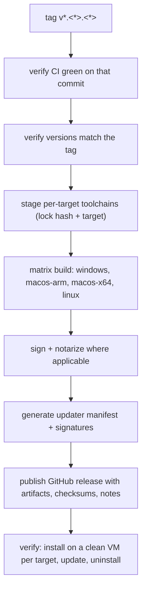

# Phase 6 — Deployment

> **Planning record.** Current delivery status lives in [progress.md](../progress.md).

**Goal:** signed, versioned, reproducible artifacts that install, update, and uninstall
cleanly on every supported platform, plus the public website that documents and demos them.

**Exit criterion:** a tagged release produces installers for Windows, macOS, and Linux, each
carrying the largest toolchain its target can prove; the updater delivers the next version to
an installed copy; the release notes, checksums, signatures, and GPL source offer are all
present; the approved public website and its `MockTransport` demo are published.

---

## 1. Entry criteria

- [ ] Phase 5 workflows green and required
- [ ] at least one release candidate has completed the manual test plan
- [ ] signing identities and secrets available
- [ ] the license decision  is reflected in the About screen and the repository

## 2. Platform matrix

| Platform | Target | Format | Bundle target | Priority |
| --- | --- | --- | --- | --- |
| Windows x64 | `x86_64-pc-windows-msvc` | `.msi` (WiX) + `.exe` (NSIS) | full bundle | **primary** |
| macOS arm64 | `aarch64-apple-darwin` | `.dmg` + `.app` | full bundle after 6.22 | secondary (primary Mac) |
| macOS x64 | `x86_64-apple-darwin` | `.dmg` + `.app` | full bundle after 6.22 | secondary |
| Linux x64 | `x86_64-unknown-linux-gnu` | `.AppImage` + `.deb` | full bundle after 6.22 | secondary |
| Windows arm64 | `aarch64-pc-windows-msvc` | — | not supported | out of scope |
| Linux arm64 | `aarch64-unknown-linux-gnu` | — | not a Phase 6 target | later, reduced plugins |

Windows x64 is primary because its full bundle is the release gate.
“Secondary” is a build order, not a support tier: Phase 6 exits only with an installer for
every listed release target. The old reason — VapourSynth only publishing a Windows runtime —
no longer applies: R82 publishes `cp312-abi3` wheels for Windows x64, Linux x86_64 and macOS
13+ arm64/x64. macOS and Linux wait on the relocation and signing spike in 6.22, not on an
artefact.

macOS 13.0 is the floor because the bundled Python and VapourSynth wheels are
`macosx_13_0`; macOS 11 and 12 stay on System VapourSynth. macOS installers are thin (arm64
and x64), not universal. Linux builds on Ubuntu 22.04/Debian 12 and declares WebKitGTK 4.1;
Windows arm64 has no VapourSynth wheel, and Linux arm64 is a later target with a reduced
plugin set, not a Phase 6 promise.

### 2.1 Bundled toolchain

The installer carries the pipeline. A clean machine needs no Python, VapourSynth,
FFmpeg, MKVToolNix or encoder install; a user who maintains their own chooses **System** for
that capability and every other capability stays bundled.

| Capability | Bundled contents (per target) |
| --- | --- |
| Python | python-build-standalone CPython 3.14.10, full distribution, no `Scripts/*.exe`; Windows `python.exe`/`Lib`, macOS/Linux `bin/python3`/`lib` |
| VapourSynth | official core + VSScript R82; the target's `cp312-abi3` wheel; Windows `vsscript.dll`, macOS/Linux `libvsscript` plus the runtime `vapoursynth.toml` in app data; ffms2, vszip, `vapoursynth-vship` where published |
| Plugins | `vsjetpack[full,gpu,cl,vulkan]` per target — fmtconv, mvsfunc, mvtools, akarin, zsmooth, knlmeanscl, nlm-cuda, bm3d, dfttest2, eedi2, SangNom, edgefixer, …; omissions recorded in the lock |
| Encoders | `aomenc`, `SvtAv1EncApp`, `rav1e`, `vpxenc`, `avmenc`, `x264`, `x265`, `vvencapp`, built for the target |
| Muxing | an LGPL FFmpeg build (no x264/x265) and MKVToolNix `mkvmerge` for the target |
| Scene model | TransNetV2 `transnetv2.onnx` |
| Metrics | `libvmaf`; `fmetrics` from the pinned shared-library fork (`fmetrics.dll`, `libfmetrics.dylib`/`.so`); `libvship` only from a pinned audited build |
| Windows runtime | the Visual Studio 2015–2026 redistributable DLLs, app-local |
| OS webview | WebView2 on Windows, WKWebView on macOS, WebKitGTK 4.1 on Linux — a platform dependency, never in `<tools>` |

Staging layout and the provider rules are in [packaging.md](../packaging.md). The short form:

- Each target's tree is installed at `<resource>/tools`; the host passes `--tools-dir` and
  nothing is derived from the manifest directory or the working directory.
- `tool_sources` selects `bundled` or `system` per id. Absent means auto: bundled when
  healthy, system otherwise. `custom_tools` still wins.
- Python, VapourSynth and its plugins are one id (`vapoursynth`): VSScript initialises one
  CPython and the plugins are built against one core API. The unit is the target's own; a
  second platform's tree is never substituted. Changing that id needs a restart.
- FFmpeg and `mkvmerge` are exposed through `<app-data>/toolbin`; encoder paths are
  materialised into the run document. No tool is copied into a project.
- Each target is built from `packaging/toolchain.lock.json` and never from the network at
  install time. About lists every component with its version, licence and source link.
- Windows x64 carries the full bundle and is the gate. macOS arm64, macOS x64 and Linux x64 stage
  the executables and metrics immediately; their VapourSynth runtime waits for the
  relocation/signing spike in 6.22. Until then those installs default VapourSynth to System
  and say why.
- A component with no artefact for a target is absent from that target's lock, not copied
  from another target; the Dependencies row offers System only.

Each target's installer size is measured, not assumed (6.21). Above 2 GiB compressed, that
target's `scale` extra moves to a companion installer built from the same lock; that is a
size decision, not a runtime download, and it is made separately per target.

## 3. Versioning

- semver, single source in `package.json`, propagated by the Phase 1 script.
- Tags: `v<major>.<minor>.<patch>`.
- Pre-releases: `v<version>-rc.<n>`, published as a GitHub pre-release, never offered by the
  updater to stable installs.
- The updater refuses downgrades.
- The Tauri config's `version` and the Rust crate version must match the tag; `release.yml`
  verifies this before building and fails otherwise.

## 4. Release workflow

Tasks:

| # | Task |
| --- | --- |
| 6.1 | `release.yml` with a `windows-latest`, `macos-14` (arm64), `macos-13` (x64), `ubuntu-22.04` matrix; one staging leg per target, each cached by lock hash and target triple |
| 6.2 | Tauri updater signing key pair; public key compiled in; private key in a secret |
| 6.3 | Windows code signing (Authenticode) of the installer **and every bundled PE**, or an explicit, documented decision to ship unsigned with a SmartScreen warning |
| 6.4 | macOS signing + notarisation of the `.app` and every nested Mach-O (Python, VSScript, FFmpeg, MKVToolNix, encoders, plugins, metrics), inside-out; ad-hoc signing plus documented Gatekeeper instructions if no Developer ID |
| 6.5 | Linux: AppImage + deb; declare `libwebkit2gtk-4.1-0`; build on Ubuntu 22.04; document the `libfuse2` requirement |
| 6.6 | Checksums (SHA-256) per artifact, published in the release body |
| 6.7 | Release notes generated from Conventional Commits, then hand-edited |
| 6.8 | GPL source offer per target: the exact tagged app source, plus `SOURCE-OFFER.md` naming the source and recipe for x265, mkvmerge, FFmpeg and every other GPL/LGPL component |
| 6.9 | `latest.json` updater manifest published; tested by installing `n-1` and updating |
| 6.10 | Uninstall check on each platform: no orphaned data or helper process |
| 6.11 | Portable/zip variant for Windows users who cannot install; macOS/Linux use the normal installers |
| 6.12 | Crash reporting: **none automatic**; a documented "export diagnostics" path instead |
| 6.13 | Website design round: approve landing, documentation index/article, and demo boards against the final app chrome  |
| 6.14 | Build and deploy the public website; the demo uses `MockTransport` and never implies a live encode |
| 6.15 | `packaging/toolchain.json`, `packaging/toolchain.lock.json` and `packaging/recipes/` for all four release targets : per-target wheel tags, fmetrics fork pin/portability patch, and no artefact copied across targets |
| 6.16 | `npm run toolchain:stage --target <triple>` in `release.yml`, cached by lock hash and target; install Zig 0.16.0 for the fmetrics build; build thin macOS targets, never universal |
| 6.17 | Provider module shared by preflight and launch, `--tools-dir`, `tool_sources`, custom precedence, the macOS/Linux VSScript TOML under app data, and provider/version reporting in the preflight contract  |
| 6.18 | Tauri resource bundling per target, generated `toolbin`, app-local MSVC runtime on Windows, `macOS.minimumSystemVersion` 13.0, absolute encoder paths in the run document |
| 6.19 | Settings → Dependencies source controls and About toolchain list, including the VapourSynth restart notice and target-specific omissions |
| 6.20 | Clean-VM matrix for every documented bundled/system combination: Windows, macOS 13+ (arm64 and x64), Ubuntu 22.04 with WebKitGTK 4.1; no Python, VapourSynth, FFmpeg or user VapourSynth config preinstalled |
| 6.21 | Measure each target's compressed installer and installed size; over 2 GiB, move that target's `scale` extra to a companion built from the same lock |
| 6.22 | macOS/Linux VapourSynth relocation spike: move the staged tree, generate the app-data `vapoursynth.toml`, verify Linux `libpython`/rpath linkage, macOS `install_name`/rpath rewriting and nested-code signing; ship executables and metrics whether or not it passes |
| 6.23 | Publish each target's lock, notices, SPDX SBOM and corresponding-source assets, including fmetrics' fork commit, upstream base and target patch set; serve the summary at `GET /api/toolchain` |

## 5. Manual release test plan

Automated tests cannot cover the native edges. Required before tagging:

- [ ] fresh install on a clean Windows VM with **no** Python, VapourSynth, FFmpeg, MKVToolNix
      or encoder on `PATH` → app opens, preflight is green, nothing downloads, a real encode runs
- [ ] fresh install on a clean macOS 13+ account with **no** Homebrew Python, VapourSynth,
      FFmpeg, encoder or `~/.config/vapoursynth/vapoursynth.toml` → app opens, preflight is
      green, a real encode runs; repeat on arm64 and x64 installers
- [ ] `spctl --assess --type execute` accepts the macOS app and the notarisation ticket is
      stapled; a build without a Developer ID documents the Gatekeeper override instead
- [ ] fresh install on Ubuntu 22.04 with WebKitGTK 4.1 and **no** Python, VapourSynth, FFmpeg,
      encoder or `~/.config/vapoursynth/vapoursynth.toml` → the `.deb` installs its declared
      dependencies, the app opens, and a real encode runs; repeat with the AppImage and
      `libfuse2` installed
- [ ] Settings lists the bundled version for every capability on each target; switching
      VapourSynth to System with nothing installed shows the reason and requires a restart;
      switching back is green
- [ ] install a system `aomenc`, select System for aom only → the encode uses it while every
      other capability stays bundled
- [ ] system VapourSynth + bundled encoders + bundled `mkvmerge` → encode succeeds on
      Windows, macOS and Linux (the mixed case in the requirement)
- [ ] on a machine with no usable Vulkan device, SSIMULACRA2 scores through the bundled
      `fmetrics` (the CPU fallback), and the Dependencies row shows it as bundled
- [ ] on each full bundle, script-editor completion works against the bundled interpreter
      with no user Python installed, and the row names the active completion server
- [ ] create a project, add a video, run a real encode to completion
- [ ] cancel an encode; app remains usable; output is not corrupted
- [ ] kill the app mid-encode; relaunch; state is consistent and no lock is stuck
- [ ] enable LAN mode; connect from a phone; run an encode; watch progress; disconnect
- [ ] revoke the token; the phone loses access immediately
- [ ] export an anonymised log; verify no paths, hostnames, or usernames remain
- [ ] edit a `.vpy` in Monaco; format; save; encode reflects the change
- [ ] scene list with a 5,000-scene file; drag-select; bulk edit; verify one undo step
- [ ] preview a scene in the desktop app and in a LAN browser; both play and seek
- [ ] switch the player between `Original`, `Decode` and `Encode`; `Decode` appears only with an overridden Parallel Encoder input
- [ ] change the Encode's input source between `Decode` and `Original`; the picture changes, the encoded bytes and position do not
- [ ] switch to dark mode; charts, editor, and player all follow
- [ ] update from `n-1` to `n` on Windows; settings and projects survive; repeat on macOS if
      the updater is offered there
- [ ] uninstall; app-data behaviour matches the documentation
- [ ] `prefers-reduced-motion` respected
- [ ] screen reader pass on the encode flow

## 6. Documentation to ship

| Document | Content |
| --- | --- |
| `README` (in-app) | what it is, that no prerequisites are installed separately, first-run per platform |
| First-run guide | create a project; how to choose a system Python/VapourSynth/encoder; where the bundle lives on Windows, macOS and Linux |
| Bundled toolchain | per target: every component, version, licence and source link, generated from the lock |
| Troubleshooting | the preflight failures verbatim, with fixes, including bundled-vs-system provider mismatches, WebKitGTK on Linux and the macOS 13 floor |
| Privacy statement | no telemetry, what the anonymised export contains |
| License | GPL-3.0, upstream attribution, source link |

### 6.1 Public website, documentation and demo

The public site is a separate static build from `apps/website`: a landing page, the
user-facing documentation, and the demo. The demo mounts the same SPA with
`MockTransport`; it has no backend and must not imply that it encodes files. The public
website design round is deferred out of Phase 0 to this phase. The `11 Website`
boards are an unapproved draft, not a Phase 0 gate; they fix the documentation IA (280px
sidebar, index, article with a 760px reading column and TOC) and the demo shell. The draft
is revalidated against the final app chrome and approved under 6.13 before 6.14 builds the
site. The static-site tool is chosen when that work starts and is not assumed by the
boards. Publishing the site is a release task, but it is not part of the desktop installer.

## 7. Rollback

- The updater manifest can pin the previous version's artifact in minutes.
- A bad release is marked as a pre-release / unpublished, and `latest.json` is repointed.
- Project files carry `schema_version`; a downgraded app refuses newer files rather than
  corrupting them. This is the reason for the refuse-newer rule (Phase 2).

## 8. Deliverables

- `release.yml` producing all four artifacts, each carrying the toolchain subset its
  platform can support, with its own lock, notices and source offer.
- Signed updater manifest with a verified `n-1 → n` update.
- Release checklist completed and attached to the release.
- Published checksums, `toolchain.lock.json`, `THIRD_PARTY_NOTICES.md`, SPDX SBOM and the
  GPL source offer for each target.
- A clean-VM install on each claimed platform that encodes with nothing preinstalled, and a
  mixed-provider install that encodes with a system VapourSynth.
- Stable installers and the Windows portable ZIP.
- Public website build (landing, documentation, demo) deployed to its static host.

## 9. Exit checklist

- [ ] all matrix jobs produce artifacts for their target
- [ ] artifacts are signed (or the decision not to sign is documented in `decisions.md`)
- [ ] macOS app is notarised and stapled, or the ad-hoc fallback is documented
- [ ] Linux `.deb` declares WebKitGTK 4.1 and the AppImage runs on the 22.04 baseline
- [ ] updater verified end-to-end on Windows
- [ ] clean-VM install test passed on each claimed platform with no Python, VapourSynth or
      FFmpeg present
- [ ] on Windows, every capability switches between bundled and system, and a mixed
      selection encodes; macOS and Linux cover the capabilities their bundle claims
- [ ] per-target toolchain lock, notices, SBOM and source assets published and match the
      installer
- [ ] manual release test plan completed with evidence
- [ ] release notes, checksums, source link published
- [ ] uninstall leaves no orphaned helper processes or data without documentation
- [ ] public website published with approved boards and a working `MockTransport` demo
- [ ] `docs/progress.md` marks v0.1 released

## 10. Known traps

| Trap | Avoidance |
| --- | --- |
| Version mismatch between tag, `package.json`, `tauri.conf.json`, crate | verified in `release.yml` before building |
| WebView2 missing on old Windows | Tauri's bootstrapper handles it; document the requirement |
| macOS unsigned app killed by Gatekeeper | notarise, or document the workaround prominently |
| macOS app fails on 11/12 because the bundled wheels are `macosx_13_0` | raise `minimumSystemVersion` to 13.0; older Macs use System VapourSynth |
| macOS nested Python or plugin Mach-O unsigned, invalid or missing hardened runtime | sign inside-out before the `.app`; verify with `codesign --verify --deep --strict` and `spctl`, never rely on `codesign --deep` alone |
| A universal macOS build mixes two wheel architectures | build thin arm64 and x64 installers; verify each on its own runner |
| The `macos-13` Intel runner label is retired | pin the current Intel image, or drop macOS x64 explicitly in a recorded decision |
| Linux AppImage needing `libfuse2` | document; also ship the `.deb` |
| Building Linux on `ubuntu-latest` raises the glibc floor | build on Ubuntu 22.04/Debian 12, the declared baseline |
| Linux webview not present on a minimal install | `.deb` depends on `libwebkit2gtk-4.1-0`; verify the AppImage on a clean 22.04 VM |
| A GUI app does not inherit the shell `PATH` on macOS/Linux | probe standard locations and the explicit custom path; do not assume a terminal's `PATH` is visible |
| Signing key rotation breaking updates | keep the previous public key available; document the procedure |
| Updater pointing at a pre-release | manifest generation excludes pre-releases from `latest.json` |
| Bundling native libs accidentally via a Cargo feature | audit each target's artifact contents in the release job |
| Bundled Python and VapourSynth are initialised once per process | the probe runs against the moved staged tree; changing the VapourSynth source requires a restart and the UI says so |
| A relocated `vsscript.dll`/`libvsscript` is not found | the probe runs against the moved staged tree with the runtime TOML generated for its resolved path, not against the build machine's install |
| macOS/Linux VSScript cannot find the bundled interpreter | generate the TOML at first use from the resolved paths under `<app-data>/vapoursynth`, launch with `XDG_CONFIG_HOME=<app-data>`, and never write the user's config |
| A staged `vapoursynth.toml` keeps staging absolute paths | generate it after installation from the resolved library and interpreter paths; test the moved tree in 6.22 |
| A library loads from a temporary extraction directory | install under the resolved resource directory; never derive a path from `CARGO_MANIFEST_DIR` or the CWD |
| System and bundled libraries mixing in one process | one provider per capability; Python, VapourSynth and plugins are a single id |
| Installer signed but bundled executables are not | sign every PE/Mach-O before staging (6.3/6.4); verify signatures on the staged tree |
| A toolchain bump is hidden in a lock diff | the manifest diff is the review surface; CI rejects a lock that does not match it |
| A wheel from another platform slips into a target tree | `toolchain:verify` checks wheel tags and install paths against the target triple |
| The fmetrics Windows patch is applied on macOS/Linux | the patch set is per target in the lock; POSIX builds omit it |
| `x265`/`mkvmerge` GPL obligations missed | `SOURCE-OFFER.md` is generated from each target's lock and checked in the release checklist |
| The fmetrics fork branch moves or is rebased | the lock pins the commit, the upstream base and the patch hash; staging fails when the merge-base or patch check does not match |
| Windows arm64 has no VapourSynth wheel | keep it out of the release matrix until a wheel exists; do not ship a bundle that cannot load |
