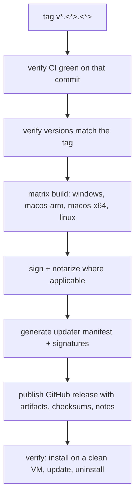

# Phase 6 — Deployment

**Goal:** signed, versioned, reproducible artifacts that install, update, and uninstall
cleanly on every supported platform, plus the public website that documents and demos them.

**Exit criterion:** a tagged release produces installers for Windows, macOS, and Linux; the
updater delivers the next version to an installed copy; the release notes, checksums,
signatures, and GPL source offer are all present; the approved public website and its
`MockTransport` demo are published.

---

## 1. Entry criteria

- [ ] Phase 5 workflows green and required
- [ ] at least one release candidate has completed the manual test plan
- [ ] signing identities and secrets available
- [ ] the license decision (D12) is reflected in the About screen and the repository

## 2. Platform matrix

| Platform | Target | Format | Priority |
| --- | --- | --- | --- |
| Windows x64 | `x86_64-pc-windows-msvc` | `.msi` (WiX) + `.exe` (NSIS) | **primary** |
| macOS arm64 | `aarch64-apple-darwin` | `.dmg` + `.app` | secondary |
| macOS x64 | `x86_64-apple-darwin` | `.dmg` + `.app` | secondary |
| Linux x64 | `x86_64-unknown-linux-gnu` | `.AppImage` + `.deb` | secondary |

Windows is primary because VapourSynth, ffms2, and the DirectML path for `ort` are best
supported there.

### 2.1 Native dependency reality

The application links VapourSynth and ffms2 dynamically. Two distribution models:

| Model | Pros | Cons |
| --- | --- | --- |
| **Require a user-installed VapourSynth + FFmpeg** (v0.1) | small artifact, no licensing entanglement, matches how the target users already work | a first-run failure mode; mitigated by the preflight fix-it screen |
| **Bundle everything** | frictionless install | artifact size, GPL/LGPL obligations for FFmpeg builds, per-platform packaging of native DLLs/dylibs |

**v0.1 requires a user-installed VapourSynth and FFmpeg.** Bundling is a post-1.0 decision
with its own licensing review and its own ADR. The preflight screen from Phase 2 is what
makes this acceptable: the user is told exactly what is missing with a link, rather than
seeing a crash.

## 3. Versioning

- semver, single source in `package.json`, propagated by the Phase 1 script.
- Tags: `v<major>.<minor>.<patch>`.
- Pre-releases: `v<version>-rc.<n>`, published as a GitHub pre-release, never offered by the
  updater to stable installs.
- The updater refuses downgrades.
- The Tauri config's `version` and the Rust crate version must match the tag; `release.yml`
  verifies this before building and fails otherwise.

## 4. Release workflow

Tasks:

| # | Task |
| --- | --- |
| 6.1 | `release.yml` with a `windows-latest`, `macos-latest` (arm), `macos-13` (x64), `ubuntu-latest` matrix |
| 6.2 | Tauri updater signing key pair; public key compiled in; private key in a secret |
| 6.3 | Windows code signing (Authenticode) or an explicit, documented decision to ship unsigned with a SmartScreen warning |
| 6.4 | macOS signing + notarisation, or documented `xattr -d` instructions if no Developer ID |
| 6.5 | Linux: AppImage + deb; document the `libfuse2` requirement |
| 6.6 | Checksums (SHA-256) per artifact, published in the release body |
| 6.7 | Release notes generated from Conventional Commits, then hand-edited |
| 6.8 | GPL source offer: link to the exact tagged source in every release |
| 6.9 | `latest.json` updater manifest published; tested by installing `n-1` and updating |
| 6.10 | Uninstall check on each platform: no orphaned data, no orphaned service |
| 6.11 | Portable/zip variant for users who cannot install |
| 6.12 | Crash reporting: **none automatic**; a documented "export diagnostics" path instead |
| 6.13 | Website design round: approve landing, documentation index/article, and demo boards against the final app chrome (D31) |
| 6.14 | Build and deploy the public website; the demo uses `MockTransport` and never implies a live encode |

## 5. Manual release test plan

Automated tests cannot cover the native edges. Required before tagging:

- [ ] fresh install on a clean Windows VM with **no** VapourSynth → app opens, fix-it screen
      names what is missing, no crash
- [ ] install VapourSynth → preflight goes green without restarting
- [ ] create a project, add a video, run a real encode to completion
- [ ] cancel an encode; app remains usable; output is not corrupted
- [ ] kill the app mid-encode; relaunch; state is consistent and no lock is stuck
- [ ] enable LAN mode; connect from a phone; run an encode; watch progress; disconnect
- [ ] revoke the token; the phone loses access immediately
- [ ] export an anonymised log; verify no paths, hostnames, or usernames remain
- [ ] edit a `.vpy` in Monaco; format; save; encode reflects the change
- [ ] scene list with a 5,000-scene file; drag-select; bulk edit; verify one undo step
- [ ] preview a scene in the desktop app and in a LAN browser; both play and seek
- [ ] switch the player between `Original`, `Decode` and `Encode`; `Decode` appears only with an overridden Parallel Encoder input
- [ ] change the Encode's input source between `Decode` and `Original`; the picture changes, the encoded bytes and position do not
- [ ] switch to dark mode; charts, editor, and player all follow
- [ ] update from `n-1` to `n`; settings and projects survive
- [ ] uninstall; app-data behaviour matches the documentation
- [ ] `prefers-reduced-motion` respected
- [ ] screen reader pass on the encode flow

## 6. Documentation to ship

| Document | Content |
| --- | --- |
| `README` (in-app) | what it is, prerequisites, first-run |
| First-run guide | install VapourSynth, point at FFmpeg, create a project |
| Troubleshooting | the preflight failures verbatim, with fixes |
| Privacy statement | no telemetry, what the anonymised export contains |
| License | GPL-3.0, upstream attribution, source link |

### 6.1 Public website, documentation and demo

The public site is a separate static build from `apps/website`: a landing page, the
user-facing documentation, and the demo. The demo mounts the same SPA with
`MockTransport`; it has no backend and must not imply that it encodes files. The public
website design round is deferred out of Phase 0 to this phase (D31). The `11 Website`
boards are an unapproved draft, not a Phase 0 gate; they fix the documentation IA (280px
sidebar, index, article with a 760px reading column and TOC) and the demo shell. The draft
is revalidated against the final app chrome and approved under 6.13 before 6.14 builds the
site. The static-site tool is chosen when that work starts and is not assumed by the
boards. Publishing the site is a release task, but it is not part of the desktop installer.

## 7. Rollback

- The updater manifest can pin the previous version's artifact in minutes.
- A bad release is marked as a pre-release / unpublished, and `latest.json` is repointed.
- Project files carry `schema_version`; a downgraded app refuses newer files rather than
  corrupting them. This is the reason for the refuse-newer rule (Phase 2).

## 8. Deliverables

- `release.yml` producing all four artifacts.
- Signed updater manifest with a verified `n-1 → n` update.
- Release checklist completed and attached to the release.
- Published checksums and a GPL source link.
- Stable and portable variants.
- Public website build (landing, documentation, demo) deployed to its static host.

## 9. Exit checklist

- [ ] all matrix jobs produce artifacts
- [ ] artifacts are signed (or the decision not to sign is documented in `decisions.md`)
- [ ] updater verified end-to-end on Windows
- [ ] clean-VM install test passed with no VapourSynth present
- [ ] manual release test plan completed with evidence
- [ ] release notes, checksums, source link published
- [ ] uninstall leaves no orphaned services or data without documentation
- [ ] public website published with approved boards and a working `MockTransport` demo
- [ ] `docs/progress.md` marks v0.1 released

## 10. Known traps

| Trap | Avoidance |
| --- | --- |
| Version mismatch between tag, `package.json`, `tauri.conf.json`, crate | verified in `release.yml` before building |
| WebView2 missing on old Windows | Tauri's bootstrapper handles it; document the requirement |
| macOS unsigned app killed by Gatekeeper | notarise, or document the workaround prominently |
| Linux AppImage needing `libfuse2` | document; also ship the `.deb` |
| Signing key rotation breaking updates | keep the previous public key available; document the procedure |
| Updater pointing at a pre-release | manifest generation excludes pre-releases from `latest.json` |
| Bundling native libs accidentally via a Cargo feature | audit the artifact contents in the release job |
