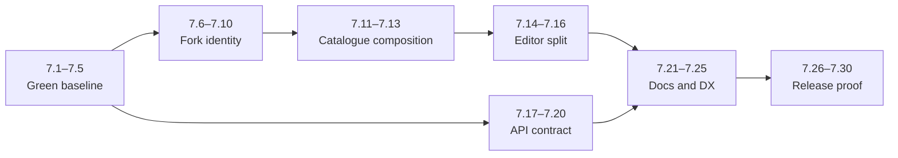

# Phase 7 — Pre-release quality hardening

> **Planning record.** Current delivery status lives in [progress.md](../progress.md).

**Status:** in progress. The baseline is green: `5a97680` reconciled the service map and
route matrix, `de3d3c0` formatted the remaining files, and 7.4/7.5 record the aggregate
checks and the generated-artifact checklist. The baseline run also moved the chunk guard to
`shared/`, so projects and videos no longer import scenes, and added the project config
impact route to the reviewed matrix. The fork-selection marker is now read at run
preparation, so a build located after a project selected it runs its own binary; the
explicit `fork_id` field (7.6/7.7) is deferred to the stable window under the migration
rule below. The encoder-editor split (7.14–7.16) is complete: selection resolution is a
tested model module and the editor composes four sections. Workstream D (7.17–7.20), 7.21–7.22, and the
7.23–7.25 documentation items are closed or deferred; 7.26 is closed, and the browser
and real-encode proof (7.27–7.30) remains. This phase follows Phase 6 and precedes the first stable tag. It is a
hardening phase, not a feature phase.

**Goal:** make the repository’s quality claims true again, remove the maintainability
regressions introduced by the encoder-fork work, and leave the stable release with a green
static gate, an honest contract story, and a re-audited grade of at least **A− (90/100)**.

**Exit criterion:** every P0 and P1 item below is closed with recorded evidence; every P2 item
is either closed or explicitly deferred with a reason; `npm run verify`, the browser E2E
suite, and the available real-encode suite pass; the route matrix and service map are current;
and the re-audit has no P0 or P1 finding.

**Audit record:** the 2026-11-18 whole-codebase quality audit is kept locally and is not
committed to the repository.

---

## 1. Why this phase exists

The current tree is architecturally sound but is making three quality claims it cannot
currently support:

1. **A green static gate.** Prettier fails on five tracked files, so `check:static` stops
   before lint, typecheck, boundaries, contracts, and routes run.
2. **A current architecture map.** The new fork modules are missing from
   `docs/service.md`, and the generated route matrix is stale with an invalid waiver.
3. **A coherent encoder selection.** A pathless fork is identified by a hidden CLI option;
   after the fork is later located, the UI can report it as available while the project still
   resolves the base provider on `PATH`.

The audit score is **B+ (87/100)**. The largest single code-quality regression is the fork
catalogue duplicating 102 of 113 base SVT-AV1 parameter rows for Essential, and 88 of 113 for
5Fish. The largest single file risk is `EncoderEditor.tsx` at 1,009 lines.

This phase removes those risks without reopening product scope.

---

## 2. Baseline

| Area | Grade | Basis |
| --- | ---: | --- |
| Developer experience | B+ (88) | Strong feature navigation and docs index; docs are long and currently stale. |
| Code | B (84) | Strong boundaries and single sources of truth; duplicated fork tables and oversized editor. |
| API design | B+ (86) | Strong error model and generated routes; mixed command/resource style and a false versioning claim. |
| TDD | A− (91) | 1,191 frontend tests, 18 Rust integration files, 17 E2E specs, route matrix, coverage policy; missing fork lifecycle test. |
| Domain modeling | A− (91) | Excellent glossary and decisions; hidden fork marker is a domain leak. |

Baseline gate evidence from 2026-11-18:

| Gate | Result |
| --- | --- |
| ESLint, typecheck, feature boundaries, API JSON, docs | pass |
| Contracts, routes, version, toolchain | pass |
| Rust format and clippy | pass |
| Test inventory | pass, 204 checks |
| Prettier | **fail**, 5 files |
| Route-test matrix | **fail**, stale matrix and invalid `POST /api/encoders/forks` success waiver |
| Service module map | **fail**, 4 new fork modules not listed |

---

## 3. Scope and non-goals

### In scope

- Restore the static and evidence gates.
- Make fork identity explicit and test its lifecycle.
- Compose fork catalogues from the base table plus explicit differences.
- Split the encoder editor along its existing data/UI seams.
- Correct the API versioning and route-naming story.
- Make the normative docs accurate and quick to navigate.
- Run the full release verification and re-audit.

### Non-goals

- New encoder features, new providers, or new UI surfaces.
- A general repository rewrite or a new test framework.
- Changing encoder output or parameter semantics.
- Replacing the generated-contract pipeline.
- Fixing unrelated product-backlog items from Phase 6.

If an item below reveals a product bug, it moves to Phase 6 with a named owner rather than
silently expanding this phase.

---

## 4. Entry and exit criteria

### Entry

- [ ] Phase 6 is closed, or every remaining item is explicitly deferred with a reason.
- [ ] The current release-candidate baseline is tagged or otherwise identified.
- [ ] The audit report is accepted as the Phase 7 baseline.
- [ ] No feature branch is mid-merge against the encoder files.

### Exit

- [ ] All P0 and P1 tasks are closed.
- [ ] P2 tasks are closed or deferred in this plan with a reason.
- [ ] `npm run check:static`, `npm run check:evidence`, and `npm run check:test-inventory` pass.
- [x] `npm run verify` passes.
- [ ] `npm run test:e2e` passes; `npm run test:real-encode` passes where the environment is
      available, or its limitation is recorded.
- [ ] The route matrix and `docs/service.md` are current.
- [ ] The re-audit has no P0 or P1 finding and no axis below B+.
- [ ] `docs/progress.md` and release readiness record the evidence.

---

## 5. Workstream A — Restore the green baseline

**Priority:** P0. **Purpose:** make every later claim measurable.

| ID | Task | Acceptance | Verification | Depends |
| --- | --- | --- | --- | --- |
| 7.1 | Format the five failing tracked files. Keep this as its own commit if the encoder commit is already prepared. | `prettier --check .` passes. | `npm run format:check:web` | — |
| 7.2 | Add the four missing fork modules to `docs/service.md` and keep the fenced tree exact. | `check:service-modules` passes. | `npm run check:service-modules` | — |
| 7.3 | Remove the obsolete `success` waiver for `POST /api/encoders/forks`; regenerate `docs/route-test-matrix.md`. | No invalid or stale waiver; matrix reports the success test. | `node scripts/route-test-matrix.mjs`; `npm run check:evidence` | — |
| 7.4 | Run the aggregate gates from a clean state and record the exact failure point, if any. | `check:static` and `check:evidence` pass in one run. | `npm run check:static`; `npm run check:test-inventory` | 7.1–7.3 |
| 7.5 | Add a short pre-commit/review checklist for generated docs: route, service map, contracts, inventory. | The checklist is in `CONTRIBUTING.md` and names the four commands. | Review; `npm run check:docs` | 7.2–7.3 |

**Stop rule:** do not start 7.6 until 7.4 is green. A green baseline is the first deliverable,
not a cleanup after the refactor.

**Landed early:** commit `5a97680` reconciled `docs/service.md`, regenerated the route matrix,
removed the invalid fork waiver, and updated the Phase 6 status. 7.1 is closed by
`de3d3c0`. 7.4's aggregate gates and 7.5's generated-artifact checklist in `CONTRIBUTING.md`
are recorded; 7.1–7.5 are complete. The 7.4 run also fixed an unused `ConfigOverrides`
import, moved the shared chunk guard out of `features/scenes` so the projects and videos
features declare no new edges, and regenerated the matrix with the missing
`POST /api/projects/{project_id}/config/impact` requirement and coverage.

---

## 6. Workstream B — Fork identity and lifecycle

**Priority:** P1. **Purpose:** remove the hidden CLI marker and make the selected build
truthful through reload, path changes, and deletion.

The current marker is a UI concern stored in the engine’s `options` map. It works for the
first save but does not survive the fork becoming available later: the UI reads the
descriptor’s new path, while the project document still has `executable: null` and the run
resolves the base provider.

| ID | Task | Acceptance | Verification | Depends |
| --- | --- | --- | --- | --- |
| 7.6 | Define an explicit build selection on the encoder document, for example `fork_id` plus an optional executable. Keep the engine’s CLI option map for CLI options only. | A saved project names a stable fork ID; no `__av1ation_fork_*` string appears in `options`. | Contract/schema test; serialization round-trip test | 7.4 |
| 7.7 | Read legacy markers for one release and migrate them on load/save. | Existing projects keep their selection; new writes use the explicit field. | Service migration test; UI fixture with a legacy document | 7.6 |
| 7.8 | Resolve the executable at run preparation from the explicit selection. If the fork has no path, return the documented base-provider fallback and a visible warning. | A pathless fork still runs the base provider; a located fork uses its path; a stale path is a typed refusal or fallback, not silence. | `run/prepare.rs` tests; pathless and located fixtures | 7.6 |
| 7.9 | Add lifecycle tests: pathless → located, path moved, fork deleted, fork reset. | Each transition has a UI test and a service/run test where the state crosses the boundary. | Vitest encoder tests; `service/tests/api/run.rs` | 7.7–7.8 |
| 7.10 | Remove the warning’s dependency on the descriptor’s current `executable`; base it on the document’s resolved provider or the explicit selection. | The warning cannot disappear while the run still uses the base provider. | UI test for the transition | 7.8–7.9 |

**Migration rule:** if the explicit field is too large a contract change for the stable
window, keep the marker behind a single legacy codec and add the transition test anyway. Do
not spread marker checks into more components.

**Landed:** 7.8 and 7.10 are implemented with the marker as the one codec. Run preparation
resolves the saved fork's current path for a pathless document and falls back to the base
provider when the build is deleted or its path is missing; the Encoding section warns for
pathless, missing, and deleted selections. 7.9's pathless → located, moved, deleted, and
reset transitions have Rust and UI tests. 7.6/7.7 are deferred to the stable window: the engine encoder
document has no app-owned field, and a contract change would touch every saved project
during the rc window. The migration rule above permits the single legacy codec.

---

## 7. Workstream C — Catalogue and editor structure

**Priority:** P1. **Purpose:** remove duplicated parameter ownership and make the encoder
editor testable by responsibility.

### 7.11 Compose fork catalogues from the base

`svt_av1.rs` has 113 keys. `essential.rs` has 116 keys: 14 additions, 59 overrides, 43
inherited, and 11 removals. `five_fish.rs` has 151 keys: 63 additions, 54 overrides, 34
inherited, and 25 removals. The shared rows were copies with independent ownership.

| ID | Task | Acceptance | Verification | Depends |
| --- | --- | --- | --- | --- |
| 7.11 | Represent a fork as base entries plus explicit additions, overrides, and removals. | A base-table correction reaches both forks unless the fork explicitly overrides or removes the row. | Catalogue table test: no unintended duplicate key; explicit divergence list | 7.4 |
| 7.12 | Add a drift test for the three tables. | The test names every intentional divergence and fails on an accidental copy change. | Rust service test | 7.11 |
| 7.13 | Preserve probe/help authority where a fork genuinely differs. | A fork-only flag or changed range still comes from the fork’s own evidence, not a guessed union. | Catalogue fixtures for Essential and 5Fish | 7.11 |

**Landed:** `essential.rs` and `five_fish.rs` hold `ADDITIONS`, `OVERRIDES`, and `REMOVALS`
over `svt_av1.rs`; `fork_catalogue` composes base − removals + overrides + additions. The
drift test `every_fork_states_only_real_differences_from_the_base` verifies each declared
difference against the base and that the composed table equals the base plus the declarations;
the checked-in website fork snapshot matches, so the rewrite is behavior-preserving and a
deleted row or changed description still fails. The probe test
`a_probe_defers_to_the_fork_table_where_the_fork_differs` keeps the fork's kind and range,
drops a fork-only flag the help no longer lists, and takes only a stated default from the
help.

### 7.14 Split `EncoderEditor`

`EncoderEditor.tsx` is 1,009 lines and combines selection, catalogue merging, persistence
mapping, parameter filtering, three cards, and two sheets.

| ID | Task | Acceptance | Verification | Depends |
| --- | --- | --- | --- | --- |
| 7.14 | Extract selection and catalogue resolution into hooks or model functions. | Selection, marker migration, and merge behavior are tested without rendering the full editor. | Unit/component tests | 7.9–7.11 |
| 7.15 | Extract the settings, parameter, and command-preview sections. | `EncoderEditor.tsx` is below 500 lines and each section owns one concern. | `wc -l`; existing encoder tests pass | 7.14 |
| 7.16 | Keep the rendered behavior unchanged. | No visual redesign; all existing encoder tests pass without weakening assertions. | `npm run test:web -- packages/ui/src/features/encoders` | 7.14–7.15 |

**Landed:** `encoder-selection.ts` resolves the selected build, the pathless/missing/deleted
warnings, and the merged parameter catalogue from the document and catalogue;
`useEncoderSelection` wraps the query and memoizes that resolution. `EncoderEditor` consumes
the hook, and `encoder-selection.test.ts` covers marker selection and migration, path
matching, loaded/unloaded deletion, pathless and missing warnings, catalogue merge,
encoder-switch seeding, and marker writes without rendering the editor.

**Landed (7.15):** `EncoderEditor.tsx` is 161 lines and composes four sections that each
own one concern: `EncoderChoiceSection` (encoder, passes, workers, fork warning, status),
`EncoderSettingsSection` (colour, photon noise with its coefficient sheet, FFmpeg filter),
`EncoderParametersSection` (set rows, catalogue search, and the Add parameter sheet), and
`EncoderCommandPreview` (the copyable argv sheet). Each section owns the state it edits,
so the editor keeps only the document patch helpers and the scope copy; the 15 existing
`EncoderEditor` tests pass unchanged.

**Landed (7.16):** no production code changed for this check. The editor from `528d85e`,
the commit before 7.14, and the current one render byte-identical DOM — after normalising
React's generated ids — for a base encoder, an SVT-AV1 document with photon noise and an
active filter, a selected pathless build with its warning, both open sheets, and a populated
Workers slot. `EncoderEditor.test.tsx` is unchanged since `2f3a56f`, so 7.14–7.15 edited no
assertion; `npm run test:web -- packages/ui/src/features/encoders` passes 90 tests in 14
files, including the 15 editor tests.

**Do not** combine this with a styling pass. The split is behavior-preserving.

---

## 8. Workstream D — API and contract hygiene

**Priority:** P1/P2. **Purpose:** make the API’s stated contract match its implementation.

| ID | Task | Acceptance | Verification | Depends |
| --- | --- | --- | --- | --- |
| 7.17 | Correct the versioning statement in `docs/backend.md`. Either add a real version segment/header, or state that the local API is lockstep and `API_VERSION` is diagnostic. | No doc claims request negotiation that does not exist. | Docs review; `API_VERSION` use sites checked | 7.4 |
| 7.18 | Record the route-naming rule: resource transitions use resource URLs and HTTP methods; domain commands use a named exception. | A new route author has one rule and an exception list. | `AGENTS.md`; `check-routes` review | 7.17 |
| 7.19 | Audit the existing command/resource exceptions (`videos/remove`, `scenes/add`, `split`, `merge`, `reset`, `undo`, `preflight/refresh`, `encoders/probe`, `script/materialise`). | Each is either kept with a reason or scheduled for a breaking rename; no silent inconsistency remains. | Route review; no functional change required | 7.18 |
| 7.20 | Keep the generated route table current and make the matrix a required review artifact. | A route change cannot land without the generated diff. | `check:evidence` | 7.3 |

**Landed:** `docs/api.md` §1 states that the API is lockstep and `api_version` is
diagnostic, not negotiated. `AGENTS.md` §2.15 records the naming rule and requires a new
verb path to add a row to the exception list. `docs/api.md` §3 audits every trailing-verb path — the
nine named here plus the validate, probe, import, listener, run-control, reset, and export
commands — and keeps each with a reason; none is scheduled for a breaking rename. The route
table and matrix remain generated and required: `routes:check` rejects stale prose and
`check:evidence` requires the matrix.

---

## 9. Workstream E — Documentation and developer experience

**Priority:** P2. **Purpose:** keep the index strong while reducing the cost of finding one
fact.

| ID | Task | Acceptance | Verification | Depends |
| --- | --- | --- | --- | --- |
| 7.21 | Split `docs/backend.md` §5 into focused reference pages. Keep topology, ownership, persistence, and error policy in the backend page. | The backend page is below roughly 600 lines; links and anchors pass. | `npm run check:docs` | 7.17 |
| 7.22 | Keep the route table generated and link it from the focused API page. | No hand-maintained route list remains in prose. | `routes:check` | 7.21 |
| 7.23 | Add the Phase 6 and Phase 7 plans to `docs/README.md`. | The index remains the only documentation map. | `npm run check:docs` | — |
| 7.24 | Replace layout-history comments in `EncoderEditor` with invariant comments. | Comments explain engine, state, security, or accessibility constraints; pixel history is gone. | Review | 7.15 |
| 7.25 | Defer `use-preview-playback` splitting unless the release work touches it. | A named deferral, not an unowned refactor. | Phase 7 close-out | — |

**Landed:** 7.23 was already satisfied — `docs/README.md` lists
`plan/06-product-backlog.md` and `plan/07-quality-hardening.md`. 7.24 replaced the encoder
editor's layout-history comments with invariants in the four split sections and
`ParameterValueGrid`. **Deferred (7.25):** `use-preview-playback` is not split during Phase 7;
the release work does not touch it, so the split stays a named follow-up.

**Landed (7.21–7.22):** `docs/backend.md` is 554 lines. The HTTP surface moved to
[api.md](../api.md) — naming and its exception list, inputs and scripts, preview media,
and the generated route table, which `npm run routes` now writes there. Run semantics moved
to [runs.md](../runs.md) — sequence catalogue, transitions, run loop, live data, progress
fan-out, and derived state. `backend.md` keeps topology and ownership, service state,
persistence, logging, errors, and preflight, with §3 and §5 as pointers so existing section
anchors survive. `check-routes` scans both backend and API prose, and the docs index lists
both pages.

**Landed (7.26):** `npm run verify` passes end to end — static checks, 1,318 web tests in
200 files with the frontend coverage policy and the 219-check inventory, and the Rust suite
plus coverage (engine 74.12%, service 82.84%). The gate exposed two real defects, both
fixed: `ProjectChunkImpact` had no boundary fixture since `9be8807`, and a failed preview
scene could answer before removing its decoder session, letting the next scene reserve a
dying graph; the session is now forgotten before the failure reply. It also exposed a
loading race in the `VideoDemo` test, which now allows the same five seconds as its
navigation wait. The first run hit a transient `link.exe` `STATUS_DLL_INIT_FAILED`; a
clean rerun passed. The regenerated `docs/test-inventory.md` is part of the evidence.

---

## 10. Workstream F — Release proof and re-audit

**Priority:** P0. **Purpose:** replace “the gates are green” with evidence for the stable
release.

| ID | Task | Acceptance | Verification | Depends |
| --- | --- | --- | --- | --- |
| 7.26 | Run the complete local gate. | Static checks, web tests, Rust tests, and coverage pass. | `npm run verify` | 7.1–7.25 |
| 7.27 | Run the browser journeys. | All current Playwright specs pass, including the chart and security-negative journeys. | `npm run test:e2e` | 7.26 |
| 7.28 | Run the real-encode suite where the environment is available. | 12 environment-gated tests pass; a missing environment is recorded as a limitation, not a pass. | `npm run test:real-encode` | 7.27 |
| 7.29 | Re-run the audit against the post-hardening tree. | No P0/P1 findings; every axis at least B+; overall at least A−. | New HTML report or appended section | 7.26–7.28 |
| 7.30 | Update `docs/progress.md`, the Phase 7 row, and release readiness. | Status and evidence agree; the stable gate has a named owner. | Review | 7.29 |

**Release rule:** a green aggregate without the full test evidence is not a release proof. A
red environment-gated test is a limitation only when the missing environment is named and the
release owner accepts it.

---

## 11. Sequencing

1. **Baseline first.** No refactor while the static gate is red; otherwise a regression cannot
   be distinguished from the existing failure.
2. **Fork identity before catalogue composition.** The identity fix determines what a fork
   entry means; the table shape should follow that decision.
3. **Catalogue before editor split.** The editor split should consume a stable catalogue API,
   not move duplication around.
4. **Release proof last.** Re-audit only after the code, tests, and docs have settled.

---

## 12. Metrics and targets

| Measure | Baseline | Phase 7 target |
| --- | ---: | ---: |
| Overall audit grade | B+ (87) | A− (90+) |
| P0 findings | 3 | 0 |
| P1 findings | 5 | 0 |
| P2 findings | 4 | 0 or named deferrals |
| `EncoderEditor.tsx` | 1,009 lines | under 500 |
| Fork rows duplicating base | 102 Essential / 88 5Fish | 0 unintended duplicates |
| Invalid route waivers | 1 | 0 |
| Missing service-map modules | 4 | 0 |
| Static gate | fail at Prettier | pass |
| Full `npm run verify` | not run in audit | pass |

---

## 13. Risks and mitigations

| Risk | Likelihood | Impact | Mitigation |
| --- | --- | --- | --- |
| Explicit fork identity changes saved projects | medium | high — selection loss | Legacy marker reader and migration test; ship one compatibility release |
| Catalogue composition sends a flag the fork does not accept | medium | high — encoder failure | Explicit removal set; fork help/probe fixtures; no blind union |
| Editor split changes behavior | medium | medium — UX regression | Behavior-preserving extraction; encoder tests before and after |
| Full real-encode suite unavailable | medium | medium — release claim limited | Record the environment limitation and owner acceptance; do not mark as passed |
| Formatting commit mixes with feature commit | medium | low — review noise | Separate formatting commit or clearly staged file list |
| Phase 7 expands into Phase 6 product work | medium | high — schedule slip | Non-goals section; move product bugs to Phase 6 with an owner |

---

## 14. Definition of done

- [ ] 7.1–7.10 closed.
- [x] 7.11–7.16 closed; `EncoderEditor.tsx` below 500 lines.
- [x] 7.17–7.20 closed; API story is accurate.
- [x] 7.21–7.25 closed or explicitly deferred.
- [ ] 7.26–7.30 closed with evidence.
- [ ] No P0/P1 audit finding remains.
- [ ] The stable release can cite a green static gate, the full local verification, the E2E
      result, and the real-encode result or its recorded limitation.
