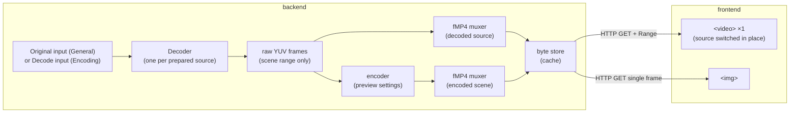
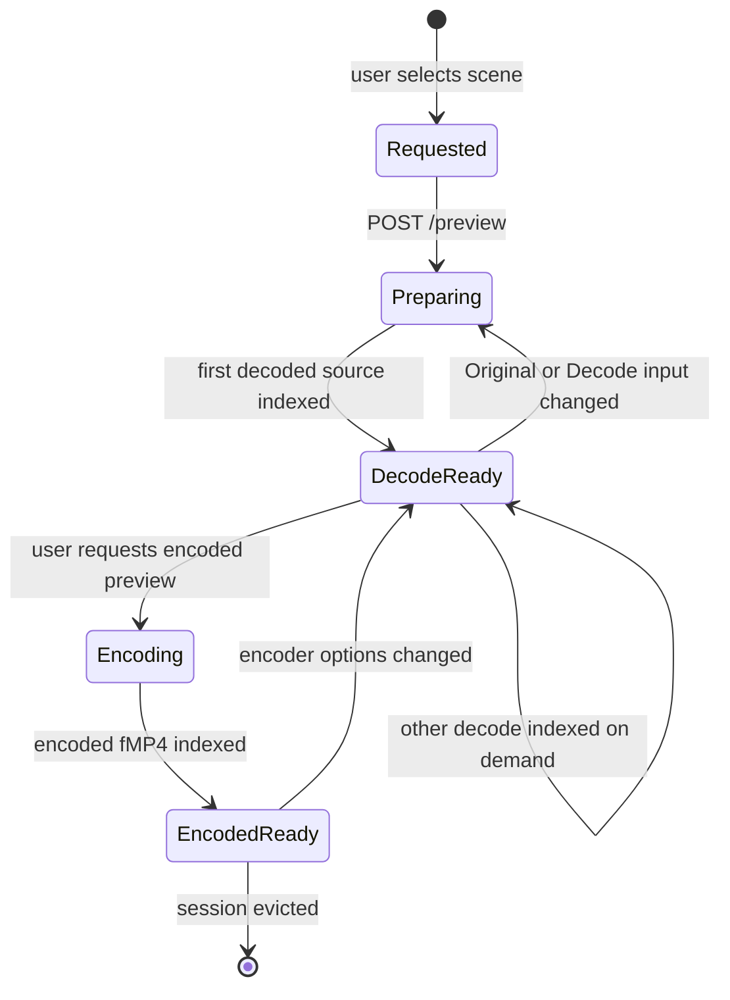
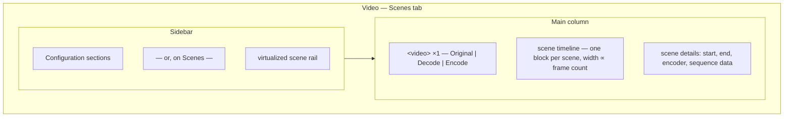

# Preview

The scene editor and live preview: the highest-risk, highest-value part of the
application. This document specifies the design *and* the experiments that must pass
before it is implemented.

## 1. What the user asked for

1. Edit VapourSynth script behaviour **per scene**, and see the result.
2. Preview the **encoded** output of a single scene, with a choice of which decode supplies
   the Encode: the Decode (default) or the Original.
3. Select multiple scenes (click, shift-click, drag) and apply one action to all.
4. Layout: a sidebar that carries the configuration sections or the virtualized scene
   rail; one player above a proportional scene timeline, with the selected scene's details
   and sequence data below it.
5. All of it must work over LAN in a browser, using the same UI code.

## 2. The hard constraint that shapes the design

`av-decoders`/VapourSynth script changes require the script to be re-evaluated and the
decoder reinitialised. That is a **cold, blocking, multi-second** operation in the general
case, and it cannot be done per-scene-per-keystroke.

Therefore: the preview is **not** a live-reload editor. It is an explicit *re-initialise*
workflow with cached results.

There is a second constraint that is easy to miss and shapes §3.3: the script is a **single
input for the whole video**. It is not per scene, and it cannot be made per scene, because
VapourSynth evaluates one graph over one clip.

## 3. Design



Up to three sources are available for a scene; exactly one is attached to the single
`<video>` at a time:

| UI label | Stream ID | Content | When it is offered | Purpose |
| --- | --- | --- | --- | --- |
| `Original` | `original` | decoded frames of the video's General input | always, when that input resolves | the unfiltered source |
| `Decode` | `decode` | decoded frames of the Parallel Encoder input | only when that input is **overridden**; otherwise it is the General input | what the encoder actually received |
| `Encode` | `encode` | the retained scene chunk, or the session's encoded stream | when a chunk exists, or after `Preview scene` | what you will get |

The Decode is the default **input source** for the Encode because the Encode was produced
from it: comparing against the same frames keeps the filter out of the comparison. The
Original is offered for review when the filter graph is expensive and the user does not
want to pay for it, but it is not the default. The UI describes where each source's frames
come from and never labels one fast or slow. When the Parallel Encoder input inherits the
General input, the `decode` source is absent rather than duplicated, and the Encode's input
source is the Original with no choice to make.

All sources are delivered as **fragmented MP4** so the browser's own `<video>` element can
play, seek, and buffer them with zero JavaScript decoding. This is the decision that makes
LAN and website preview possible at all; a native `mpv` surface cannot render into a remote
browser tab.

### 3.1 Why fMP4 and not WebRTC, HLS, or MSE

| Option | Assessment |
| --- | --- |
| **fMP4 over HTTP with range requests** | **Chosen.** `<video src>` works everywhere, seeks are handled by the browser, no JS player, cacheable by the local byte store, works identically over LAN. Cost: latency is not sub-second for the *first* byte until enough fragments exist. |
| HLS/DASH | Adds a manifest and segment protocol for no benefit at LAN scale. Rejected as over-engineering. |
| WebRTC | Lowest latency, but needs a signalling channel, a native stack (`webrtc`/`str0m`), codec negotiation, and it fails through some corporate proxies. High complexity, low payoff for a scene preview. |
| MSE + custom JS player | Needed only for adaptive streaming or DRM. Also loses `<video>`'s built-in seeking. Rejected. |
| MJPEG / per-frame JPEG | Fine for scrubbing thumbnails (and used for exactly that), useless for real-time playback. |
| `mpv`/`libmpv` embedded | Rejected: native window, cannot serve a browser, breaks single source of truth. |

Note the deliberate split of responsibilities: fMP4 for viewing, single-frame JPEG for
the scrubber and for the scene strip thumbnails. Both are cheap and both work in a
browser tab.

### 3.2 Session lifecycle



- A **preview session** is per (video, scene-set, Original input revision, Decode input
  revision, encoder option hash). It is cached and evicted LRU under a disk budget.
- Changing **one input's script** invalidates that input's decode only. Each input owns its
  own script, so the invalidation key is the input, not the project, and the other decode
  stays warm. This is the expensive path, and the UI shows a progress state with a cancel
  button.
- The **Decode** is a distinct prepared source, not a second stream on the same decoder.
  It exists only when `ParallelEncoderConfig.input` is `Some`; when it is `None` the Decode
  source is the Original source and is not prepared twice.
- Changing **encoder options** only invalidates the Encode source, not either decode.
  Re-encoding a 10-second scene is fast; re-decoding is not.
- Changing **injected scene data** (see §3.3) invalidates the decode whose input owns it,
  because it changes the script text that is evaluated.
- Multiple selected scenes produce **one** session with several scenes concatenated into
  the stream, plus per-scene index markers so the player can jump between them.

### 3.3 Injecting scene data into the script

The script is one input for the whole video. Per-scene behaviour therefore has to come
from the script reading per-scene data and applying it to frame ranges itself. Three
mechanisms are available, and they compose.

**Mechanism A — `variables`, the engine's own mechanism.** `Input::VapourSynthScript`
carries `variables: HashMap<String, String>`, and the engine passes these into the
VapourSynth evaluation environment. The engine itself uses this to hand a script its source
path and cache path as *values*, explicitly so they "are never interpreted as code". The
service can add its own keys the same way.

Limitation: values are strings, so anything structured must be serialised into the string
and parsed in Python. This is fine for one scalar and painful for a scene table.

**Mechanism B — a generated sidecar module.** The service writes a Python module into the
session's temp directory and adds that directory to the script's import path via
`variables`. The script does `import condor_data` and reads a typed object. The module is
generated from the `Condor` model at session-preparation time, so it is exactly as current
as the script revision.

This is the recommended default. It gives structure, it is inspectable, and it needs no
parser in Python.

**Mechanism C — a prelude appended to the script text.** The service prepends a generated
block of Python literals to the script before evaluation. No file, no import path, no
`variables`. Simplest to implement and the easiest to reason about when something goes
wrong, because the fully-materialised script is a single string the user can view.

Cost: the materialised script differs from what the user typed, so the editor must be able
to show both, and error line numbers shift by the prelude length unless the prelude is a
single line or the mapping is recorded.

**Recommendation:** B by default, C as the mechanism used for the "show me exactly what
runs" view, A only for single scalars such as the session id. B and C are both generated
from the same source of truth, so supporting both costs one generator, not two.

The injected `CondorData` is per source. The General and Encoding inputs are separate
inputs with separate paths, so a session that prepares both writes one data module per
input and the script that owns each input reads its own.

#### The Python-accessible object

Whichever mechanism carries it, the shape is the same, and it is generated from the engine
model rather than hand-written:

```python
# generated; do not edit
class Scene:
    index: int
    start: int          # inclusive frame
    end: int            # exclusive frame
    frame_count: int

class CondorData:
    # absolute path of the input video this session is decoding
    video_path: str
    # per-video scratch directory (sidecars, tables, caches)
    temp_dir: str
    scenes: list[Scene]
    def scene_at(self, frame: int) -> Scene | None: ...
```

Width, height, and fps are deliberately absent. The script already owns a `VideoNode`; its
`width`, `height`, and `fps` are the authoritative values, and copying them into the data
module would create a second source that drifts when a filter changes the format. The path
and the temp directory are different: the script cannot infer the path from a Python string
or locate sidecars without them, and `video_path` is also what makes the injection work when
the script was copied out of an external file.

Sequence data (`noise`, quantizer, score, bitrate) is **not** in the first version of
`CondorData`. Those values exist in `sequence_data`, but exposing them commits us to a
schema and a field naming convention before the filtering template is validated. They are
added only after the spike below chooses a template and proves which values it needs. The
scene range is the only per-scene data the template requires.

#### The template is gated on a spike

The user's scene ranges are sound, but the **decode-performance-preserving template is not
yet chosen**. Applying a different filter to each range and splicing the ranges back
together can defeat a decoder's frame cache, and the cost depends on the source plugin and
the graph. A template that looks tidy in an example is not evidence.

Until the spike reports, no example template is normative. The spike must compare, on the
same 10-minute fixture, at least:

1. **Per-range splice** — build each filtered range, then splice once at the end. Measures
   the intuitive implementation.
2. **Ordered single pass** — apply filters in one chain in frame order, with no random
   access outside the active range. Tests whether a planner can avoid the splice cliff.
3. **Precomputed range module** — the same graph, but ranges materialised as Python data
   with no per-frame Python evaluation. Isolates Python overhead from decode overhead.

The pass criterion is throughput within 10% of the unfiltered 1080p baseline and no
unbounded memory growth over the run. If no variant passes, the editor ships without a
per-scene template and says so; it does not ship a slow default. This is spike **S5** in
[testing.md](testing.md#4-feasibility-spikes).

The template, once chosen, uses only `video_path`, `temp_dir`, and `scenes`, because those
are the values the script cannot obtain itself. The `VideoNode` supplies the rest.

#### Typing and validation

The generated module ships with a `.pyi` stub, so Monaco gives completion and type checking
against the real field names. A script that references `scene.noise_strength` instead of
`scene.noise.strength` is flagged in the editor before it is ever run.

Validation happens in two places, deliberately:

| Check | Where | Catches |
| --- | --- | --- |
| Syntax and name resolution against the stub | Monaco, on edit | typos, wrong attribute paths, wrong arity |
| Script parses as Python | backend, on save and before evaluation | syntax errors that bypass the editor |
| Script evaluates and returns a clip | backend, at session preparation | runtime errors, wrong output count |

The stub is regenerated with the contracts pipeline, so it cannot drift from the model.

#### Boilerplate

New VapourSynth-script inputs start from a template that already imports the data module,
declares the output node, and contains one commented example of a per-scene adjustment. A
user who does not want per-scene behaviour deletes nothing; the template's loop is over an
empty predicate.

### 3.4 Reload strategy

The expensive operation is decoder initialisation. Mitigations, in order of payoff:

1. **Warm the decoder lazily, ahead of demand.** When the user opens a scene editor, start
   initialising a decoder for the *current* script revision in the background. By the time
   they press play, it is usually ready.
2. **Debounce script patch edits** at 500 ms and only re-initialise on an explicit
   "Apply & preview", never on keystroke.
3. **Index instead of re-decode on seek.** A prepared session holds a frame index, so
   seeking inside the prepared range is a decode of the nearest keyframe, not a rebuild.
4. **Cap the prepared range.** Prepare at most N seconds (default 10, configurable) around
   the scene; a full-movie prepare is never attempted implicitly.
5. **Keep one decoder alive per prepared source.** The Encode source is a file and needs no
   decoder; the Original and Decode sources may each need one, but only the selected one is
   prepared eagerly. The other is prepared on demand and evicted first.

Spike **S1** measures whether this is fast enough to feel usable, and defines the
thresholds.

### 3.5 Streaming details

- The muxer writes fragmented MP4 (`moof`/`mdat` pairs) so a partially-produced file is
  playable. Segments are ~1 second.
- Bytes are written to a session-scoped cache file; the HTTP handler serves it with
  `Accept-Ranges: bytes` and correct `Content-Type: video/mp4`.
- The player is given a URL. On a new session the URL changes (`?session=…`), which forces
  the `<video>` element to reload — no manual buffer management.
- Seeking beyond the produced range returns `416` and the UI shows "preparing" with the
  available range, rather than a spinner that never resolves.
- Frame extraction for thumbnails uses the same warm decoder and writes JPEG at the
  scrubber's native resolution.

### 3.6 One player, up to three sources

The Scenes tab has exactly **one** `<video>` element. The source control swaps what that
element is attached to; there is no second player, no synchronized pair, and no hidden
element kept in lockstep.

| Source | Stream ID | Produced from | Available when |
| --- | --- | --- | --- |
| `Original` | `original` | decoded frames of the video's General input | the General input resolves |
| `Decode` | `decode` | decoded frames of the Parallel Encoder input | that input is **overridden**; otherwise it is the same input and is not offered |
| `Encode` | `encode` | the retained scene chunk, or the session's encoded stream after `Preview scene` | a retained chunk exists, or a preview is prepared |

The Encode's input source defaults to the Decode because that is what the encoder actually
received; the Original is available when the user wants to review the encode without the
filter chain. The UI says where each option's frames come from rather than labelling one
fast or slow. The input-source choice changes the picture, never the encoded bytes. When
the Decode is absent, the Encode's input source is the Original and the control is hidden.

**The encoded stream always begins at the scene's first frame.** Seeking into the middle of
a scene before encoding it is not equivalent to encoding from the start: an encoder's rate
control and its keyframe placement both depend on everything decoded before that point, so
a mid-scene start produces a different quality than the final encode will. The encoded
stream is therefore a prefix of the real encode, produced from frame 0 of the scene, and a
seek to frame N means "encode frames 0..N and play from N".

That makes seeking ahead in the Encode source a **buffering** operation with real duration,
and the UI must say so:

- The player's buffered range reflects what has actually been encoded, so the native
  buffering indicator is honest.
- A separate progress affordance shows encoder throughput and the estimated time to reach
  the requested frame, because the native indicator alone reads as "stalled" during a long
  seek.
- The requested frame is highlighted on the timeline as pending, and the player shows the
  last available frame until it is ready rather than going blank.
- Cancelling a long seek keeps what was already encoded; the buffer is not discarded.

**Sources need not share geometry.** A filter can Resize, Crop, or Trim, so the Decode and
the Encode may differ in size or frame count from the Original. Within one scene the player
maps by scene-relative time, not absolute frame number; when frame counts differ the
timeline marks the mapped position instead of pretending the ranges are identical. When geometry differs the player letterboxes the selected source and shows a
`Geometry differs` badge, and pixel comparison is disabled rather than cropping one
side silently.

**Switching preserves the position** in scene-relative time and never restarts playback.
Switching between Original and Decode may prepare a decoder and therefore show a short
spinner; switching to Encode may be a buffering operation. Only the selected source is attached,
preloaded, and unmuted; a hidden source is not playing audio or burning decode time.

## 4. UI



### 4.1 Scene rail and timeline

The Scenes tab is laid out like an editor, not like a table beside a player: one player at
the top, a proportional scene timeline beneath it, and the selection's details at the
bottom. The player is a fixed-height stage that letterboxes its frame, and the source
picker is a transport popover, so no third column is reserved for sources. The sidebar carries the configuration sections while Configuration is active and
the virtualized scene rail while Scenes is active, so the same column serves both tabs
without a second navigation surface.

- The scene rail is virtualized; 5,000 scenes is a supported case. Each row is one line:
  index, frame range, duration, size, quantizer, override indicator.
- The timeline draws every scene as one block whose width is proportional to its frame
  count, grouped by scene index. Blocks carry the selection state, a warning marker when
  their boundaries are invalid (§4.5), and a chunk marker when a retained chunk exists.
- Timeline and rail share one selection and one playhead. Clicking a block or a row selects
  and seeks; dragging the playhead scrubs the prepared range; `Shift`-click extends.
- Multi-select: click, `Shift`-click for range, `Cmd/Ctrl`-click for toggle, and
  **drag-across** either the rail or the timeline to sweep a range. Drag-select is a
  pointer handler on the virtualized container plus a range selection in the store, not a
  per-row handler.
- Keyboard: arrows move the cursor, `Shift`+arrows extend, `Space` toggles membership,
  `Home`/`End` jump to first/last, `PageUp`/`PageDown` move by one viewport-height of rows,
  `Shift`+`PageUp`/`PageDown` extend by the same. Full keyboard parity is required because
  drag-select on thousands of rows is miserable without it.
- The timeline stays mounted and uses `content-visibility` for off-screen blocks; it is one
  canvas-like layer of absolutely positioned divs, not a widget library.

### 4.2 Scene editing

The scene rail and timeline are not read-only. A scene is editable in the details panel
beneath the timeline, for the currently selected scene, or for the whole selection when
more than one is selected.

| Field | Scope | Notes |
| --- | --- | --- |
| `start`, `end` | per scene | frame numbers; editing either may invalidate neighbours |
| `encoder` | per scene | shows the inherited or overridden encoder with its provenance and opens the scene encoder sheet; same parameter editor, descriptors and constraints as Configuration, writing this scene's override |
| sequence data | per scene | the values that sequence produced; read-only once produced |
| split | action | splits at the playhead frame |
| merge | action | merges the selection into one scene spanning its bounds |
| delete | action | removes the scene, leaving its frames uncovered |

Structural edits — add, delete, split, merge, and boundary changes — are the operations
that can make the scene set inconsistent, so they are the operations §4.5 validates. Each
is a single undo entry, and the undo history is the configuration draft's, not a separate
one.

Editing `start` or `end` never silently moves a neighbour. The neighbour becomes invalid
and is flagged; the user resolves it. Auto-adjusting neighbours hides the mistake and is
how a gap or an overlap reaches the final encode.

### 4.3 Multi-select semantics

A selection of N scenes is an **edit context**, and the details panel shows only fields
that are meaningful in aggregate:

| Panel area | Single selection | Multi-selection |
| --- | --- | --- |
| Player | plays that scene | plays the concatenation of the selected scenes in index order |
| Timeline | the scene's block is active | every selected block is active; the playhead spans the concatenation |
| Details | exact values | aggregate statistics (min/median/max) plus "mixed" badges |
| Configuration | per-field value + provenance | field shows the common value, or "mixed", with a "set for all N" action |
| Scene editor | editable | field shows the common value, or "mixed", with a "set for all N" action |
| Reset | per field | resets the selection |

The aggregation rule for the "mixed" badge is: show the value if all selected share it;
otherwise show `mixed` and offer bulk assignment. Bulk assignment writes one batched
override request and creates one undo entry.

### 4.4 The single player and its sources

One `<video>` element, one transport, and a source control in the transport bar.

- **Swap sources** with the segmented control or `V`; the control always names the active
  source, so the user is never unsure whether they are looking at a decode or the encode.
- **Encode input source.** When Encode is active, a second control chooses `Decode`
  (default) or `Original` as the source the encode is compared against. `\` swaps it in
  place without leaving Encode. `Decode` exists only when the Parallel Encoder input is
  overridden; with no Override the control is absent and the input source is `Original`.
- **No synchronization.** There is nothing to synchronize: swapping changes the source of
  the same element and preserves scene-relative time, so the frame under the playhead is
  the frame shown after the swap. The old hidden-element pair is gone.
- **Frame mapping.** The encoded stream is a prefix of the real encode from the scene's
  first frame (§3.6). When the encode's input source has the same geometry and frame count,
  frame N maps directly; otherwise the player maps by scene-relative time and says so.
- **Audio.** The selected source plays its audio; nothing else is loaded, so a swap can
  never double the sound or keep a hidden track running.
- One indicator covers the active source, labelled with its cause: decoder prepare on a
  decode, encoder throughput on a long encoded seek. The two have different expected waits
  and never share an unlabelled spinner.

### 4.5 Scene validation

Structural edits can produce a scene set that encodes something other than what the user
intends. The application validates the set on every edit. A valid set is summarized in the
timeline footer; a problem appears in a strip between the timeline and the details panel,
with each problem linking to the offending scene and highlighting its block.

| Problem | Meaning | Severity |
| --- | --- | --- |
| **Gap** | frames exist between one scene's `end` and the next scene's `start` | warning — those frames are absent from the output |
| **Overlap** | two scenes claim the same frame | error — the engine cannot concatenate a frame twice |
| **Out of order** | a scene's `start` is before the previous scene's `start` | error — concatenation order is list order |
| **Invalid frame** | `start < 0`, `end > frame_count`, or `start >= end` | error |
| **Empty scene** | `start == end` | error |

Gaps are a warning rather than an error because trimming frames deliberately is legitimate;
the user is told which frames are missing so the result is not a surprise. Overlaps, order,
and invalid or empty ranges are errors because no output is correct.

The validation result is **advisory in the same sense as the engine's own `validate()`**:
it never blocks editing, and it blocks *running* only for the error rows. The strip stays
visible while the problem exists, and the run button states which problems must be
resolved. A clean set shows nothing.

### 4.6 Configuration changes under selection

Editing a config field with N scenes selected does **not** write N overrides, because
scene-level config is not where most fields belong. The two categories are kept distinct:

- **Sequence-level fields** (target quality, noise settings, encoder): bulk edit writes at
  the *video* level if all selected scenes share a video, otherwise the action is
  presented as "apply to project" with an explicit scope choice.
- **Scene-level fields** (the per-scene encoder): always per scene, and the bulk form
  writes the affected engine scenes. There are no per-scene script values to write: the
  script is one input for the whole video and reads `CondorData` (AGENTS §2.10).

Presenting the scope choice explicitly is important: silently writing 500 per-scene
overrides because the user dragged a slider would be catastrophic and irreversible.

## 5. Disk and memory budget

| Artifact | Budget | Eviction |
| --- | --- | --- |
| preview session cache | 4 GB default, user-configurable | LRU by session |
| decoded frame cache | 256 MB | LRU frames |
| prepared decoders | 2 concurrent (Original + overridden Decode) | LRU, oldest idle evicted |

Budget exhaustion must never fail an encode. Preview cache eviction is opportunistic and
runs on a low-priority task; a full encode wins every arbitration.

## 6. Feasibility spikes (gate for this feature)

These run in Phase 4 before any preview UI is built. Full procedure in
[testing.md](testing.md#4-feasibility-spikes).

| Spike | Question | Pass criterion | If it fails |
| --- | --- | --- | --- |
| **S1** Decoder init and source switch | how long from "input script changed" to "first frame playable" for a 10 s scene, and how long to switch the input source between Original and Decode? | median ≤ 2.5 s, p95 ≤ 6 s; switch to an already-prepared source ≤ 250 ms | reduce default prepared range, pre-warm more aggressively, or ship the editor as a separate "prepare" step with a longer, honest progress UI |
| **S2** fMP4 pipeline | can we mux VapourSynth frames (and encoder output) into a playable fMP4 that `<video>` seeks in, on all three OSes? | playable and seekable in Chromium and WebView2; correct A/V where audio exists | fall back to MJPEG playback at reduced frame rate for scrubbing only, and keep encoded preview |
| **S3** Remote preview | does the same stream work over LAN with acceptable start latency? | start-to-first-frame ≤ 3 s on 1 GbE and on 802.11ac | reduce default prepared range, lower preview resolution, or disable preview when LAN mode is on (documented degradation) |
| **S4** Drag multi-select | does drag-select across a 5,000-row virtualized list hold 60 fps? | no long tasks > 50 ms during a sweep | restrict to click/shift-click and add a range input |
| **S5** Per-scene script template | which frame-range template keeps decode throughput within 10% of the unfiltered baseline on the fixture? | throughput within 10%, bounded memory, same output on all three candidate templates | ship no template and state that per-scene filtering is manual; do not choose the fastest-looking microbenchmark |

S2 is the one that decides assumption A4. If S2 fails on any supported platform, the
preview transports diverge and the "same UI everywhere" rule needs an exemption — which
would be an ADR, not a quiet decision.

## 7. Explicit non-goals

- Frame-accurate editing of the source video. This is a scene-level tool, not a NLE.
- Real-time playback of the full movie through VapourSynth.
- Timeline scrubbing beyond the prepared range without an explicit prepare action.
- Audio editing. Audio is passed through; the preview shows it when present.
- Per-scene script *files*. The script is one input for the whole video; per-scene
  behaviour comes from the script reading injected scene data (§3.3), not from swapping
  the script per scene.
