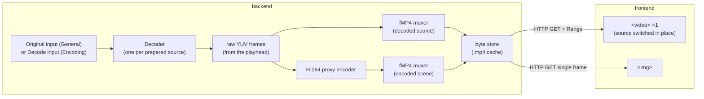
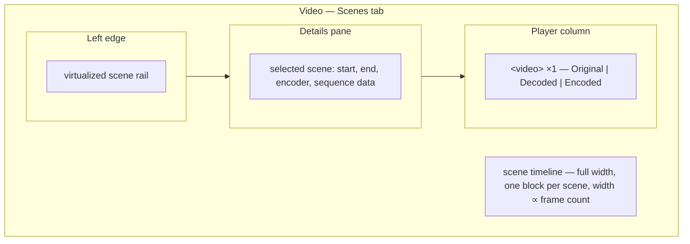

# Preview

The scene editor and live preview: the highest-risk, highest-value part of the
application. This document specifies the design and the experiments that gated it. The
Scenes tab, the three sources, and the media route are implemented. Preview has no
per-player HTTP session: each window is a stateless cache entry (§3.2). The service does
keep one opened decode graph per source identity behind that cache, so consecutive windows
reuse a decoder; it is dropped after 45 seconds without a window. A native `Video` source
may open a second graph while the first is busy; every other input keeps one. Scene builds
reuse one idle graph the same way and open a transient one while it is writing, so only the
first scene of a review pays for the script and its graph.

## Contents

- [1. What the user asked for](#1-what-the-user-asked-for)
- [2. The hard constraint that shapes the design](#2-the-hard-constraint-that-shapes-the-design)
- [3. Design](#3-design)
- [4. UI](#4-ui)
- [5. Disk and memory budget](#5-disk-and-memory-budget)
- [6. Feasibility spikes (gate for this feature)](#6-feasibility-spikes-gate-for-this-feature)
- [7. Explicit non-goals](#7-explicit-non-goals)

## 1. What the user asked for

1. Edit VapourSynth script behaviour **per scene**, and see the result.
2. Preview the **encoded** output of a single scene, with a choice of which decode supplies
   the Encode: the Decode (default) or the Original.
3. Select multiple scenes (click, shift-click, drag) and apply one action to all.
4. Layout: a virtualized scene rail on the left, the selected scene's details and editor
   beside it, and one player filling the rest of the row above a proportional scene
   timeline. Configuration is a separate section grid, not a sidebar.
5. All of it must work over LAN in a browser, using the same UI code.

## 2. The hard constraint that shapes the design

`av-decoders`/VapourSynth script changes require the script to be re-evaluated and the
decoder reinitialised. That is a **cold, blocking, multi-second** operation in the general
case, and it cannot be done per-scene-per-keystroke.

Therefore: the preview is **not** a live-reload editor. It is an explicit *re-initialise*
workflow with cached results.

There is a second constraint that is easy to miss and shapes §3.3: the script is a **single
input for the whole video**. It is not per scene, and it cannot be made per scene, because
VapourSynth evaluates one graph over one clip.

## 3. Design



Up to three sources are available for a scene; exactly one is attached to the single
`<video>` at a time:

| UI label | Stream ID | Content | When it is offered | Purpose |
| --- | --- | --- | --- | --- |
| `Original` | `original` | the queued source file, served as it is | the video has a source path | the unfiltered source |
| `Decoded` | `decoded` | decoded frames of the Parallel Encoder input, coded as lossless H.264 MP4 at the input's resolution and depth | the Parallel Encoder input resolves; it falls back to General | exactly what the encoder received, down to the sample |
| `Encoded` | `encode` | one detected scene's chunk, produced by the run's exact encoder | a scene contains the playhead | what the encoder will produce for that scene |

The Decoded source is the default **input source** for the Encoded source because the
encode was produced from it: comparing against the same frames keeps the filter out of the
comparison. Original is offered for review when the filter graph is expensive and the user
does not want to pay for it, but it is not the default. The UI describes where each
source's frames come from and never labels one fast or slow. When the Parallel Encoder
input inherits the General input, Decoded and Original show the same frames only if that
input has no filters; the control stays because it still states which input the encode
actually used.

All three sources are delivered as **fragmented MP4**. `Decoded` is H.264 with `-qp 0`
(`ultrafast`), at the Parallel Encoder input's resolution and bit depth. x264 signals
lossless with the High 4:4:4 Predictive profile even when the coded planes stay 4:2:0;
Chromium plays that profile both as a direct source and through MediaSource. The release
FFmpeg is built without libx264, so the sibling `x264` executable encodes the window when
libx264 is absent; it is passed `--output-depth` so a 10-bit input stays 10-bit. VP9 is a
fallback only for 8-bit inputs: a 10-bit input with no x264 is refused rather than silently
quantised to 8-bit. The old CRF 16 proxy was smaller, but it was not a reference: its
quantization is visible on gradients and edges at 400% zoom. A lossless window's size follows the source's
grain and detail rather than a fixed bitrate: on the two 1080p 10-bit test projects,
six-second windows measured **73.5-117.3 MiB** and two-second windows measured
**25.3-31.8 MiB** and built in **1.2-1.4 s** each. Opening the decode graph used to happen
per window: the build materialised the input, imported the script module, and constructed an
FFMS2 or VapourSynth graph before it encoded a frame. The service now keeps one opened
graph per source identity on a dedicated thread and writes consecutive windows through it;
a native `Video` source may open a second while the first is busy, so an append and a warm
do not queue behind each other, while every other input stays at one. The frame range
belongs to the cache key, not to the graph's identity. A window build therefore pays for
the lossless encode and mux, not for decoder construction.

The lead is not a fixed number. Chromium retains roughly 150 MB in one `SourceBuffer`, so
the player spends a 140 MiB budget at the source's measured lossless rate: a two-second
1080p 10-bit window yields about six seconds of appended lead, and a cheaper source yields
more from the same bytes. The paused fill is capped at **six seconds**, even when a coarser
rate estimate would plan more: the next window has to fit beside the fill, and a grainy
source can otherwise reach 8–10 s and leave the append that starts playback no room at all.
The cap is `PAUSED_MSE_MAX_SECONDS` in `preview-buffer-plan.ts`. The cache runway beyond the append horizon is sized from the
measured build time, so a slower machine prebuilds more windows instead of outrunning a
constant. Those warm builds are not attached to the timeline: the append that later reaches
one reads the finished cache file, so the seam is a local read rather than an encode. A warm
starts once the last appended window's request is already in flight, not after that window
has downloaded, so a builder overlaps the client's append instead of idling through it.
Warms run **only while paused**: playing, the script input's single decode graph belongs to
the appends, and a warm would make the next window queue behind it instead of landing ahead
of the playhead. Paused, the player fills up to the six-second cap and warms up to 1.5 GiB
of cache runway (at most sixty windows), so a source whose build is slower than realtime
keeps building while the user reads the frame and has cached windows to resume into.
Starting playback aborts a paused warm, and the next append reads whichever cache file
finished or queues its build. Reaching the browser's memory cap is not an error: the read
parks until playback or a seek frees a window behind the playhead, then writes the same
fragment without dropping it. A picture that runs dry releases the stream's
read throttle too, so the rest of a window already on the wire is never left unread behind
a stalled element. The offset for each window is written only once the `SourceBuffer` has
finished parsing the previous append; a quota retry can otherwise race the parser and throw
`InvalidStateError`. The paused fill does not wait for `timeupdate`, which a paused element
never sends. The lead is a prefetch target,
not a playback gate. Decoded clears its loading stage as soon as the requested frame is on
screen, and it never pauses for buffer: when the decoder is slower than realtime, the
element presents each appended frame as it lands and waits between arrivals, with the sound
paused by the same wait. Encoded still holds until its scene chunk has a lead, because a
chunk ends at a cut instead of continuing the same stream. MediaSource receives each proxy in 4 MiB
batches rather than one append per 64 KB read: an append is a full `updateend` round trip,
and one per read spent seconds on a single 30 MB window. The element retains one second
behind the playhead, plus another half-second before a trim so it cannot cut the GOP that
is playing, so a short backward step is a buffer read; a seek further back opens
the window containing that frame from cache. Its one-second GOPs let the element start on
the first fragment.

The browser's own `<video>` element plays, seeks, and buffers all three with zero
JavaScript decoding. This is the decision that makes LAN and website preview possible at
all; a native `mpv` surface cannot render into a remote browser tab.

### 3.1 Why fMP4 and not WebRTC, HLS, or MSE

| Option | Assessment |
| --- | --- |
| **fMP4 over HTTP with range requests** | **Chosen.** `<video src>` works everywhere, seeks are handled by the browser, no JS player, cacheable by the local byte store, works identically over LAN. Cost: latency is not sub-second for the *first* byte until enough fragments exist. |
| HLS/DASH | Adds a manifest and segment protocol for no benefit at LAN scale. Rejected as over-engineering. |
| WebRTC | Lowest latency, but needs a signalling channel, a native stack (`webrtc`/`str0m`), codec negotiation, and it fails through some corporate proxies. High complexity, low payoff for a scene preview. |
| MSE + custom JS player | Needed only for adaptive streaming or DRM. Also loses `<video>`'s built-in seeking. Rejected. |
| MJPEG / per-frame JPEG | Fine for scrubbing thumbnails (and used for exactly that), useless for real-time playback. |
| `mpv`/`libmpv` embedded | Rejected: native window, cannot serve a browser, breaks single source of truth. |

Note the deliberate split of responsibilities: fMP4 for viewing, and a single-frame PNG
route for an explicitly requested reference picture. The still is lossless because it is
the reference picture the user inspects; a JPEG would put artefacts in exactly the frame
being examined. A 10-bit input becomes a 16-bit PNG.

The Scenes tab does **not** request stills for its rail rows or timeline blocks. Every
still opens the input again, decodes one frame, and spawns FFmpeg, and the decoder's
memory is retained per request: a rail of visible rows cost gigabytes and occupied the
webview's connections, so the player's own range requests queued behind the thumbnails and
the video appeared never to load. The rail and the timeline read one cached keyframe grid
instead: the service decodes keyframes once, writes five-second 320 px JPEGs, and both
surfaces ask the same lookup for the same indexed file. The frame route remains for an
explicit request; the player uses it for a paused scrub still, and the rail and timeline
never take that path.

The proxy encode is CPU-bound at 1080p. Lossless `ultrafast` uses the least CPU x264
offers for a sample-exact picture: the preset trades compression for speed, so the window
is larger than `veryfast` would produce, not lower quality. NVENC is not used: H.264 NVENC
cannot encode losslessly, and the Decoded source is never allowed to trade the picture for
speed. The alternative that removes the encoder is raw YUV over HTTP with a
canvas/WebCodecs renderer, at roughly 142 MB/s for 10-bit 1080p; that is a local-connection
path, not a LAN default, and it gives up the element's own buffering and seeking.

### 3.2 Cache lifecycle

There is no per-player preview-session resource. `GET …/videos/:vid/media` prepares exactly
the source and range the element asked for, and FFmpeg writes the result under
`<app-data>/cache/preview`. The one piece of server state in the path is the opened decode
graph: it is keyed by the source identity (never the frame range) and expires after 45
seconds without a window, so a second player shares it but a replaced source does not
outlive the review. The cache key is the engine's proxy recipe, the input document,
the encoder document when applicable, the frame range, the scene table's fingerprint, and
the source's size and modification time. The recipe names the codec, lossless mode, preset,
GOP, bit-depth rule, and mux flags, so changing the pipeline changes the key without a
separate hand-maintained version.

- Original is served directly from the source file; it is never prepared or cached.
- Decoded is prepared as a bounded window from the playhead. The decode graph is opened
  once per source identity and reused for every window, so only the range is part of the
  per-file key. A native `Video` source may open a second graph while the first is busy;
  every other input stays on one, because evaluating it again allocates a second copy of
  everything it builds. A second request for the same key follows the running build instead
  of starting a duplicate decode.
- Encoded resolves the scene containing the playhead and runs that scene's encoder. The
  key includes the scene and the input choice (`decoded` or `original`), so changing the
  encoder invalidates the Encoded cache without touching Decoded. The decode graph behind
  the build is keyed by the input and the scene table, never by the encoder: every scene's
  document can differ while they all read the same graph. One idle graph is kept per source
  identity and dropped after 45 seconds without a scene. A build that finds it busy opens a
  transient graph and drops it when the scene ends, so a warm and the chunk the playhead is
  waiting for still overlap. An encoder that refuses its input leaves the graph open; only a
  frame the graph could not produce closes it.
- Every scene row carries `encoder_fingerprint`, a hash of the encoder document that scene
  actually encodes with (its own, or the video's resolved encoder), and the player puts it
  in the Encoded source URL. A saved settings change is therefore a different URL: the
  element is reopened instead of replaying the bytes it already holds, and the request
  rebuilds the chunk with the new document. Nothing about the fingerprint is stored between
  requests; the URL is a cache key, and the route resolves the document from disk again.
- Changing an input's script changes that input's document, so the key changes and the
  next request rebuilds only the affected source.
- Every scene list carries `scene_fingerprint`, a hash of the checkpoint's scene entries
  plus the user's pairs — the table a script receives. A script can read a scene's
  `sequence_data` and change the picture for that range, so the player puts the value in
  both derived sources' URLs as well: an edited pair or a new measurement is a different
  request, and the window is decoded again instead of replayed from the old table.
- The last viewer leaving a build stops it and removes the partial file. A request whose
  range starts past zero waits for the finished cache file before using ordinary range
  delivery.
- Multiple selected scenes are an editing selection, not a preview concatenation: the
  player previews the scene containing the playhead.

### 3.3 Injecting scene data into the script

The script is one input for the whole video. Per-scene behaviour therefore has to come
from the script reading per-scene data and applying it to frame ranges itself. Three
mechanisms are available, and they compose.

**Mechanism A — `variables`, the engine's own mechanism.** `Input::VapourSynthScript`
carries `variables: HashMap<String, String>`, and the engine passes these into the
VapourSynth evaluation environment. The engine itself uses this to hand a script its source
path and cache path as *values*, explicitly so they "are never interpreted as code". The
service can add its own keys the same way.

Limitation: values are strings, so anything structured must be serialised into the string
and parsed in Python. This is fine for one scalar and painful for a scene table.

For a full run, `rust/crates/engine` already uses A for the scene table and each scene's engine
`sequence_data`: `condor_scenes` is JSON, and the runner reopens the script before every
sequence so a later sequence sees what Noise Detector or Target Quality produced. The
values arrive as `bytes` in Python. Detection still runs on the unmodified graph, so the
script must preserve the frame count and format it measured. The key list is in
[backend.md](backend.md#script-evaluation-and-injected-data). The video state endpoint
serves the keys, descriptions, and current values as `script_data`, so the editor documents
what a script receives without opening it. Preview uses the same keys; a script that works
in a full encode works in preview.

**Mechanism B — a generated sidecar module.** The service writes a Python module into the
session's temp directory and adds that directory to the script's import path via
`variables`. The script does `import condor_data` and reads a typed object. The module is
generated from the `Condor` model at session-preparation time, so it is exactly as current
as the script revision.

This is the recommended default. It gives structure, it is inspectable, and it needs no
parser in Python.

**Mechanism C — a prelude appended to the script text.** The service prepends a generated
block of Python literals to the script before evaluation. No file, no import path, no
`variables`. Simplest to implement and the easiest to reason about when something goes
wrong, because the fully-materialised script is a single string the user can view.

Cost: the materialised script differs from what the user typed, so the editor must be able
to show both, and error line numbers shift by the prelude length unless the prelude is a
single line or the mapping is recorded.

**Recommendation:** B by default, C as the mechanism used for the "show me exactly what
runs" view, A only for single scalars such as the session id. B and C are both generated
from the same source of truth, so supporting both costs one generator, not two.

The injected `CondorData` is per source. The General and Encoding inputs are separate
inputs with separate paths, so a session that prepares both writes one data module per
input and the script that owns each input reads its own.

#### The Python-accessible object

Whichever mechanism carries it, the shape is the same, and it is generated from the engine
model rather than hand-written:

```python
# condor_data.py, generated into the scenes directory; do not edit
video_path: str      # absolute path of the file this run decodes
temp_dir: str        # per-video scratch directory (sidecars, tables, caches)
run_id: str
sequence: str
scenes: tuple[Scene, ...]
scene_count: int

def scene_at(frame: int) -> Scene | None: ...

class Scene:
    index: int
    start: int          # inclusive frame
    end: int            # exclusive frame
    sequence_data: types.data.SequenceData
    encoder: types.encoder.Encoder
    frame_count: int
```

The document classes are generated from the engine models' `JsonSchema`, the same
schema the contracts use, so a field exists in the stub exactly when the engine serialises
it. `types.data.SequenceData` names each sequence's data object, `types.encoder.Encoder`
names the encoder variant, and a nested document is a class of its own rather than another
untyped value. Only a free-form map remains `dict[str, Any]`; every fixed field carries its
Python type.

The classes form a tree, not a flat list. They live under `cd.types`, grouped by the
document they describe: `types.sequence` is the configuration the open runs under,
`types.data` is what the sequence wrote, and `types.encoder` is the encoder document.
Inside a group, a document is nested in the one class that references it, so
`cd.sequence_config.noise_detector` is typed as
`types.sequence.SequenceConfig.NoiseDetectorConfig`; a document several classes share — an
input, a metric, an encoder parameter — stays at its group's top level instead of being
copied into an arbitrary owner. Any annotation that names a class outside its own class
body is written by its full path, because a nested class cannot resolve an enclosing
class's names; `typing.get_type_hints` therefore resolves every field, and so does a
language server. The module level carries the data a script reads (`video_path`, `scenes`,
`sequence_config`, `scene_at`, …) and the one `types` namespace; `cd.` completion offers
only those values plus `types`, because `cd.SequenceConfig` is never the value a script
wants.

The names are lowercase module attributes, not a `CondorData` object: a script does
`import condor_data as cd` and reads `cd.video_path` and `cd.scenes`. The runner sets the
same values as `condor_` globals for a script that does not import the module; the module
decodes those bytes once.

Width, height, and fps are deliberately absent. The script already owns a `VideoNode`; its
`width`, `height`, and `fps` are the authoritative values, and copying them into the data
module would create a second source that drifts when a filter changes the format. The path
and the temp directory are different: the script cannot infer the path from a Python string
or locate sidecars without them, and `video_path` is also what makes the injection work when
the script was copied out of an external file.

Every scene also exposes the run's `sequence_data` and `encoder` as read-only
`Object`s, so a script can vary a filter by `scene.sequence_data.noise_detection.noise` or
by the quantizer the Parallel Encoder will use. The stub's classes describe those fields;
at run time the same values remain attribute objects, so an unknown or absent key raises
`AttributeError` instead of returning `None`.

#### The default script is a no-op; the per-scene examples are optional

The default template applies no filter; it opens the queued video and sets that source as
the output. Per-scene filtering is optional: the methods are commented examples, and the
application makes no filter choice for the user. S5 measured the candidates
on the same 600 s 1080p fixture, filtering every third scene. The **ordered single pass**
reached 421.3 fps, 93.9% of the unfiltered 448.5 fps baseline, and the precomputed range
module 423.8 fps (94.5%); both are inside the 10% budget. The per-range splice reached
388.1 fps (86.5%) with the widest spread and is not offered. All three produced
byte-identical frames at every sampled frame and, with a stateless filter, held a flat
22.8 MB peak CPU RSS. The baseline's own spread is wider than the difference between
templates, so the choice is for the passing median and the tightest distribution, not a
measured splice cliff. See `docs/spikes/S5-template.md`.

The direct-range example slices each scene range in frame order, splices the parts
progressively, and reads the scene table from the generated module; one `std.Splice` over
every part is the rejected per-range shape. Nothing is evaluated per frame in Python.
It uses only `video_path`, `temp_dir`, and `scenes`, because those are the values the script
cannot obtain itself. The `VideoNode` supplies the rest. Ordering is a splice-tree decision,
not a licence to construct a filter inside the loop; a device-allocating filter is built
before the loop (see Boilerplate). The FrameEval escape hatch is the only per-frame example
and is documented with its rebuild and reader-concurrency cost.

#### Typing and validation

The generated module ships with a `.pyi` stub, so Monaco gives completion and type
checking against the real field names. A script that references `scene.noise_strength`
instead of `scene.noise.strength` is flagged in the editor before it is ever run. The
editor also documents the reserved variables from the state API, so a script can inspect
the values the runner will provide.

Validation happens in two places, deliberately:

| Check | Where | Catches |
| --- | --- | --- |
| Syntax and name resolution against the stub | Monaco, on edit | typos, wrong attribute paths, wrong arity |
| Script parses as Python | backend, on save and before evaluation | syntax errors that bypass the editor |
| Script evaluates and returns a clip | backend, at session preparation | runtime errors, wrong output count |

The stub is generated from the same source as the module, so it cannot drift from the
model.

#### Boilerplate

New VapourSynth-script inputs start from a template that imports the data module, opens the
queued video, and sets that source as the output. It applies no filter: the whole-clip
example is commented, and so are the optional per-scene methods. A new input therefore opens
as a valid clip before Scene Detector has run, and the application does not choose a filter
for the user. The commented examples cover direct scene ranges for cheap filters, one variant
per distinct parameter set for device-allocating filters, and a bounded scene-keyed
`std.FrameEval` cache for a continuous parameter. `FrameEval` is documented as an escape
hatch: it calls the selector for every frame, rebuilds when its cache evicts, and the engine's
readers share one script node, so a one-scene cache thrashes. It is not the default.

The grouped example also states the constraint S5 did not measure. A filter that allocates
device memory — NLMeans, BM3D, MVTools — keeps that allocation for the life of the graph, so
calling it inside the per-scene loop builds one instance per scene. At 1080p an NLMeans
instance is ~0.9 GB; a 278-scene script exhausted an 8 GB card while the graph was being
built. The example builds one variant per distinct parameter set over the whole source and
slices its output instead. On the real 278-scene project the two distinct strengths held
2.9 GB and 22.3 fps, against 2.0 GB and 21–23 fps for one instance over the whole clip, so
the per-scene choice costs one instance per extra variant, not a slowdown. A single
strength for the whole clip is the only way to reach one instance, and it gives up the
per-scene choice. Building over the whole source also lets a temporal filter see the
neighbouring scene at a cut instead of a clamped edge.

### 3.4 Reload strategy

The expensive operation is decoder initialisation. Mitigations, in order of payoff:

1. **Warm the decoder lazily, ahead of demand.** When the user opens a scene editor, start
   initialising a decoder for the *current* script revision in the background. By the time
   they press play, it is usually ready.
2. **Debounce script patch edits** at 500 ms and only re-initialise on an explicit
   "Apply & preview", never on keystroke.
3. **Index instead of re-decode on seek.** A prepared session holds a frame index, so
   seeking inside the prepared range is a decode of the nearest keyframe, not a rebuild.
4. **Cap the prepared range.** Prepare at most N seconds (default 10, configurable) around
   the scene; a full-movie prepare is never attempted implicitly. S1 measured warm
   init-to-first-frame at 61 ms (native FFMS2) and 68 ms (BestSource) for a 10 s 1080p
   scene, and a 0.6 ms switch between two prepared sources, so 10 s is the default and the
   editor does not need an explicit prepare step.
5. **Keep one decoder alive per prepared source.** The Encode source is a file and needs no
   decoder; the Original and Decode sources may each need one, but only the selected one is
   prepared eagerly. The other is prepared on demand and evicted first.

Spike **S1** measures whether this is fast enough to feel usable, and defines the
thresholds.

### 3.5 Streaming details

- The muxer writes fragmented MP4 (`moof`/`mdat` pairs) so a partially-produced file is
  playable. Segments are ~1 second.
- Bytes are written to a session-scoped cache file; the HTTP handler serves it with
  `Accept-Ranges: bytes` and correct `Content-Type: video/mp4`.
- A direct source changes URL with the requested window or scene, which forces the
  `<video>` element to reload. A MediaSource session keeps one element and appends instead.
- Seeking beyond the produced range returns `416` and the UI shows "preparing" with the
  available range, rather than a spinner that never resolves.
- The frame route opens the input for each request and writes a PNG; it shares no warm
decoder and keeps no cache, which is why the UI never calls it per scene.

### 3.6 One player, up to three sources

The Scenes tab has exactly **one** `<video>` element. The source control swaps what that
element is attached to; there is no second player, no synchronized pair, and no hidden
element kept in lockstep.

| Source | Stream ID | Produced from | Available when |
| --- | --- | --- | --- |
| `Original` | `original` | decoded frames of the video's General input | the General input resolves |
| `Decoded` | `decoded` | decoded frames of the Parallel Encoder input | the Parallel Encoder input resolves; it falls back to General |
| `Encoded` | `encode` | one scene's chunk, produced by the encoder executable and parameters the run would use | a detected scene contains the playhead |

**Current transport.** `Decoded` and `Encoded` are attached through **MediaSource**, not a
`src` URL: the player fetches the growing proxy itself and appends it to a `SourceBuffer`, so
every byte it has received stays seekable even while the file is still being written. Each
new window, and each scene's chunk, is appended at its offset on the same timeline, which is
what makes a boundary continuous instead of a remount. The codec string comes from the proxy's
own `moov`; a codec the browser decodes but will not put in a `SourceBuffer` falls back to a
direct source, where seeking is the old, slower path. `Original` is always a direct source.

**Cache.** The player prepares one proxy per requested range under
`<app-data>/cache/preview`, keyed by the engine's proxy recipe, the input document, the
encoder document, the frame range, and the source file's size and modification time.
`Decoded` writes fragmented MP4 in **windows** rather than from the playhead to the end:
each window is two seconds of source snapped to a fixed frame grid, so the same playhead
always names the same cache key and a seek backwards is a cache hit. The decode graph,
however, is opened once per source identity and kept on its own thread; consecutive windows
reuse it and only pay for the lossless encode and mux. Only a native `Video` source may
open a second graph while the first is busy; every other input keeps one. The appended lead
and the depth of the prebuilt runway come from the measured lossless rate and build time,
bounded by the `SourceBuffer` budget, rather than from fixed counts; the prefetch follows
the direction the user is travelling and is cancelled when the source changes. A window is
video only: the player takes sound from the source's own element, because a `SourceBuffer`
cannot hold a track its index does not declare. While the user is paused, a lossless PNG
follows the playhead so a scrub does not wait for a stream. `Encoded` resolves the scene containing the playhead, reproduces its
whole chunk from the scene's first frame with the exact encoder executable and parameter
list, and pipes the encoder's elementary stream to FFmpeg with `-c:v copy` into fragmented
MP4. The elementary stream never touches disk. Fragments end at a keyframe and, because a
run's `--keyint 0` would otherwise leave one keyframe per chunk, at half a second; a
request that opens a proxy streams the growing part file instead of waiting for the build
to finish, so the element starts on the first fragment. The encoder's stdout is pumped
through by the engine rather than handed to FFmpeg as a raw handle: an IVF encoder writing
to a pipe repeats its file header at the end instead of rewinding to fill in the count, and
the pump rewrites the count and stops at that trailer so FFmpeg never sees a zero-length
final sample. The container is the only option the preview changes. An SVT-AV1 build that exposes
`--webm` is pinned to IVF with `--webm 0` because a run reads IVF chunks back; mainline
builds without that switch already write IVF, so the preview does not send an argument they
would reject. A request whose byte range starts past zero waits for the finished cache file
and then uses ordinary range delivery, and a second request for the same proxy follows the running build
rather than starting a duplicate. The next scene's chunk is warmed as soon as the current
one is partly buffered or playable, and is appended at its own offset once the current chunk
is fully in the session, so a cut is an append rather than an element swap. The cursor is
the last scene the session holds, not the scene under the playhead: those differ for the
whole run after a cut, and following the playhead left the scene actually being entered
never requested. One chunk is built ahead at a time because a cold build peaks at 1.8 GB of
encoder RSS. The session also appends only the scene after the playhead's own, and only
while that append would keep the buffered picture within a minute of the playhead. Without
both rules the append effect re-ran as each chunk landed and chained through every following
scene while the element was paused; a two-minute lead was what that looked like. A scene
longer than the lead is still built, and is opened from its cache at its own cut instead of
being appended early. A warm is not cancelled when the playhead moves to the scene being built — that
would throw away the work the seek is about to need — only when the player unmounts. The build runs at
idle process priority: below normal still took a share of every core and showed up as
dropped and frozen frames, where idle leaves the decoder that is presenting the picture in
control and gives the encoder only the cycles nobody else wants. When the last
viewer leaves, the build is stopped and its partial file removed; a later request starts
that scene again. Consecutive scenes reuse one opened input graph. On the 261-scene 1080p
project, opening it was **1.75 s of a 19.1 s warm build** — 9%, with the encoder taking the
other 17.3 s — and every later scene reads the same graph. The same scene then measured
**19.8 s with a fresh graph and 18.1 s reusing one**. A scene that arrives while that
graph is writing opens a transient one and drops it afterwards, so the warm and the chunk
the playhead is waiting for still overlap. An encoder refusal leaves the graph in place,
because the decoder is healthy; only a frame the graph could not produce closes it. An encoder that refuses the
frames (a 10-bit-only executable given an 8-bit script) is detected from stderr while the
scene is being fed. The body opens only after the first fragment, not on the muxer's own
header: FFmpeg writes `ftyp` and an empty `moov` before the encoder has produced a frame,
so committing to a `200` there loses the diagnostic and leaves the element with a stream
that stops. With the wait, a refusal is answered as the structured error carrying the
encoder's own line, in about a second instead of after the whole scene. A build that fails
after the body opened ends it in an error rather than a clean close — a clean close is
indistinguishable from a finished scene — so the player reports a stopped preview instead
of a picture that simply freezes, and the reason is written to the application log.

The Encode's input source defaults to the Decoded frames because that is what the encoder
actually received; Original is available when the user wants to review the encode without
the filter chain. The UI says where each option's frames come from rather than labelling
one fast or slow. The input-source choice changes the picture, never the encoded bytes.

**The encoded stream always begins at the scene's first frame.** Seeking into the middle of
a scene before encoding it is not equivalent to encoding from the start: an encoder's rate
control and its keyframe placement both depend on everything decoded before that point, so
a mid-scene start produces a different quality than the final encode will. The preview
therefore produces the scene's whole chunk from its first frame. The player seeks to the
requested frame and keeps its loading stage until that position is actually seekable, but
the rest of the chunk continues behind it, so later seeks inside the scene reuse the same
stream.

That makes opening the Encode source a **buffering** operation with real duration, and the
UI must say so:

- The player's buffered range reflects what has actually been encoded, so the native
  buffering indicator is honest.
- The requested frame is the point the loading stage waits for; the player does not start at
  the scene's opening frames and call that ready.
- Leaving the source stops the encoder, because the preview spends a parallel encoder's
  worth of CPU on a chunk nobody is watching. The partial cache file is removed; returning
  restarts that scene.

**The Decoded and Encoded clips are the source, in order.** Both are spliced from the
scene table, so a hole in the stored table is closed into the scene before it
([`data-model.md`](data-model.md) §1) rather than cut out of the clip. Without that, every
frame after the hole named a different picture in the clip than in the source, and the
window could not reach the last frame the Original plays. The probe and the clip now report
the same frame count, so a frame index addresses the same picture on every source.

**Sources need not share geometry.** A filter can Resize, Crop, or Trim, so the Decode and
the Encode may differ in size or frame count from the Original. Within one scene the player
maps by scene-relative time, not absolute frame number; when frame counts differ the
timeline marks the mapped position instead of pretending the ranges are identical. When geometry differs the player letterboxes the selected source and shows a
`Geometry differs` badge, and pixel comparison is disabled rather than cropping one
side silently.

**Switching preserves the position** in scene-relative time and never restarts playback.
Switching between Original and Decode may prepare a decoder and therefore show a short
spinner; switching to Encode may be a buffering operation. Only the selected source is attached,
preloaded, and unmuted; a hidden source is not playing audio or burning decode time.

### 3.7 Hardware encode and decode

Hardware is used where it is provably identical, measured, and never as a silent
approximation.

**Decode.** `Original` is the source file itself: Chromium decodes it, and on a machine with
a GPU that is already `D3D11VA`/`VideoToolbox`/`VA-API` decode, with no work in this app.
`Decoded` is the engine's own decoder output, and `andean-condor` decodes through FFMS2 or
VapourSynth on the CPU; there is no hardware decoder in that path to enable, and the H.264
proxy is then decoded by Chromium's hardware decoder in the same way as `Original`.
`Encoded` is the run's own AV1 bitstream, decoded by Chromium (AV1 hardware decode where the
GPU supports it). No preview frame is ever produced by an FFmpeg approximation of a
software decoder.

**Encode.** The only encode this app performs for preview is the H.264 proxy, at x264
`ultrafast -qp 0`. `-qp 0` is sample-exact; `-crf 16` was not. `ultrafast` keeps CPU use
down by compressing less, which is the right trade for a reference window. NVENC is not
offered because H.264 NVENC cannot encode losslessly. A build without libx264 uses the
bundled x264 executable and passes the input's depth as `--output-depth`; a 10-bit input
with no H.264 encoder is refused rather than falling back to an 8-bit VP9 stream. The VP9
path remains for 8-bit inputs through `vpxenc` or FFmpeg's `libvpx-vp9`.

**Grain and colour are part of that parameter list.** The Parallel Encoder writes a
photon-noise table per scene into its scratch directory and appends the encoder's grain
option before it encodes, and it appends the colour metadata the document asks for. `Encoded`
does the same from the scene's own document, so a scene previewed before Parallel Encoder has
run still carries the grain a run would add — the table is generated on demand, into the same
`Parallel Encoder` directory under the same hashed name, which makes the rebuilt table
byte-identical to the run's. A retained document can also name a table that is no longer on
disk (the scratch directory was cleaned); SVT-AV1 refuses the whole scene over a missing
`--fgs-table` value, so the table is regenerated, and an option whose photon-noise setting
was cleared — the only other way to reach a missing path — is dropped rather than handed to
the encoder.

**Not offered.** GPU encoders are not used for `Encoded`: that source must be the exact
encoder executable and parameter list the Parallel Encoder will run, and an AV1 GPU encoder
is a different encoder with different output. Using one would make the preview agree with a
file that never gets written.

## 4. UI



### 4.1 Scene rail and timeline

The Scenes tab is laid out like an editor, not like a table beside a player: the scene rail
is the left edge, the selection's details and editor sit immediately right of it behind a
resizable split, the single player fills the rest of that row, and one full-width
proportional timeline spans the bottom. The player letterboxes its frame in the row's
remaining height, and the source picker is a transport popover, so no column is reserved
for sources. The rail appears at `lg`; below that the details and player use the full width.

- The scene rail is virtualized; 5,000 scenes is a supported case. Each row is compact:
  index, frame range, duration (or the frame count when the rate is not yet probed),
  quantizer, and retained-chunk size. The per-scene override indicator joins the row with
  the scene encoder sheet, which is the surface that can create one.
- The timeline draws every scene as one block whose width is proportional to its frame
  count, grouped by scene index. Blocks carry the selection state, a warning marker when
  their boundaries are invalid (§4.5), and a chunk marker when a retained chunk exists.
- Timeline and rail share one selection and one playhead. A click on the timeline seeks the
  frame under the pointer and selects its scene; a press that moves pans the zoomed window
  instead, and the playhead handle is the one drag that scrubs. `Shift`-click extends.
- Multi-select: click, `Shift`-click for range, `Cmd/Ctrl`-click for toggle, and
  **drag-across the rail** to sweep a range. The timeline drag is a pan, not a sweep. Drag-
  select is a pointer handler on the virtualized container plus a range selection in the
  store, not a per-row handler.
- Keyboard: arrows move the cursor, `Shift`+arrows extend, `Space` toggles membership,
  `Home`/`End` jump to first/last, `PageUp`/`PageDown` move by one viewport-height of rows,
  `Shift`+`PageUp`/`PageDown` extend by the same. Full keyboard parity is required because
  drag-select on thousands of rows is miserable without it.
- The timeline stays mounted and uses `content-visibility` for off-screen blocks; it is one
  canvas-like layer of absolutely positioned divs, not a widget library.

### 4.2 Scene editing

The scene rail and timeline are not read-only. A scene is editable in the details panel
beneath the timeline, for the currently selected scene, or for the whole selection when
more than one is selected.

| Field | Scope | Notes |
| --- | --- | --- |
| `start`, `end` | per scene | frame numbers; editing either may invalidate neighbours |
| `encoder` | per scene | shows the inherited or overridden encoder with its provenance and opens the scene encoder sheet; same parameter editor, descriptors and constraints as Configuration, writing this scene's override |
| sequence data | per scene | the values that sequence produced; read-only once produced |
| split | action | splits at the playhead frame |
| merge | action | merges the selection into one scene spanning its bounds |
| delete | action | removes the scene, leaving its frames uncovered |

Structural edits — add, delete, split, merge, and boundary changes — are the operations
that can make the scene set inconsistent, so they are the operations §4.5 validates. Each
is a single undo entry, and the undo history is the configuration draft's, not a separate
one.

Editing `start` or `end` never silently moves a neighbour. The neighbour becomes invalid
and is flagged; the user resolves it. Auto-adjusting neighbours hides the mistake and is
how a gap or an overlap reaches the final encode.

### 4.3 Multi-select semantics

A selection of N scenes is an **edit context**, and the details panel shows only fields
that are meaningful in aggregate:

| Panel area | Single selection | Multi-selection |
| --- | --- | --- |
| Player | plays that scene | plays the concatenation of the selected scenes in index order |
| Timeline | the scene's block is active | every selected block is active; the playhead spans the concatenation |
| Details | exact values | aggregate statistics (min/median/max) plus "mixed" badges |
| Configuration | per-field value + provenance | field shows the common value, or "mixed", with a "set for all N" action |
| Scene editor | editable | field shows the common value, or "mixed", with a "set for all N" action |
| Reset | per field | resets the selection |

The aggregation rule for the "mixed" badge is: show the value if all selected share it;
otherwise show `mixed` and offer bulk assignment. Bulk assignment writes one batched
override request and creates one undo entry.

### 4.4 The single player and its sources

One `<video>` element, one transport, and a source control in the transport bar.

- **Swap sources** with the segmented control or `V`; the control always names the active
  source, so the user is never unsure whether they are looking at a decode or the encode.
- **Encode input source.** When Encode is active, a second control chooses `Decode`
  (default) or `Original` as the source the encode is compared against. `\` swaps it in
  place without leaving Encode. `Decode` exists only when the Parallel Encoder input is
  overridden; with no Override the control is absent and the input source is `Original`.
- **No synchronization.** There is nothing to synchronize: swapping changes the source of
  the same element and preserves scene-relative time, so the frame under the playhead is
  the frame shown after the swap. The old hidden-element pair is gone.
- **Frame mapping.** The encoded stream is a prefix of the real encode from the scene's
  first frame (§3.6). When the encode's input source has the same geometry and frame count,
  frame N maps directly; otherwise the player maps by scene-relative time and says so.
- **One transport, one length.** The seek bar spans the video for all three sources, not the
  window or scene chunk currently attached, so a swap neither rescales the bar nor moves the
  thumb: an element's own clock starts at its anchor, and the transport adds that anchor back.
  The part the element has received is drawn behind the played part at half opacity — a seek
  inside it answers from memory, a seek outside it waits for a build. A paused seek reads its
  position from `seeked`, since no frame callback is running to report it.
- **Audio.** One audio element plays the source file for every proxy source, muted and
  paused together with the picture, so a swap can never double the sound or leave a hidden
  track running. `Original` uses the element's own audio until a different track is chosen.
  The track list is the source file's, so the selector is the same for all three sources, and
  a file with no streams mounts no audio element. Only a real decode or fetch failure raises
  the notice; a pause that aborts a pending `play()` does not, and the notice can be dismissed.
- **The picture is the clock.** A video editor must not trade frames for speed, and a browser
  element that is asked to keep up and cannot drops them silently. The playhead and the
  timeline therefore advance only on frames the compositor actually presented, and the sound
  is paused with the picture and put back in step on the next frame shown. When a proxy is
  being built slower than it plays, the player holds the last presented frame and resumes
  once three quarters of a second is appended, rather than running dry and stuttering a few
  frames at every arriving fragment. Playback always runs at the source rate. A rate
  governor used to lower picture and sound to 0.5× whenever the compositor dropped a few
  frames; that turned a brief drop into sustained slow motion, so it was removed. The
  presented-frame clock still reports only frames that reached the screen, but it no
  longer changes speed.
- One indicator covers the active source, labelled with its cause: decoder prepare on a
  decode, encoder throughput on a long encoded seek. The two have different expected waits
  and never share an unlabelled spinner.
- **Seeks are coalesced.** A scrub writes only its newest target, once the gesture pauses, and
  a target that arrives while the element is walking waits for that walk rather than
  abandoning it: an Encoded chunk has one keyframe, so every abandoned walk is a decode
  thrown away. A discrete step is written at once. Sound is repositioned when the walk
  lands, never when it is requested.
- **A seek during playback keeps its request.** Frames the element presents on the way to a
  requested position are not reported back as the playhead: a report overwrote the target
  with the old position, so a click ahead played from where the picture already was, and a
  click behind was discarded as if it were playback latency. The transport shows the
  requested time until a presented frame reaches it. This is why a MediaSource seek is
  applied even while the element reports `Infinity` duration.
- **A seek never leaves the transport claiming Pause over a stopped picture.** The resume a
  seek interrupted is applied when the requested frame is on screen, however it got there:
  a `seeked` event, or a target the element already sat on. A window boundary is the common
  case — the new element starts on exactly the requested frame, so no `seeked` ever fires —
  and waiting for that event alone left Pause showing while the picture stood still, until a
  click on the video started it again. Readiness likewise waits for the requested frame:
  the first fragment being appendable is not the frame the user asked for.

### 4.5 Scene validation

Structural edits can produce a scene set that encodes something other than what the user
intends. The application validates the set on every edit. A valid set is summarized in the
timeline footer; a problem appears in a strip between the timeline and the details panel,
with each problem linking to the offending scene and highlighting its block.

| Problem | Meaning | Severity |
| --- | --- | --- |
| **Gap** | frames exist between one scene's `end` and the next scene's `start` | warning — those frames are absent from the output |
| **Overlap** | two scenes claim the same frame | error — the engine cannot concatenate a frame twice |
| **Out of order** | a scene's `start` is before the previous scene's `start` | error — concatenation order is list order |
| **Invalid frame** | `start < 0`, `end > frame_count`, or `start >= end` | error |
| **Empty scene** | `start == end` | error |

Gaps are a warning rather than an error because trimming frames deliberately is legitimate;
the user is told which frames are missing so the result is not a surprise. Overlaps, order,
and invalid or empty ranges are errors because no output is correct.

The validation result is **advisory in the same sense as the engine's own `validate()`**:
it never blocks editing, and it blocks *running* only for the error rows. The strip stays
visible while the problem exists, and the run button states which problems must be
resolved. A clean set shows nothing.

### 4.6 Configuration changes under selection

Editing a config field with N scenes selected does **not** write N overrides, because
scene-level config is not where most fields belong. The two categories are kept distinct:

- **Sequence-level fields** (target quality, noise settings, encoder): bulk edit writes at
  the *video* level if all selected scenes share a video, otherwise the action is
  presented as "apply to project" with an explicit scope choice.
- **Scene-level fields** (the per-scene encoder): always per scene, and the bulk form
  writes the affected engine scenes. There are no per-scene script values to write: the
  script is one input for the whole video and reads `CondorData` (AGENTS §2.10).

Presenting the scope choice explicitly is important: silently writing 500 per-scene
overrides because the user dragged a slider would be catastrophic and irreversible.

## 5. Disk and memory budget

| Artifact | Budget | Eviction |
| --- | --- | --- |
| preview proxy cache | 2 GiB fixed | oldest finished files by modification time; the file being built is skipped |
| decoded frame stills | not cached | each PNG is produced per request from a fresh input open |
| concurrent builds | one per cache key | a second viewer follows the running build; the last viewer leaving stops it |

Budget exhaustion must never fail an encode. Preview cache eviction is opportunistic and
runs on a low-priority task; a full encode wins every arbitration.

## 6. Feasibility spikes (gate for this feature)

These were the Phase 4 gate before the preview UI was built. Full procedure in
[testing.md](testing.md#4-feasibility-spikes).

| Spike | Question | Pass criterion | If it fails |
| --- | --- | --- | --- |
| **S1** Decoder init and source switch | how long from "input script changed" to "first frame playable" for a 10 s scene, and how long to switch the input source between Original and Decode? | median ≤ 2.5 s, p95 ≤ 6 s; switch to an already-prepared source ≤ 250 ms | reduce default prepared range, pre-warm more aggressively, or ship the editor as a separate "prepare" step with a longer, honest progress UI |
| **S2** fMP4 pipeline | can we mux VapourSynth frames (and encoder output) into a playable fMP4 that `<video>` seeks in, on all three OSes? | playable and seekable in Chromium and WebView2; correct A/V where audio exists | fall back to MJPEG playback at reduced frame rate for scrubbing only, and keep encoded preview |
| **S3** Remote preview | does the same stream work over LAN with acceptable start latency? | start-to-first-frame ≤ 3 s on 1 GbE and on 802.11ac | reduce default prepared range, lower preview resolution, or disable preview when LAN mode is on (documented degradation) |
| **S4** Drag multi-select | does drag-select across a 5,000-row virtualized list hold 60 fps? | no long tasks > 50 ms during a sweep | restrict to click/shift-click and add a range input |
| **S5** Per-scene script template | which frame-range template keeps decode throughput within 10% of the unfiltered baseline on the fixture? | throughput within 10%, bounded memory, same output on all three candidate templates | ship no template and state that per-scene filtering is manual; do not choose the fastest-looking microbenchmark |

All five ran on 2026-11-02; method, numbers and limitations are in `docs/spikes/`. S1, S3,
S4 and S5 pass. S2 passes on Chromium and Edge 156 (the WebView2 engine family), with
WebKit untested on this machine, so the transport is confirmed and assumption A4 stands; no
exemption is needed. S3 passes from the same host, with the second-device check left to the
release checklist. S5 chooses the progressive splice for the optional per-scene example and
rejects the per-range shape; the default template is a whole-clip no-op, and the grouped example adds
the filter-instance rule the real project exposed.

## 7. Explicit non-goals

- Frame-accurate editing of the source video. This is a scene-level tool, not a NLE.
- Real-time playback of the full movie through VapourSynth.
- Timeline scrubbing beyond the prepared range without an explicit prepare action.
- Audio editing. Audio is passed through; the preview shows it when present.
- Per-scene script *files*. The script is one input for the whole video; per-scene
  behaviour comes from the script reading injected scene data (§3.3), not from swapping
  the script per scene.
