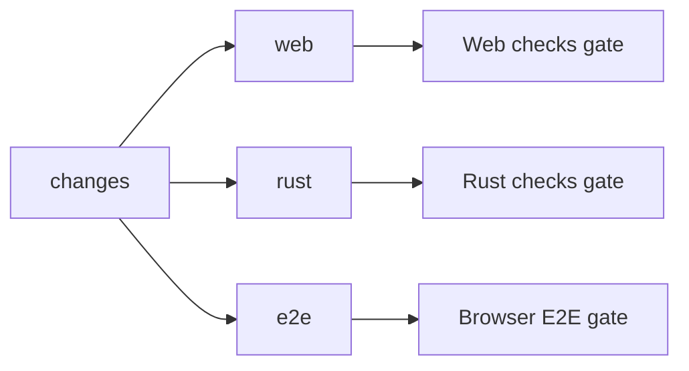

# Progress

The only current delivery-status surface. [README.md](README.md) is the documentation index;
the phase plans under `plan/` are historical planning records. Update this file in the same
pull request as the work.

**Legend:** `☐` not started · `◐` in progress · `☑` done · `⊘` blocked · `—` not applicable / deferred

---

## Dashboard

| Phase | State | Progress | Blocked by |
| --- | --- | --- | --- |
| 0 — Design | ☑ complete | documentation set reviewed, application boards approved, public website exempted from board design, named app-board export pending | — |
| 1 — Scaffolding | ☑ complete | workspace, contracts, API/UI hosts, Tauri shell, guards, and developer scripts verified | — |
| 2 — Backend | ☑ complete | exit criterion met; API contract `v1`; raw engine stderr remains an upstream limitation | — |
| 3 — UI | ☑ complete | every screen, the scene editor, scene preview, charts, Logs, Monaco and LAN ship; axe pass and feature reorganization complete; Penpot live sync was unavailable, so no live board match is claimed | — |
| 4a — Spikes | ☑ | 5 / 5 with recorded verdicts | — |
| 4b — Testing | ☑ complete | real-service Playwright smoke, a validating fake-engine completion journey, held-open cancel/navigation journeys, a three-host capability pass (locked-scope writes and process-wide 409), LAN pairing, log filter/anonymised-export, foreign-origin/token/path-traversal security negatives, and scene bulk-configuration undo journeys, browser axe, an external-request guard, split E2E build/run with cached service and SPA artifacts, frontend and Rust coverage policy including changed-line reporting, split `verify:web`/`verify:rust` local gate with parallel `npm run verify`, CI test jobs, the unified both-theme screenshot gallery, the 68-cell four-state render matrix, boundary fixtures, and 10/10 error-path rows including the recorded native second-instance check | — |
| 5 — CI and delivery | ◐ | the first hosted CI run executed the web, Rust, and browser E2E jobs behind the aggregate gates, with npm and Rust dependency audits inside the web and Rust jobs, plus a push-only Tauri-compile job; hosted run 43791199725 passed all three gates in 11m59s on 2026-11-16; local web/Rust static checks, full Rust tests, and Rust coverage pass (coverage is verified from a clean MSVC Developer Prompt; a default-shell run can hit linker error 0xc0000142); weekly real-encode, dependency-audit, coverage-trend, and readiness-gated tag jobs exist, with the tests gated on a non-documentation change since the previous run; the screenshot gallery is manual; `main` requires the three aggregate gates, linear history, force-push/deletion blocking, conversation resolution, and one review, with admin bypass retained while the owner is the only admin; hosted package run 44218214023 at `70bad22` passed all 62 jobs, including Windows/Linux install/uninstall and lock verification against untouched hosted trees; the tag-driven `release.yml` run 44221921120 on `v0.1.0-rc.3` passed tag, audit, security, preflight, and provenance checks, and `v0.1.0-rc.3` is now published as a prerelease; the toolchain lock and transitive Python/plugin notice gate are complete, and the package job validates Windows/Linux install, size, and one-run uninstall; a local stable `0.1.0` package check installed the bundled MSI in its logged `INSTALLDIR`, launched it, passed health, completed an eight-sequence encode, and uninstalled both MSIs on 2026-11-18; the local weekly real-encode suite passes 12 environment-gated tests, including the five prior failures; macOS remains in the build/release matrix as best-effort with package sizes only and no install/signing guarantee, and the updater is deferred. Unsigned Windows/Linux and ad-hoc macOS distribution is the permanent policy | macOS host (best-effort), weekly tag candidate |
| 6 — Product backlog | ◐ in progress — stable gate | B3 (queue run-control width), B5 (tooltip and disabled-reason audit), C1 (timeline still aspect), C3 (scene Engine data rows), C4 (CLI delimiter readout), C5 (ECharts gesture regression), D1 (desktop webview zoom), D2 (fullscreen transport overlay), E4 (dependency draft), and F1 (Monaco loading skeleton) are implemented with focused tests; E4 adds a probe-only executable endpoint, page-level dependency draft, and candidate Locate; E7 (shared optional-sequence switches) is implemented with off/on and locked-state component tests, and the full configuration suite passes 99 tests; A3/G2 resolve a `portable` marker beside the launch artifact on every desktop form — the Windows executable, the macOS `.app` bundle (marker beside the bundle in the ZIP), and an AppImage opted in beside `$APPIMAGE` — keep service data and scratch inside `<artifact>/data`, and ship the marker in both the Windows and macOS archives, with resolver, store, HTTP and archive-marker tests; the Linux service portable-scratch test passes under Docker, while packaged AppImage unzip-and-run and macOS checks remain pending; E6 is closed with a recorded no-replacement spike: source metadata stays in-process FFMS2/VapourSynth, while muxer keys stay with `mkvmerge`/FFmpeg, because neither MediaInfo candidate supplies decoded frames or muxer selection keys; E5 is closed with path-only rows: the VapourSynth row lists the nine namespaces this build's inputs, filters and metrics require (`bs`, `ffms2`, `dgdecodenv`, `lsmas`, `vszip`, `mvu`, `zoomv`, `fgs`, `vship`) with per-plugin availability and loaded paths, covered by engine, service contract, HTTP and UI tests; plugin versions are not reported because the Rust wrapper exposes no version accessor, and a manual enumeration of the staged R82 tree confirmed the shipped names and the absence of `zoomv`/`fgs` from the bundle; E2 is implemented: a fresh data directory seeds one ordinary `Recommended` template (SVT-AV1 CRF 25/preset 4, photon noise ISO 200, 960×540 FFMS2 scene detection, noise detection/scaling, SSIMULACRA2 79–81 with an 11-frame subset and probe preset 6, mkvmerge concatenation) with no inline scripts or host paths; it is editable and deletable, never marked default, and seeded only when `config.json` is absent; E3 is implemented: the Add control is a split button whose menu imports up to ten exported template files, the Project Templates screen accepts HTML5 file drops, each row downloads a sanitized archive, and the portability report names every removed host path without repeating its value; export and import share one sanitizer, imports are validated and normalized, duplicate names are suffixed case-insensitively, imported templates never become default, wrong-kind and unknown-version files are distinct `422`s, malformed JSON is `400`, and the desktop window disables Tauri's native drop handler so the page receives the drop; the split-button/import/export state is drawn provisionally from the checked-in generator under decision 4; E1 is implemented for the nine official encoders: all 186 descriptors carry labels, descriptions, groups, documentation links, and resolved widgets; the catalogue adds documented ranges and units (SVT-AV1 CRF 1–70 in 0.25 steps, app default 25), `/api/encoders` resolves every `Auto`, sliders clamp typed values and show the default plus up to eight curated marks with collision-aware labels, and a read-only test compares every map in the all-nine website snapshot; known encoder forks are first-class profiles with app-owned tables, probe detection, pathless base-provider fallback, and clear/reset actions; A4 is closed: the checkpoint restamp has a non-ignored unit regression and the saved-project retry completed without resetting chunks; D5 now prefers FFmpeg/libx264, falls back to the bundled x264, then to VP9 through vpxenc or libvpx, with a non-ignored prepared-writer route regression covering both derived media responses and bundled sibling resolution, and the preview cache key is version 6 so version-1 files from the broken pipeline cannot be reused (packaged Windows check pending); D6's close guard and E8–E10 are implemented with focused tests, the close_action host test passes, and a native Windows no-run close exited on the first request (active-run dialog check pending); E1's known fork profiles are implemented with focused tests; Penpot is unavailable, and remaining screen work is accepted provisionally from checked-in generators under decision 4; the remaining backlog items are B4, D3 and D4, to be explored next; B2's queue menu no longer trips Radix's modal scroll lock; at scroll 300 the row menu opens fully above the trigger, with a shared non-modal regression test. B3's queue Start expands from 28 px to 56 px on hover, C1's 14 demo stills preserve 16:9 without distortion, and E7's three project-scope switches are consistent; video/template scope and the 2.39:1/4:3 C1 source remain visual checks. C5/D1/D2/E9 native checks remain advisory. Phase 6 must be completed, or each remaining item explicitly deferred, before the first stable tag | — |

**Current focus:** Phase 5 release proof is complete for the RC channel. Hosted CI run 44218206255 at `70bad22` passed all checks; hosted package run 44218214023 passed all 62 jobs, including Windows and Linux install/uninstall and lock verification against untouched hosted trees; tag-driven run 44221921120 verified the tag, security gates, audit bundle, preflight, and provenance, and created the 32-asset `v0.1.0-rc.3` prerelease. `gh attestation verify` passed for `SHA256SUMS-github.txt`. The owner published `v0.1.0-rc.3`; no tag was moved. The website snapshot now projects that published release, including macOS downloads. A local stable MSI check now passes install, launch, health, a real eight-sequence encode, and uninstall for the bundled and system payloads; hosted package run 44218214023 reproduced the install/uninstall result. Phase 6 is now the first-stable gate: A4, D5, D6 and E8–E10 are reconciled, R1/R2 are closed by hosted evidence, and R3 keeps Cargo output under `dist/cargo` and leaves optional Kache shared externally; the remaining product-backlog items must be completed or explicitly deferred before a stable tag. Remaining Phase 5 work is the hosted docs-only timing, a weekly tag candidate, and macOS host verification (best-effort, not a v0.1 gate). The updater (tasks 5.6/5.13) is deferred. Phases 3 and 4 are closed. 4.2.2 is
certified by the 68-cell four-state render matrix; 4.4's deterministic screenshot gallery and its
manual CI artifact job are wired; 4.5's 47-fixture boundary coverage enumerates
every schema an API hook parses. The 4.6 matrix is complete: the native second-instance
check ran on the packaged Windows system build on 2026-11-12, where the second process
exited without a window and the first was restored from minimized and focused. The Phase 4b browser harness starts three headless services with
`--port 0`: a completing fake runner for create → add video → save → validate → run →
progress → completion → reload, a holding runner for start → navigate away and back via the run chip →
Save and leave / Discard → cancel → History, and a LAN-enabled holding runner for the
capability and pairing journeys. The capability journey proves active-video and project
writes return `423 LOCKED`, a sibling write succeeds, a second start returns `409 BUSY`, and
the in-place refusal is visible after a reload; the pairing journey exchanges the desktop
shortcode in a second browser context and creates a project and video over the network
origin. A log journey filters a completed run, enables the runner's source-path debug line,
and verifies the export preview redacts it; a security-negative journey refuses a foreign
origin and stale, wrong, or absent LAN tokens, and rejects path traversal outside the built
SPA; a scene journey selects two seeded ranges, writes
one bulk encoder document, and proves one undo restores both rows. Journeys run `axe` in
Chromium on the pipeline, General, Projects, History, pairing, and Logs screens, and a context
request guard aborts every non-service origin and asserts the list is empty at teardown. All
journeys use the typed run-journey module built on generated
paths and contracts, and the typed host module owns startup, health, the journal, logs, and
teardown. Each test attempt has a typed workspace with a unique project-name suffix, tracked
UI/HTTP projects, and cleanup after a pass. The draft-guard component harness covers clean
and blocked navigation, Stay, Discard, Save and leave, a rejected save, and the tab-switch
request path. `e2e/tsconfig.json` is part of `npm run typecheck`. The 68-cell four-state
matrix renders every route through `MockTransport`; the boundary registries have one
standalone fixture per hook shape and reject missing, orphaned, or unenumerated files; and
`npm run screenshots` captures 35 surfaces in both themes, publishes AVIF images with a
catalog and contact sheet, and can write a feature-only manifest for a selected group or
screen id. Its
workflow runs only on manual dispatch and uploads an advisory artifact.

The lock and navigation pass of 2026-11-10 keeps project configuration and the encoding
video read-only, leaves sibling videos, other projects, and templates editable, allows
navigation during a run with a compact top-bar run chip, and still refuses every second start.

---

## Phase details

### Phase 4b — Testing (closed 2026-11-13)

| Item | State | Evidence |
| --- | --- | --- |
| 4.1 Rust tests | ☑ | 496 workspace tests pass, with the environment-gated real-encode suite excluded from the default run; engine 73.90% and service 80.05% lines against enforced floors; the route matrix and failure, persistence, and property suites cover the reviewed cases. Schema v1 has no historical migration. |
| 4.2 Frontend tests | ☑ | coverage is enforced with 70%/60% floors, a 0.25-point ratchet, and critical-file floors; changed-line coverage reports existing frontend files and gates new files at 80%; the P0 screen-behaviour pass covers all 17 routed screens, including Scenes bulk encoder writes, the confirmed History run deletion, Settings hash-tab navigation, the encoder editor, About, Video General, ScriptEditor and the project, video, and template script pages, Transport, Network, FilterComposer, Home, AddVideos, and the project, video, and template section editors; a curated mutation pilot covers scene selection, config resolution, and run supervision (9/13 killed in the initial run, with the four survivors recorded as P2 hardening) |
| 4.2.2 Four-state certification | ☑ | 68 render cells over 17 route families; Pairing gate certified by LAN E2E, 12 structural N/A reasons recorded; behaviour is covered separately by the screen suites |
| 4.3 E2E | ☑ | 17 Playwright tests pass, including the all-route Chromium axe sweep and the template export/import and drag-drop journeys; nine error-path rows are automated and the native second-instance row is a recorded release check; the weekly workflow runs the environment-gated real-encode suite. |
| 4.4 Screenshots | ☑ | 35-surface both-theme gallery, AVIF catalog and contact sheet, optional feature manifest, manual CI artifact, and `check:gallery` decoding every catalog image from a served copy |
| 4.5 Contract tests | ☑ | 47 hook-boundary fixtures (45 generated + 2 local) with missing/orphan and hook-enumeration checks; drift checks unchanged |
| 4.6 Error-path matrix | ☑ | 10 / 10 rows recorded; the native second-instance check ran against the packaged Windows system build on 2026-11-12 |

The spike verdicts and measurements live in [spikes/](spikes/) and [testing.md](testing.md).
The five gates passed; their records are evidence, not a second status tracker.

### Phase 5 — CI

| Item | State | Remaining |
| --- | --- | --- |
| 5.1 `ci.yml` | ☑ | hosted run 43791199725 at `9e788e2` passed `Web checks gate`, `Rust checks gate`, and `Browser E2E gate`; the web job took 3m26s and the Rust tests and coverage job 11m44s. Local `check:web`, `test:web` (1,060 passed in 161 files), `check:rust`, and full `test:rust` (496 passed, 0 failed, environment-gated suite excluded) pass; `verify:web` and `check:test-inventory` pass, with frontend coverage at 75.02% total and 73.56% UI against baselines 74.91% and 73.46%; `test:rust:coverage` and `coverage:check:rust` pass from a clean `vcvars64` environment with MSVC `link.exe` first (490 passed, environment-gated suite excluded; engine 73.68%, service 79.98%), while default-shell coverage attempts can fail at link time with 0xc0000142. npm high/critical and Rust vulnerability checks run inside those jobs; a push-only Tauri compile job is added; the initial-JavaScript budget is enforced by `npm run check:bundle-size` after the build; cargo-deny license/ban policy and repository secret scanning are release-time gates ([tasks 5.28–5.29](plan/05-ci.md#15-release-workflow)), while the pull-request workflows keep cargo audit and npm audit. Run 43794113650 at `adf1bee` failed only `Rust tests and coverage` on a Windows `DirectoryNotEmpty` cleanup race in `a_cached_thumbnail_is_served_as_a_jpeg`; run 43797175140 at `a44c774` passed all eight CI jobs, verifying the cleanup retry fix |
| 5.2 `weekly.yml` | ☑ | real-encode, dependency-audit issue, and coverage-trend jobs run weekly, gated on a non-documentation change since the previous successful scheduled run (a manual dispatch always runs); a `weekly-tag` job creates at most one tag per UTC date after those jobs pass, only from `main`, and only when the reviewed readiness record passes for the weekly channel; it then dispatches `release.yml` explicitly; the screenshot gallery is manual; no weekly job is a pull-request check or a required status |
| 5.3 Branch protection | ☑ | configured on `main` on 2026-11-15 as the single repository ruleset `Main branch protection - CI gates, review, linear history` (ID 27332355): required status checks `Web checks gate`, `Rust checks gate`, and `Browser E2E gate`; strict up-to-date branches; linear history; force-push and deletion blocking; stale-review dismissal; one approving review; conversation resolution. Admin bypass remains enabled because the owner is the only admin and the second collaborator has read access. Hosted push run 43791199725 reported all three contexts successfully; the strict up-to-date and review path still needs a pull request with a second reviewer |
| 5.4 Caching and path filters | ◐ | cache steps and per-language filters are implemented: Web runs for packages, website, schema, scripts and shared config; Rust runs for Rust, Cargo, packaging and release inputs; contract/route sources run both; E2E runs when either changes; docs-only and unknown paths have explicit gate conditions. 2026-11-13 local measurements (web re-measured 2026-11-14) are docs-only 57 s, web 122 s, a full-PR local component estimate of 221 s, and a measured local component sum of 442 s. Hosted run 43791199725 completed a full change in 11m59s; a hosted docs-only run and its under-3-minute target remain unverified. Details in [testing.md §3.4.1](testing.md#341-pr-ci-workflow-timings) |

**Pipeline:**

### Phase 5 — Delivery (tasks 5.5–5.29)

| Item | State | Remaining |
| --- | --- | --- |
| Installers and trust labels | ◐ | hosted package run 44218214023 built both variants for all three targets and passed Windows/Linux install and one-run uninstall; the tag-driven run 44221921120 created, and the owner published, the `v0.1.0-rc.3` prerelease with unsigned Windows/Linux and ad-hoc macOS labels and 32 assets, including all twelve installers/portables, per-target audit files, and checksums; [releases.md](releases.md) records the permanent unsigned Windows/Linux and ad-hoc macOS policy; macOS install/signing verification remains. macOS artifacts are best-effort |
| Uninstall | ☑ | hosted package run 44218214023 passed install and one-run uninstall for both Windows variants (bundled 8,648 files/1,211.8 MiB; system 177 files/75.6 MiB) and both Linux `.deb` variants (bundled 8,909 files/1,862.4 MB; system 181 files/95.4 MB); the local 2026-11-17 check also passed, with the documented 1.3 GiB app data retained. macOS install/uninstall remains unverified. The updater is deferred |
| Website | ◐ | the public site presents the real application and a focused manual: production-component samples for the toolchain, New project, run control, video configuration, command palette, draft actions, appearance, project search, scene actions, log filtering, queue selection, storage, retained-work removal, and network pairing; the 48-page manual and 60-capture inventory remain the reference contract; `npm run typecheck`, the docs checks, and the website build pass after `npm run screenshots` supplies the uncommitted captures; CI uses `npm run build:ci` so a clean checkout compiles the gallery variant; the Pages workflow generates the captures, builds the `/Av1ation-Station/` project base, and deploys with `actions/deploy-pages`. Run 43826749325 succeeded at `866febc` and deployed the corrected hero timing; the live stylesheet keeps both wordmarks at `opacity:0` until `1.05s`/`1.15s`, after the lower contrail ends. The landing page and `/demo/` returned 200; the demo rendered its Projects screen with the "sample data, never reads or encodes" notice and no failing console resource. A browser navigation to `/docs/get-started/install` rendered "Install and verify"; GitHub Pages still answers that deep link with the `404.html` SPA shell and a 404 status, which is a routing limitation rather than a failed client render. The checked-in release catalogue now projects the published `v0.1.0-rc.3` with Windows, macOS arm64, and Linux downloads |
| Bundled toolchain | ☑ | the reviewed manifest, 17 recipes, per-component cache builder and `toolchain.yml` matrix cover the three supported targets; run 44106271598 assembled the target trees (8,757 Windows, 8,838 macOS and 11,746 Linux files); run 44218214023 verified the committed 5.6 MB `packaging/toolchain.lock.json` against untouched hosted Windows and Linux trees and passed both package gates. The Windows tree carries 107 DLLs, including the 22-file MKVToolNix closure, and its hosted `mkvmerge` reports v103.0; the package job no longer substitutes a generated lock; macOS 15 is the floor and Linux is a full bundle. Transitive Python/plugin notices and licence texts are generated from each tree (73 packages on Windows/Linux, 74 on macOS; 98 texts per target) and the readiness gate is recorded as passed. About lists the same components with source links and artifact hashes; its layout is accepted provisionally for v0.1 because the live Penpot board is unavailable. macOS host verification remains best-effort under 5.8/5.26 |
| Release transparency | ☑ | [releases.md](releases.md) defines the audit bundle; `npm run release:audit -- --tag v0.1.0 --tools <trees>` writes each supported target's directory, copying each lock and generating top-level notices, Python/plugin notices, licence texts, SPDX 2.3 SBOMs and source offers from the reviewed inputs, including the fmetrics fork commit, upstream base and recipe digest; `release:preflight` passes the audit checks against that bundle, rejects a stray `latest.json`, and consumes the reviewed readiness record. A fixture covers all targets, a missing target, an invalid tag, a pending readiness gate, and a forbidden updater manifest. Run 44221921120 generated the three-target bundle, passed preflight, attached 32 assets including `<target>-<file>` audit files plus `AUDIT-SHA256SUMS.txt`, and attested the upload set; `gh attestation verify` passed for `SHA256SUMS-github.txt`. The next tag attaches one metadata archive instead, with `release:preflight` checking its member list. The local manifest step selects only release extensions outside `audit/`, so audit and preflight files cannot collide with upload asset names; its regression test covers that case |
| Release security | ☑ | reviewed `deny.toml` passes `cargo-deny 0.20.2 check licenses bans sources` (bans, licences, and sources all ok; `av1-grain` clarified against its BSD-2-Clause and AOM patent-license file; the pinned `rust-av/Av1an` git source is allowed); `.gitleaks.toml` scans the tree clean with gitleaks 8.30.1, excluding only generated/dependency output; reusable `.github/workflows/release-security.yml` installs both pinned binaries with SHA-256 checks and runs the gates. Hosted run 44221921120 at the `v0.1.0-rc.3` tag ref passed both jobs: the secret scan reported `no leaks found`, and cargo-deny reported `bans ok, licenses ok, sources ok`. Neither gate is a PR check ([tasks 5.28–5.29](plan/05-ci.md#15-release-workflow)) |

### Phase 5 — Task inventory

State reflects the checked-in evidence on 2026-11-18. `◐` means the implementation exists
but a hosted or external release check is still outstanding.

| Task | State | Evidence / remaining |
| --- | --- | --- |
| 5.5 Release matrix | ☑ | `release.yml` run 44221921120 built all three targets and created prerelease `v0.1.0-rc.3`; the owner published it. |
| 5.6 Updater keys | — | Deferred with the updater; no key will be provisioned for v0.1. |
| 5.7 Windows unsigned | ☑ | Unsigned MSI/NSIS/portable artifacts are built; SmartScreen and SHA-256 policy documented. |
| 5.8 macOS ad-hoc signing | ◐ | The hosted build ad-hoc signs and packages the macOS arm64 target; no macOS host has verified the signature or install. |
| 5.9 Linux packages | ☑ | `.deb`/AppImage paths and the WebKitGTK/FUSE policy are defined; the package job validates install/remove. |
| 5.10 Checksums | ☑ | Recursive `SHA256SUMS` and flat `SHA256SUMS-github` are generated; the next tag also places both, with the per-target audit files, into one metadata archive. |
| 5.11 Release notes | ☑ | Conventional-Commit draft plus the hand-edit section. |
| 5.12 GPL source offer | ☑ | Per-target `SOURCE-OFFER.md` is generated from the lock and staged tree. |
| 5.13 Updater | — | Deferred; v0.1 publishes no `latest.json` and no installed update test. |
| 5.14 Uninstall | ☑ | Hosted package run 44218214023 passed one-run uninstall for both Windows and both Linux `.deb` variants; macOS remains unverified. |
| 5.15 Windows portable | ☑ | Bundled and system portable ZIPs are built. |
| 5.16 Crash reporting | ☑ | Automatic reporting is absent; the redacted diagnostics export ships. |
| 5.17 Website review | ◐ | Landing, docs and demo reviewed at `866febc`; the updated About card is accepted provisionally and not deployed. |
| 5.18 Website deploy | ☑ | Pages run 43826749325 deployed the site; the demo uses `MockTransport`. |
| 5.19 Toolchain manifest and lock | ☑ | The three-target lock and recipes pass `toolchain:verify`; run 44218214023 verified them against untouched hosted Windows and Linux trees. |
| 5.20 Toolchain build and cache | ☑ | `toolchain.yml` and per-component caches assembled the target trees. |
| 5.21 Provider selection | ☑ | Shared provider module, `tool_sources`, custom precedence and restart notice ship. |
| 5.22 Resource bundling | ◐ | Tauri resources are configured; the hosted Linux installed-tree proof passes, while macOS remains unverified. |
| 5.23 Settings and About | ☑ | Source controls and the toolchain list ship; the About layout is accepted provisionally for v0.1, and the live Penpot comparison is unavailable and deferred. |
| 5.24 Clean-VM matrix | — | Deferred; the hosted package job validates Windows/Linux install and uninstall, not a clean VM. |
| 5.25 Installer sizes | ☑ | Both variants are measured for all three targets by the hosted package job; Linux and macOS have no install check beyond Windows/Linux. |
| 5.26 VapourSynth relocation | ◐ | macOS ships the bundle best-effort; moved-tree linkage and signing remain unverified and do not block. |
| 5.27 Audit assets and API | ☑ | Per-target audit bundle and `/api/toolchain`; the transitive-notices gate passed. |
| 5.28 `cargo-deny` | ☑ | Hosted runs 43794123741 and 44221921120 passed licenses, bans and sources. |
| 5.29 Secret scanning | ☑ | The same hosted runs reported no leaks. |

---

## Known gaps and release checks

| Gap | Impact | Next |
| --- | --- | --- |
| Named application-board export | The archived design set is not captured as a named version | Export when Penpot is reachable; not a Phase 1 blocker |
| `4.2.2` four-state certification | Certified by the 68-cell four-state render matrix, not as behaviour coverage; the separate screenshot catalog supplies the visual record | Add a route to `ROUTE_META` and its fixture detail to `packages/ui/src/test/route-cases.ts`; the matrix and axe pass derive from them |
| Full E2E journey | The smoke plus nine browser journeys, nine automated error-path rows, and the native second-instance release check exist; the weekly real-encode gate is now scheduled | — |
| Rust and frontend coverage | Package floors are enforced (72%/74% engine/service, 70%/60% API/UI), the ratchet allows 0.25 points, primary screens have critical-file floors, and `--modules` reports branch and function coverage beside lines | Keep `scripts/coverage-baseline.json` current after a reviewed coverage change; run `npm run check:test-inventory` after regenerating the inventory |
| Windows Rust coverage environment | Rust coverage is verified from a clean `vcvars64` environment with MSVC's `link.exe` first; a default Git Bash run can fail while linking instrumented test binaries with `0xc0000142` (`STATUS_DLL_INIT_FAILED`). The clean rerun does not isolate linker ordering as the only cause | Run `npm run test:rust:coverage` from a Developer Command Prompt, then confirm the hosted Windows Rust job; do not treat the default-shell failure as a coverage regression |
| Screenshot review set | The screenshot gallery uploads an advisory CI artifact; there is no pixel baseline or required check | Run the manual workflow when the website needs assets; never add a merge gate |
| Branch-protection verification | Protection is configured with the three aggregate gates; hosted push runs have reported all three contexts successfully, but no pull request with a second reviewer has exercised the review path; admin bypass remains while the owner is the only admin | Push a pull request and confirm all three gates report; add a writer/reviewer before removing admin bypass |
| Tag-driven release workflow | Run 44221921120 at `v0.1.0-rc.3` passed tag verification, required checks, readiness, lock, package, audit, preflight, security, and attestation; it created a 32-asset prerelease with unsigned Windows/Linux, ad-hoc macOS, and no-updater labels, and the owner published it | Exercise a weekly candidate separately; keep macOS host verification best-effort |
| Second-device LAN parity | Same-host pairing is verified; a second physical device is not | Phase 5 release check |
| Safari/WebKit preview | Chromium and the WebView2 family are verified; WebKit is not | Phase 5 release check |
| macOS VapourSynth relocation | The recipes stage the runtime and the hosted build packages it, but no macOS host has verified relocation, signing or runtime behaviour | Run the checks when a macOS host is available; best-effort, not a v0.1 gate |
| Linux bundled provider set | The recipes and the reviewed lock cover the full set (VapourSynth/Python, encoders, FFmpeg, MKVToolNix, scene model and native metrics); run 44218214023 installed and removed the bundled `.deb` and verified its tree | A full provider smoke remains |
| Windows MKV runtime closure | The recipe resolves the MSYS2/Qt/MinGW DLL closure with `ldd`, stages it beside `mkvmerge.exe`, and the lock hashes the whole target tree; run 44218214023 verified the hosted tree against the lock | A runtime smoke on a hosted Windows artifact remains; no manual clean-VM gate |
| Linux glibc floor | The engine's prebuilt ONNX Runtime requires glibc 2.38 and the current build emits GLIBC_2.39; Debian 12/Ubuntu 22.04 cannot link it | Ship the Debian 13/Ubuntu 24.04 pre-release; a custom ORT or lower-glibc build is needed to lower the floor |
| Raw engine stderr | Some upstream failures are not attributed to a sequence | Track upstream; failure text is already in `run.jsonl` |

---

## Deferred features

| Feature | Lands in | Why deferred |
| --- | --- | --- |
| Verified macOS bundle | post-0.1 | the best-effort build ships in v0.1; verification needs a macOS host |
| Third-party sequence plugins | post-1.0 | needs a security review |
| Fuzzing the project loader | post-1.0 | valuable, not required for v0.1 |
