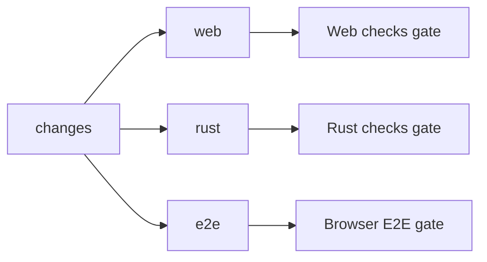

# Progress

The only current delivery-status surface. [README.md](README.md) is the documentation index;
the phase plans under `plan/` are historical planning records. Update this file in the same
pull request as the work.

**Legend:** `☐` not started · `◐` in progress · `☑` done · `⊘` blocked · `—` not applicable / deferred

---

## Dashboard

| Phase | State | Progress | Blocked by |
| --- | --- | --- | --- |
| 0 — Design | ☑ complete | documentation set reviewed, application boards approved, public website exempted from board design, named app-board export pending | — |
| 1 — Scaffolding | ☑ complete | workspace, contracts, API/UI hosts, Tauri shell, guards, and developer scripts verified | — |
| 2 — Backend | ☑ complete | exit criterion met; API contract `v1`; raw engine stderr remains an upstream limitation | — |
| 3 — UI | ☑ complete | every screen, the scene editor, scene preview, charts, Logs, Monaco and LAN ship; axe pass and feature reorganization complete; Penpot live sync was unavailable, so no live board match is claimed | — |
| 4a — Spikes | ☑ | 5 / 5 with recorded verdicts | — |
| 4b — Testing | ☑ complete | real-service Playwright smoke, a validating fake-engine completion journey, held-open cancel/navigation journeys, a three-host capability pass (locked-scope writes and process-wide 409), LAN pairing, log filter/anonymised-export, foreign-origin/token/path-traversal security negatives, and scene bulk-configuration undo journeys, browser axe, an external-request guard, split E2E build/run with cached service and SPA artifacts, frontend and Rust coverage policy including changed-line reporting, split `verify:web`/`verify:rust` local gate with parallel `npm run verify`, CI test jobs, the unified both-theme screenshot gallery, the 68-cell four-state render matrix, boundary fixtures, and 10/10 error-path rows including the recorded native second-instance check | — |
| 5 — CI and delivery | ◐ | the first hosted CI run executed the web, Rust, and browser E2E jobs behind the aggregate gates, with npm and Rust dependency audits inside the web and Rust jobs, plus a push-only Tauri-compile job; hosted run 43791199725 passed all three gates in 11m59s on 2026-11-16; local web/Rust static checks, full Rust tests, and Rust coverage pass (coverage is verified from a clean MSVC Developer Prompt; a default-shell run can hit linker error 0xc0000142); weekly real-encode, dependency-audit, and coverage-trend jobs exist, gated on a non-documentation change since the previous run; the screenshot gallery is manual; `main` requires the three aggregate gates, linear history, force-push/deletion blocking, conversation resolution, and one review, with admin bypass retained while the owner is the only admin; local Windows bundled/system installers, portable ZIPs, and Linux bundled/system `.deb`/AppImage are built, while macOS builds, the updater, and the remaining toolchain failures keep the release gate closed. Unsigned Windows/Linux and ad-hoc macOS distribution is the permanent policy | Bundled toolchain lock and unsigned packaging |

**Current focus:** closing the release-security gates (tasks 5.28–5.29) and the remaining bundled-toolchain failures, then release packaging on Windows and Linux (tasks 5.5–5.29). Phases 3 and 4 are closed. 4.2.2 is
certified by the 68-cell four-state render matrix; 4.4's deterministic screenshot gallery and its
manual CI artifact job are wired; 4.5's 47-fixture boundary coverage enumerates
every schema an API hook parses. The 4.6 matrix is complete: the native second-instance
check ran on the packaged Windows system build on 2026-11-12, where the second process
exited without a window and the first was restored from minimized and focused. The Phase 4b browser harness starts three headless services with
`--port 0`: a completing fake runner for create → add video → save → validate → run →
progress → completion → reload, a holding runner for start → navigate away and back via the run chip →
Save and leave / Discard → cancel → History, and a LAN-enabled holding runner for the
capability and pairing journeys. The capability journey proves active-video and project
writes return `423 LOCKED`, a sibling write succeeds, a second start returns `409 BUSY`, and
the in-place refusal is visible after a reload; the pairing journey exchanges the desktop
shortcode in a second browser context and creates a project and video over the network
origin. A log journey filters a completed run, enables the runner's source-path debug line,
and verifies the export preview redacts it; a security-negative journey refuses a foreign
origin and stale, wrong, or absent LAN tokens, and rejects path traversal outside the built
SPA; a scene journey selects two seeded ranges, writes
one bulk encoder document, and proves one undo restores both rows. Journeys run `axe` in
Chromium on the pipeline, General, Projects, History, pairing, and Logs screens, and a context
request guard aborts every non-service origin and asserts the list is empty at teardown. All
journeys use the typed run-journey module built on generated
paths and contracts, and the typed host module owns startup, health, the journal, logs, and
teardown. Each test attempt has a typed workspace with a unique project-name suffix, tracked
UI/HTTP projects, and cleanup after a pass. The draft-guard component harness covers clean
and blocked navigation, Stay, Discard, Save and leave, a rejected save, and the tab-switch
request path. `e2e/tsconfig.json` is part of `npm run typecheck`. The 68-cell four-state
matrix renders every route through `MockTransport`; the boundary registries have one
standalone fixture per hook shape and reject missing, orphaned, or unenumerated files; and
`npm run screenshots` captures 35 surfaces in both themes, publishes AVIF images with a
catalog and contact sheet, and can write a feature-only manifest for a selected group or
screen id. Its
workflow runs only on manual dispatch and uploads an advisory artifact.

The lock and navigation pass of 2026-11-10 keeps project configuration and the encoding
video read-only, leaves sibling videos, other projects, and templates editable, allows
navigation during a run with a compact top-bar run chip, and still refuses every second start.

---

## Phase details

### Phase 4b — Testing (closed 2026-11-13)

| Item | State | Evidence |
| --- | --- | --- |
| 4.1 Rust tests | ☑ | 496 workspace tests pass (12 ignored); engine 73.90% and service 80.05% lines against enforced floors; the route matrix and failure, persistence, and property suites cover the reviewed cases. Schema v1 has no historical migration. |
| 4.2 Frontend tests | ☑ | coverage is enforced with 70%/60% floors, a 0.25-point ratchet, and critical-file floors; changed-line coverage reports existing frontend files and gates new files at 80%; the P0 screen-behaviour pass covers all 17 routed screens, including Scenes bulk encoder writes, the confirmed History run deletion, Settings hash-tab navigation, the encoder editor, About, Video General, ScriptEditor and the project, video, and template script pages, Transport, Network, FilterComposer, Home, AddVideos, and the project, video, and template section editors; a curated mutation pilot covers scene selection, config resolution, and run supervision (9/13 killed in the initial run, with the four survivors recorded as P2 hardening) |
| 4.2.2 Four-state certification | ☑ | 68 render cells over 17 route families; Pairing gate certified by LAN E2E, 12 structural N/A reasons recorded; behaviour is covered separately by the screen suites |
| 4.3 E2E | ☑ | 15 Playwright tests pass, including the all-route Chromium axe sweep; nine error-path rows are automated and the native second-instance row is a recorded release check; the weekly workflow runs the 12 ignored real-encode tests. |
| 4.4 Screenshots | ☑ | 35-surface both-theme gallery, AVIF catalog and contact sheet, optional feature manifest, manual CI artifact, and `check:gallery` decoding every catalog image from a served copy |
| 4.5 Contract tests | ☑ | 47 hook-boundary fixtures (45 generated + 2 local) with missing/orphan and hook-enumeration checks; drift checks unchanged |
| 4.6 Error-path matrix | ☑ | 10 / 10 rows recorded; the native second-instance check ran against the packaged Windows system build on 2026-11-12 |

The spike verdicts and measurements live in [spikes/](spikes/) and [testing.md](testing.md).
The five gates passed; their records are evidence, not a second status tracker.

### Phase 5 — CI

| Item | State | Remaining |
| --- | --- | --- |
| 5.1 `ci.yml` | ☑ | hosted run 43791199725 at `9e788e2` passed `Web checks gate`, `Rust checks gate`, and `Browser E2E gate`; the web job took 3m26s and the Rust tests and coverage job 11m44s. Local `check:web`, `test:web` (1,060 passed in 161 files), `check:rust`, and full `test:rust` (496 passed, 0 failed, 12 ignored) pass; `verify:web` and `check:test-inventory` pass, with frontend coverage at 75.02% total and 73.56% UI against baselines 74.91% and 73.46%; `test:rust:coverage` and `coverage:check:rust` pass from a clean `vcvars64` environment with MSVC `link.exe` first (490 passed, 12 ignored; engine 73.68%, service 79.98%), while default-shell coverage attempts can fail at link time with 0xc0000142. npm high/critical and Rust vulnerability checks run inside those jobs; a push-only Tauri compile job is added; the initial-JavaScript budget is enforced by `npm run check:bundle-size` after the build; cargo-deny license/ban policy and repository secret scanning are release-time gates ([tasks 5.28–5.29](plan/05-ci.md#15-release-workflow)), while the pull-request workflows keep cargo audit and npm audit. Run 43794113650 at `adf1bee` failed only `Rust tests and coverage` on a Windows `DirectoryNotEmpty` cleanup race in `a_cached_thumbnail_is_served_as_a_jpeg`; run 43797175140 at `a44c774` passed all eight CI jobs, verifying the cleanup retry fix |
| 5.2 `weekly.yml` | ☑ | real-encode, dependency-audit issue, and coverage-trend jobs run weekly, gated on a non-documentation change since the previous successful scheduled run (a manual dispatch always runs); the screenshot gallery is manual; none is a pull-request check or a required status |
| 5.3 Branch protection | ☑ | configured on `main` on 2026-11-15 as the single repository ruleset `Main branch protection - CI gates, review, linear history` (ID 27332355): required status checks `Web checks gate`, `Rust checks gate`, and `Browser E2E gate`; strict up-to-date branches; linear history; force-push and deletion blocking; stale-review dismissal; one approving review; conversation resolution. Admin bypass remains enabled because the owner is the only admin and the second collaborator has read access. Hosted push run 43791199725 reported all three contexts successfully; the strict up-to-date and review path still needs a pull request with a second reviewer |
| 5.4 Caching and path filters | ◐ | cache steps and docs-only gating exist; per-language filters are not implemented, so every non-doc change runs all three aggregates. 2026-11-13 local measurements (web re-measured 2026-11-14) are docs-only 57 s, web 122 s, a full-PR local component estimate of 221 s, and a measured local component sum of 442 s. Hosted run 43791199725 completed a full change in 11m59s; a hosted docs-only run and its under-3-minute target remain unverified. Details in [testing.md §3.4.1](testing.md#341-pr-ci-workflow-timings) |

**Pipeline:**

### Phase 5 — Delivery (tasks 5.5–5.29)

| Item | State | Remaining |
| --- | --- | --- |
| Installers and trust labels | ◐ | local Windows MSI/NSIS and bundled/system portable ZIPs plus Linux bundled/system `.deb`/AppImage; [releases.md](releases.md) records the permanent unsigned Windows/Linux and ad-hoc macOS policy; macOS builds, trust labels on published artifacts, and clean-VM checks remain |
| Updater and uninstall | ☐ | [releases.md](releases.md) defines stable-only minisign updates on Windows and the Linux AppImage; macOS updates stay manual because no Developer ID will be provisioned. No key, delivery implementation, rollback, or clean uninstall yet |
| Website | ◐ | the public site presents the real application and a focused manual: production-component samples for the toolchain, New project, run control, video configuration, command palette, draft actions, appearance, project search, scene actions, log filtering, queue selection, storage, retained-work removal, and network pairing; the 48-page manual and 60-capture inventory remain the reference contract; `npm run typecheck`, the docs checks, and the website build pass after `npm run screenshots` supplies the uncommitted captures; CI uses `npm run build:ci` so a clean checkout compiles the gallery variant; the Pages workflow generates the captures, builds the `/Av1ation-Station/` project base, and deploys with `actions/deploy-pages`. Run 43797175198 succeeded at `a44c774`; the earlier run 43794113653 at `adf1bee` and run 43791199591 at `9e788e2` also passed, `https://av1ation-association.github.io/Av1ation-Station/` returned 200 with its title and JavaScript asset, and `/demo/` returned 200. Direct docs paths return the SPA shell from `404.html` with a 404 status, so a browser route check is still required |
| Bundled toolchain | ◐ | the reviewed manifest, 17 recipes, per-component cache builder and `toolchain.yml` matrix exist for all four targets; the Windows VapourSynth/Python and vs-wheels ffms2 components were built locally and cache hits were verified; macOS 15 is the floor, Linux is a full bundle, and the lock is still absent, so the release gate remains closed; VapourSynth relocation remains; run 43794113794 at `adf1bee` passed every job except `mkvmerge / x86_64-pc-windows-msvc`, where configure found Boost::Filesystem but lacked DocBook XSL; run 43797175178 at `a44c774` has the same sole failure but gets past DocBook and stops at Inkscape. The follow-up adds the UCRT64 Inkscape, ImageMagick and zsh packages, forces LF checkout, and makes rake use zsh; run 43801955205 at `c6a3b25` built the Windows MKV component successfully, and the lock/assemble/package jobs remain skipped |
| Release transparency | ☐ | [releases.md](releases.md) defines the audit bundle; notices, SBOM, source offer, attestations, and final size measurements remain |
| Release security | ◐ | reviewed `deny.toml` passes `cargo-deny 0.20.2 check licenses bans sources` (bans, licences, and sources all ok; `av1-grain` clarified against its BSD-2-Clause and AOM patent-license file; the pinned `rust-av/Av1an` git source is allowed); `.gitleaks.toml` scans the tree clean with gitleaks 8.30.1, excluding only generated/dependency output; reusable `.github/workflows/release-security.yml` installs both pinned binaries with SHA-256 checks and runs the gates. Hosted run 43794123741 at `adf1bee` passed both jobs: the secret scan reported `no leaks found`, and cargo-deny reported `bans ok, licenses ok, sources ok`; only wiring into the blocked `release.yml` remains, and neither gate is a PR check ([tasks 5.28–5.29](plan/05-ci.md#15-release-workflow)) |

---

## Known gaps and release checks

| Gap | Impact | Next |
| --- | --- | --- |
| Named application-board export | The archived design set is not captured as a named version | Export when Penpot is reachable; not a Phase 1 blocker |
| `4.2.2` four-state certification | Certified by the 68-cell four-state render matrix, not as behaviour coverage; the separate screenshot catalog supplies the visual record | Add a route to `ROUTE_META` and its fixture detail to `packages/ui/src/test/route-cases.ts`; the matrix and axe pass derive from them |
| Full E2E journey | The smoke plus seven browser journeys, nine automated error-path rows, and the native second-instance release check exist; the weekly real-encode gate is now scheduled | — |
| Rust and frontend coverage | Package floors are enforced (72%/74% engine/service, 70%/60% API/UI), the ratchet allows 0.25 points, primary screens have critical-file floors, and `--modules` reports branch and function coverage beside lines | Keep `scripts/coverage-baseline.json` current after a reviewed coverage change; run `npm run check:test-inventory` after regenerating the inventory |
| Windows Rust coverage environment | Rust coverage is verified from a clean `vcvars64` environment with MSVC's `link.exe` first; a default Git Bash run can fail while linking instrumented test binaries with `0xc0000142` (`STATUS_DLL_INIT_FAILED`). The clean rerun does not isolate linker ordering as the only cause | Run `npm run test:rust:coverage` from a Developer Command Prompt, then confirm the hosted Windows Rust job; do not treat the default-shell failure as a coverage regression |
| Screenshot review set | The screenshot gallery uploads an advisory CI artifact; there is no pixel baseline or required check | Run the manual workflow when the website needs assets; never add a merge gate |
| Branch-protection verification | Protection is configured with the three aggregate gates, but no hosted run has yet exercised those contexts; admin bypass remains while the owner is the only admin | Push a pull request and confirm all three gates report; add a writer/reviewer before removing admin bypass |
| Second-device LAN parity | Same-host pairing is verified; a second physical device is not | Phase 5 release check |
| Safari/WebKit preview | Chromium and the WebView2 family are verified; WebKit is not | Phase 5 release check |
| macOS/Linux VapourSynth relocation | The recipes stage the full runtime; a signed relocation spike has not run | Phase 5 (5.26) |
| Linux bundled provider set | The recipes cover the full set (VapourSynth/Python, encoders, FFmpeg, MKVToolNix, scene model and native metrics), but no built target tree or pinned lock exists yet | Run the toolchain workflow, then generate the lock and pass the relocation/audit gates |
| Windows MKV runtime closure | The recipe now resolves the MSYS2/Qt/MinGW DLL closure with `ldd`, stages it beside `mkvmerge.exe`, and the lock hashes the whole target tree; hosted verification is pending | Verify the staged tree on a clean Windows machine and include the added notices before packaging |
| Linux glibc floor | The engine's prebuilt ONNX Runtime requires glibc 2.38 and the current build emits GLIBC_2.39; Debian 12/Ubuntu 22.04 cannot link it | Ship the Debian 13/Ubuntu 24.04 pre-release; a custom ORT or lower-glibc build is needed to lower the floor |
| Raw engine stderr | Some upstream failures are not attributed to a sequence | Track upstream; failure text is already in `run.jsonl` |

---

## Deferred features

| Feature | Lands in | Why deferred |
| --- | --- | --- |
| Bundled VapourSynth on macOS and Linux | 5, after the relocation spike (5.26) | the runtime must be signed and probed from a moved tree |
| Third-party sequence plugins | post-1.0 | needs a security review |
| Fuzzing the project loader | post-1.0 | valuable, not required for v0.1 |
