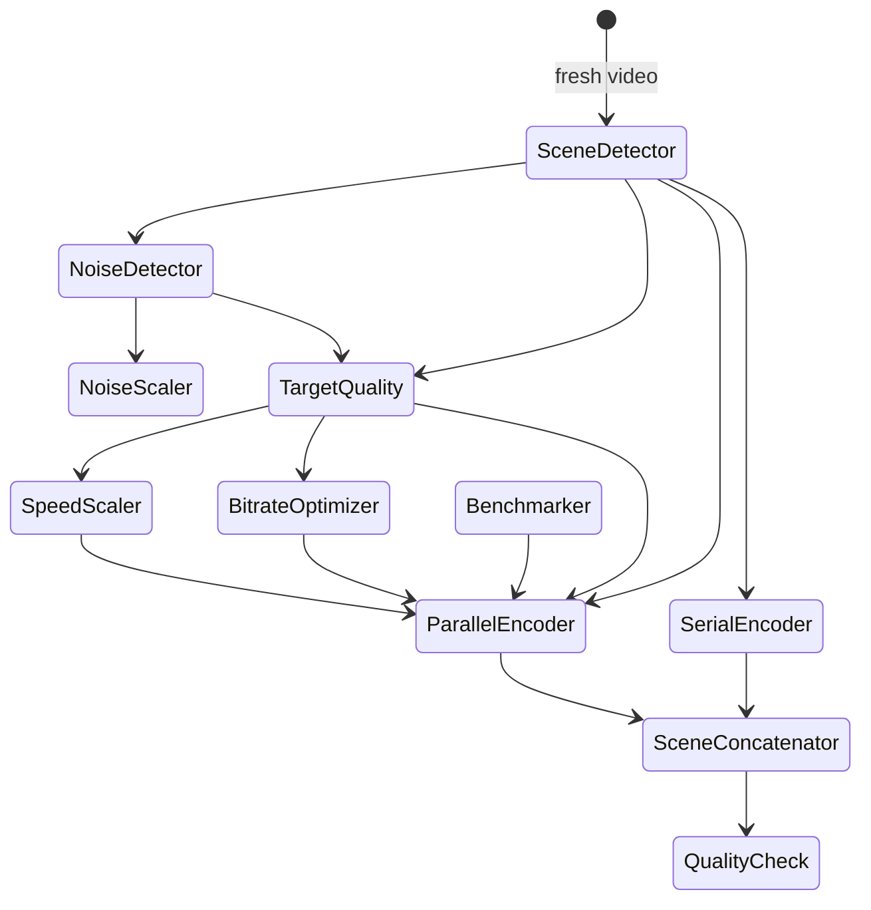
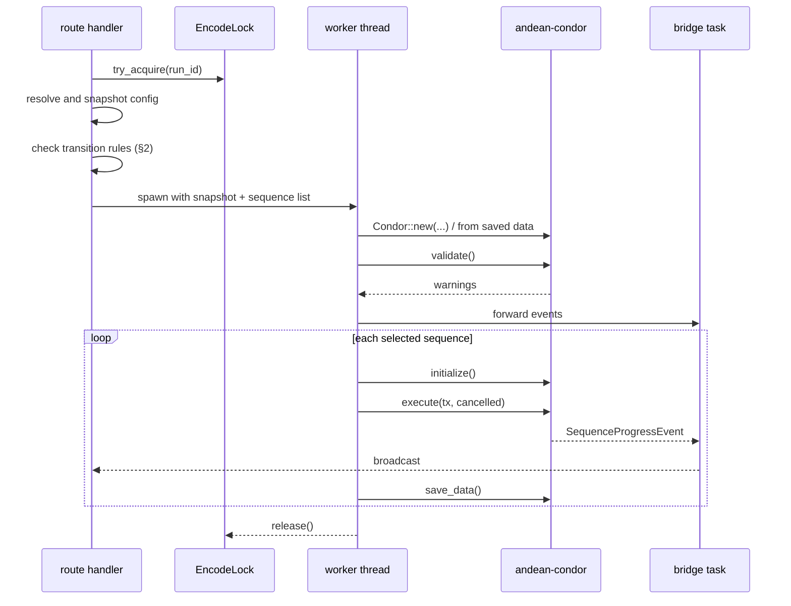

# Runs and sequences

How the service drives the engine: the sequence catalogue, the transitions each sequence
requires, the run loop, live checkpoint data, progress fan-out, and derived state.
Persistence and error policy stay in [backend.md](backend.md).

## Contents

- [1. The sequence catalogue](#1-the-sequence-catalogue)
- [2. Valid transitions](#2-valid-transitions)
- [3. Running one sequence vs. running all](#3-running-one-sequence-vs-running-all)
- [4. Live data during a run](#4-live-data-during-a-run)
- [5. The run loop](#5-the-run-loop)
- [6. Progress fan-out](#6-progress-fan-out)
- [7. Derived state, computed server-side](#7-derived-state-computed-server-side)

## 1. The sequence catalogue

`andean-condor` ships eleven sequences. The engine does **not** order them — the caller
supplies a `Vec<Box<dyn Sequence>>` and the engine runs them in that order. Ordering is
therefore our responsibility, and it is the heart of the "run one sequence" feature.

| Sequence               | Requires                                                                                                                                                 | Produces                                                                                                                                                                                                                                                                    |
| ---------------------- | -------------------------------------------------------------------------------------------------------------------------------------------------------- | --------------------------------------------------------------------------------------------------------------------------------------------------------------------------------------------------------------------------------------------------------------------------- |
| **Scene Detector**     | a valid `Input`                                                                                                                                          | `condor.scenes`; optional per-scene cut scores                                                                                                                                                                                                                              |
| **Noise Detector**     | scenes non-empty; VapourSynth installed. A native `Input::Video` is accepted: the sequence builds its own VapourSynth graph from the FFMS2 decode.       | `sequence_data.noise_detection`                                                                                                                                                                                                                                             |
| **Noise Scaler**       | scenes non-empty; encoder is AOM/RAV1E/SVT-AV1. A scene without noise detection is left untouched, so Noise Detector need not have finished every scene. | `sequence_data.noise_scaling`; sets `photon_noise.iso`. Reset clears the setting **and** the grain-table option it produced, because photon noise is the only writer of that file: a document holding the option after the setting is gone names a path nothing will create |
| **Target Quality**     | scenes non-empty; encoders validate; `scenes_directory`                                                                                                  | `sequence_data.target_quality` (passes with quantizer/scores/bitrate); probe files                                                                                                                                                                                          |
| **Bitrate Optimizer**  | scenes non-empty; a Target Quality pass exists; `bitrate_sigma_threshold` set                                                                            | rewrites per-scene quantizers; no new data field, so it is an action rather than a state                                                                                                                                                                                    |
| **Parallel Encoder**   | scenes non-empty; encoders validate; `scenes_directory`, `workers > 0`; `ffmpeg` if any scene has an `ffmpeg_filter`                                     | `sequence_data.parallel_encoder`; encoded scene files                                                                                                                                                                                                                       |
| **Serial Encoder**     | scenes non-empty; encoders validate; `scenes_directory`                                                                                                  | encoded scene files; no data field                                                                                                                                                                                                                                          |
| **Scene Concatenator** | every scene has an encoded chunk; `mkvmerge` or `ffmpeg`                                                                                                 | the output file                                                                                                                                                                                                                                                             |
| **Quality Check**      | scenes non-empty; output file exists                                                                                                                     | `sequence_data.quality_check`                                                                                                                                                                                                                                               |
| **Benchmarker**        | scenes non-empty; encoders validate; `workers` **not** already set                                                                                       | sets `parallel_encoder.workers`                                                                                                                                                                                                                                             |
| **Speed Scaler**       | scenes non-empty; `speed_quantizers` with ≥2 pairs                                                                                                       | rewrites per-scene speed; no data field, so it is an action rather than a state                                                                                                                                                                                             |

**Zone Encoder** is not a standalone sequence — Target Quality uses it internally when the
scene set is eligible.

## 2. Valid transitions

Only **Scene Detector** can run on a fresh video. Everything else needs scenes, and several
need specific prior data. The transition table is the specification:



Rules, derived from the engine's own `validate`/`initialize`/`execute` checks:

1. **Scene Detector is the only entry point.** No other sequence can run without scenes.
2. **Noise Scaler requires only scenes.** It scales the scenes that have a Noise Detector
   measurement and leaves the rest untouched, so a partial detection does not lock it.
3. **Speed Scaler requires scenes and at least two speed/quantizer pairs.** It is an action:
   it rewrites each scene's encoder speed and has no completion field of its own.
4. **Bitrate Optimizer requires Target Quality** to have produced at least one pass, and a
   configured `bitrate_sigma_threshold`. It is an action too: it rewrites high-bitrate scene
   quantizers without adding a data field.
5. **Scene Concatenator requires encoded scene files on disk** — from Parallel _or_ Serial
   Encoder. This is the one prerequisite the filesystem answers, not the condor object.
6. **Quality Check requires the output file to exist**, so it runs after Concatenator.
7. **Benchmarker requires `workers` to be unset**, and must run before Parallel Encoder.
8. **Parallel and Serial Encoder are alternatives**, not a sequence — pick one per video.

The two actions are never reported as `Complete` and never enter `next`; a full run applies
both in front of Parallel Encoder when they are enabled, and the UI starts either one alone
from its Target Quality row.

One of these is a _warning_ in the engine rather than an error, and we promote it to a
blocking error because running it anyway produces a confusing failure later:

- Quality Check with no output file (engine warns) → we block.

Scene Concatenator is already strict: the engine errors when any requested chunk is
missing, so partial concatenation is never offered. The row stays visible and names how
many scenes are missing. Resetting the concatenator removes its `Scene Concatenator`
scratch directory as well as the finished output, so a failed mux cannot leave a stale file
behind.

## 3. Running one sequence vs. running all

| Endpoint        | Behaviour                                                                     |
| --------------- | ----------------------------------------------------------------------------- |
| `POST …/run`    | executes exactly the named sequence, after checking §2                      |
| `POST …/encode` | runs the full chain in dependency order, like the `condor` CLI's root command |

`encode` resolves the chain at request time from the video's current state, skipping
stateful sequences whose completion rule is already satisfied. So a video that already has
scenes and target quality starts at Parallel Encoder, with the enabled Speed Scaler and
Bitrate Optimizer actions applied immediately before it. This is the same "newest evidence
wins" rule as derived state; there is no separate stale check, because the engine stores no
config hash to compare.

Both endpoints share the lock, the cancellation path, the event stream, and the periodic
`save_data` described in §5.

## 4. Live data during a run

A sequence calls `condor.save()` many times while it executes, not once when it finishes.
Every one of those calls is a durable checkpoint and the service must treat it as such.

The engine gives the service the hook: `Condor` carries a `save_callback` supplied at
construction, and `save()` invokes it with the current `CondorModel` before returning. The
service's callback is the persistence sink, so each call serialises and stores the model
before the sequence continues. Writes are atomic — write to a sibling temp path, `fsync`,
rename — so a power loss during a save leaves either the previous checkpoint or the new
one, never a truncated file. The callback is synchronous and must stay cheap; it enqueues
the write and returns.

Why each call matters:

- **Cancellation mid-sequence keeps its work.** Scene Detector may detect 400 of 1,200
  scenes before the user cancels. Those 400 survive because they were checkpointed as they
  were found, not at completion.
- **Live charts are real, not estimated.** Each checkpoint is fanned out on the SSE stream,
  so a scene chart grows as scenes are detected and a target-quality plot gains points as
  scenes are scored. There is no second data path and no polling loop.
- **Crash recovery resumes from the last checkpoint.** The next run reads the checkpoint
  and the sequence's own `initialize()` decides what to redo. It resumes only a result
  whose provenance revision and context still match; otherwise it names the sequences to
  reset instead of reusing the old data.

Checkpoint data is **read-only in the UI**. It is the engine's record of what happened;
permitting edits would reintroduce the drift that derived state exists to prevent. User
intent — the configuration — is stored separately and is the only thing the user edits.

Checkpoints are coalesced, not queued: if two saves land within the write window, the
later one supersedes the earlier, and the fan-out still emits a notification per save so
subscribers observe monotonic progress. Coalescing bounds write amplification during a
fast sequence without losing the final state of any call.

## 5. The run loop



Rules:

1. **Snapshot, then start.** The worker receives owned data. It never reads project state
   from the shared store.
2. **One worker thread per run.** The `Condor` is created on that thread and dropped on
   that thread.
3. **`validate()` before `execute()`.** Warnings are surfaced to the user as a pre-flight
   panel; a validation error aborts before any work.
4. **Cooperative cancellation only.** Set the atomic and let the engine unwind; the
   terminal event decides whether the run counts as cancelled or failed.
5. **`save_data` after each sequence completes**, not only at the end. A crash then loses
   at most one sequence's work, and the UI can show partial results immediately.
6. **Persistence is a separate step** from the run's log and result, so a failed run still
   leaves evidence.

## 6. Progress fan-out

```
engine mpsc::Sender<SequenceProgressEvent>
      │
      ▼
 bridge task (tokio)  ──►  EncodeEvent { project_id, video_id, run_id, seq, at, kind, … }
      │
      ├──► tokio::sync::broadcast  ──►  GET /api/events (SSE)
      └──► ring buffer (last N)     ──►  GET /api/runs/:id/events?since=seq  (resume after reload)
```

The ring buffer plus monotonic `seq` is what lets a browser tab reload mid-encode and
recover without gaps. `Last-Event-ID` on a native SSE reconnect resolves to `seq`; a
fresh `EventSource`, which cannot send that header, passes the next sequence as `?since=`.
Both resume from the cursor rather than restarting.

Backpressure policy: the bridge never blocks the engine. If a subscriber is slow, the
broadcast channel lags and that subscriber receives a `lagged` marker and refetches the
ring buffer. Dropping progress is acceptable; blocking the encoder is not.

## 7. Derived state, computed server-side

The UI must not reimplement the state machine, because then it exists twice. The service
exposes `GET /api/projects/:p/videos/:v/state` which returns:

```rust
pub struct VideoState {
    pub video_id: String,
    pub scene_count: u32,
    pub sequences: Vec<SequenceState>,  // per-sequence, not just per-phase
    pub next: Vec<String>,              // every sequence currently runnable, not just one
    pub active: bool,
    pub run_id: Option<String>,
    pub failure: Option<VideoFailure>,  // latest failed run; sequence is None before its first sequence
    pub output_exists: bool,
    pub retained_bytes: u64,            // derived from the temp directory
    pub script_data: Vec<ScriptData>,   // what each script input will receive
}

pub struct SequenceState {
    pub id: String,                     // the id `POST …/run` accepts, e.g. `SceneDetector`
    pub name: String,
    pub status: SequenceRunStatus,      // never_run | incomplete | complete | active | failed | skipped
    pub runnable: bool,
    pub progress: Option<f64>,          // live while active, and cancelled detection's coverage
    pub detail: Option<String>,         // short evidence, e.g. `42/48 scenes encoded`
}
```

Two things this shape fixes relative to a simple phase list:

1. **State is per sequence, not per phase.** A video can have Scene Detector complete,
   Noise Detector complete, and Target Quality never run. A flat phase list cannot express
   that, and the user needs to see exactly which sequences are done and which are available.
2. **`next` is a list, not an option.** Because sequences can be run individually, several
   may be simultaneously valid — after Scene Detector, both Noise Detector and Target
   Quality are runnable. The UI offers all of them.

There is deliberately no `Stale` status. The engine does not stamp `sequence_data` with a
config hash, so staleness cannot be derived. Freshness is an advisory comparison of the
data's `created_on` with the section's last-saved time, displayed beside the state and never
used to change it ([data-model.md](data-model.md#41-sequences-not-phases)).

`retained_bytes` and each scene's chunk state come from listing the video's temp directory,
so they are correct even with no `Condor` instantiated and no run active. That is what lets
the concatenator report "3 of 40 scenes are not encoded" before the user asks it to run;
it is not offered until every scene has a chunk, because the engine refuses a partial
concatenation rather than publishing a shortened video.

The engine stamps resumable results with a provenance revision and the context that
produced them. A checkpoint from an older engine has no stamp and cannot be resumed: the
sequence refuses it at admission with the applicable reset path. The service neither
rewrites nor deletes the old result; the run error carries the engine's guidance.

The derivation is a pure function over three evidence sources — live run progress, condor
`sequence_data`, and the temp directory listing — with newest evidence winning. It is unit
tested against fixture `Condor` values including partially-complete ones. The algorithm is
specified in [data-model.md](data-model.md#4-derived-state). The latest run's failure is attached from the timeline after derivation; its `sequence`
names the failed attempt, or is `None` when the run failed before its first sequence. It is
the only reason a run that failed before its first sequence can explain itself, and it lets
the UI place a sequence failure in that sequence's card without reconstructing the owner
from a `Failed` status.

Why server-side: the same derivation feeds the queue's progress bars, the video timeline,
the per-sequence run buttons, and the "can this encode start?" preflight. Four consumers,
one implementation.
