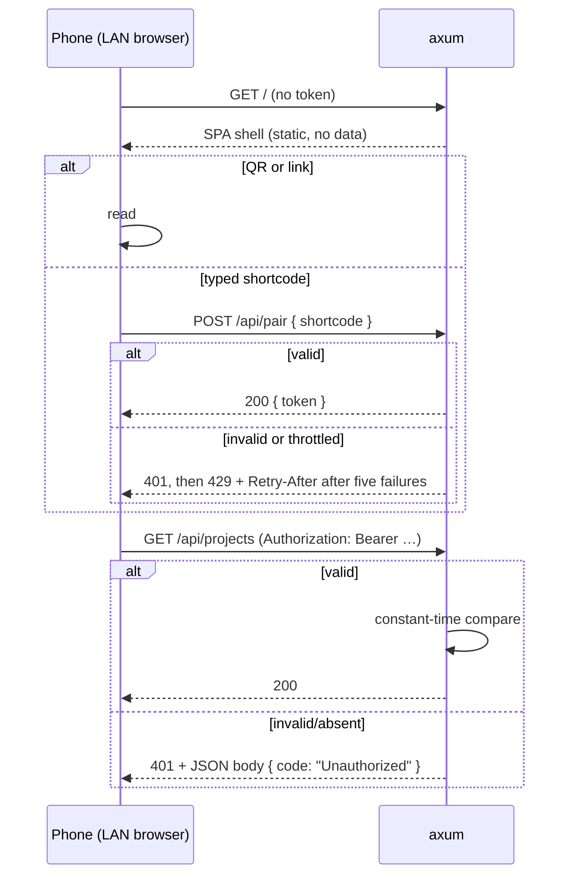

# Security

## Contents

- [1. Threat model](#1-threat-model)
- [2. Network exposure](#2-network-exposure)
- [3. Filesystem](#3-filesystem)
- [4. Arbitrary code execution](#4-arbitrary-code-execution)
- [5. Updates](#5-updates)
- [6. Log anonymisation](#6-log-anonymisation)
- [7. Dependency and supply chain](#7-dependency-and-supply-chain)
- [8. Privileges](#8-privileges)
- [9. Security checklist per release](#9-security-checklist-per-release)

## 1. Threat model

Av1ation Station is a **local, single-user** application. It is not multi-tenant, has no
user accounts, and does not phone home. The threat model reflects that.

| Asset | Threat | Impact | Mitigation |
| --- | --- | --- | --- |
| Local media files and project data | another LAN device reading them | high | LAN access off by default; token auth when on |
| The encoder pipeline | a LAN device starting/cancelling encodes | medium | same token, and encode routes are state-changing and require it |
| Arbitrary code execution | a VapourSynth script or malicious media file | high | inherent to the domain; documented, not solved by the app |
| Log contents | paths, filenames leaking when shared | medium | anonymised export |
| Update channel | supply-chain substitution | high | signed updates (§5) |
| Secrets | none stored | low | no accounts, no keys, no telemetry |

Out of scope: a compromised local machine, a malicious administrator, and attacks that
require local code execution.

## 2. Network exposure

### 2.1 Default posture: loopback only

The `axum` server binds `127.0.0.1:<ephemeral>` on startup. LAN access is:
- **off by default**;
- enabled only by an explicit user action in Settings;
- bound to `0.0.0.0` only while enabled;
- torn down immediately when disabled.

The port is ephemeral and communicated to the desktop webview through a Tauri
initialization script. Nothing hardcodes a port. The OS chooses a free port; a bind
failure is reported and startup fails rather than retrying a guessed range.

### 2.2 LAN mode

Enabling LAN mode:

1. Starts a second listener on `0.0.0.0:<ephemeral>`; the loopback listener is untouched.
2. Generates a random token from two UUID v4 values (64 hex characters), an eight-character
   pairing code, and records them as the first paired session, labelled **Desktop pairing**.
3. Serves the SPA shell (static assets) publicly so a browser can load, and gates every
   `/api` request on the LAN listener except `POST /api/pair`.
4. Displays a QR code, pairing link, shortcode, the bound address, the token, and a clear
   "anyone on this network with this link can control the app" warning.

The pairing link carries the token in the URL fragment (`http://host:port/#t=<token>`),
which is never sent to a server in a `Referer` or a log. The SPA reads it once, moves it to
`sessionStorage`, and rewrites the URL without the fragment.

Pairing is per browser, not per run. A session is a token, a shortcode, a label, creation
time, peer address, and last-seen time. **New token** adds a session without invalidating
the others; **Revoke** removes exactly one. At most 16 sessions are live, each expires 24
hours after issue, and disabling LAN clears every session and stops the listener.

The shortcode is eight characters from a 32-symbol alphabet that removes `0`/`O` and
`1`/`I`, displayed as `ABCD-EFGH` and generated from forty random bits. It is a session
credential, not a second secret class: `POST /api/pair` normalizes the typed value (case,
spaces, and the hyphen are optional), finds the session, and returns that same bearer
token. The code expires and is revoked with its session. An unknown, expired, or revoked
code all answer the same `401`, so the endpoint does not confirm which codes exist. The
pairing route requires a same-origin request and is the only `/api` route reachable
without a token.



### 2.3 Auth mechanics

- Bearer token in an `Authorization` header for every API call on the LAN listener,
except `POST /api/pair`, which exchanges a shortcode for that token.
- `EventSource` and the editor's WebSocket cannot set that header, so they use a
  **short-lived one-use ticket** from `POST /api/events/ticket` (valid 60 s) instead of
  putting the long-lived token in a URL. URLs end up in logs and browser history; tickets
  are cheap to expire.
- A `<video>` cannot set that header either, and one picture makes many range requests, so
  a one-use ticket would be consumed by the first. A paired browser instead mints a
  **media ticket** from `POST /api/media/ticket`, which is a credential of its own — never
  the bearer token — accepted only for a `GET` on a video's `media` or `frame` route. It
  lives as long as the session that requested it, so revoking that browser revokes its
  media URLs with it. A leaked media URL reads picture and nothing else: it cannot change
  configuration, start an encode, or list project data. The desktop loopback window needs
  no ticket and is never issued one.
- Constant-time comparison for the token.
- Loopback is not gated, even while LAN mode is on. Only the network listener applies the
  token check, so the desktop window keeps working and the rule is tied to exposure rather
  than to the client's source address.
- Pairing allows five failed attempts per peer address in a 60-second window. Further
  attempts answer `429 Too Many Requests` with `Retry-After`; a valid pairing or the end of
  the window clears the count. The bucket is per LAN peer; loopback is the trusted desktop
  host and is not throttled. Bearer-token checks are not rate-limited. The bearer token
  carries 244 random bits, the shortcode 40, and a session expires after 24 hours; LAN
  remains opt-in.
- **New token** and **Revoke** in Settings are the documented recovery for "I shared the
  link by accident". Revoking a session is immediate for new requests.

### 2.4 Additional hardening in LAN mode

| Control | Setting |
| --- | --- |
| `Origin` check | cross-origin state-changing requests on the LAN listener rejected (`Origin` must match the served origin) |
| CORS | not enabled for service origins; a debug desktop build additionally allows only the Vite dev origins on port 1420 |
| `X-Frame-Options` | `DENY` — never framed by a third party |
| `Content-Security-Policy` | `default-src 'self'`; `media-src 'self'`; `img-src 'self' data:`; `style-src 'self' 'unsafe-inline'`; `connect-src 'self'`; no `unsafe-eval` (Monaco is loaded as a worker, not eval'd) |
| HSTS | not applicable (plain HTTP on LAN); documented as a limitation |
| TLS | **not** provided. Self-signed certs are worse UX than transparent plaintext for a LAN tool, and the token is the protection. Documented explicitly, with a recommendation to use a trusted LAN or a VPN. |
| Bind scope | LAN mode binds every interface; the loopback listener remains separate |
| `Cache-Control` | `no-store` on all API responses |

Also note the limit that matters: **anyone who obtains the token is fully authorized.**
There is no per-user authorization because there are no users. The Settings screen must
say so.

## 3. Filesystem

- The app never writes outside its app-data directory, its cache directory, and
  user-selected output paths.
- User-selected paths arrive through the Tauri dialog (a native, user-driven chooser) or
  through a path the user typed; both are canonicalized and checked for existence before
  use.
- Path traversal: project, video, and run identifiers are UUID v4 strings the service
  generates. Before one is joined to a path it must be non-empty, at most 64 characters,
  and only ASCII alphanumerics or `-`; `.` and `/` are therefore impossible. No other
  user-controlled string is concatenated into a filesystem path.
- Preview proxies write only inside the cache directory. Their file names are generated by
  the service from a UUID, and the cache key is the input, encoder, frame range, and source
  identity, never a client-supplied path.
- Output files are opened by the encoder, not by our HTTP layer, except the preview stream,
  which is read-only.

## 4. Arbitrary code execution

VapourSynth scripts are Python. Running them executes arbitrary code on the user's machine
with the user's privileges. This is inherent to the tool being a GUI for VapourSynth-based
encoding, and cannot be "fixed" by the GUI.

What the application does:

1. **States it plainly** in the script editor: "This script runs with your user privileges.
   Only run scripts you trust."
2. Never fetches scripts or plugins from the network.
3. Never auto-loads a script from a project received from another machine without the user
   opening the editor and seeing it first.
4. Renders the script editor as a code editor, never as a "paste and run anything" prompt,
   so the user has read the content.

What it does not do: sandbox (would break legitimate plugin usage). That is an accepted
risk of running scripts with the user's privileges.

## 5. Updates

- Tauri's updater with a **signed** manifest; the public key is compiled in.
- Updates are user-initiated or user-approved; no silent install.
- The manifest is served over HTTPS from a release host. Signing, not TLS, is the trust
  anchor.
- Version downgrade is refused.
- Phase 6 plan owns the mechanics; the architectural rule here is that unsigned updates are
  never enabled, not even for a beta channel.

## 6. Log anonymisation

Users must be able to share logs for debugging without leaking personal information.

### 6.1 What is anonymised

| Category | Example | Transform |
| --- | --- | --- |
| Absolute paths | `C:\Users\ana\Videos\wedding2019.mkv` | → `<PATH:1>`, consistently mapped for the whole export |
| Usernames in paths | `C:\Users\ana\…` | covered by the path rule |
| Filenames | `wedding2019.mkv` | → `<FILE:3>` |
| Hostnames | `DESKTOP-7HK2` | → `<HOST>` |
| IP addresses | `192.168.1.14` | → `<IP>` |
| MAC addresses | `aa:bb:…` | → `<MAC>` |
| Email addresses | `ana@example.com` | → `<EMAIL>` |
| Windows SIDs | `S-1-5-21-…` | → `<SID>` |
| URLs | `https://example.com/a/b` | → `<URL:1>` |
| Encoder options containing paths | `-x "…\file"` | path rule applied inside the string |

### 6.2 What is not anonymised

Codec settings, dimensions, frame counts, timings, versions, OS name and version, CPU
model, and error messages. The export contains the run's log lines only; there is no
separate script-inclusion option, and any path or filename inside a message is still
replaced by the rules above.

### 6.3 Mechanics

Anonymisation is a **pure function over lines**, unit tested with fixtures:

```rust
pub fn anonymise(lines: impl Iterator<Item = String>, opts: Options) -> (Vec<String>, Map)
```

- The reverse map (`<PATH:1>` → original) is returned separately and **never** written to
  the export. It is shown in-app so the user can decode their own export if they want.
- Consistency: the same input maps to the same placeholder for the whole export, so a log
  is still readable.
- Determinism: same input, same output — makes it testable and diffable.
- The export includes a header stating which redactions were applied.
- Export is a user action with a preview: the user sees the anonymised text before saving.

## 7. Dependency and supply chain

- Cargo and npm lockfiles are committed; CI installs from lockfiles only.
- `cargo-deny` for advisories, licenses, and banned crates. It belongs in CI rather than a
  pre-commit hook; the current workflow does not run it yet.
- `npm audit` is advisory, not blocking (it produces noise on dev-only transitive deps). A
  weekly scheduled job is planned to open an issue on high-severity findings; no scheduled
  workflow exists yet.
- `monaco-editor@0.57.0` pins `dompurify@3.4.15`, which is in a critical advisory range. The
  root override and direct dev pin hold `3.4.17` until Monaco updates its own dependency.
- The engine is consumed from a pinned git revision, never a branch.
- Vendored sources, if we reach that fallback, are committed with a recorded hash.
- The Phase 6 bundle will be pinned by `packaging/toolchain.lock.json`: every artefact URL
  will carry a version and a SHA-256, no entry may name `latest`, a branch with no pinned
  commit, or an unhashed asset, and Python will install with `--no-index
  --require-hashes`. A fork-built component will also record its upstream base and patch
  hashes, so the delta is reviewable. `npm run toolchain:verify` will be the required check;
  the release build will read only the lock and resolve nothing from the network
  ([packaging.md](packaging.md)).
- That release will download nothing at install or run time, and no binary is committed to
  Git. It will publish the lock, generated third-party notices, an SPDX SBOM and a source
  offer, so a reviewer can rebuild or audit exactly what the installer contains.
- In that release, every bundled executable and DLL must be signed before the installer is
  assembled; an artefact that cannot be signed is not shipped.
- Phase 6 will embed a generated summary of the lock in the service and serve it at
  `GET /api/toolchain`. It will contain versions, licences, source links and hashes only —
  never a secret or a user path.

## 8. Privileges

- No administrator rights required for normal operation.
- No Windows Service, no launch daemon, no privileged helper.
- Autostart (if enabled) starts the app in the user session, not elevated.
- The release installs its toolchain under the application's resource directory. That still
  needs no elevation: no Windows Service, no machine-wide PATH edit, no registry
  registration. `VSSCRIPT_PATH` is set on the service process, and the generated
  `<app-data>/toolbin` is prepended only to that process's `PATH`.
- A user-selected system tool is executed with the user's own privileges, like any other
  child process. The bundle does not silently update a system tool, and a system tool does
  not replace the bundled one unless the user selects it.

## 9. Security checklist per release

Maintained in the Phase 6 plan, and required before any tagged release:

- [ ] LAN mode defaults to off
- [ ] Token required for every non-static route when LAN mode is on
- [ ] CSP present and no `unsafe-eval`
- [ ] `Origin` check on state-changing requests
- [ ] Anonymiser fixture test green
- [ ] `cargo-deny` clean
- [ ] Updater signing key present and manifest signed
- [ ] No secrets in the repository (checked by a scanner in CI)
- [ ] `npm run toolchain:verify` green, and the release lock matches the installer
- [ ] Bundled executables and DLLs signed; notices, SBOM and source offer attached
- [ ] Clean-VM install performs an encode with no Python, VapourSynth or FFmpeg installed
- [ ] Mixed provider selection (system VapourSynth, bundled encoders) encodes
