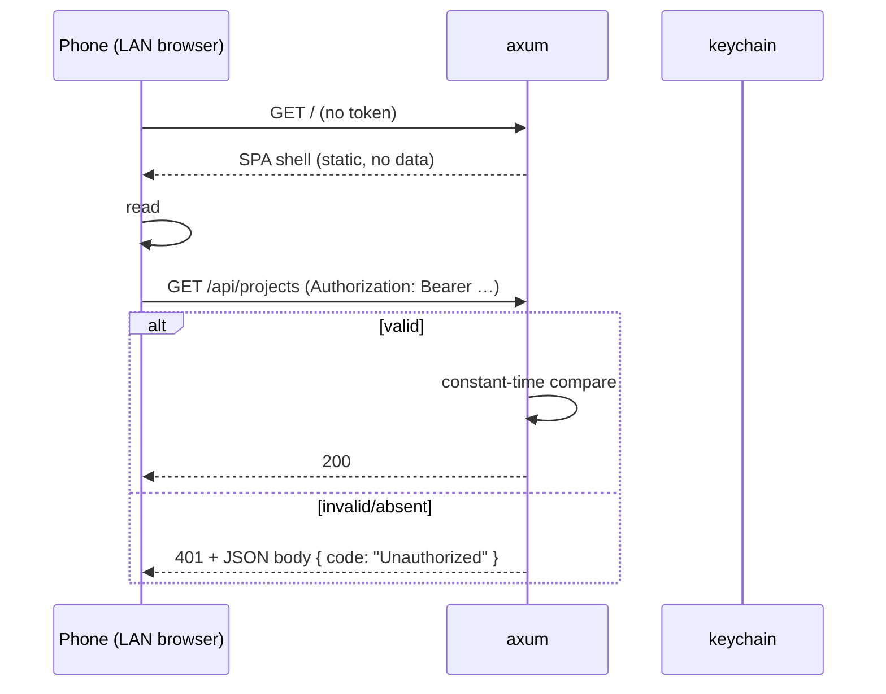

# Security

## 1. Threat model

Av1ation Station is a **local, single-user** application. It is not multi-tenant, has no
user accounts, and does not phone home. The threat model reflects that.

| Asset | Threat | Impact | Mitigation |
| --- | --- | --- | --- |
| Local media files and project data | another LAN device reading them | high | LAN access off by default; token auth when on |
| The encoder pipeline | a LAN device starting/cancelling encodes | medium | same token, and encode routes are state-changing and require it |
| Arbitrary code execution | a VapourSynth script or malicious media file | high | inherent to the domain; documented, not solved by the app |
| Log contents | paths, filenames leaking when shared | medium | anonymised export |
| Update channel | supply-chain substitution | high | signed updates (§5) |
| Secrets | none stored | low | no accounts, no keys, no telemetry |

Out of scope: a compromised local machine, a malicious administrator, and attacks that
require local code execution.

## 2. Network exposure

### 2.1 Default posture: loopback only

The `axum` server binds `127.0.0.1:<ephemeral>` on startup. LAN access is:
- **off by default**;
- enabled only by an explicit user action in Settings;
- bound to `0.0.0.0` only while enabled;
- torn down immediately when disabled.

The port is ephemeral and communicated to the desktop webview through a Tauri
initialization script. Nothing hardcodes a port. A collision is retried over a small range.

### 2.2 LAN mode

Enabling LAN mode:

1. Generates a 256-bit random token, stored in the OS keychain when available, else in
   `config.json` with restrictive permissions.
2. Serves the SPA and API only to requests bearing that token.
3. Displays a QR code **and** a shortcode for pairing.
4. Shows the bound address, the token, and a clear "anyone on this network with this link
   can control the app" warning.

Token delivery — two mechanisms, because they serve different situations:

| Method | Better when |
| --- | --- |
| **QR code** | the desktop app is on screen and a phone is in hand |
| **Shortcode** | the user is typing on a keyboard, or the QR is unreadable (small window, shared screen) |

The QR carries the token in the URL fragment (`http://host:port/#t=<token>`), which is never
sent to a server in a `Referer` or a log. The SPA reads it once, moves it to
`sessionStorage`, and rewrites the URL without the fragment.

The shortcode is an 8-character encoding of the same token from an unambiguous alphabet
(no `0`/`O`, `1`/`I`/`l`), grouped `ABCD-EFGH`. It is **not a second secret** — it carries
the same authority and expires on the same schedule. A keyboard user types it into the
browser's pairing field, which exchanges it for the token via `POST /api/pair`.



### 2.3 Auth mechanics

- Bearer token in an `Authorization` header for all API calls.
- `EventSource` cannot set headers, so SSE uses a **short-lived signed query token** issued
  by `GET /api/events/ticket` (valid 60 s, single use) rather than putting the long-lived
  token in a URL. URLs end up in logs and browser history; tickets are cheap to expire.
- Constant-time comparison for the token.
- Loopback requests during LAN mode still require the token, so the rules do not change
  based on source address — that avoids a class of "it works for me" bugs.
- Rate limit: 20 failed auth attempts per minute per IP, then `429` with an exponential
  backoff. Prevents token brute force from being free.
- Token rotation is exposed in Settings and is the documented recovery for "I shared the
  link by accident".

### 2.4 Additional hardening in LAN mode

| Control | Setting |
| --- | --- |
| `Origin` check | cross-origin state-changing requests rejected (`Origin` must match the served origin) |
| CORS | not enabled at all; the SPA is same-origin with the API |
| `X-Frame-Options` | `DENY` — never framed by a third party |
| `Content-Security-Policy` | `default-src 'self'`; `media-src 'self'`; `img-src 'self' data:`; `connect-src 'self'`; no `unsafe-eval` (Monaco is loaded as a worker, not eval'd) |
| HSTS | not applicable (plain HTTP on LAN); documented as a limitation |
| TLS | **not** provided. Self-signed certs are worse UX than transparent plaintext for a LAN tool, and the token is the protection. Documented explicitly, with a recommendation to use a trusted LAN or a VPN. |
| Bind scope | optional "loopback only" toggle even in LAN mode |
| `Cache-Control` | `no-store` on all API responses |

Also note the limit that matters: **anyone who obtains the token is fully authorized.**
There is no per-user authorization because there are no users. The Settings screen must
say so.

## 3. Filesystem

- The app never writes outside its app-data directory, its cache directory, and
  user-selected output paths.
- User-selected paths arrive through the Tauri dialog (a native, user-driven chooser) or
  through a path the user typed; both are canonicalized and checked for existence before
  use.
- Path traversal: project/video identifiers are ULIDs and are validated against
  `^[0-9A-HJKMNP-TV-Z]{26}$` before being joined to a path. No user-controlled string is
  ever concatenated into a filesystem path.
- Preview sessions write only inside the cache directory and are keyed by session ids we
  generate.
- Output files are opened by the encoder, not by our HTTP layer, except the preview stream,
  which is read-only.

## 4. Arbitrary code execution

VapourSynth scripts are Python. Running them executes arbitrary code on the user's machine
with the user's privileges. This is inherent to the tool being a GUI for VapourSynth-based
encoding, and cannot be "fixed" by the GUI.

What the application does:

1. **States it plainly** in the script editor: "This script runs with your user privileges.
   Only run scripts you trust."
2. Never fetches scripts or plugins from the network.
3. Never auto-loads a script from a project received from another machine without the user
   opening the editor and seeing it first.
4. Renders the script editor as a code editor, never as a "paste and run anything" prompt,
   so the user has read the content.

What it does not do: sandbox (would break legitimate plugin usage). Recorded as an accepted
risk in [decisions.md](decisions.md).

## 5. Updates

- Tauri's updater with a **signed** manifest; the public key is compiled in.
- Updates are user-initiated or user-approved; no silent install.
- The manifest is served over HTTPS from a release host. Signing, not TLS, is the trust
  anchor.
- Version downgrade is refused.
- Phase 6 plan owns the mechanics; the architectural rule here is that unsigned updates are
  never enabled, not even for a beta channel.

## 6. Log anonymisation

Users must be able to share logs for debugging without leaking personal information.

### 6.1 What is anonymised

| Category | Example | Transform |
| --- | --- | --- |
| Absolute paths | `C:\Users\ana\Videos\wedding2019.mkv` | → `<PATH:1>`, consistently mapped for the whole export |
| Usernames in paths | `C:\Users\ana\…` | covered by the path rule |
| Filenames | `wedding2019.mkv` | → `<FILE:3>` |
| Hostnames | `DESKTOP-7HK2` | → `<HOST>` |
| IP addresses | `192.168.1.14` | → `<IP>` |
| MAC addresses | `aa:bb:…` | → `<MAC>` |
| Email addresses | `ana@example.com` | → `<EMAIL>` |
| Windows SIDs | `S-1-5-21-…` | → `<SID>` |
| Device serials in ffmpeg output | vendor strings | → `<DEVICE>` |
| Encoder options containing paths | `-x "…\file"` | path rule applied inside the string |

### 6.2 What is not anonymised

Codec settings, dimensions, frame counts, timings, versions, OS name and version, CPU
model, error messages, the VapourSynth script **unless the user opts in** (it may contain
paths and personal comments — offered as a separate checkbox, default off).

### 6.3 Mechanics

Anonymisation is a **pure function over lines**, unit tested with fixtures:

```rust
pub fn anonymise(lines: impl Iterator<Item = String>, opts: Options) -> (Vec<String>, Map)
```

- The reverse map (`<PATH:1>` → original) is returned separately and **never** written to
  the export. It is shown in-app so the user can decode their own export if they want.
- Consistency: the same input maps to the same placeholder for the whole export, so a log
  is still readable.
- Determinism: same input, same output — makes it testable and diffable.
- The export includes a header stating which redactions were applied.
- Export is a user action with a preview: the user sees the anonymised text before saving.

## 7. Dependency and supply chain

- Cargo and npm lockfiles are committed; CI installs from lockfiles only.
- `cargo-deny` for advisories, licenses, and banned crates; a CI job, not a pre-commit hook.
- `npm audit` is advisory, not blocking (it produces noise on dev-only transitive deps),
  but a weekly scheduled job opens an issue on high-severity findings.
- The engine is consumed from a pinned git revision, never a branch.
- Vendored sources, if we reach that fallback, are committed with a recorded hash.

## 8. Privileges

- No administrator rights required for normal operation.
- No Windows Service, no launch daemon, no privileged helper.
- Autostart (if enabled) starts the app in the user session, not elevated.
- Native dependencies (VapourSynth, FFmpeg) are used as installed by the user; we do not
  bundle or silently update them in v0.1. Bundling is a Phase 6 discussion with its own
  licensing consequences.

## 9. Security checklist per release

Maintained in the Phase 6 plan, and required before any tagged release:

- [ ] LAN mode defaults to off
- [ ] Token required for every non-static route when LAN mode is on
- [ ] CSP present and no `unsafe-eval`
- [ ] `Origin` check on state-changing requests
- [ ] Anonymiser fixture test green
- [ ] `cargo-deny` clean
- [ ] Updater signing key present and manifest signed
- [ ] No secrets in the repository (checked by a scanner in CI)
